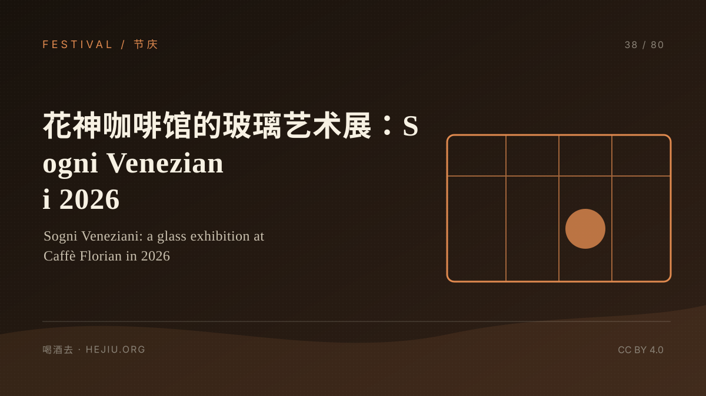

# Sogni Veneziani: a glass exhibition at Caffè Florian in 2026

From 12 September to 18 October 2026, Caffè Florian's historic rooms hosted “Sogni Veneziani”, a glass sculpture exhibition by Pierpaolo Seguso. It was one of the city events in the tenth edition of The Venice Glass Week, though the exhibition outlasted the festival itself: the festival ran from 12 to 20 September, while the display continued to 18 October. Admission was free and no reservation was required, with opening following the café's daily hours, 9:00–23:00. The event has ended, and this event records the 2026 edition's arrangements and rules.

Figure: Sogni Veneziani: a glass exhibition at Caffè Florian in 2026. Project-generated or category illustration used for bar and dining context; not a photograph of the subject.

> **Quick verdict**
> **In one line:** This event explains the current status of Sogni Veneziani: a glass exhibition at Caffè Florian in 2026, and how to take part.
>
> - **Best for:** Anyone who wants the scene, mechanics and current status of Sogni Veneziani: a glass exhibition at Caffè Florian in 2026.
> - **Not for:** If you want only want live ticketing or real-time logistics.
> - **Check first:**
>   - The display is inside the historic rooms, and the works are glass sculptures.
>   - The Venice Glass Week placed the exhibition in Caffè Florian's historic rooms rather than a white-cube gallery: Murano glass pieces share the space with mirrors, frescoes.

## Background

The Venice Glass Week was founded in 2017 and reached its 10th edition in 2026. The official description presents it as an international glass-art festival spread across Venice, Mestre and Murano, with exhibitions, installations, workshops, galleries and special projects in historic buildings. The tenth edition ran from 12 to 20 September 2026 and, according to the official site, offered more than 200 events. Its emphasis is not a single exhibition hall but movement across the city, from workshops and galleries to historic spaces.

Caffè Florian's relationship with Murano glass did not begin with this exhibition. The café's official article reviews glass artists and works previously shown in its historic rooms, including Silvano Rubino, Lucio Bubacco, Davide Salvadore and Lilla Tabasso, as well as international artists. The list makes clear that Florian treats the historic café as a venue for contemporary art rather than a purely retro display; glass, with its transparency, reflections and fragility, enters into dialogue with mirrors, frescoes and gilded decoration.

“Sogni Veneziani” is a solo exhibition by Pierpaolo Seguso. The official article describes its main thread as inner change: the glass sculptures do not present a finished answer but record how thought, experience and awareness alter over time. Seguso focuses on process rather than result; glass is fluid while being shaped and solid once cooled, yet retains fragility, a material condition that corresponds to the theme of constant becoming. The title therefore reads more like a journey than a destination.

For Caffè Florian, the show continues its practice of making art inside working historic space. Visitors do not enter a white-cube gallery but a café that still sells coffee, pastries and seats. Works share the room with mirrors, frescoes and light, and the same piece may look different in the morning and the afternoon; this is why the official article returns repeatedly to light and space.

## Dates and place

- Exhibition dates: 12 September to 18 October 2026.
- Opening hours: daily 9:00–23:00, following Caffè Florian's hours.
- Place: [Caffè Florian (Venice)](ref:florian), Piazza San Marco 57, in the Historic Rooms.
- Timezone: Europe/Rome.
- This event's `start` uses 9:00 on the first day and `end` uses 23:00 on the last day, matching the daily hours on the official event page.

Two time layers need separating. The first is The Venice Glass Week: 12 to 20 September, when exhibitions, installations and events concentrate across the city. The second is Florian's exhibition: 12 September to 18 October, almost a month longer than the festival. Anyone travelling specifically for the show does not have to squeeze the visit into the first week, though St Mark's Square and Murano are busier during the festival week, and transport and bookings are tighter.

The official event page gives the address as Piazza San Marco 57, 30124 Venezia, and marks the display as taking place inside Caffè Florian. The café is under the arcade on St Mark's Square; visitors reach it on foot from the square and do not need a boat to Murano. The run crosses September and October, and Venice remains on summer time until late October, so the page's offset applies throughout the exhibition; if the organiser changes opening hours temporarily, the official notice still governs.

## Taking part and tickets

The ticket rule is simple: free admission, no reservation. The Venice Glass Week official event page states “Ingresso gratuito” (free entry) and “Prenotazione non richiesta” (no reservation required), and notes that the exhibition is open to the public during Caffè Florian's normal hours. Visitors therefore did not need a separate exhibition ticket or advance registration on the festival site.

“Free exhibition” does not mean “free use of the café”. Florian remains a working business, and the historic rooms are its seating and dining space; the display is open to the public while the café continues to serve guests. In practice, visitors should follow the café's seating and spending rules, not occupy a table for a long time without ordering, and not treat the passage in front of the works as a photo studio. “Free” means no additional admission charge, not that the whole café has become a free gallery.

The official event page marks accessible entry and lists telephone +39 041 5205641 and email info@caffeflorian.com for enquiries. Visitors needing to confirm wheelchair access, group visits or temporary closure of the historic rooms can contact the café directly. Florian published no separate booking channel for the exhibition; if crowds reach capacity, staff may admit visitors in batches, and such temporary measures follow on-site instructions.

The exhibition included no fixed programme of guided tours, talks or workshops. Both Florian's article and the Glass Week event page describe the display and opening hours only, without a “tour at a given time each day” schedule. To see it properly, allow 30 to 60 minutes, order at the café and walk through the historic rooms calmly; if it is a passing stop, treat it as a reason to enter Florian rather than a whole-day itinerary.

## On site and house rules

The display is inside the historic rooms, and the works are glass sculptures. The material is fragile, so visitors should keep their distance and not touch, knock or lean on the display. The rooms themselves contain frescoes, mirrors and gilded decoration; do not move furniture, climb barriers or block service aisles for a photograph. The café's staff are still working, and however quiet the exhibition feels, the rooms are not an unattended space.

Changing light is part of the exhibition. The official article says glass transparency and reflections interact with mirrors, frescoes and gilded details, so the same work may look different in the morning and the afternoon. If time allows, see the rooms in the first hour after opening and return near evening; that comes closer to the exhibition's intent than a single noon photograph. Later in the run, Venice moves into autumn, and both the angle of daylight and visitor density change the viewing experience.

Dress and etiquette follow the café's normal rules: there is no formal dress code, but removing a hat indoors and putting away a wet umbrella are basic courtesy; do not take loud calls or let children run between the works. Visitors with pushchairs or mobility needs should first check the arcade entrance and the actual conditions in the historic rooms; the official event page marks accessible entry, but the specific route still follows the venue. High water is outside this exhibition window, but October rain is possible, and the arcade floor can be slippery.

The exhibition was free, but café food and drink are charged separately. Florian's seat prices are at the high end of central Venice; terrace and arcade seats, music supplements and an ordinary coffee do not follow the same pricing logic. If the aim is only the exhibition, an indoor seat or a short stay is enough, and there is no need to pay a terrace premium for “the best position”. The works are not for sale, and the official pages publish no merchandise; questions about buying a piece should go to the café's official channels.

## Glass art inside a historic room

The Venice Glass Week placed the exhibition in Caffè Florian's historic rooms rather than a white-cube gallery: Murano glass pieces share the space with mirrors, frescoes, wood panelling and chandeliers, and viewing distance, background and light are set by an 18th-century building. Pierpaolo Seguso took part, and the theme circles around “Venetian dreams”, bringing Murano glassmaking into a working café on St Mark's Square. The number, size and exact placement of the works follow the official pages and the on-site display; this event does not list them one by one.

## From Florian to the square: a checkable walk

Caffè Florian sits under the arcade on St Mark's Square, the exhibition is in the historic rooms inside, and admission was free with no reservation; food, drink and terrace seating were charged separately. Harry's Bar and other historic bars are within walking distance, and the repository's San Marco two-bar route orders a historic café and a classic bar into one walk. Crowds, acqua alta and temporary shop closures affect the actual route, so check the day's notices before setting out.

## Verification and boundaries

The dates and hours come from two official pages: Florian's article gives 12 September to 18 October and places the display in the historic rooms; The Venice Glass Week event page gives 12 September to 18 October 2026, daily 9:00–23:00, free admission, no reservation and accessible entry. The festival's home page adds that the tenth edition ran from 12 to 20 September, confirming that Florian's show was longer than the city festival. The three sources agree on dates and place, so this event does not invent an “extended until” date.

There are three boundaries. First, this event records the 2026 exhibition, which has ended; the 2027 festival dates, Florian's participation, the artist and the run should follow the current official pages. Second, free admission and no reservation are the rules on the official event page at the time of checking, not a guarantee that every day in the run was open; the historic rooms may close temporarily for private events, maintenance or filming, and only the on-site notice can confirm that. Third, opening follows the café's hours; 9:00–23:00 is the regular window on the official event page, and holidays or special events may change it, so this event does not promise that it was always open until 23:00.

Photographs are credited in the figure captions; no map is drawn. Photographs of the works, the artist's portrait and posters are outside this event's licence. Caffè Florian is on St Mark's Square, the exhibition is inside a fixed building, and no route coordinates are involved, so no schematic map is needed. Visitors can find the entrance by its position under the square's arcade, and the specific entrance and accessible route follow on-site signs.

## See also

- [Caffè Florian (Venice)](ref:florian): the 1720 opening, the decoration of the historic rooms, seating and music supplements, and how to reach St Mark's Square.
- [San Marco two-bar route](ref:venice-san-marco-two-bars): a walk that pairs a historic café with a classic bar.
- [Harry's Bar (Venice)](ref:harrys-bar-venice): another historic bar within walking distance of St Mark's Square.
- [Wine and festivals](ref:wine-and-festivals): how exhibitions, festivals and drinking occasions relate.
- For The Venice Glass Week's full programme, other venues and schedule changes, use the festival's official site; this event only covers “Sogni Veneziani” at Caffè Florian in 2026.
