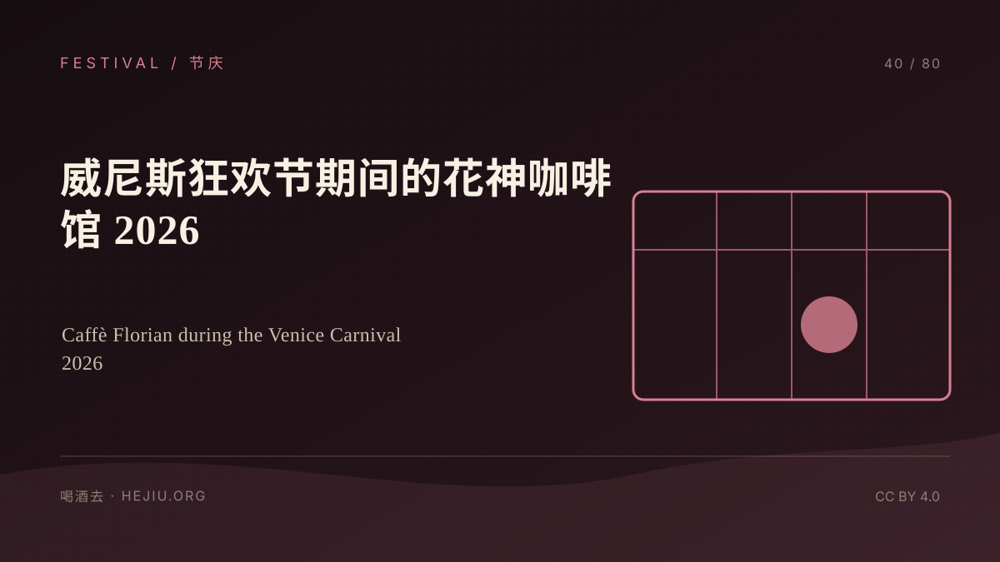

# Caffè Florian during the Venice Carnival 2026

From 31 January to 17 February 2026 the Venice Carnival ran under the theme “Olympus – The Origins of the Game”. Caffè Florian did not stage a separate ticketed show. The café stayed open as usual, turned its arcade and terrace on Piazza San Marco into seats for watching masks, costumes and crowds, and served the traditional Carnival pastries. The event has ended, and this event records the 2026 edition's arrangements and limits; exact times remain subject to the organiser and the venue's official channels.

Figure: Caffè Florian during the Venice Carnival 2026. Project-generated or category illustration used for bar and dining context; not a photograph of the subject.

> **Quick verdict**
> **In one line:** This event explains the current status of Caffè Florian during the Venice Carnival 2026, and how to take part.
>
> - **Best for:** Anyone who wants the scene, mechanics and current status of Caffè Florian during the Venice Carnival 2026.
> - **Not for:** If you want only want live ticketing or real-time logistics.
> - **Check first:**
>   - During Carnival, Florian serves two Venetian seasonal pastries: frittelle veneziane and galani.
>   - The Venice Carnival is one of the city's oldest public festivities.

## Background

The Venice Carnival is one of the city's oldest public festivities. Its history reaches back centuries, to a period when social rules were briefly relaxed: behind a mask, nobles and commoners could meet in the same square and alleys, with identity concealed and speech and behaviour given more room. Caffè Florian's official article still uses that history to explain the mood of Carnival, and sorts masks into types such as the Bauta, the Moretta and the Colombina, each tied to a different social setting.

The 2026 city theme was “Olympus – The Origins of the Game”. According to the official programme, it honours the Olympic year and links mythology, physical training and the tradition of competition. The Municipality of Venice and the Carnival website both give the run as 31 January to 17 February 2026. Florian's article gives the same dates and mentions city-wide events: the street show opening on 31 January, the water parade along the Grand Canal on 1 February (day 2 of the Carnival), and the election of the Maria on 16 February.

For Caffè Florian, Carnival is not a festival it organises but one of the most important “scene periods” of its year. The café has traded on Piazza San Marco since 1720, selling coffee, pastries and seats; during Carnival, the same arcade and terrace become a stand for watching the theatre of the square. That distinction matters: Florian's “event” is the venue's opening and hospitality arrangement, while the Carnival itself is a city programme with its own performances and traffic controls.

## Dates and place

- Run: 31 January to 17 February 2026.
- City theme: “Olympus – The Origins of the Game”.
- Place: [Caffè Florian (Venice)](ref:florian), under the arcade on Piazza San Marco.
- Timezone: Europe/Rome.
- This event's `start` and `end` use 00:00 on the first day and 23:59:59 on the last day only to mark the festival window. They do not mean that the café or any individual show began or ended at that exact moment.

Florian's official article describes the café as a privileged place for observing Carnival: guests sit at tables and watch masks and costumes flow across the square, which becomes an open-air theatre. That is a description of the venue experience, not a programme. The article does not list daily performance, band or meet-and-greet times inside the café, so this event does not claim to know “what time the show starts each day”.

The city programme is spread across Venice, including Piazza San Marco, the Grand Canal, Mestre and the lagoon islands. Some events take place in public space; others require booking or tickets. Schedules, meeting points and cancellations belong to the current Carnival programme page. Caffè Florian provides its own seats, food and opening hours; it does not organise or sell the city's programme.

## Taking part and tickets

Caffè Florian did not publish a separate “Carnival ticket” for 2026. The official article describes the normal café experience: guests sit down, order and pay, with pastries and souvenirs priced separately. Entry to the café is therefore not conditional on buying a ticket to a particular performance, and anyone attending the city Carnival does not have to book a seat at Florian first.

Visitors who only want to watch the atmosphere of the square can use Piazza San Marco as public space. During Carnival there are barriers, security checks and crowd control, and how close you can get or how long you can stay depends on the arrangements on the day. For those who want to sit at Florian, the terrace and arcade seats are the café's core product, priced on a different logic from an ordinary coffee. Carnival is peak season, waits are longer, and groups or specific time slots should confirm booking rules through Florian's official channels.

Florian's article also mentions two kinds of purchasable venue goods: Carnival-themed magnets based on photographs by Massimo Di Capua, and watercolours by Adrian Tuchel depicting the café and the Carnival season. These are souvenirs and art objects, not admission passes. Buying them does not affect seating and does not secure a seat at any performance.

If Florian is meant to be a fixed stop during Carnival, the safer order is to check the day's city programme and square controls first, then decide whether to book a table. The square is dense with people during Carnival, and a walk-in may not find a seat immediately; city events can also change walking routes. Treating “watching the square” and “sitting at Florian” as two separate decisions is closer to reality than imagining a combined ticket.

## On site and house rules

During Carnival, Florian serves two Venetian seasonal pastries: frittelle veneziane and galani. The official article describes the first as soft, fragrant fried dough and the second as light, crisp festive pastry, both meant as a break between events. That detail defines the Florian experience: pastry, a seat and the square, rather than a stage show.

The historic rooms remain working café space, not a sealed display case. Guests may look at the decoration, order and eat, but should not treat the rooms as a free photo studio: do not move tables or chairs, block service aisles, or touch frescoes and mirrored decoration. In winter, the arcade can be affected by high water, with wet floors or temporary walkways; visitors with pushchairs or mobility needs should check usable entrances and seating areas first.

Seating deserves its own note. Florian's terrace and arcade are priced by position and number of guests, and tables may be shared during busy periods. Coffee and pastry prices are at the high end for central Venice, and any music or performance supplement follows the venue's rules for that day. The official article does not publish 2026 Carnival price figures, so this event gives no fixed amount. The reliable check is the price list at the venue and the confirmation taken when ordering.

There is no official dress code for Carnival at Florian, but many people in the square wear masks. Photographing others should start with their consent; do not stand in the middle of a passage or climb barriers for a shot. The café is a business, not a public viewing platform, and occupying a table for a long time without ordering affects other guests. Putting the phone away and ordering at a normal pace usually reveals more of the Carnival than chasing the perfect frame.

## Verification and boundaries

This event checks the 2026 dates and theme against Florian's official article, the Carnival official programme and the Municipality of Venice page. All three agree on 31 January to 17 February. Florian's article also supplies the pastry, mask and souvenir details, which this event treats as venue arrangements rather than city programming.

There are three boundaries. First, this event records the 2026 edition, which has ended; it cannot be used to infer 2027 dates, themes or Florian's participation, and the Carnival site has already published a separate next edition, so the current official page should govern any future trip. Second, the official article does not provide a daily schedule or a complete list of performances at Florian, so this event invents no “artist on stage at a given hour” detail. Third, opening hours, seat prices and square controls can change with crowds and weather, so any fixed statement may become stale.

Photographs are credited in the figure captions; no map is drawn. Carnival is a city-wide event involving squares, canals and multiple venues; a single diagram could not accurately represent traffic controls and schedule changes. Caffè Florian itself is a fixed building, and readers can find it by its position on Piazza San Marco.

## See also

- [Caffè Florian (Venice)](ref:florian): the 1720 opening, the decorated historic rooms, seating and music supplements, and how to reach the square.
- For the city programme, schedule changes and tickets, use the Venice Carnival official site and Municipality of Venice notices; this event only covers Florian's venue arrangements during the 2026 Carnival.

Further reading: [Wine and festivals: the calendar inside seasonal drinks](ref:c-extra-1), [Venice: two bars around Piazza San Marco](ref:c-extra-2), [Harry's Bar Venice](ref:c-extra-3).
