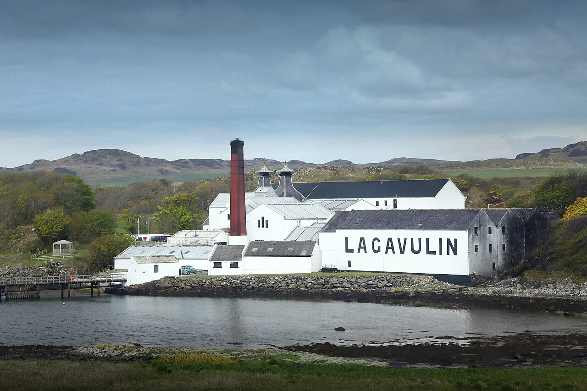

# Fèis Ìle 2026: The Islay Festival's 40th Edition

From 22 to 31 May 2026, the 40th Fèis Ìle was held on the Scottish island of Islay. It is the most concentrated and least improvised week in the whisky calendar: the island's distilleries take turns to open, while music, Gaelic events, walks, fishing and community dinners fill the gaps. The festival has ended; this page records that edition's dates, venues, open-day arrangements and rules of participation.

Figure: "Fèis Ìle 2026: The Islay Festival's 40th Edition". Photograph: File:2019-05-05 Lagavulin Distillery.jpg. Credit: Charlie Marshall, CC BY 2.0 ([source page](https://commons.wikimedia.org/wiki/File:2019-05-05_Lagavulin_Distillery.jpg)). Category image; not a claim that it shows the exact product, site or event.

## What the event is

Fèis Ìle is often shortened to “the Islay whisky festival”, but it began as an island cultural festival. When the first edition was held in 1986, the programme was dominated by walks, history talks, slideshows, Gaelic ceilidhs and theatre, with a single whisky tasting. Distilleries gradually joined and open days became the format we know today. The 2026 programme still kept its community side: an opening parade, a family ceilidh, a fishing competition and music stood alongside the distillery open days. It was not a tasting schedule aimed only at the trade.

For visitors, the key structure is one distillery per day. Over ten days, each distillery chooses a day for its open day, with tours, special releases, tastings, food trucks and live music. Some open days are free to enter, some require a ticket, and some experiences cost extra. Treating Fèis Ìle as “one ticket to drink across the island” is the fastest way to plan it wrong.

## Dates and venue in 2026

- Dates: Friday 22 May to Sunday 31 May 2026, ten days.
- Time zone: Europe/London (British Summer Time, UTC+1).
- Main venue: none. Events are spread across Islay's villages and distilleries; the opening is in Port Ellen.
- The `start` here is 00:00 on 22 May and the `end` is 23:59:59 on 31 May, used to mark the festival window. Individual event times are below.

The 2026 edition was longer than usual. The organisers extended the finish to a second Sunday, taken by Islay Ales and Laggan Bay Distillery. That was the clearest change of the year, and it pushed accommodation, ferry and car-rental pressure one day further. The opening parade left Port Ellen Primary School at 17:00 on 22 May, walked along Frederick Crescent to Ramsay Hall, and a country-music ceilidh followed at Ramsay Hall at 19:30. These are community events, not distillery tastings.

For the three south-shore distilleries named in this task, the 2026 open days were:

- [Lagavulin](ref:lagavulin): Saturday 23 May, 11:00–18:00, free entry, with tastings and experiences booked separately. There was live music, whisky and cocktail bars and food trucks. Tastings and experiences were over-18 only; dogs could enter the site but not the tours or experiences.
- [Laphroaig](ref:laphroaig): Tuesday 26 May, 10:00–16:30, free entry, with tastings and experiences booked separately. Tastings and experiences were also over-18 only.
- [Ardbeg](ref:ardbeg): Saturday 30 May, 10:00–17:00, ticketed, with tickets available online or on the day and experiences bookable on the day. That year's Final Fling was sold out, with Peat and Diesel headlining.

All three sit on the south shore west of Port Ellen, close to one another. The official Three Distilleries Pathway links Port Ellen, Laphroaig, Lagavulin and Ardbeg on foot. It is walkable, but weather, wind and path conditions change quickly over ten days; waterproof boots matter more than a fashionable outfit.

## History and mechanics

Fèis Ìle began in 1985. A local committee was formed to lengthen Islay's summer tourist season and give the island's Gaelic culture an annual focus; the first Fèis Ìle was held in 1986, mostly as a community programme with a single whisky tasting. Distilleries joined over the following years, open days became the centre of the festival, and Fèis Ìle grew from an islanders' event into a pilgrimage week for whisky lovers who book a year ahead. 2026 was the 40th edition, and both the organisers and the distilleries used the anniversary as the year's identity.

The festival is run by a committee of local volunteers and is a non-profit organisation. There is no ticket for the festival itself; income comes from event tickets, sponsorship and merchandise, and supports cultural and community projects on the island. Each distillery organises its own open day, and ticketing is handled by the distillery or a partner platform; in 2026 the committee and partner events were sold through Skiddle. The structure is deliberately decentralised: there is no “all-festival ticket” and no single gate, so each event has to be checked with its own organiser.

Another mechanism is the limited release. Many distilleries issue festival bottlings or offer warehouse experiences during Fèis Ìle, usually by advance booking and in small numbers. These are not the whole festival, but the secondary market magnifies them, so first-time visitors can think that missing a limited bottle means missing the event. In practice, the music, food trucks, distillery tours and queuing in the sea air are the most reliable parts of the week.

## Taking part on site

The first step is to confirm which day and which distillery you are attending. The Fèis Ìle programme is arranged by date, and two or three sites may open on the same day. If you have only one day, choose by distillery rather than by “where you can drink the most”. The second step is transport and accommodation. Islay has no railway; access is by ferry or plane. Ferries from Kennacraig or Port Ellen are full during the festival, and rental cars must be booked early. Public buses are limited, taxis between distilleries are convenient but hard to find at peak times, and the official page lists local taxi numbers.

The third step is to separate admission from experience. Lagavulin and Laphroaig were free to enter in 2026, but tastings, tours and special experiences had to be booked separately. Ardbeg's open day required a ticket, and the Final Fling was sold separately. All tastings and experiences were over-18 only, with ID checks at the entrance. Do not buy tasting tickets for minors, and do not read “free entry” as “free drinking”.

The fourth step is to plan drinking and driving. Islay's roads are narrow, windy and often single-track, so do not drive after a distillery open day. Stay in Port Ellen or Bowmore and use taxis, walking or official shuttles; if you stay in a remote village, book a return car in advance. Ferries and flights are weather-dependent, so do not schedule your return on the last boat of the last day.

## Wine and the city

Islay's whisky identity rests on peat, sea air and the stylistic differences among the three south-shore distilleries. Lagavulin was founded in 1816 by John Johnston and is known for heavy peat, pear-shaped stills and its 16-year-old single malt. Ardbeg took its licence in 1815, closed and reopened, and is now known for heavy peat and the visitor experience at the Old Kiln Cafe. Laphroaig was founded in 1815 by the Johnston brothers, with a site next to the Kilbride stream and the sea, and its visitor centre and booked tours are the main entry points. The three sit on the same south-shore road but emphasise different fermentation, distillation and maturation choices. That is the real value of the Fèis Ìle open days: within a few days, against the same sea wind, you can compare three expressions of heavy peat.

For the island, the whisky festival is not simply tourism business. It ties accommodation, food, transport, music and Gaelic activity together and brings the year's most concentrated cash flow to a quiet winter island; it also brings pressure on housing, ferry capacity and the environment. Extending the 2026 festival to ten days spread the crowd but stretched the pressure too. Understanding that tension is what stops Fèis Ìle from being written as a distillery checklist.

## Disputes and limits

First, “the festival is free” does not mean every event is free. Fèis Ìle itself sells no ticket, but distillery open-day tickets, tastings, tours, the Final Fling and limited releases are paid or booked separately. In 2026 Ardbeg's open day required a ticket, Lagavulin and Laphroaig were free to enter but charged for experiences, and all three models coexisted.

Second, open days are not drop-in. Each distillery has one day and fixed hours; Lagavulin's 11:00–18:00, Laphroaig's 10:00–16:30 and Ardbeg's 10:00–17:00 were that year's announcements and will change. Do not use the 2026 timetable to plan 2027.

Third, limited releases and sold-out Final Fling tickets are easily amplified by the secondary market. In 2026 Ardbeg's Final Fling was sold out, and the organiser confirmed Peat and Diesel as headliners. Check official ticketing pages; do not trust “inside tickets”.

Fourth, weather and transport are hard constraints. Ferries, flights, roads and walking routes can all be adjusted for wind and rain; an over-packed itinerary is more likely to miss an open day. Medical and rescue resources on the island are limited, so do not walk the coast after drinking.

Fifth, editions and dates. 2026 was the 40th edition, with the first in 1986; the 2026 run was 22–31 May, the first to extend to a second Sunday. The official site has already announced 2027 as 28 May–6 June, which shows that the dates move every year and cannot be reused.

Photographs are credited in the figure captions; no map is drawn. The three distilleries are on the south shore, and their addresses and relative positions are described on the place pages. Fèis Ìle's programme is spread across the whole island, and a single diagram cannot show ferries, roads and daily open days at once, so no route map is drawn.

## See also

- [Lagavulin Distillery](ref:lagavulin): founded 1816, heavy peat, tours and Warehouse No.3.
- [Laphroaig Distillery](ref:laphroaig): founded 1815, south-shore sea air and booked tours.
- [Ardbeg Distillery](ref:ardbeg): licence in 1815, heavy peat and the Old Kiln Cafe.
- [Islay](ref:islay): the region, peat and the geography of island whisky.
- [Scotch whisky](ref:scotch): the regulations, regions and style framework.
- [Place and process](ref:process): how terroir, distillation and maturation shape a spirit.
