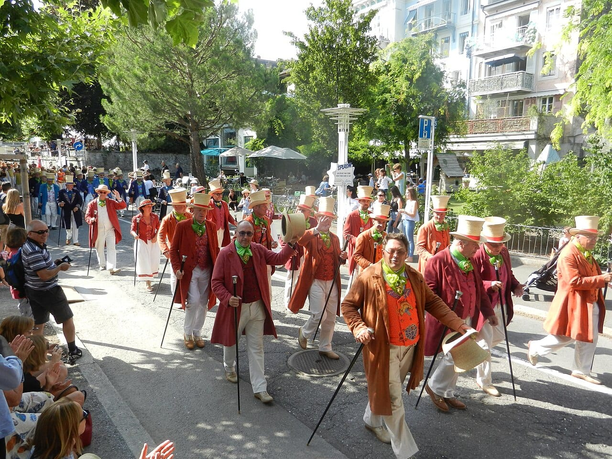

# Fête des Vignerons: a wine festival held once in a generation

Most wine festivals happen every year. The Fête des Vignerons does not. It is organised by Vevey's Confrérie des Vignerons, roughly once a generation, with intervals between editions of 14 to 28 years. The most recent edition was in 2019, and the next is expected about twenty years later. It is not a trade fair or a tasting; it is a festival that turns vine-growing, harvest, winemaking and local life into an open-air spectacle.

Figure: The Confrérie des Vignerons procession at the 2019 Fête des Vignerons in Vevey; the image is not inside the open-air theatre and does not represent the next edition. Photo: Beat Ruest, CC BY-SA 4.0.. Image: Beat Ruest, CC BY-SA 4.0, via Wikimedia Commons ([source page](https://commons.wikimedia.org/wiki/File:F%C3%AAte_des_Vignerons_Vevey_2019_-_Cort%C3%A8ge_de_la_Confr%C3%A9rie_des_Vignerons_(2).jpg)).

## A festival once in a generation

“Once in a generation” is not marketing language; it is the rhythm of the organisation. Each edition requires building an open-air arena, assembling thousands of performers, training choirs and bands, making costumes and props, and coordinating the City of Vevey, the Canton of Vaud, sponsors and residents. That scale cannot be repeated annually, so the festival chooses the generation as its unit.

It is therefore not a tourist product available at any time. Each edition has different dates, a different director, script, music and stage design; missing one may mean waiting twenty years. After 2019 the organisers stated that the next edition would be about twenty years away. That scarcity makes it part of Vevey's local identity and forces researchers and visitors to name the edition precisely.

## 1797 and the earlier procession

The brotherhood's history reaches back to the seventeenth century. A festival is recorded in 1648, and the early form was a procession, a pourmenade, held on the brotherhood's annual assembly day, later developing into a bravade. 1797 is usually treated as the first “true” Fête des Vignerons because it combined the procession, performance and the crowning of the winegrowers.

In the nineteenth century the festival added a large open-air theatre, choirs, orchestras and historical scenes. Twentieth-century editions brought modern stage technology, but the core remained the crowning of the winegrowers: outstanding growers are honoured during the festival, putting the labour of winemaking at the centre of the stage. That ceremony matters more than the star performances; it explains why the festival belongs to growers rather than to a tourist board.

## Vevey and Lavaux

Vevey sits in the Canton of Vaud, on Lake Geneva, below the terraced vineyards of Lavaux. Lavaux was inscribed as a UNESCO World Heritage cultural landscape in 2007, and the Fête des Vignerons was inscribed on UNESCO's Intangible Cultural Heritage list in 2016. The two designations support each other: one protects the landscape, the other a living tradition.

The Lavaux terraces were built over centuries by monasteries and winegrowers and are still maintained by hand. The festival puts the labour, seasons and community relations of that landscape on stage, showing that wine is not only a commodity but also local memory. The venue is Vevey's market square, where a temporary open-air theatre faces Lake Geneva; both seating and stage are temporary.

## The 2019 edition

The 2019 edition ran from 18 July to 11 August, with 21 performances. The open-air arena had about 20,000 seats, a stage of about 14,000 square metres, and about 5,500 performers, including choirs, bands, dancers, acrobats and local volunteers. Daniele Finzi Pasca directed; Maria Bonzanigo, Jérôme Berney and Valentin Villard composed the music.

Performances ran in day and night sessions, built around the annual cycle of vine-growing, the Lavaux landscape, local history and myth. The opening performance included the crowning of the winegrowers, traditionally held early in the morning. Tickets were sold by performance, some sold out, and the city hosted street performances, exhibitions and concerts alongside. After 2019, the organisers and the city faced the question of how to preserve the stage, costumes and archive.

## Who organises it

The organiser is the Confrérie des Vignerons, a non-profit brotherhood in Vevey whose members come from winegrowing, the wine trade and the local community. The brotherhood sets the overall direction, the growers' awards and the ceremony; each edition hires an artistic director, composer, choreographer, stage designer and production team. The City of Vevey and the Canton of Vaud provide the site, permits, transport and some funding, while sponsors and ticket income share the cost.

The structure keeps the festival local while giving it professional production values. The brotherhood is not a government agency or a company; its legitimacy comes from history, membership and local recognition. Accounts, tickets and sponsorship vary by edition, and full financial detail is not always public, so numbers need a source.

## Why UNESCO recognised it

UNESCO did not recognise the festival for its size but for living transmission: how vine-growing knowledge, terrace maintenance, ceremony, music and costume pass through families, the brotherhood and the local community. The festival turns growers' labour into public performance and lets a younger generation learn by taking part, which is what distinguishes it from other wine festivals.

It also offers a non-commercial model for wine culture. Most wine festivals aim at sales and tourism; the Fête des Vignerons centres on crowning growers, with sponsorship as support. It is a reminder that the root of a wine festival can be agriculture and community, not only brands and traffic.

## Boundaries and common misreadings

First, it is not an annual event. Treating 2019 as “every July” is wrong; the next edition is about twenty years away. Second, it is not a wine fair. Tasting and sales are not the core; performance and ceremony are. Third, it is not a “Swiss national festival”. It belongs to Vevey and Lavaux; other Swiss cities have their own wine festivals. Fourth, it is not free. Performances require tickets; city events and street performances may be free, but the central theatre is not. Fifth, UNESCO listing does not automatically bring funding or legal protection; protection still depends on the local community and government.

Other common misreadings: treating “once a generation” as a fixed 25 years; treating the crowning of growers as a beauty pageant; treating the festival as a tourism film. A more accurate reading is that it is a living tradition maintained by a growers' brotherhood, using open-air performance to put agricultural labour, local history and community memory together. To understand wine and place, see [terroir](ref:terroir); to understand festivals and drink, see [Wine and festivals](ref:festivals); to check the International Organisation of Vine and Wine's statistical framing, see [OIV](ref:oiv); to start tasting from a single glass, see [A first tasting](ref:first-tasting). It lands on [wine](ref:wine) and the vineyards of Lavaux.

Start with the date and venue. From there, consider the organiser, then what changed afterwards. That is how a practical judgment about Fête des Vignerons is built.
