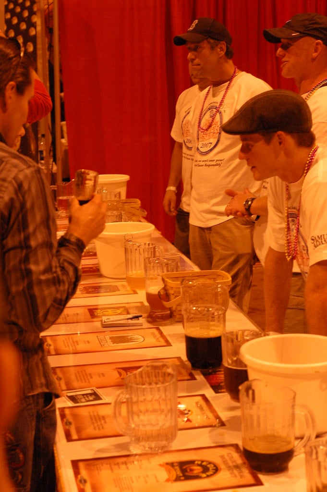

# Great American Beer Festival: from a 1982 hotel gathering to an open-air beer festival

The Great American Beer Festival (GABF) is often called the annual gathering of American craft beer. It is both a ticketed consumer festival and a professional competition among breweries. In 2026 it left the Colorado Convention Center for the outdoor Levitt Pavilion for the first time. To understand GABF, follow how a small 1982 gathering became a quality signal for the American craft industry.

Figure: A typical booth at the Great American Beer Festival, with staff serving beer behind a long table. Image: Herkie, CC BY-SA 2.0, via [source page](https://www.flickr.com/photos/44038067@N00/1603082280).

## The annual gathering of American craft beer

GABF is presented by the Brewers Association and describes itself as America's premier beverage alcohol festival, professional competition and cultural phenomenon. Hundreds of breweries bring thousands of beers; visitors taste, meet brewers and attend talks and events. A judging panel scores entered beers, and medals are announced during the festival.

It serves two audiences at once: consumers discover new beers and craft culture; the trade competes, learns, networks and presents brands. That “public festival plus professional competition” identity separates GABF from a pure trade fair or a pure beer festival.

## Starting in Boulder in 1982

In 1982 GABF was held at the Harvest House in Boulder, Colorado, as part of the American Homebrewers Association's annual conference. The first edition had only 24 breweries, 47 beers and 800 attendees. It was closer to a homebrew and small-brewery gathering than a national competition.

In 1984 GABF moved to Denver. As the American craft-beer movement expanded, exhibitor and attendance numbers grew quickly. In 2000 it moved to the Colorado Convention Center and became a large indoor festival. It marked its 40th anniversary in 2022. In 2026 it moved outdoors for the first time, to Levitt Pavilion in Denver's Ruby Hill neighbourhood.

## Denver and Levitt Pavilion

Denver is the capital of Colorado and a centre of American craft beer. There are many breweries around the city, and Colorado occupies an important place on the US craft map. GABF's long residence in Denver reinforces the local beer culture: breweries treat GABF as a home event, and the city treats it as a tourism and industry asset.

Levitt Pavilion in 2026 sits in Ruby Hill Park, a non-profit music venue with open lawns, city views and an outdoor stage. The outdoor site lets GABF add live music, food trucks and freer movement, but it also brings weather, transport and capacity problems. The organisers treated 2026 as a “reimagining”, not a simple change of address.

## The 2026 edition

GABF 2026 ran on 10–11 October, with one session each day, from 12:00 to 16:00. Tickets started at $60, with PAIRED packages costing more; some sessions sold out. Hundreds of breweries poured beer, alongside live music, food trucks and stein hoisting.

Compared with the indoor era, the scale and flow changed. The outdoor site can hold more people but depends more on weather; music and food trucks add festival atmosphere but queues and space can affect tasting. For a first visit, study the exhibitor list and style spread rather than trying to “drink the whole floor”.

## Competition and beer styles

GABF's competition began in 1987 with only 12 style categories and later expanded to more than a hundred. Judges score against the Brewers Association's Beer Style Guidelines, assessing appearance, aroma, flavour, mouthfeel and overall impression. Breweries choose categories, and category strategy affects medal chances.

The competition runs alongside the festival, but entering is not the same as exhibiting, and a medal is not market success. For breweries, a GABF medal is a quality signal and marketing material; for consumers, it is a way to discover beers, not an absolute ranking. The style guidelines change with the industry, including non-alcohol beer categories, which shows that “what good beer is” also moves.

## Who organises it, who exhibits

The organiser is the Brewers Association, a trade body representing small and independent US breweries. It sets competition rules, organises judges, ticketing, venue and media; breweries pay or participate through membership, and visitors buy tickets. Sponsors and partners provide funding and activities.

This structure ties GABF closely to the BA's industry agenda. The BA uses GABF to promote the craft brewer definition, beer styles and independent brewery brands; breweries use GABF for exposure and medals; consumers use GABF to enter craft culture. The three form a loop, with commercial tension inside it.

## Boundaries and common misreadings

First, GABF is not “all-you-can-drink”. Tickets include tasting, but breweries bring samples, and drunken disruption is removed. Second, it is not the “beer Olympics”. The competition judges by category, and medals are not a global absolute ranking. Third, exhibiting is not winning, and winning does not mean every style is excellent. Fourth, the 2026 outdoor format is an experiment; Levitt Pavilion is not a permanent site. Fifth, GABF is mainly for American breweries, with limited international participation, so it is not a “world beer panorama”.

Other common misreadings: treating GABF as a homebrew competition, when it is for commercial breweries and homebrewing has separate events; treating the BA's “craft” definition as law; treating a sold-out ticket as “a failed event”. A more accurate reading is that GABF is the annual festival and professional competition of American craft beer, connecting breweries, brewers and consumers through public tasting and industry judging. To practise beer tasting, see [Beer tasting from aroma to bitterness](ref:beer-tasting); to read a label, see [A small label, many clues](ref:read-a-label); for the US trade meaning of “craft”, see [Craft beer](ref:craft-beer); to understand festivals and drink, see [Wine and festivals](ref:festivals). It lands on [beer](ref:beer) and the American craft industry.

Great American Beer Festival is best read by starting with the date and venue, moving to the organiser, and ending with what changed afterwards.

[Beer](ref:beer) and [The rise of Chinese craft beer around 2015](ref:craft-beer) are the nearest useful comparisons: one clarifies date, the other tests venue.

Dates, venues and programmes change, so the organiser’s current notice remains the practical check before relying on an old account.

**Key facts.**

| Item | Detail |
| --- | --- |
| In one line | The Great American Beer Festival (GABF) was first held in 1982 at the Harvest House in Boulder, Colorado, with only 24 breweries, 47 beers and 800 attendees. Organised by the Brewers Association, it is one of the United … |
| Dates | 2026-10-10–2026-10-11 |
| Official site | greatamericanbeerfestival.com |

**Sources and limits.** The key claims about Great American Beer Festival: from a 1982 hotel gathering to an open-air beer festival are checked against the following sources: Great American Beer Festival; Brewers Association, Brewers Association (Used to check the Brewers Association as organiser, the 10–11 October 2026 dates, Levitt Pavilion and Denver). For current products, addresses or opening status, use greatamericanbeerfestival.com. Prices, batches and status change; the body is project-written and does not reproduce source text.
