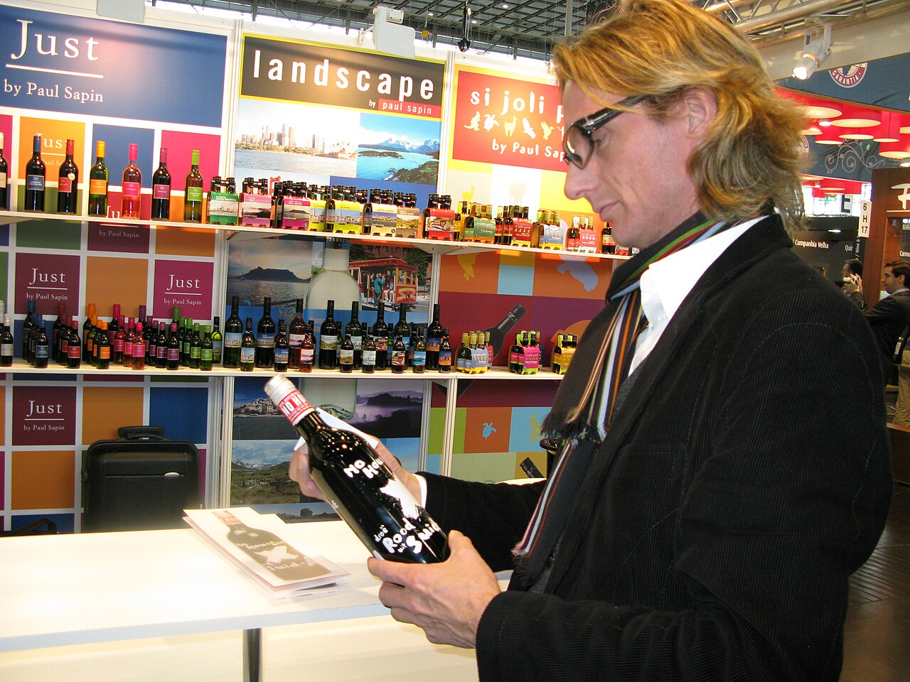

# ProWein: Düsseldorf in March, the trading floor for wine and spirits

ProWein is the wine trade's March appointment. It is held at Messe Düsseldorf, open only to trade visitors, with exhibitors from producing regions and buyers from retail, restaurants, importing and distribution. It is not a consumer festival where anyone buys a ticket to drink; it is a trading floor that puts supply and demand in the same halls. To understand it, start with the trade-only boundary and the expansion since 1994.

Figure: The ProWein fair in Düsseldorf; the image is not an official record of a particular edition and does not represent the 2027 exhibitor list. Photo: FLY2005, CC BY 2.0.. Image: FLY2005, CC BY 2.0, via Wikimedia Commons ([source page](https://commons.wikimedia.org/wiki/File:Prowein_%C3%A0_D%C3%BCsseldorf.jpg)).

## Not a tasting, but a trade-only fair

ProWein describes itself as an international trade fair for wines and spirits. It is open only to trade visitors: merchants, importers, distributors, restaurant and hotel buyers, media and industry bodies. Consumers cannot simply buy a ticket, which separates it from wine festivals and winery open days.

There is a great deal of tasting at the fair, but tasting is a business tool, not entertainment. Exhibitors use samples so buyers can judge quality, price and market fit; buyers walk several regions in a few days and compare styles and offers. The fair also runs forums, lectures and trend presentations to help the trade read the market. The core is business, not celebration.

## From ProVins in 1994

ProWein was first held in 1994 under the name ProVins, inspired by a small French wine presentation held in Düsseldorf the previous year. The first edition ran on 23–24 February 1994, with 321 exhibitors and 1,517 visitors, all in a single hall, from Germany, France, Greece, Italy, Colombia, Austria, Portugal, Spain and Hungary.

The second edition in 1995 expanded to two halls and 532 stands, and the name became ProWein to fit several languages. It later added spirits, sparkling wine, no- and low-alcohol categories and services, becoming a large multi-category fair. The 2027 edition is set for 7–9 March, with the organisers sharpening the positioning around “Focus. Proximity. Industry.”

## Düsseldorf and the March slot

Düsseldorf is the capital of North Rhine-Westphalia, on the Rhine near the Belgian and Dutch borders. It is a major German exhibition city, with Messe Düsseldorf providing large halls and transport links. The March slot has a particular place in the wine year: the southern-hemisphere harvest is just ending, northern-hemisphere new wines are still in cellar, and buyers can assess old and new world supply at once.

March is also a dense period for European trade fairs, and ProWein forms an “industry week” with nearby wine events. Exhibitors and buyers often link Düsseldorf with Paris, London or Milan. For regions, March is a window to launch new wines, find importers and test market response; for buyers, it is a key point in the annual purchasing plan.

## Halls and categories

ProWein is organised by region and category, covering still wine, sparkling wine, Champagne, spirits, no- and low-alcohol drinks, accessories, packaging, software and services. Exhibitors range from large houses to small producers, and some regions present themselves through national or regional pavilions. The fair also has themed areas such as the Village, giving smaller producers and emerging categories more visibility.

In recent years the fair has added spirits and no-alcohol sections, reflecting changes in consumption. Wine remains central, but a “wine-only” identity is no longer enough. For buyers, this means comparing wine, spirits and alcohol-free alternatives in one place; for exhibitors, competition no longer comes only from the same category.

## Who organises it, who exhibits

The organiser is Messe Düsseldorf, a German exhibition company. It handles venues, recruitment, visitor organisation, media and operations; exhibitors pay for stands, buyers register free or at a low fee, and media and trade bodies enter through accreditation. Stand fees and sponsorship, not tickets, are the core revenue.

The business model shapes the atmosphere: it serves trade, not the public. Exhibitors spend heavily on stands, samples and staff; buyers build purchasing and negotiation schedules. Success is measured not by “how many people came” but by “how much business and how many follow-up contacts”. That is the main difference from a wine festival.

## Why it leads in Europe

ProWein's advantage comes from scale, location and professionalism. Scale lets buyers see global regions in one place; location makes it easy for European buyers; professionalism keeps the trade-only boundary and prevents the fair from being diluted by tourists. It also works with the OIV, regional bodies, media and industry organisations on trends and data, adding content weight.

For ProWein, begin with the date and venue, then the organiser, and finish with what changed afterwards; that order keeps the account grounded.

## Boundaries and common misreadings

First, it is not a consumer event. Without trade status you cannot simply enter, and a ticket does not open every hall. Second, it is not a “wine festival”. There are no street performances or public concerts; the core is business. Third, tasting at the fair is not quality certification. Exhibitors show samples, buyers must judge, and “exhibiting” is not “winning an award”. Fourth, stand size is not quality. A large stand may belong to a big brand or a regional body; a small stand may hold an excellent producer. Fifth, dates and halls change; 7–9 March 2027 applies only to that edition.

Other common misreadings: treating ProWein as a “German wine fair” when it is global; treating “trade visitor” as “anyone who registers”; treating fair prices as retail prices. A more accurate reading is that it is Europe's leading wine and spirits trade fair, serving the trade through concentrated display and business matching. To read a label, see [A small label, many clues](ref:read-a-label); to understand regional difference, start with [terroir](ref:terroir); to check the International Organisation of Vine and Wine's trade framing, see [OIV](ref:oiv); to distinguish a trade fair from a public wine festival, see [Wine and festivals](ref:festivals). It ultimately serves the global trade in [wine](ref:wine).

**Short definition:** ProWein was first held in Düsseldorf in 1994 under the name ProVins, with 321 exhibitors, 1,517 visitors and a single hall. It is now Europe's leading trade fair for wine and spirits and is open only to trade visitors. The 2027 edition is scheduled for 7–9 March at Messe Düsseldorf. It is not a consumer tasting or a regional festival.

**Key facts.**

| Item | Detail |
| --- | --- |
| In one line | ProWein was first held in Düsseldorf in 1994 under the name ProVins, with 321 exhibitors, 1,517 visitors and a single hall. It is now Europe's leading trade fair for wine and spirits and is open only to trade visitors. T… |
| Dates | 2027-03-07–2027-03-09 |
| Official site | prowein.com |
