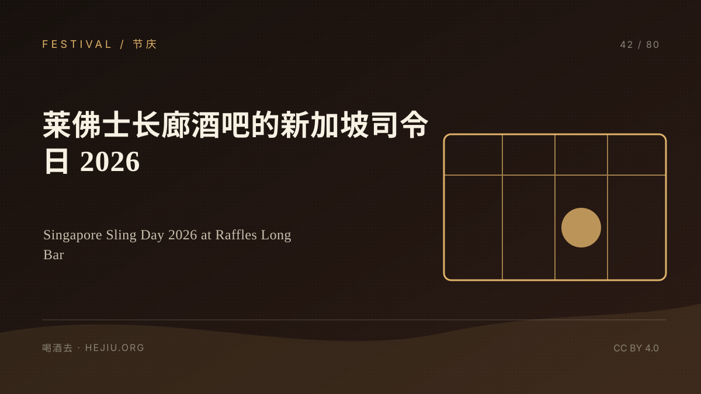

# Singapore Sling Day 2026 at Raffles Long Bar

On 27 June 2026 Raffles Hotel Singapore's Long Bar held its annual Singapore Sling Day. The date coincides with International Pineapple Day, and the bar made the pineapple its festive symbol: the first 100 guests who brought a whole pineapple could exchange it for a complimentary Singapore Sling. The alcohol-free Singapore Sling Zero also became available on the same day. The event has ended, and this event records the 2026 edition's arrangements and rules.

Figure: Singapore Sling Day 2026 at Raffles Long Bar. Project-generated or category illustration used for bar and drinks context; not a photograph of the subject.

> **Quick verdict**
> **In one line:** This event explains the current status of Singapore Sling Day 2026 at Raffles Long Bar, and how to take part.
>
> - **Best for:** Anyone who wants the scene, mechanics and current status of Singapore Sling Day 2026 at Raffles Long Bar.
> - **Not for:** If you want only want live ticketing or real-time logistics.
> - **Check first:**
>   - The first rule on Sling Day is the queue.
>   - The Singapore Sling was created at Long Bar in 1915.

## Background

The Singapore Sling was created at Long Bar in 1915. Raffles' official page gives a precise account: bartender Ngiam Tong Boon combined gin, pineapple juice, lime juice, curaçao and Bénédictine, then used grenadine and cherry liqueur to give the drink its rosy colour and make it look like fruit juice. In a period when social convention discouraged women from drinking alcohol in public, that “fruit-juice disguise” helped the cocktail travel. Today Long Bar still treats the Sling as its main subject and uses locally distilled Brass Lion Singapura Gin.

Singapore Sling Day is fixed on 27 June each year, according to the official page, to honour the cocktail created in 1915. The date also marks International Pineapple Day, which makes the pineapple the focus: it is a key ingredient of the Sling and, in the hotel's account, an international emblem of hospitality. From 1915 to 2026 the drink reached 111 years, which is the time context for this edition.

Long Bar is not a quiet hotel lounge but one of Raffles' most heavily visited set pieces: two storeys, dark wood, decoration inspired by Malayan plantation life in the 1920s, and peanut shells that guests are invited to brush onto the floor. Singapore Sling Day concentrates those everyday elements into one day, putting the drink's history, ingredients and ritual in front of the same counter.

## Dates and place

- Date: 27 June 2026.
- Place: [Raffles Long Bar](ref:long-bar), level 2 of Raffles Arcade, entered from the North Bridge Road side.
- Address: #02-01 Raffles Arcade, 328 North Bridge Road, Singapore 188719.
- Timezone: Asia/Singapore.
- This event's `start` is 11:00 and `end` is 23:30 (last seating) on the day, matching the bar's Thursday-to-Saturday hours; 27 June 2026 was a Saturday.

The official opening hours are 11:00–22:30 from Sunday to Wednesday (last seating) and 11:00–23:30 from Thursday to Saturday (last seating). The official page does not publish a minute-by-minute schedule for Sling Day, nor a stated time when the pineapple exchange ends. This event therefore makes no promise about “the exchange starts at this hour” or “it finishes at that minute”. For a similar future event, the hotel's notice on the day and the arrangements on site should govern.

## Taking part and tickets

Long Bar is open to walk-ins only and does not take reservations. There was no separate ticket for Singapore Sling Day: participation meant joining the queue, ordering from the normal menu, and taking part in the exchange on site. The official page offers no fast track or guaranteed seat, so claims from third parties about queue-jumping or “inside allocations” should not be trusted.

The official pineapple rule is that the first 100 guests bringing a whole pineapple may exchange it for one complimentary Singapore Sling. The key words are “whole” and “first 100”: the fruit must be complete, not sliced or canned, and the quota is counted by arrival order and lasts while it lasts. The English page does not state a per-guest limit on the number of drinks exchanged, and the Chinese page gives only the first-100 threshold, so this event adds no “one per guest” restriction. Actual handling is at the staff's discretion.

The alcohol-free Singapore Sling Zero became available at Long Bar from 27 June 2026. The official recipe uses Tanqueray 0.0% Alcohol Free Spirit, Raffles' signature grenadine, fresh pineapple and lime juices, Singapore Sling tea, a 48-hour spice tincture, orange peel and cherry. It keeps the original's pineapple, citrus and warm-spice profile without alcohol; for companions who do not drink or want to limit alcohol, it is the more practical choice on the day.

On cost, the official page publishes neither a fixed Singapore Sling price nor a “market value” for the pineapple exchange. Long Bar sits at hotel-bar pricing; drinks and bar snacks are charged from the menu, with service charge and prevailing goods and services tax added under Singapore rules. Bringing a pineapple is not free admission or a free seat: what is exchanged is a drink, while seating still follows the queue and normal spending arrangements.

## On site and house rules

The first rule on Sling Day is the queue. The bar opens at 11:00, and the official page identifies 11:00–11:30, 14:00–15:30 and after 21:00 on weekdays as the relatively quieter windows. On the event day, guests carrying pineapples tend to arrive around opening, so waits are longer than on an ordinary day. If the exchange matters, arrive before opening rather than late in the afternoon; by 6 p.m. the evening crowd is usually building as well.

The second rule concerns the pineapple itself. A whole pineapple means solving your own transport and storage problem; do not leave it in passages, at the door or in the hotel courtyard. The official page does not say what happens to the fruit after the exchange, so follow staff instructions on site. Do not try to pass off a cut fruit reassembled to look whole; that will be refused.

The third rule concerns peanut shells. Long Bar allows guests to brush shells onto the floor, a habit dated by the hotel to plantation owners in the 1900s, but the permission applies only inside the bar. Do not take shells outside, into the hotel garden or into the public areas of Raffles Arcade. Peanuts are a bar snack, not a meal; drinking two long, sweet, relatively low-alcohol cocktails on an empty stomach is a poor plan.

Smart casual is the dress suggestion. Singapore is hot, but the hotel and bar are heavily air-conditioned, so a light jacket is safer than a vest and slippers; other hotel areas may also have dress expectations. The bar is dense and loud, and it is not a place for a quiet business conversation. If companions want calm talk, treat Long Bar as a daytime stop rather than the base for the whole evening.

On photography, the official page imposes no ban, but the bar is a working business: photographing other guests, especially close shots of the counter and staff, should begin with consent. Do not hold a passage for a long “empty shot”, and do not take glasses or tableware out of the bar. On Sling Day, crowds concentrate at the entrance and counter, so keep phones and wallets with you rather than leaving them on a table when you step away.

## Verification and boundaries

The three core facts come from Raffles' official pages: Singapore Sling Day falls on 27 June, coincides with International Pineapple Day, and the first 100 guests bringing a whole pineapple may exchange it for a complimentary Sling; the Singapore Sling Zero page states that it was available at Long Bar from 27 June 2026; the Long Bar page gives the address, walk-in-only policy, hours and smart-casual suggestion. All three are hotel channels, and the dates and rules corroborate one another.

The boundaries also need stating. First, this event records the edition of 27 June 2026, which has ended; the 2027 date, quota and continuation had not been published on these pages when checked. Second, the official page gives the standing “first 100” rule but no complete 2026 programme, guest list or exact number of drinks available; this event therefore does not write “111 guests” or “111 drinks”, even though 111 years is arithmetically correct, because anniversary arithmetic cannot replace an official quota. Third, hours and exchange handling can be affected by crowds, weather and hotel arrangements, and no “guaranteed exchange” claim is valid.

Photographs are credited in the figure captions; no map is drawn. Long Bar is on level 2 of Raffles Arcade; entering from North Bridge Road is more direct than going around the hotel's main entrance. Directions should follow the navigation of the day and on-site signs. The bar is a fixed indoor venue with no route coordinates, so no schematic map is needed.

## See also

- [Raffles Long Bar](ref:long-bar): the 1915 origin of the Singapore Sling, the two-storey space, the peanut-shell tradition, opening hours and the walk-in queue.
- Raffles Hotel Singapore's official pages are the first source for the facts here; third-party press, social posts and resale prices are not the verification basis for this event.

Further reading: [Wine and festivals: the calendar inside seasonal drinks](ref:c-extra-1), [Singapore Sling](ref:c-extra-2), [Gin](ref:c-extra-3).
