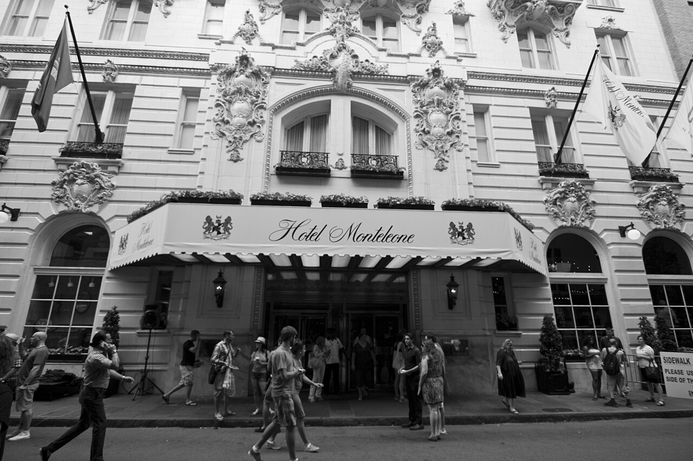

# Tales of the Cocktail: from a bar walk to the drinks industry's annual meeting

The name sounds like a story-telling cocktail party. It did start with stories: in 2002 Ann Tuennerman, a New Orleans cocktail enthusiast, organised a walking tour of historic bars, telling the story of each drink and each address. More than two decades later it has become one of the most important annual meetings of the global bar and spirits trade. To understand it, look at how a local tour became industry infrastructure.

Figure: Tales of the Cocktail at the Hotel Monteleone in New Orleans; the image is not the 2026 conference and does not represent that year's programme. Photo: Dan Silvers, CC BY 2.0.. Image: Dan Silvers, CC BY 2.0, via Wikimedia Commons ([source page](https://commons.wikimedia.org/wiki/File:Tales_of_the_Cocktail_at_the_Hotel_Monteleone,_New_Orleans,_LA.jpg)).

## Not a drinking party, but an industry conference

There is plenty of tasting and partying at Tales of the Cocktail, but its core is education, networking and awards. The conference runs seminars, tastings, networking events, competitions and the Spirited Awards for bartenders, distillers, brand representatives, journalists, bar owners and cocktail enthusiasts. Daytime is classes and discussion; evening is brand events and socialising, and together they form the annual gathering.

What separates it from an ordinary trade fair is content density. A trade fair is built around stands and samples; Tales is built around issues and people. A bartender can learn a technique, meet peers, discuss industry problems and present a brand. It is not a government-run public festival; it is an industry conference organised by a non-profit foundation.

## The 2002 walking tour

In 2002 Tuennerman created the New Orleans Original Cocktail Tour, taking visitors through French Quarter bars and telling the story of cocktails and the city. In September 2003, to mark the tour's first anniversary, she held the first Tales of the Cocktail, a small gathering of bartenders, writers and enthusiasts.

After Hurricane Katrina in 2005 the event paused, returning to New Orleans in 2006 and moving to July to avoid the hurricane anniversary. It then expanded year by year, adding education, competitions, awards and more brand participation. In 2018 the organisers created the Tales of the Cocktail Foundation, placing the event and year-round education and grant programmes in a non-profit frame.

## New Orleans and the French Quarter

New Orleans is a key city in cocktail history. French Quarter bars, hotels and restaurants preserve the stories of classics such as the Sazerac, the Ramos Gin Fizz, the Hurricane and the Vieux Carré. Tales is held here not only for tourism but because the city itself provides a stage for cocktail culture.

Venues are spread across French Quarter hotels and bars, with historic properties such as The Ritz-Carlton New Orleans and Hotel Monteleone often used. Participants move between seminar rooms and tasting rooms by day and between bars and parties by night. City space and conference content reinforce each other: the history heard in class is a few streets away.

## The 2026 edition

The 24th edition ran from 19 to 24 July 2026, based at The Ritz-Carlton, New Orleans, under the theme “Spark”. It included education, tastings, industry networking, brand events and the Spirited Awards, presented on 23 July. Tickets came in several tiers, and some events required separate booking.

The schedule is dense: several classes and tastings run in the same slot, so participants must choose; evening brand parties and industry gatherings often need invitations or extra tickets. For a first-timer, the priority is not to drink the most but to choose a theme, leave time for conversation and manage alcohol and energy.

## Education, awards and community

Tales' education covers bartending technique, ingredients, bar operations, brand stories, sustainability, inclusion and industry policy. Formats include lectures, workshops, tastings and roundtables, with speakers from bars, distilleries, media and academia. It is not a qualification course; attending a few classes does not confer an official licence.

The Spirited Awards recognise bars, bartenders, brands, media and education projects. A jury selects the winners, and the commercial value for a bar or individual is high, but an award is not a guarantee of quality or a lifetime title. Through the foundation, Tales also runs grants, mentoring and community programmes, linking conference income to industry giving.

## Who organises it, where the money comes from

The organiser is the Tales of the Cocktail Foundation, a non-profit. Income comes from tickets, brand sponsorship, event partnerships and merchandise; spending covers venues, speakers, production, staff and community programmes. Brand sponsorship is normal at a drinks conference, but organisers usually separate education from brand activity to avoid turning classes into advertisements.

The model has tension. Sponsorship keeps the event large and tickets relatively affordable, but brand influence can reach content and awards. When reading a tasting or an award, ask whether it is education or promotion, and whether the editorial and judging rules are public. These questions do not reject the event; they explain its commercial structure.

## Boundaries and common misreadings

First, Tales is not a “drinking competition”. It has tastings and parties, but the core is education, networking and awards. Second, it is not government-run. The organiser is a non-profit foundation; government may support venues or tourism but does not set content. Third, a ticket is not universal access. Many events need separate booking or invitations, and one pass does not open every session. Fourth, it is not “the Oscars of cocktails”. The Spirited Awards have influence, but their jury and categories are limited and cannot cover every bar in the world. Fifth, New Orleans is not the only site. Tales has overseas events and brand partnerships, but the annual main conference remains in New Orleans.

Other common misreadings: treating Tales as “tasting tourism”; treating a sponsor brand as the organiser; treating an award as an absolute ranking. A more accurate reading is that it is an industry conference organised by a foundation, using education, awards and socialising to bring the global bar community together. To start with the logic of mixing drinks, see [Cocktail-making as another way into drink](ref:cocktail-basics); to understand festivals and drink, see [Wine and festivals](ref:festivals); to practise a first tasting, see [A first tasting](ref:first-tasting); to think about time in a glass, see [Time in a cup](ref:time-in-a-cup); to compare cocktails with beer, see [Beer](ref:beer). It lands on cocktail culture and the everyday life of New Orleans.

Setting [A cocktail is another way in](ref:cocktail-basics)'s date beside [Give the first sip a moment](ref:first-tasting)'s venue makes the boundary between them visible.

**Key facts.**

| Item | Detail |
| --- | --- |
| In one line | Tales of the Cocktail began in New Orleans in 2002 as Ann Tuennerman's walking tour of historic bars and grew into a global cocktail and spirits conference. The 24th edition ran from 19 to 24 July 2026 in New Orleans, wi… |
| Dates | 2026-07-19–2026-07-24 |
| Official site | talesofthecocktail.org |
