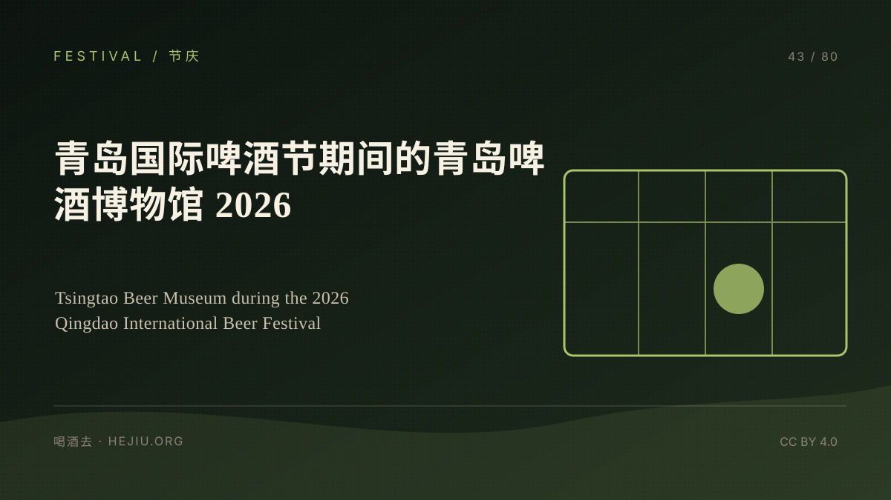

# Tsingtao Beer Museum during the 2026 Qingdao International Beer Festival

The 36th Qingdao International Beer Festival ran from 17 July to 15 August 2026, a 30-day edition. Its main venues were in West Coast New Area, Laoshan and Qingdao's old town. The Tsingtao Beer Museum was not on that venue list, but it sits on Dengzhou Road in Shibei District and is one of the easiest stops to add during the festival: the museum follows its summer hours and runs the “Golden Wonder Night” night tour. The event has ended, and this event records the 2026 edition's hours, ticketing and limits.

Figure: Tsingtao Beer Museum during the 2026 Qingdao International Beer Festival. Project-generated or category illustration used for beer context; not a photograph of the subject.

> **Quick verdict**
> **In one line:** This event explains the current status of Tsingtao Beer Museum during the 2026 Qingdao International Beer Festival, and how to take part.
>
> - **Best for:** Anyone who wants the scene, mechanics and current status of Tsingtao Beer Museum during the 2026 Qingdao International Beer Festival.
> - **Not for:** If you want only want live ticketing or real-time logistics.
> - **Check first:**
>   - Allow 2–3 hours for the daytime visit.
>   - The Qingdao International Beer Festival began in 1991; 2026 was its 36th edition.

## Background

The Qingdao International Beer Festival began in 1991; 2026 was its 36th edition. At a press conference on 26 June 2026, the Qingdao municipal government announced the dates: 17 July to 15 August, 30 days. The official description presents the edition as a city-wide, multi-point event with three venues in West Coast New Area, Laoshan and the old town, continuing the theme “Qingdao toasts the world”. The three venues again waived admission, a policy separate from the museum's own ticketing.

The Tsingtao Beer Museum opened on 15 August 2003 on the site of the 1903 German-funded brewery. It is both a national first-class museum and a working brewery visitor site: historic equipment, German industrial architecture and an automated production line behind glass sit on one route. Its regular hours are divided by season, and July to August is the longest opening window of the year, so the festival and the museum's peak period naturally overlap.

The official culture and tourism recommendation included “visiting the museum's Golden Wonder Night” in its festival guide. That sentence defines the museum's role during the festival: it is not a festival sub-venue, and a festival ticket does not admit visitors to the museum. It is a city cultural attraction recommended during the festival. Seeing the industrial heritage and production line by day and the night tour in the evening makes a route distinct from the main festival venues.

## Dates and place

- Festival dates: 17 July to 15 August 2026.
- Museum summer opening: 1 July to 31 August, admission from 07:30, last entry at 18:30 (6:30 p.m.).
- Night-tour entry: 19:30–21:00 in July (7:30–9 p.m.); 19:00–21:00 in August, so an 8 p.m. arrival still falls inside the window.
- Place: [Tsingtao Beer Museum](ref:tsingtao-museum), 56 Dengzhou Road, Shibei District, Qingdao.
- Timezone: Asia/Shanghai.
- This event's `start` and `end` use 00:00 on the festival's first day and 23:59:59 on its last day to mark the festival window; the museum and night-tour entry times are given above.

One discrepancy needs handling. A museum notice published through its WeChat account on 9 June 2026 says that July to August admission is 07:30–18:30 and that August night-tour entry is 19:00–21:00. The museum's official “Visit information” page says that from 1 July to 31 August admission runs 07:30–19:30 with last entry at 18:30. The two sources disagree on closing time but agree on “admission from 07:30, last entry at 18:30”. This event follows the more conservative 18:30 last entry and advises checking the official notice for the day of travel.

## Taking part and tickets

The museum uses online timed tickets and real-name entry checks. The official notice asks visitors to buy in advance through the “Tsingtao Beer Museum” WeChat account, or to book through OTA platforms by searching for the museum. At entry, the original second-generation ID card, booking QR code or equivalent is checked. If a time slot shows “not bookable”, it is full and no tickets are sold at the door, so entry at that time is impossible. This matters especially during the beer festival: summer and weekend slots sell out earlier than on ordinary days.

Free-admission groups for the standard ticket include visitors aged 70 and above, children 1.4 metres and under accompanied by an adult, people with disabilities, active-duty military personnel, retired military personnel, holders of the Shandong talent card and firefighters. Visitors aged 60 to 69, full-time undergraduate and lower students aged 23 and under, and veterans may buy half-price or concession tickets. Complete ticket types, prices and document requirements follow the booking page and on-site notices; this event gives no fixed admission price.

“Golden Wonder Night” is a separately ticketed night tour. The museum's night-tour page describes it as the first beer-themed immersive walking performance, with 5 story scenes, 18 sprite characters and a 600-second 3D mapping show; the page shows a price of 300 yuan. That is the price displayed on the page and may vary by ticket type, channel and session. The night tour is not included with an ordinary daytime ticket: buying a day ticket does not admit you to the night tour.

The beer festival itself waives admission, but that waiver applies only to festival venues, not to the museum. Museum admission, the night tour and festival spending are three separate ticketing and pricing systems. Treating “the festival is free” as “the museum is free” is one of the most common misunderstandings of this period.

## On site and house rules

Allow 2–3 hours for the daytime visit. Start with the century-history zone and follow the timeline from 1903; then take the production zone, focusing on the old motor, mash tun, wort kettle and the automated line behind glass; finish in the experience zone with interactive exhibits, tasting or a custom label. During the festival, crowds increase and tour groups cluster between 10 a.m. and 3 p.m., so the first hour after opening or after 3 p.m. is calmer.

The night tour has a different rhythm. The official entry windows are 19:30–21:00 in July and 19:00–21:00 in August; these are entry times, not closing times. The tour takes place in a lit and projected environment, and the route, sessions and meeting arrangements follow the ticket and on-site instructions. Do not infer the night route from the daytime visit, and do not stop to photograph in areas that are not open.

Museum rules are specific: the production area has safety and hygiene requirements and cannot be entered independently; historic equipment, archives and exhibits should not be touched, and flash or photography may be restricted; do not block stairways or passages for photographs, because crowds build behind you. Families should supervise children, and the tasting segment follows age rules, with minors not drinking. Do not drive after tasting: the old town's roads are complicated, and finding a way out after alcohol is a poor combination.

Dengzhou Road's beer street outside the museum is a food and drink area, not the same entrance or the same ticket. During the festival, the street's evening activity does not overlap with the museum's closing: last entry is 18:30, while the night tour has its own 19:30 or 19:00 window. Treating “go to the beer street in the evening” as “the museum is still open” leads to a wasted trip. By metro, Line 1 and Line 2 at Taidong station, Line 1 at Guangrao Road station and Line 2 at Lijin Road station are all within walking distance; old-town streets are narrow and parking is limited, so metro plus walking is more reliable than driving.

## Verification and boundaries

The date chain is clear. Qingdao government reporting on 27 June 2026 confirmed the 36th festival from 17 July to 15 August; the Qingdao culture and tourism bureau's guide on 20 July named the museum's Golden Wonder Night within the same window; the museum's 9 June notice gave July and August admission and night-tour entry times; the museum's visit-information page and night-tour page add real-name ticketing, free-admission groups and tour content. Of the five sources, four are official domains or an official museum notice republished by local media, and the dates and venue information can be cross-checked.

There are four boundaries. First, this event records the 2026 edition, which has ended; the 2027 festival dates, museum summer hours and night-tour schedule should follow the notice for that year. Second, the museum's visit-information page and its 9 June notice differ on the July–August closing time; this event follows 18:30 last entry and does not present 19:30 as guaranteed. Third, the 300 yuan shown on the night-tour page is a displayed price, and ticket types, channels and sessions may differ; this event gives no “uniform price”. Fourth, free festival admission does not mean free museum admission, and the museum is not one of the three festival venues; this event does not merge the two events.

Photographs are credited in the figure captions; no map is drawn. The museum is a fixed building, and its address and walking routes are covered on the place page. Festival venues are spread across West Coast New Area, Laoshan and the old town; a single diagram could not represent all three venues and the museum at once, so no route map is drawn.

## See also

- [Tsingtao Beer Museum](ref:tsingtao-museum): the 1903 brewery site, the three exhibition zones, German industrial architecture, regular hours, ticketing and transport.
- For the Qingdao International Beer Festival's venues, programme and transport, use the current notices from the Qingdao municipal government and the culture and tourism bureau; this event only covers the museum's opening and night tour during the festival.

Further reading: [Wine and festivals: the calendar inside seasonal drinks](ref:c-extra-1), [Beer](ref:c-extra-2), [Tsingtao Beer](ref:c-extra-3).
