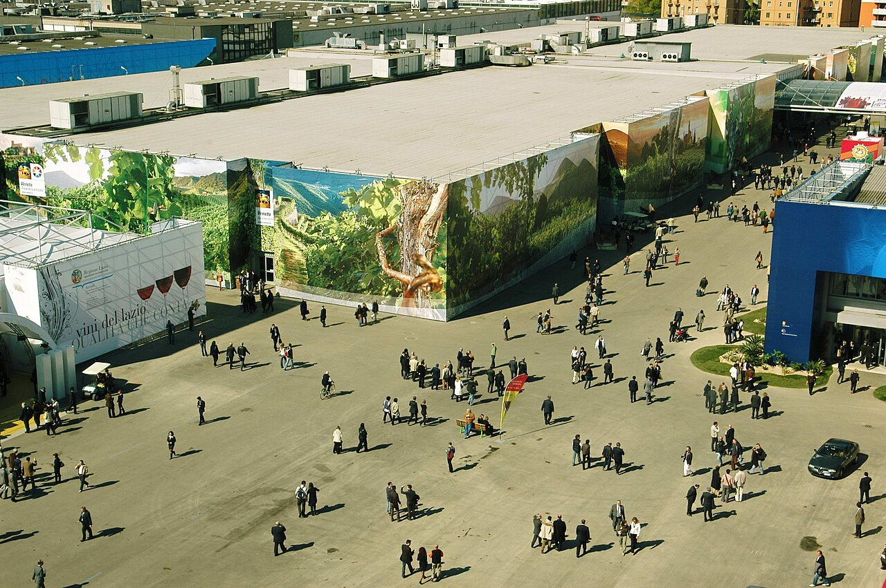

# Vinitaly: Verona's annual showcase for Italian wine

Vinitaly is the centre stage of the Italian wine year every April. It is held at the Verona exhibition centre, organised by Veronafiere, with exhibitors mainly Italian wineries and buyers and media from around the world. It is not a public wine festival but a platform between Italian wineries and international markets. To understand it, follow the shift from “Italian Wine Days” to an international trade fair.

Figure: An aerial view of the Vinitaly halls at the Verona exhibition centre; the image is not an official record of a particular edition and does not represent the 2026 exhibitor list. Photo: Fabio Ingrosso (VinoFamily), CC BY 2.0.. Image: Fabio Ingrosso (VinoFamily), CC BY 2.0, via Wikimedia Commons ([source page](https://commons.wikimedia.org/wiki/File:Vinitaly,_vista_dei_padiglioni_dall%27alto.jpg)).

## Italy's annual wine showcase

Vinitaly describes itself as the international exhibition of wines and spirits. Its core is Italian wine: almost every region, from Piedmont, Tuscany and Veneto to Sicily and Puglia, presents itself here. International exhibitors also attend, but their share and position are usually smaller than the Italian presence.

The fair is open only to trade visitors: wineries, importers, distributors, restaurants, hotels, media and industry bodies. There is heavy tasting and negotiation, alongside forums, masterclasses and regional promotion. It is not a festival where tourists drink their way around; it is a fair where buyers plan a year.

## The Italian Wine Days of 1967

Vinitaly began on 22–23 September 1967 with the Italian Wine Days, Giornate del Vino Italiano, at Verona's Palazzo della Gran Guardia. It was mainly a conference and showcase and is treated as Vinitaly's official debut. In 1969 the third edition had 130 wineries exhibiting; in 1971 the event became Vinitaly, a full trade exhibition, adding a wine auction, winemaking equipment and the first DOC wine catalogue.

In 1978 Vinitaly gained “international” status and foreign exhibitors began to attend. In 1987 an olive-oil section was added; in 1988 came Grappa, Brandy and spirits; in 1992 the international wine competition was created. In 2016 the 50th edition was opened by Italian President Sergio Mattarella, marking its status as a national industry platform.

## Verona and Veronafiere

Verona is a major city in Veneto, between Milan and Venice, near Lake Garda and the southern Alps. It has a long wine-trade and exhibition tradition, and Veronafiere has organised fairs there since 1898. The Verona exhibition centre has multiple halls and outdoor areas and receives large numbers of international buyers.

Veronafiere is an exhibition company responsible for venues, recruitment, visitor organisation and media. It owns and directly organises Vinitaly, Marmomac, Fieragricola, Samoter and other brands. Vinitaly's success is tied to Verona's location: European cities are reachable by train or plane, the fairground is close to the centre, and the city has enough hotels and restaurants.

## The 2026 edition

The 58th edition ran from 12 to 15 April 2026. Official releases said nearly 4,000 Italian wine companies exhibited, all halls were in use, and more than 100 official events included tastings, forums and regional promotion; buyers and media from more than 70 countries attended, with 1,000 top buyers hosted jointly by Veronafiere and the Italian Trade Agency.

The 2026 fair added No-Lo, no- and low-alcohol, and spirits areas, and strengthened wine tourism under Vinitaly Tourism. This shows that Vinitaly no longer speaks only of “wine” but puts consumption trends, tourism and spirits on one platform. For Italian wineries it is a window to launch new wines and find export opportunities; for buyers it is a chance to compare the whole Italian map in a few days.

## Halls, tasting and competition

Vinitaly's halls are organised by region and category. Italian regions usually have concentrated areas, with wineries grouped by association or consortium. International exhibitors, spirits, no-alcohol, accessories and equipment occupy separate halls. There is extensive free tasting, alongside booked masterclasses and vertical tastings.

Vinitaly also runs the International Wine Competition, Concorso Enologico Internazionale, where judges score entered samples. The competition runs alongside the fair, but entering is not the same as exhibiting, and a medal is not market success. For wineries, a medal is a quality signal; for buyers, it is a reference, not a substitute for tasting.

## Who organises it, who exhibits

The organiser is Veronafiere, an Italian exhibition company. Exhibitors pay for stands, buyers and media enter through accreditation, and some events require booking. The Italian Trade Agency and the Ministry of Agriculture provide support, helping to bring international buyers and media. Revenue comes from stands, sponsorship and services, not primarily tickets.

This structure ties Vinitaly closely to Italian national promotion. It serves business and also carries the “Italian wine” image. When a visitor sees a theme, guest country or official event, it helps to separate commercial stands from government-supported promotion.

## Boundaries and common misreadings

First, Vinitaly is not a consumer wine festival. It is trade-only, and ordinary tourists cannot simply buy a ticket. Second, it is not a fair of “all Italian wine”. Exhibitors are mainly Italian wineries, but international exhibitors, spirits and no-alcohol brands also attend. Third, stand size is not quality. A large regional stand may gather many wineries; a small winery may pour excellent wine from a corner. Fourth, a competition medal is not an absolute ranking: judges, categories and entry strategy all matter. Fifth, dates and halls change; 12–15 April 2026 applies only to that edition.

Other common misreadings: treating Vinitaly as a “Verona wine festival”; treating “international” status as “the world's largest”; treating samples at the fair as retail products. A more accurate reading is that it is the Italian wine trade's annual platform, connecting regions and international markets through stands, tasting, competition and media. To read a label, see [A small label, many clues](ref:read-a-label); to understand Italian regional difference, start with [terroir](ref:terroir); to check the International Organisation of Vine and Wine's statistical framing, see [OIV](ref:oiv). It ultimately serves [Italy](ref:italy)'s [wine](ref:wine).

Start with the date and venue. From there, consider the organiser, then what changed afterwards. That is how a practical judgment about Vinitaly is built.

[Wine](ref:wine) and [Terroir](ref:terroir) are the two useful reference points for Vinitaly. [Wine](ref:wine) sets out date; [Terroir](ref:terroir) brings in venue. Read them together.

**Key facts.**

| Item | Detail |
| --- | --- |
| In one line | Vinitaly first appeared in Verona on 22–23 September 1967 as the Italian Wine Days, became a full trade fair in 1971 and gained “international” status in 1978. Today it is organised by Veronafiere and is the central trad… |
| Dates | 2026-04-12–2026-04-15 |
| Official site | vinitaly.com |

**Sources and limits.** The key claims about Vinitaly: Verona's annual showcase for Italian wine are checked against the following sources: Vinitaly; Veronafiere (Used to check the fair's positioning, halls and current edition entry points), Veronafiere S.p.A.. For current products, addresses or opening status, use vinitaly.com. Prices, batches and status change; the body is project-written and does not reproduce source text.
