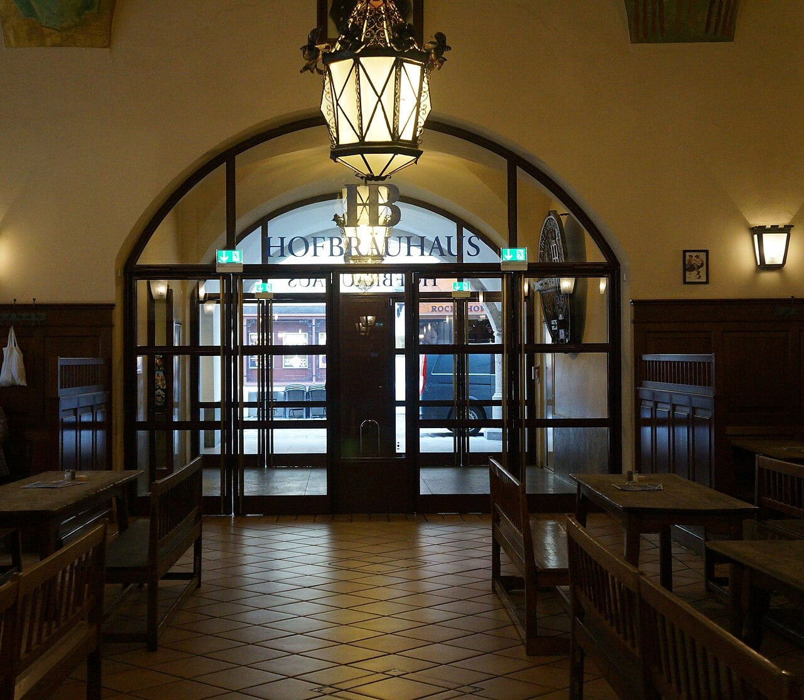

# WirtshausWiesn 2026 at the Hofbräuhaus

From 19 September to 4 October 2026, the Hofbräuhaus in Munich ran a “WirtshausWiesn” alongside Oktoberfest. The idea is clear: instead of squeezing into a tent on the Theresienwiese, drink festival beer, hear daily live music and eat Oktoberfest dishes in the old city-centre beer hall. The event has ended, and this page records that year's arrangements.

Figure: The entrance hall of Munich's Hofbräuhaus, with the name lettered on the glass doors. Image: Pierre André Leclercq, CC BY-SA 4.0, via [source page](https://commons.wikimedia.org/wiki/File:Munich_Hofbrauhaus_(1).JPG).

## Organiser and edition

The organiser is the Hofbräuhaus München at Platzl 9 in Munich, whose operating parent is the Bavarian state-owned Staatliches Hofbräu München. The Hofbräuhaus was founded by Duke Wilhelm V in 1589 as a court brewery, and in 1828 King Ludwig I opened it to the public, after which it became one of Munich's best-known beer halls. The event takes place inside that building rather than on a separate site.

On the edition, the official event page gives only the 2026 dates and programme and does not state an edition in words; the number in the page address is a site identifier and is not read as an edition number here. This page therefore records it as the 2026 edition and does not invent a number. What can be confirmed is that it belongs to the Hofbräuhaus's regular Oktoberfest-season schedule rather than being a one-off.

## Date and place

- Start: 2026-09-19T00:00:00+02:00.
- End: 2026-10-04T23:59:59+02:00.
- Time zone: Europe/Berlin (Central European Summer Time, UTC+2).
- Venue: [Hofbräuhaus](ref:hofbrauhaus), Platzl 9, 80331 Munich.

The dates overlap the main 2026 Oktoberfest, which also ran from 19 September to 4 October. The WirtshausWiesn is not a branch of the main site but a parallel programme in a city-centre beer hall. It covers the whole festival period, but not with the same programme every day: the official page promises only “daily live music”, with bands and times set by the house.

## Programme

The official description lists three main elements: festival beer, daily live music and Oktoberfest dishes. Festival beer is a seasonal style with a different strength and recipe from the regular beer, usually emphasising malt aroma and drinkability; the music is typically Bavarian brass and folk; the food leans toward roast chicken, sausages, sauerkraut, bread and sweets. The historic building has several floors and a beer garden, so the atmosphere differs by area: the ground floor is the busiest and turns over fastest, upper rooms suit groups and families, and the garden is quieter in good weather.

A distinction should be made between what is promised and what is scheduled. The official page does not publish a complete daily timetable or a full menu with prices, so this page states the types of activity rather than “the band starts at this hour” or “this dish costs this much”. Such details change daily, and visitors should check the event page or the house's notice on the day.

## How to attend

No ticket or reservation is required; according to the official page, visitors simply arrive and find a seat on the ground floor or in the beer garden. Free seating is the most practical information about the event: it means no need to book a table as at the main festival tents, but it also means finding a place during peak hours.

It is sensible to avoid the early evening rush or to arrive a little earlier; weekends and core festival dates are busier. Large groups, or anyone wanting a seat in the evening peak, should still arrive early. Payment is by order, with drinks and food priced separately. Visitors with children or mobility needs should confirm available areas and step-free routes on site; the house's directions take precedence.

## Rules on site

The official page makes three rules clear: free seating on the ground floor and in the beer garden, no admission charge, and payment by order. Free-seating areas do not take advance reservations, and seats are first come, first served. During the event the hall is loud and crowded, and belongings should be watched.

The official page does not set out full rules on dress, pets, children, payment methods or outside drinks, and this page does not invent them. Such information should come from the house notice or staff. The event takes place inside a fixed building and does not involve coordinates or a map, so no map is drawn here.

## Verification status

This page is based on three sources: the Hofbräuhaus official event page, for the dates, programme, free seating and free admission; the official venue page, for the address and venue; and the brewery website, for the brand and festival beer background. All three are official or affiliated sites, with no second-hand paraphrase.

Items that could not be verified include: the daily band list and times, the menu and prices, any cap on festival beer supply, whether groups need to coordinate in advance, and the exact location of accessible seating. The official pages do not publish these, and this page does not guess. The event status is past (`event_status: past`), and the last review date is 2026-11-08. Dates, menus, prices and programmes change each year; anyone planning to attend in future should re-check the official event page and treat the organiser's announcement as authoritative.

## See also

- [Hofbräuhaus](ref:hofbrauhaus): the venue and its history.
- [Beer](ref:beer): the wider category and style background for festival beer.
- [Wine and festivals](ref:festivals): how festivals and public drinking are organised.
- [Augustiner-Bräu](ref:augustiner): another Munich beer hall for comparison.

**Short definition:** From 19 September to 4 October 2026 the Hofbräuhaus in Munich ran a “WirtshausWiesn” alongside Oktoberfest: festival beer, daily live music and Oktoberfest dishes, with free seating on the ground floor and in the beer garden and no admission charge. The event has ended. 

For WirtshausWiesn 2026 at the Hofbräuhaus, begin with the date and venue. Then look at the organiser, and finally ask what changed afterwards. The answers point to different choices, not to a single score.

**Key facts.**

| Item | Detail |
| --- | --- |
| In one line | From 19 September to 4 October 2026 the Hofbräuhaus in Munich ran a “WirtshausWiesn” alongside Oktoberfest: festival beer, daily live music and Oktoberfest dishes, with free seating on the ground floor and in the beer ga… |
| Dates | 2026-09-19–2026-10-04 |
| Venue | Hofbräuhaus |
| Official site | hofbraeuhaus.de |

**Sources and limits.** The key claims about WirtshausWiesn 2026 at the Hofbräuhaus are checked against the following sources: Hofbräuhaus München (Used to check the venue and address), Staatliches Hofbräu München (Used as background on the brewery and its festival beer), Münchner Innenstadtwirte. For current products, addresses or opening status, use hofbraeuhaus.de. Prices, batches and status change; the body is project-written and does not reproduce source text.
