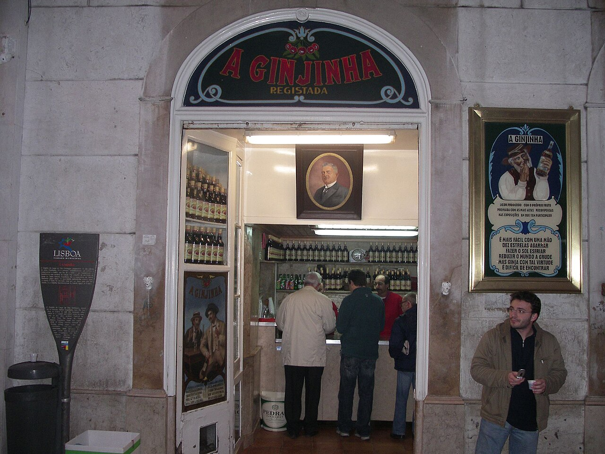

# A Ginjinha

On the north-west corner of Largo de São Domingos, a red neon sign, a narrow door, and a short marble counter are the entire shopfront. There are no tables and no invitation to linger. Customers crowd the bar, order a small glass of deep-red ginjinha, receive it, stand at the doorway to drink, return the empty glass, and make room for the next person. It is less a café than a street-corner kiosk for drinking.

> **Visit information**
> - Address: Largo de São Domingos 8, 1100-320 Lisbon, Portugal.
> - Opening and booking: check the [official page](https://ginjinhaespinheira.com/en) before travelling; hours, tours and booking rules change by season.
> - Getting there and cost: check the official page before booking; this entry does not promise a fixed price.
> - Status: Verified; sources checked: 2026-11-21.

Figure: The A Ginjinha storefront at Largo de São Domingos 8, with its red sign and standing bar. Image: Shadowgate, CC BY 2.0, via Wikimedia Commons ([source page](https://commons.wikimedia.org/wiki/File:Ginjinha_store.jpg)).

## Location and history

A Ginjinha’s official history traces the brand to 1840, when Francisco Espiñeira Couziño’s father ran a tavern at Rua das Portas de Santo Antão 27, a few minutes’ walk from today’s square. In 1910, Francisco Espiñeira Couziño refurbished the shop at Largo de São Domingos. That is the date the brand treats as the real beginning of “Ginja Espinheira.” The present shop is therefore not the original 1840 tavern, but the twentieth-century storefront into which the family moved its earlier business.

That distinction matters. A Ginjinha is not a single shop that has stood unchanged since 1840; it is a family brand rooted in 1840, fixed at the present address in 1910, and continued by the same lineage. The old counter, the sign, and the founder’s portrait are part of that continuity. What the shop sells is not only a liqueur but a piece of Lisbon’s everyday life preserved by a family.

## Architecture and space

The shop is extremely narrow. Its red façade stands out against the grey stone of the square. Inside, a short counter holds bottles, glasses, and jars of cherries soaked in liqueur; behind it, there is just enough room for the cashier, the pouring, and the handing over of glasses. Old photographs, signs, and a portrait of the founder cover the walls. The lighting is warm, and the wear of age is visible even in daylight. Because there are so few seats, the space works as “enter—order—stand—leave,” with the crowd rising and falling at the door.

The small scale is not a design choice but a historical result. The old quarter has expensive, fragmented frontage; a nineteenth-century tavern could not expand into a large bar, and the shop has not done so for tourists. Standing at the door lets everyone get close to the counter and watch the pouring, the cherry being fished out, and the glass being passed over. First-time visitors should watch the queue for a minute—where it starts, where payment happens—before speaking.

## The drink

There is essentially one drink here: ginjinha, a liqueur made by steeping sour cherries (ginja) in alcohol with sugar. Sources put it at roughly 22% ABV. It is sweet, tart, and slightly bitter with a hint of almond from the cherry stones. It is usually served cool, never with ice. It is not a wine to be decanted or a cocktail to be mixed; it is a small, direct hit of fruit, sugar, and warmth.

The two phrases to know are “com ela” and “sem ela.” The first means “with it”—a cherry in the glass; the second means “without it”—liqueur only. The cherry is not decoration. It is part of the drink: the fruit is softer and sweeter after steeping, and biting into it adds more liqueur and acidity. First-timers should order com ela, drink the liqueur, and eat the cherry. If the texture of the fruit is not appealing, order sem ela. The glass is tiny, usually one or two sips, and refills are common—but this is not a cocktail to roll around for half an hour.

## How to drink

The best times are late morning, around 11:00, or early evening before dinner. In the morning the counter is quieter and the old fixtures are easier to see; after work, locals and visitors mix and the queue is longer. Order directly: “uma ginjinha, com ela” or “sem ela.” Pay, stand at the doorway, and do not carry the glass away. Return the empty glass to the counter or the designated tray before leaving.

If the alcohol feels too strong, ask for a smaller measure or a sweeter version, but do not expect a no-alcohol option; the standard recipe is the product. A cherry, a piece of chocolate, or a sip of water is enough of a companion. Drinking on an empty stomach makes the sugar and alcohol feel sharper, so eat something first. This is a stop on a walking route, not a destination for a long afternoon.

## Practical information

- Address: Largo de São Domingos 8, 1100-320 Lisbon.
- Hours: commonly listed as daily 09:00–22:00, with some sources saying 10:00 opening; the official site does not publish daily hours, so check with the shop or official channels before going.
- Transport: Rossio metro (green line) is at the square; Praça da Figueira and Rossio are a 1–3 minute walk.
- Prices: a small glass is inexpensive and works as an experience rather than a full meal; cash is safest at peak times.
- Capacity: the shop is tiny; groups should enter in twos rather than block the doorway. Do not film for long at the counter.
- Accessibility: the old doorway is narrow, with a step and crowds; wheelchair access is difficult. Ask a companion to buy if needed.

## Etiquette and common misconceptions

First, ginjinha is a liqueur, not “cherry wine” and not beer; ordering “ginjinha” is the clearest. Second, “ela” in com ela means the cherry, not a female companion. Third, do not spend half an hour at the counter; this is a standing, small-glass ritual and the queue is behind you. Fourth, do not take the glass home as a souvenir; it is part of the shop’s turnover. Fifth, do not dismiss it as a tourist trap because of the crowd: it is still a local habit, amplified at peak times. Sixth, do not treat 1840 as the opening year of the present shop; 1840 is the brand’s root, and 1910 is the refurbishment of the Largo de São Domingos storefront.

## Nearby and routes

From A Ginjinha, Rossio and Praça da Figueira are two minutes west; Castelo de São Jorge is uphill to the south; Chiado and [A Brasileira](ref:brasileira) are a ten-minute walk north-west. A natural sequence is: ginjinha after breakfast, Rossio, the castle, coffee at Chiado, then Alcântara or Bairro Alto in the evening. For another Portuguese historic café, [Café Majestic](ref:majestic) in Porto deserves its own day. On the Iberian peninsula, Madrid’s [Casa Labra](ref:labra) and [Botín](ref:botin) offer a different “old shop plus small plates or full meal” combination. Travellers who like tiny bars can add Amsterdam’s [Café De Dokter](ref:dokter) to the same small-space list.

## Further reading and see also

- Official history: <https://ginjinhaespinheira.com/en/pages/historia>, for 1840, 1910, and the Espiñeira family narrative.
- Official contact: <https://ginjinhaespinheira.com/en/pages/contact>, for the address and contact details.
- Lisbon Trip’s ginjinha guide: <https://www.lisbon-trip.com/guides/ginjinha/>, for ABV, drinking style, and com ela / sem ela.
- The nearby `place:cafe-a-brasileira` contrasts the standing glass with Lisbon’s seated café culture.
- For an Iberian old-shop route, read `place:casa-labra`, `place:botin`, and `place:cafe-majestic`.
- Related entries: [A Brasileira](ref:brasileira), [Café Majestic](ref:majestic), [Casa Labra](ref:labra), [Botín](ref:botin), [Café De Dokter](ref:dokter)

**At a glance:** A Ginjinha at Largo de São Domingos 8 is Lisbon’s standing-room shrine to ginjinha, the sour-cherry liqueur. The brand traces its roots to an 1840 tavern at Rua das Portas de Santo Antão 27; the present shop was refurbished in 1910 by Francisco Espiñeira Couziño. A small glass, an optional cherry, and a few minutes at the counter are the whole ritual.
