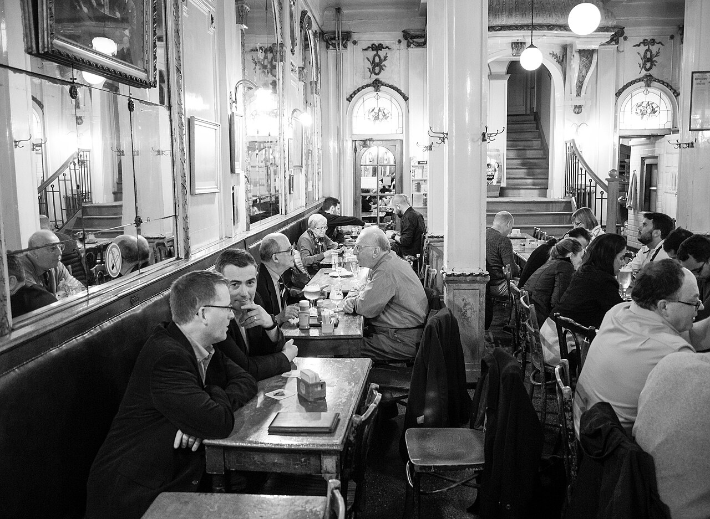

# À la Mort Subite

From Brussels’ Grand Place, walk toward the Galeries Royales Saint-Hubert and turn into a short, narrow slope. Red neon letters reading “A la Mort Subite” light up on an old façade. By day, rattan chairs and small white tables sit outside; at night, warm light comes through the tall windows and the arched mirrors draw the room deep. It is not a bar that turns “retro” into stage design: it is a Brussels café that has kept its 1920s wood, brass, mirrors and noise.

Figure: Inside À la Mort Subite: wood panelling, mirrors, long tables and the crowded atmosphere of an old Brussels café. Image: kishjar?, CC BY 2.0, via Wikimedia Commons ([source page](https://commons.wikimedia.org/wiki/File:A_La_Mort_Subite.jpg)).

## Location and history

The name means “sudden death,” and it comes from a card table, not a murder. The official history explains: around 1910, Théophile Vossen operated “La Cour Royale” at the corner of Rue d’Assaut and Rue de la Montagne. Many regulars were clerks, brokers and cashiers from the National Bank. Counter space was limited, so they preferred to wait with friends over a glass rather than queue. Rounds were won or lost at a game called pitjesbak, which became the dice game 421. The loser was called “the dead”; when time was short, they played a final decisive round, the “der des der,” settled in one throw—the “mort subite.” The nickname spread among regulars, Vossen renamed the establishment “A la Mort Subite,” and then gave the name to his gueuze.

At the end of 1928 Vossen moved a few steps away, to the present No. 7 Rue Montagne-aux-Herbes Potagères. The official history says René and Jean-Pierre Vossen continued their grandfather’s tradition for 36 years; today the fourth generation, Bernard and Olivier Vossen, stand behind the bar. One common confusion needs clearing: the café, the beer name and the brewery are three different things. The café does not brew; the beers sold under the Mort Subite name—gueuze, kriek, faro and others—are produced by a partner brewery, while the café is the most famous source of the name.

## Architecture and space

The present building dates from 1902 and was designed by Joseph François Piscador. In 1910, Paul Hamesse and F. Seeldraeyers converted it into a café-restaurant in the neo-Louis XVI style. Around Us summarises it as “high ceilings, Louis XVI decoration, long rows of tables and arched mirrors”; the official homepage stresses its position next to the Galeries Royales Saint-Hubert, opposite the gallery entrance. On 17 September 1998 the building was listed as protected heritage, which helped preserve both façade and interior.

Inside, a narrow entrance opens into a long, deep hall. Arched mirrors on both sides repeat the columns and globe lamps, making the room look longer than it is; brass pipes run along the skirting, and old posters, photographs and beer signs fill the gaps. Tables have pale wood tops, chairs are bentwood and rattan, and a dark bench runs along the wall. By day the tall windows create broad natural light; at night the white globe pendants and mirrors glow together, and the room looks like a corridor stretched by light. It suits sitting and drinking slowly, not a quick standing stop.

## The drinks

The focus is Brussels and the lambic family. The Mort Subite range usually includes gueuze, kriek, faro and witbier: gueuze blends old and young lambic and re-ferments, giving acidity, dryness, citrus and grain; kriek adds cherries, with sour fruit and almond-stone notes; faro adds sugar for a rounder, sweeter profile; witbier brings orange peel and coriander over a light wheat base. The café also stocks other Belgian beers and a few international brands, but for a first visit a glass of Mort Subite gueuze explains why the place exists.

Food is café level: cheese, salami, ham, sandwiches, rustic bread and mustard. The official homepage notes vegetarian options; portions are made for drinking, not for a full meal. For something substantial, order a cheese plate and a sandwich, or use the café as an afternoon stop and eat dinner near the Grand Place. Do not expect a hot dinner menu; the light, table spacing and noise all favour slow drinking and conversation.

## How to drink

The easiest window is 14:00–17:00. Tour groups have not yet arrived, daylight reaches the tall windows, and the mirrors and columns are clearest. After 19:00 on weekends the long tables fill with families and friends, the volume rises, and quiet conversation moves to the window or an early arrival. The café is closed on Sundays—unusual for a Brussels restaurant—so plan around it.

Order gueuze, kriek or faro directly. If you dislike acidity, start with faro or witbier. Beer usually comes in its matching glass; do not swap glasses. Cheese and sandwiches are easy to share between two. The entrance and circulation are narrow; the official site marks wheelchair access and outdoor seating, but at peak times the passage can be blocked by crowds. Photos are fine, but do not use a flash toward the mirrors and bar—reflections will wash out the picture.

## Practical information

- Address: Rue Montagne-aux-Herbes Potagères 7, 1000 Brussels (Dutch: Warmoesberg 7).
- Coordinates: 50.84861, 4.35611.
- Phone: +32 2 513 13 18.
- Hours: Monday–Saturday 11:00–00:00; closed Sunday. Both official language pages give this pattern; check on site for temporary changes.
- Transport: about eight minutes on foot from Brussels Central; metro to Gare Centrale or De Brouckère, then walk; next to the Galeries Royales Saint-Hubert.
- Reservations: small groups usually walk in; larger groups should call ahead. Sharing tables is possible at peak times.
- Payment: cash, Visa, Mastercard, debit card, Payconiq, Bancontact and meal vouchers.
- Accessibility: the official site marks wheelchair access and outdoor seating; tables are close together and help may be needed at peak times.
- Pets: check the house rule on site; do not assume all cafés welcome dogs.

## Etiquette and common misconceptions

First, do not treat this as a brewery. It is a café-restaurant; Mort Subite beer is produced by a partner brewery. To see brewing, go to a lambic brewery such as [Cantillon](ref:cantillon). Second, do not read the name as a murder story; “mort subite” is the decisive throw at a game. Third, do not judge the place after one sweet fruit beer; the acidity and dryness of gueuze are the core. Fourth, do not occupy a long table for a laptop meeting; this is a room for conversation and drinking, and only the afternoon is relatively quiet. Fifth, do not use a flash against the mirrors; the reflection turns the frame white. Sixth, do not read “1928” as the building date; the building is 1902, the café conversion 1910, and the move to this address 1928.

## Nearby and routes

Turn right for the Galeries Royales Saint-Hubert, left for the Grand Place in a few minutes. The stop fits a “Brussels beer and café” half-day: morning at [Cantillon](ref:cantillon) for lambic and gueuze production, midday back in the centre for a gueuze and cheese at À la Mort Subite, afternoon toward [De Halve Maan](ref:halve-maan) for the Bruges beer tradition, and evening again at the Grand Place. Extended to the Netherlands, [Café Hoppe](ref:hoppe) and [Café De Dokter](ref:dokter) show two scales of the Amsterdam brown café; [Prater Garten](ref:prater) is the Berlin chestnut-tree beer-garden contrast.

The Brussels section is walkable; Cantillon is about 20 minutes from the centre, or take metro to Lemonnier and walk. Do not overfill the day: the value of this café is sitting down, not photographing and leaving.

## Further reading and see also

- Official history: <https://alamortsubite.com/en/history>, for the 1910 La Cour Royale, pitjesbak/421, the decisive throw, the 1928 move and the fourth-generation Vossen family.
- Official English homepage: <https://alamortsubite.com/en/>, for the address, phone, hours, payment methods and menu structure.
- Official Dutch homepage: <https://alamortsubite.com/nl>, for the Dutch address and opening information.
- Around Us architectural entry: <https://it.aroundus.com/p/6055765-a-la-mort-subite>, for the 1902 Piscador building, the 1910 Hamesse conversion, the 1998 listing and the neo-Louis XVI style.
- Same-city and cross-city entries: [Cantillon](ref:cantillon), [De Halve Maan](ref:halve-maan), [Café Hoppe](ref:hoppe), [Café De Dokter](ref:dokter), [Prater Garten](ref:prater).
