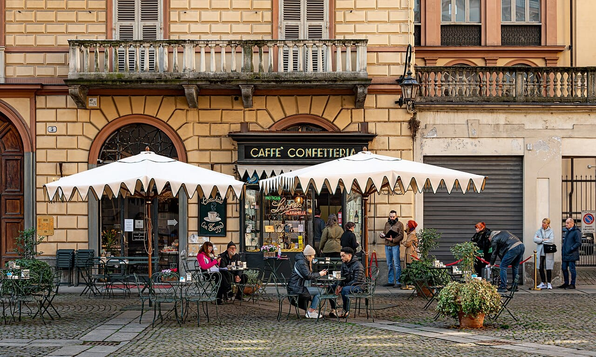

# Al Bicerin

In a corner of Piazza della Consolata, away from the grand arcades of central Turin, a small café has been serving a hot, layered drink for more than two centuries. The shop is narrow, the counter is wooden, the tables are small, and the clientele includes people who have been coming for decades alongside visitors who have read about the drink in a guidebook. Al Bicerin is not a large café and does not try to be one. Its identity is the bicerin, a drink of coffee, drinking chocolate and cream that is served in a glass and drunk without stirring.

Figure: The storefront of Al Bicerin on Piazza della Consolata in Turin; Giuseppe Dentis opened the café in 1763, and in 1856 it moved into the building designed by Carlo Promis, which is the building shown here. Image: Jorge Franganillo, CC BY 2.0, via Wikimedia Commons ([source page](https://commons.wikimedia.org/wiki/File:Torino_Caff%C3%A8_Al_Bicerin_(52738271224).jpg)).

## Location and history

Al Bicerin was founded in 1763 by Giuseppe Dentis, in a building near the Sanctuary of the Consolata. The café's name comes from the drink, not the other way round: “bicerin” means “little glass” in Piedmontese, and the drink was originally a working-class mixture of coffee, chocolate and cream. In 1856 the café moved into the present building, designed by the architect Carlo Promis, which gave it the facade and the interior it still occupies.

The drink's origin is usually told as a evolution from the bavareisa, an older Piedmontese mixture of coffee, chocolate, cream and sugar. The bicerin took the same ingredients and changed the proportions and the serving method: coffee at the bottom, chocolate in the middle, cream on top, in a small glass. The result is not a mocha and not a hot chocolate; it is a layered drink in which the three elements are tasted separately and then together.

There are three common variations. “Pur e fiur” (“pure and cream”) is the classic with all three layers; “pur e barba” (“pure and beard”) is without the cream, for those who want the coffee and chocolate only; “‘n poc ‘d tut” (“a little of everything”) is a smaller, mixed version. The names are Piedmontese, and the café uses them on its menu. The traditional price in the 19th century was three soldi, a sum that appears in accounts of the café's early days; according to the café's own history, the price stayed at three soldi (15 centesimi) for a long period and rose to 20 centesimi only in 1913. Today's prices are higher, as expected.

The café's social history is tied to the Consolata sanctuary. After Mass, and especially after receiving Communion, worshippers would come for a bicerin; the drink was both a treat and a way to warm up. The café also served as a meeting place for the neighborhood, and the small rooms encouraged conversation. It is not a political café like Caffè San Carlo, and it does not have the same aristocratic clientele; its identity is more local and more religious.

## Space and drinks

The café is small: a counter, a few tables, a back room and a staircase. The decor is old-fashioned, with wood, mirrors, marble and a few framed documents. The seating is limited, so at busy times there is a line outside. The kitchen prepares the chocolate and the cream in-house; the bicerin is assembled to order.

The menu is short: bicerin in its variations, coffee, tea, hot chocolate, pastries, sandwiches and a few simple dishes. The bicerin is the reason to come. It is served in a small glass, with the layers visible; do not stir it. A spoon may be provided, but the correct method is to drink through the cream, letting the coffee and chocolate come up together. The drink is sweet and rich; one is enough for most people.

## How to drink

Order a “pur e fiur” for the full experience, or a “pur e barba” if you want less cream. Drink it slowly; the glass is small and the drink is hot. Do not stir unless the layers have collapsed, and do not ask for ice. The café is a place to sit, not to rush; the tables are small and the staff do not turn them quickly, but the line outside means a long stay is not encouraged at peak times.

Morning and early afternoon are the best times. After Mass on Sunday the café can be busy; weekdays are quieter. The café is closed on Wednesday, so plan around it. In summer the door is open and the square is lively; in winter the drink is more welcome.

## Practical information

The address is Piazza della Consolata 5, 10122 Turin. The café is a short walk from the Porta Susa station and the Consolata sanctuary; buses stop nearby. Official hours are daily 09:00–19:15, with Wednesday closure; the café also closes for Christmas, a winter break and a summer break, so check the site before a special trip.

The café accepts cash and cards. Reservations are not taken; seating is first come, first served. The space is tight and not fully accessible for wheelchairs; ask staff about the entrance and the back room. Dress is casual. Tipping is not obligatory; rounding up or leaving 5%–10% is enough. The café does not allow smoking inside.

## Etiquette and common misconceptions

The first misconception is that the bicerin was invented at Al Bicerin. The drink evolved from the bavareisa and was served in other Turin cafés; Al Bicerin is its best-known home, not necessarily its single place of origin. The second is stirring the drink; the layers are the point. The third is ordering a large bicerin; the small glass is the standard, and a larger version changes the balance. The fourth is expecting a full restaurant; the menu is short and the café is small. The fifth is visiting on Wednesday without checking; the closure is regular.

## Nearby and routes

The Consolata sanctuary is next door, and the surrounding streets are part of the old working-class Turin. Al Bicerin fits a Turin café route with [Caffè San Carlo](ref:san-carlo) on the grand square; for the wider Italian and European comparison, read [Antico Caffè Greco](ref:greco) in Rome, [Caffè Florian](ref:florian) in Venice, [Café Sperl](ref:sperl) in Vienna and the [Vienna coffee-house evening route](ref:vienna). The project's culture articles discuss how cafés became civic institutions.

## Further reading and see also

- [Caffè San Carlo](ref:san-carlo)
- [Antico Caffè Greco](ref:greco)
- [Caffè Florian](ref:florian)
- [Café Sperl](ref:sperl)
- [Vienna Coffee-House Evening Route](ref:vienna)

Al Bicerin is best approached through the address, then the current opening status, and then what the place is known for. One check alone will not settle it.

Read [Caffè San Carlo](ref:san-carlo) for the address and space side of Al Bicerin, and [Caffè Florian](ref:florian) for the operating status side. Together they locate it.

**At a glance:** A café on Piazza della Consolata in Turin since 1763, Al Bicerin is the best-known home of the bicerin, a layered drink of coffee, chocolate and cream; the café is small, old-fashioned and still run as a daily neighborhood business.

Checked on 2026-11-21: the address at Piazza della Consolata 5 and the Wednesday closure were confirmed on the café's official site. The layered bicerin and the claims that the café is the oldest or the inventor are qualified in the body. This is the Turin café entry in the Hejiu atlas; the Chinese and English versions are aligned, and image credits and licences are given in the captions.
