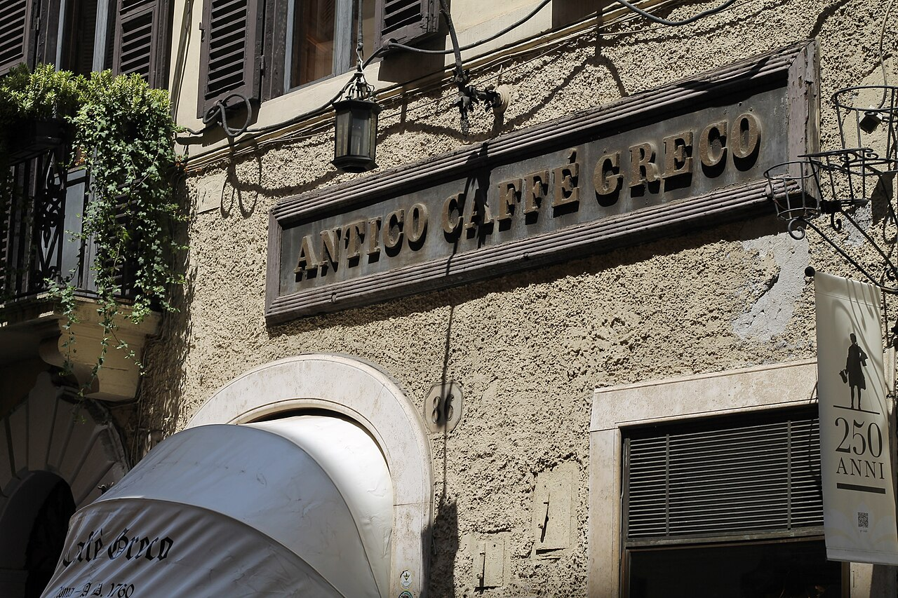
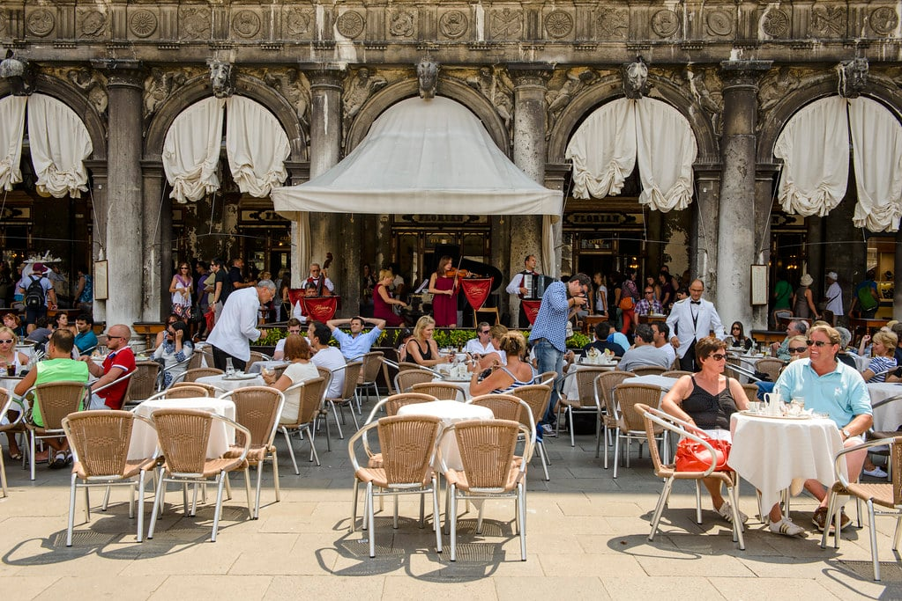

# Antico Caffè Greco

Via dei Condotti is one of Rome's most shop-window-like streets: luxury stores light the stone facades, and visitors stream from the Spanish Steps toward Via del Corso. Number 86 is easy to miss, with its wooden door, old sign and low ground floor. This is the Antico Caffè Greco, opened in 1760 and long described as Rome's oldest café. On 8 October 2025 it was formally evicted after a long lease dispute, ending 265 years of continuous trading.

Figure: Antico Caffè Greco on Via dei Condotti, Rome. Image: Elisabetta Stringhi from Italia, CC BY 2.0, via Wikimedia Commons ([source page](https://commons.wikimedia.org/wiki/File:Antico_caff%C3%A9_greco_(14869700159).jpg)).

> **Quick verdict**
> **In one line:** This entry helps you decide whether Antico Caffè Greco deserves a detour, and what to check before visiting.
>
> - **Best for:** Anyone planning a visit to Antico Caffè Greco who needs to decide whether it deserves a half-day or a full day.
> - **Not for:** If you want only want a must-visit list and will not check booking, transport or opening hours.
> - **Check first:**
>   - The name comes from its founder.
>   - As of 20 November 2026, the café has not reopened.

## Setting and history

The name comes from its founder. In 1760 Nicola della Maddalena, a member of Rome's Greek community, opened the café at 86 Via dei Condotti. The area was then a meeting ground for foreign artists, travellers and diplomats. The Italian national tourist board calls it Italy's second-oldest café, after Caffè Florian in Venice. That ranking matters: it confirms both the café's age and the fact that "Rome's oldest" is not the same as "Italy's oldest".

In the eighteenth and nineteenth centuries Rome was the end point of the European Grand Tour, and the café near the Spanish Steps became a base for writers, painters and musicians. Goethe, Byron, Stendhal, Heine, Liszt, Wagner, Gogol, Andersen, Ibsen and Joyce are among the names associated with it. A long guest list does not mean every person treated the room as a study, but it does show that the café served as a reception room for foreigners in Rome: letters were posted, newspapers read, news exchanged and work discussed at its tables. The claim that Gogol wrote parts of Dead Souls here is widely repeated in Russian-language accounts and in the café's own narrative. It is reasonable as literary background; it is not necessary to believe that a particular chapter was finished at a particular table.

The interior played a part in the reputation. The Sala Rossa and the Sala Omnibus are the two rooms most often mentioned. The latter is long and narrow, like a railway carriage, and its name reflects that shape. Paintings, drawings, prints and memorabilia hang densely on the walls, more than 300 items in all, which led to the description of the café as one of the largest private galleries open to the public. The phrase is rhetorical, but the fact behind it is clear: this was not merely a café with coffee and mirrors, but a salon that compressed nineteenth-century Roman art circles into a few rooms.

## The rooms and the menu

The café sold coffee first, but in Rome the price of coffee is tied to how you sit. Standing at the bar for an espresso is the local everyday habit; sitting at a table and being served costs noticeably more, because the seat, the space and the service are part of the bill. At an address like Via dei Condotti, the Greco was historically an expensive café. The premium came from the location and the history rather than from the beans. Expecting "the best coffee in Rome" leads to disappointment; treating it as "ten minutes inside a piece of history" is more accurate.

The coffee list followed the Roman system: espresso, macchiato, cappuccino, latte and moka, alongside hot chocolate and pastries. Italians rarely order cappuccino after midday. The rule is often relaxed in tourist areas, but in an old café the waiter still notices. Roman hot chocolate is usually thicker than coffee; in winter a cup with a flaky pastry is closer to local practice than a large dessert.

Food was never the main event. The café historically served coffee, chocolate, pastries and light meals, with a limited choice of full dishes. People came to sit, look and talk, not to have a complete dinner. The walls were the real collection: nineteenth-century paintings by Italian and foreign artists, historical photographs, dedications, old furniture and mirrors. These were not a later "vintage" set. By the time of the closure in 2025, however, the art had been removed and taken under the protection of Italy's Culture Ministry, so the original display cannot be seen from the street today.

## A first visit

As of 20 November 2026, the café has not reopened. Its official website is still online, but there is no announcement of a new opening or of reservations being accepted. The building is not a museum that can be visited on request. A first visit therefore means looking at the exterior at 86 Via dei Condotti, reading the historical markers, and then walking on to the Spanish Steps and Via del Babuino to understand the café within its neighbourhood. Do not push the door, tap on the window or ask neighbouring shopkeepers when it will reopen; the timetable depends on the owner and a future tenant, and nearby businesses may not know.

If it does reopen, the ordering logic should follow the Roman café model: first decide whether to stand or sit. In a hurry, stand at the bar, order an espresso or macchiato and leave. To experience the room, sit down, accept the table price, order a coffee and a small pastry, and take time to look at the walls. For something hot and sweet, order hot chocolate; for something sharp, an iced espresso or sparkling water. Do not arrive with a complicated "must-order" list. Roman café menus are short, and waiters rarely enjoy being asked which item is "most authentic".

Visiting a historic building and using a café are two different things. The building is protected, but "the building is there" does not mean "the café is trading". Likewise, the collection being taken over by the Culture Ministry does not mean it will be displayed in the same room again. Keep "see the building", "see the collection" and "drink coffee" as separate plans, and one closed element will not ruin the day.

## Practical information

**Address**: Via dei Condotti 86, 00187 Roma RM, Italy. The door is on the southern side of Via dei Condotti, near the Spanish Steps and Via del Babuino. Looking for number 86 is more reliable than looking for a "Greco" sign, because the facade is small and easily obscured when the street is busy.

**Transport**: Metro line A to Spagna, then about 2 minutes on foot along Via dei Condotti. From Piazza del Popolo, walk along Via del Corso. Via dei Condotti is pedestrianised, so cars cannot stop at the door; the nearest taxi ranks are around Piazza di Spagna and Via del Babuino. The stone paving is slippery in rain, so thin soles are a bad choice.

**Operating status (important)**: `operating_status` is `closed`. On 8 October 2025 the owner, the Israelite Hospital of Rome (Ospedale Israelitico), recovered the property after a long lease dispute and evicted the café. Reports say the paintings, sculptures and memorabilia were removed in September and then seized and protected by the Italian Culture Ministry, while the owner plans to find a new tenant. As of 20 November 2026 there is no official reopening date. Any claim that it is "open tomorrow" or "already reopened" should be checked against the official site or a Culture Ministry statement.

**Tickets and reservations**: There is no ticket because there is no public opening. If a new tenant reopens the site, reservation rules and any minimum charge will be the new operator's decision; do not reuse the old café's booking arrangements. The exterior can be viewed from the public street, but do not block the doorway or the neighbouring shops while taking photographs.

**Cost**: Historical accounts describe the Greco as more expensive than an ordinary Roman café, with different prices for standing and sitting. Exact figures change by year, so old guidebook prices should not be treated as current. Cafés along Via dei Condotti and Piazza di Spagna are generally expensive; for a lower bill, walk north toward Piazza del Popolo or south toward the smaller places around the Pantheon.

Page verified 20 November 2026; opening status, visiting arrangements and image credits are as noted in the sources and captions.

## Etiquette and common mistakes

First, do not treat a historic site as something that is always open. The Greco has closed; the doorway is not an exhibition room, and pushing the door, peering through the window or asking to "just look inside" is inappropriate. Second, do not call it "Italy's oldest café". Caffè Florian in Venice opened in 1720, 40 years earlier. Third, do not assume the paintings are still in place. The collection was removed and protected after the 2025 closure, and any future display will depend on the new tenant and the authorities.

There are three more common mistakes. One is treating prices on Via dei Condotti as "normal Roman prices"; this is a luxury shopping street with high rents and table charges, and side streets are cheaper. Another is reading the guest list as a list of regulars; some names were habitual customers, others visited once, and the two are not the same. The third is confusing "closed" with "demolished". The building and the historic site remain, and the owner has said it intends to find a new tenant, so "suspended, awaiting a new operator" is more accurate than "gone forever".

The café is not worth a special detour if you have only half a day, are travelling with small children or heavy luggage, or need a seat and a toilet; there is nowhere to sit at the door. It works better as a five- to ten-minute stop between the Spanish Steps and Via dei Condotti, before leaving the rest of the day to cafés that are still trading.

## Nearby and routes

From the Spanish Steps, walk east along Via dei Condotti; number 86 is on your right. Continue to Via del Corso, with Piazza del Popolo to the north and Piazza Venezia to the south. The Greco fits into a "Spanish Steps–Via dei Condotti–Piazza del Popolo" walk of about 20 minutes, with no need for a taxi. To compare a historic café that is still open, go to Sant'Eustachio near the Pantheon, known for coffee, or Canova Tadolini on Via del Babuino, a sculptor's studio turned café; the first is a coffee institution, the second a studio space, and neither has the Greco's "writers' salon" atmosphere.

If cafés are the theme, two or three in a day are enough. See the Greco facade in the morning, stand for a coffee at Sant'Eustachio at midday, sit at Canova Tadolini in the afternoon and return to the Spanish Steps at night. The Greco works better as a starting point than an ending point, because there is no interior experience at present; placing it first causes the least disappointment.

In rain or summer heat, crowds gather under the arcades and in shop doorways along Via dei Condotti, so allow space when photographing. Sitting or eating on the Spanish Steps is prohibited, so do not carry coffee up the steps. If there is media or fencing at the door, the lease or conservation process is still under way; do not cross the barrier.

## See also

- [Pubs and the city](ref:pub-and-city): how cafés use seating, newspapers and opening hours to organise public life.
- [Caffè Florian (Venice)](ref:florian): Italy's oldest café still trading, a useful contrast with the closed Roman site.
- [Café de Flore (Paris)](ref:cafe-de-flore): a Left Bank literary café and another version of the "famous customers" story.
- [Café Central (Vienna)](ref:cafe-central): a Viennese literary café opened in 1876, which has also passed through closure and reopening.
- [Café Hawelka (Vienna)](ref:hawelka): an artist's café known for family ownership and Buchteln.

## Related images

Image: The open-air tables of Caffè Florian under the arcades of Piazza San Marco, with the band playing in front of the white awning.. Credit: Son of Groucho, CC BY 2.0, via Wikimedia Commons ([source page](https://www.flickr.com/photo.gne?id=9755522045)). Related image for Antico Caffè Greco.
