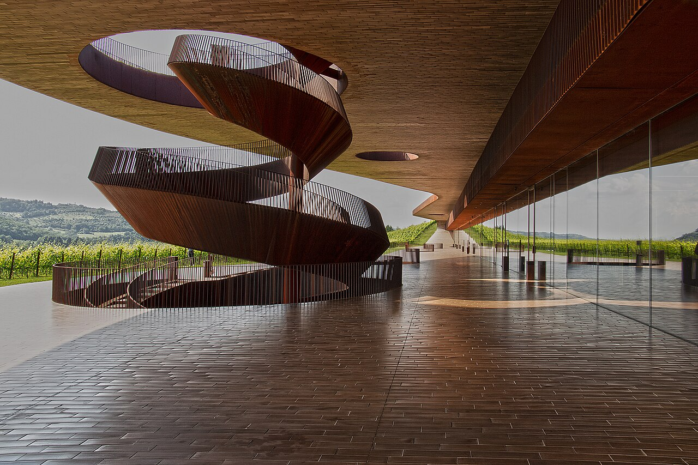
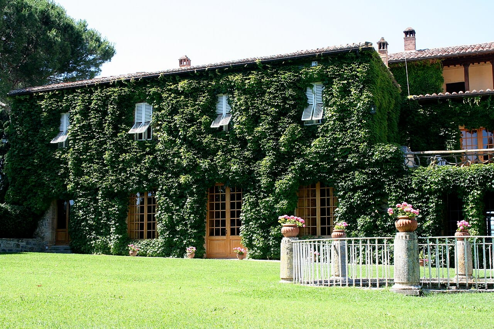

# Antinori nel Chianti Classico

South of Florence, the SS2 enters the hills of San Casciano Val di Pesa. Around Bargino, two long horizontal cuts appear between vineyards. They are not retaining walls but the visible part of Antinori nel Chianti Classico: most of the building is sunk into the slope. Visitors enter through the cuts, descend a spiral staircase and pass through fermentation, ageing and tasting spaces. It is both a working winery and the Antinori family’s reception centre in Chianti Classico.

> **Visit information**
> - Address: Via Cassia per Siena 133, Loc. Bargino, 50026 San Casciano Val di Pesa, Firenze, Italy.
> - Opening and booking: check the [official page](https://www.antinori.it/en/tenuta/estates-antinori/antinori-nel-chianti-classico-estate/) before travelling; hours, tours and booking rules change by season.
> - Getting there and cost: check the official page before booking; this entry does not promise a fixed price.
> - Status: Verified; sources checked: 2026-11-21.

Figure: The spiral staircase and geometric spaces inside Antinori nel Chianti Classico. Image: Repuli, CC BY-SA 4.0, via Wikimedia Commons ([source page](https://commons.wikimedia.org/wiki/File:Angoli_e_geometrie.jpg)).

## Location and history

The Antinori family’s link to wine goes back to 1385, when Giovanni di Piero Antinori joined the Florentine wine merchants’ guild. The family calls this 2012 building the first new production and reception facility built for wine lovers in twenty-six generations. It is not an old house converted into a visitor centre; the brief was to make winemaking visible.

The winery opened in October 2012, designed by Archea Associati with Marco Casamonti as lead architect. In 2022 it was ranked first in the World’s Best Vineyards list, voted by hundreds of wine and travel experts. That is an award for the wine-tourism destination, not a wine-quality ranking. Treat it as a reference for architecture and visit experience, not as proof of which wine is “best”.

## Architecture and spaces

The most striking features are the two horizontal cuts and the roof terrace. The building uses local materials and tries to reduce its impact on the Tuscan landscape; from a distance it almost disappears into the slope, leaving only the cuts, terrace and light wells. The rooftop houses Rinuccio 1180, facing the vines; inside, gravity moves wine between stages and reduces mechanical handling.

The spatial organisation deserves attention. Visitors enter at ground level, see reception and the shop, then descend the spiral staircase to the cellar levels. Fermentation, ageing and tasting sit at different heights, so wine flows by gravity. The house calls this “gravity-flow winemaking” and argues that it also meets the temperature, humidity and hygiene needs of production. The spiral stair and suspended tasting room are the memories most people keep: the stair connects three levels, the tasting room hangs between fermentation and ageing, with the cellar behind glass.

Art is another thread. The Antinori family has long supported art, and after the winery opened it started the Antinori Art Project, placing contemporary exhibitions and site-specific works in the building and courtyard. If an exhibition is on, it is not decoration: the works are part of how the winery is meant to be seen, alongside labels and cellars.

## The wines and palate

The clearest tasting order follows the three Chianti Classico levels: village, Riserva and more advanced family wines. Pèppoli is the village Chianti Classico, bright and fruit-forward, a good first glass. Villa Antinori Chianti Classico Riserva is the Riserva, aged longer, more complete, with dark cherry, spice and leather. Vinsanto del Chianti Classico is the sweet wine, made from dried grapes, a small glass at the end.

The rules matter. Chianti Classico DOCG requires at least 80% Sangiovese, with permitted red grapes making up the rest; village wine ages at least 12 months, Riserva at least 24 months with three in bottle; Gran Selezione requires at least 90% Sangiovese, estate fruit only, and at least 30 months with three in bottle. Riserva is not a “sweeter reserve” but a higher tier of ageing and alcohol; Gran Selezione, created in 2014, is the top of the pyramid.

At Antinori, Tignanello and Solaia come from other estates, not from this winery’s vineyards; the shop may sell family wines from elsewhere, but “bought here” does not mean “made here”. Chianti Classico is also only one of the family’s many regions; treating it as the whole family misses the rest.

## How to drink

Serve reds at 16–18°C. Pèppoli is ready on opening; Villa Antinori Riserva needs 30–60 minutes; more advanced wines such as Tignanello can take one to two hours. Use a medium-sized red-wine glass and fill no higher than the widest part. Serve Vinsanto at 8–10°C in a small sweet-wine glass, 50–70 ml at a time.

Pair Pèppoli with tomato pasta, roast vegetables and pizza; Villa Antinori Riserva with roast meat, beef stew and hard cheese; Vinsanto with almond biscotti, dried fruit and blue cheese. Avoid very hot dishes; Sangiovese acidity and cherry perfume need fat and salt.

## Practical information

Address: Via Cassia per Siena 133, Loc. Bargino, 50026 San Casciano Val di Pesa, Firenze. Hours are seasonal: April to October daily 10:00–18:30; November to March Monday to Friday 10:00–17:30, Saturday and Sunday 10:00–18:00. The shop follows the winery, with last entry one hour before closing. Rinuccio 1180 serves lunch on open days, usually 12:00–16:00, booked separately.

Driving is easiest. From Florence, take the SS2 or Chiantigiana for about 20 km, roughly half an hour; from Siena about an hour. There is public parking opposite the entrance, and reception is about 200 metres away. Public transport is sparse; without a car, book a taxi or a winery tour with transfer, and confirm the return car in the evening.

## Etiquette and common misreadings

The winery is a production site, not a theme park. Do not enter the production area without a booking, and do not touch fermentation tanks, barrels, pipes or exhibits; floors can be wet, so wear grippy shoes. Silence your phone on tour, do not use flash and do not block the route; the cellars are cold, so bring a layer even in summer.

Smell before tasting, sip slowly and spit if you do not want to finish; avoid strong perfume, which interferes with others’ perception of Sangiovese. Families should check age limits and tickets; the restaurant and shop can be visited separately, but production requires a guide. If a wedding, exhibition or private event closes part of the site, check the official notice before leaving.

## Around and routes

Link the [Chianti Classico route](ref:route): north to Florence, south through Greve and Radda to [Castello di Brolio](ref:brolio) at Gaiole, or on to [Fattoria Felsina](ref:felsina) at Castelnuovo Berardenga. Half a day is enough for the winery and lunch; if linking three estates in one day, separate tasting from driving with a hired car.

To compare a “building-driven” and a “traditional” Tuscan winery, add [Biondi-Santi](ref:biondi) at Greppo: one is a 2012 contemporary building, the other a nineteenth-century cellar, and the stories are completely different. Open the [Tuscany](ref:tuscany) map and separate Florence, Siena and Montalcino before planning.

## Further reading and see also

- Tuscan comparisons: [Biondi-Santi](ref:biondi), [Castello di Brolio](ref:brolio), [Fattoria Felsina](ref:felsina), [Chianti Classico route](ref:route).
- Background: [Tuscany](ref:tuscany).
- This entry provides no map; opening hours, tours and restaurant information should be checked with official channels.

For Antinori nel Chianti Classico, begin with the address. Then look at the current opening status, and finally ask what the place is known for. The answers point to different choices, not to a single score.

## Related images

Image: The vine-covered villa at the Biondi-Santi Greppo estate. Credit: Megan Cole from Vancouver, Canada, CC BY 2.0, via Wikimedia Commons ([source page](https://commons.wikimedia.org/wiki/File:Brunello_di_Montalcino,_Italy_(5874133867).jpg)). Related image for Antinori nel Chianti Classico.
