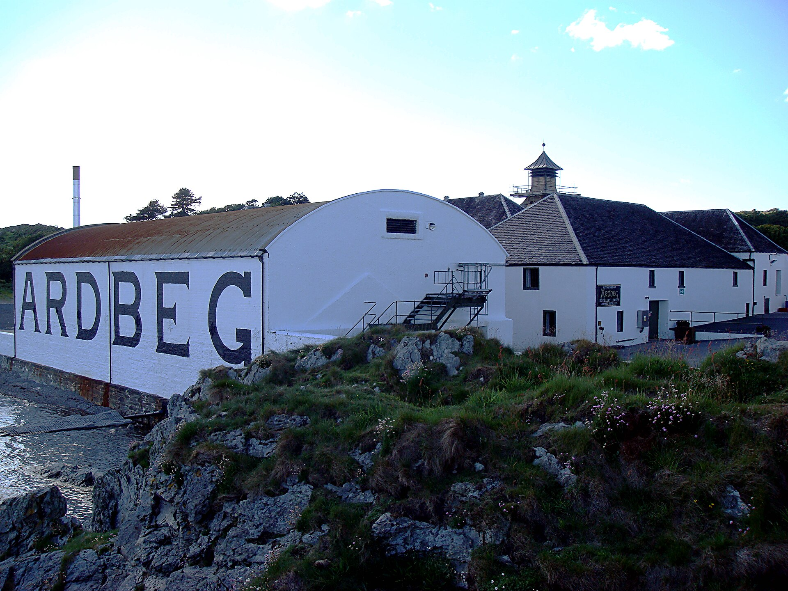

# Ardbeg Distillery

Ardbeg Distillery stands on the south coast of Islay at Port Ellen, Isle of Islay, Argyll, PA42 7EA. It is not in the centre of Port Ellen but on a side road toward the coast; turn off the main road and the first thing you see is a group of low buildings, warehouses and the visitor centre, with sea wind and grass beyond. Ardbeg is known for a heavily peated single malt with smoke, salt and maritime notes, but "the most heavily peated" is a brand and reviewer's phrase, not a regulation that can be measured in every bottle. What rewards attention during a visit is how malt, peat, distillation and maturation are combined into a consistent style.

> **Visit information**
> - Address: Ardbeg Distillery, Port Ellen, Isle of Islay, Argyll, PA42 7EA, Scotland.
> - Opening and booking: check the [official page](https://www.ardbeg.com/) before travelling; hours, tours and booking rules change by season.
> - Getting there and cost: check the official page before booking; this entry does not promise a fixed price.
> - Status: Verified; sources checked: 2026-11-08.

Figure: Related photograph of Ardbeg Distillery. Image: Rappilio, CC BY-SA 3.0, via Wikimedia Commons ([source page](https://commons.wikimedia.org/wiki/File:Ardbeg_whiskybrennerei_islay_schottland_16.06.2007.JPG)).

> **Quick verdict**
> **In one line:** This entry helps you decide whether Ardbeg Distillery deserves a detour, and what to check before visiting.
>
> - **Best for:** Anyone planning a visit to Ardbeg Distillery who needs to decide whether it deserves a half-day or a full day.
> - **Not for:** If you want only want a must-visit list and will not check booking, transport or opening hours.
> - **Check first:**
>   - In 1815 John MacDougall took out a licence and established Ardbeg as a legal commercial distillery; the official history treats that year as the foundation.
>   - Visits are mainly by reservation, and the distillery advises booking tours or tastings online in advance, especially in high season.

## Place and history

In 1815 John MacDougall took out a licence and established Ardbeg as a legal commercial distillery; the official history treats that year as the foundation. Whether illicit distilling took place on the site earlier is often repeated in brand stories, but no public primary record confirms a specific date, so it is better treated as legend than fact. In 1838 the Glasgow spirit merchant Thomas Buchanan bought the distillery for 1800 pounds, and John's son Alexander MacDougall continued to manage it. After Alexander died in 1853, ownership changed again.

In the later twentieth century Ardbeg went through a difficult period: production stopped in 1981, restarted in 1989, and the distillery was acquired by the Glenmorangie Company in 1997, which became part of LVMH in 2004. The visitor centre and Old Kiln Cafe opened in 1998, and the distillery began receiving visitors systematically. Today it is both a production site and a major stop on Islay's whisky route. Ardbeg also operates Ardbeg House in Port Ellen, but accommodation and distillery visits are separate booking systems.

## Spaces and the list

The tour follows the path from barley to spirit: malting (Ardbeg uses malt from the Port Ellen maltings), mashing, fermentation, distillation, condensation and maturation. Ardbeg's peat character comes from peat smoke used when drying the malt, not from adding smoke to the liquid; fermentation time, still shape and condensation affect the final style. On site you can see the mash tun and stills, and warehouses full of oak casks. The coastal location keeps the warehouses humid and exposed to sea wind, and the house often explains the salt and mineral notes in the matured spirit as part of that island environment.

Core expressions include Ardbeg Ten, Uigeadail, Corryvreckan, An Oa and Wee Beastie. Ten is the benchmark and a sensible first Ardbeg; Uigeadail and Corryvreckan are heavier and more complex, often with sherry-cask or high-peat character; An Oa is softer, while Wee Beastie is young and direct. The visitor centre offers drams, DIY tastings and cocktails; the Old Kiln Cafe serves food; the Ardstream trailer provides simple food in high season. They belong to the [Scotch whisky](ref:scotch-whisky) tradition and to the wider world of [whisky](ref:whisky), but Ardbeg sits at the heavily peated end of southern Islay.

## How to visit or order

Visits are mainly by reservation, and the distillery advises booking tours or tastings online in advance, especially in high season. A standard tour usually goes from the mash and still house to the warehouses and explains Ardbeg's process and history, lasting about 1 hour 15 minutes; winter products such as the "Classic Winter Tour" change with the year. The visitor centre itself can be entered without a tour and offers drams, DIY tastings and merchandise; if you only want a drink, you can go directly to the centre, but check whether a group is using the space that day.

For a first visit, choose a tour that includes the production areas and warehouses rather than only a dram in the visitor centre. Half of Ardbeg's value is in the equipment and spaces: the size of the mash tun, the shape of the stills, the humidity and sea wind in the warehouses cannot be read from a label. If you have only an hour, take the shortest classic tour; if the difference between peat and sherry casks interests you, choose a tasting with more expressions. Before a tour, avoid strong perfume or heavily scented hand cream, which interferes with your own and other people's sense of smell.

## Practical information

The address is Ardbeg Distillery, Port Ellen, Isle of Islay, Argyll, PA42 7EA, Scotland. There are usually two ways to reach Islay: take the Caledonian MacBrayne ferry from Kennacraig on the mainland to Port Ellen or Port Askaig, a crossing of about 2 hours with normally 3 sailings a day and fewer on Wednesdays and Sundays; or fly with Loganair from Glasgow to Islay, about 30 minutes, with roughly two flights a day. On the island you need a car, a taxi or a local bus; the distilleries are not close together and public transport is limited.

Visitor-centre hours change with the season: in 2026 it is open daily 09:30–17:00 from May to September; April, October and November to April 2027 are Monday to Friday 09:30–17:00. The silent season runs from 15 June to 12 July 2026, when classic tours pause but other tastings continue. The official additional closed dates include 31 May, 13 August and 15 August 2026; the distillery closes from 22 December 2026 to 4 January 2027 and reopens on 5 January, with the last tour on 18 December 2026. Schedules, silent periods and temporary closures change, so check the official site on the day.

Tickets and booking: the Classic Distillery Experience in 2026 costs £22.50 per person, lasts about 1 hour 15 minutes and includes three 15ml core-range drams; booking is essential, and online bookings close 12 hours before the start. Higher-priced options include a limited-edition tour at about £40 and warehouse tastings at about £65, with the range roughly £22.50–£70. Under-18s may join the classic tour but cannot drink; non-drinkers can ask for drivers' drams to take away. The visitor centre itself is free to enter, with drams and DIY tastings. Islay weather changes quickly, with strong wind and rain, so a windproof and waterproof jacket and non-slip shoes are more useful than formal clothes; some old distillery buildings are not fully accessible, and visitors with limited mobility should ask when booking. Opening status, prices and bookings are subject to official confirmation. This entry was verified on 2026-11-08.

## Etiquette and common mistakes

The first mistake is to treat "heavily peated" as "the more expensive, the better." Peat intensity is a style choice, not a quality grade; some drinkers prefer the weight of Uigeadail, while others are better served by Ten or An Oa. The second mistake is to imagine Ardbeg is within walking distance inside Port Ellen. It is outside the town, the walk takes time and the road has no pavement; without a car, arrange a taxi or bus in advance rather than trying to flag one down.

The third mistake is to photograph without listening. The production areas involve heat, steam and moving equipment, and visitors must stay with the guide, not cross yellow lines or touch valves. The fourth is to treat a tasting as a test of how much you can drink. Whisky is strong: smell first, add a little water, then sip; if you do not want to finish, leave it in the glass or use the spittoon. If you are driving, do not drink at all; Islay roads are narrow and the weather changes fast, and drink-driving is a serious risk.

Dogs may enter the shop but not the tours, tasting areas or the Old Kiln Cafe; this is an explicit house rule. Families should check whether a tour suits children, because the production areas are noisy and hot and not made for running. During Fèis Ìle, the Islay whisky festival, accommodation and transport on the island are extremely tight and distillery events need long-term planning; travellers who want a quiet visit should avoid the festival week.

## Around and routes

Ardbeg lies in the "Kildalton three" area on the south coast of Islay. Follow the A846 south to Laphroaig and Lagavulin; the three are close enough for a half-day or full-day whisky route. Beyond the distilleries, the south coast has the Kildalton Cross and coastal walks, which can be combined in good weather. Port Ellen has restaurants, shops and the ferry terminal and works well as a base. If you arrive at Port Askaig, you can see the east and north of the island first and then come around to the south, but do not make the route too tight.

For a one-day visit, leave Kennacraig or Glasgow in the morning, reach Port Ellen around midday, take the Ardbeg tour in the afternoon, visit the Laphroaig or Lagavulin visitor centre in the evening and stay on the island; a same-day return is rushed, and ferries and weather can delay you. Ardbeg belongs to the [Islay](ref:islay) region, and Islay is part of [Scotland](ref:scotland)'s whisky map; comparing Ardbeg with a Speyside or Highland distillery makes the difference between "island peat" and "inland style" easier to see. For the basic logic of distillation and maturation, see [place and process](ref:place-and-process).

## See also

- [Islay](ref:islay): peat, sea wind and the island's distilleries.
- [Scotch whisky](ref:scotch-whisky): regulations, regions and styles.
- [Whisky](ref:whisky): the basics from raw material to maturation.
- [Place and process](ref:place-and-process): terroir, distillation and ageing.
- [LVMH](ref:lvmh): the corporate group behind Ardbeg.

## Related images

Image: Category image for Islay. Credit: Ank Kumar, CC BY-SA 4.0, via Wikimedia Commons ([source page](https://commons.wikimedia.org/w/index.php?curid=98613535)). Related image for Ardbeg Distillery.
