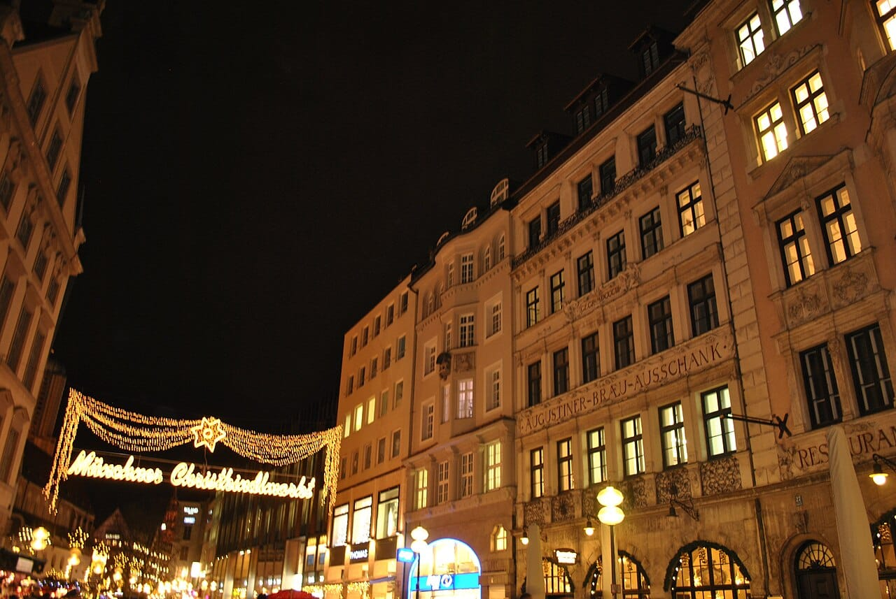

# Augustiner-Bräu

Figure: Augustiner-Bräu. Image: Elisa.rolle, CC BY-SA 4.0, via Wikimedia Commons ([source page](https://commons.wikimedia.org/wiki/File:Augustiner-Br%C3%A4u_0004.jpg)).

## Setting and history

Augustiner-Bräu's site is on the western side of Munich at Landsberger Straße 31–35, in the 80339 postcode. The brand dates its founding to 1328: the Augustinian hermits established a monastery at Haberfeld (around today's Frauenplatz) in 1294, a brewhouse appeared in the early fourteenth century, and the first documentary mention of brewing there is from 1328. Monastic brewing was not unusual in Bavaria; what makes Augustiner different is that a house brewery supplying the friars' daily needs grew into a commercial brewery for the city.

Secularisation in 1803 changed the ownership. The monastery's property was taken over by the state and the brewery passed into private hands; it has since been run by the Wagner family, and the present company is Augustiner-Bräu Wagner KG. In the late nineteenth century production was concentrated at the Landsberger Straße site, creating the industrial complex seen today. It survives largely intact but is still in use, not a heritage site frozen behind glass.

Augustiner is often called Munich's oldest surviving brewery. That claim rests on the monastic brewing lineage and continuous operation, not on a single signboard hanging since 1328. Another verifiable difference is that, since 1987, Augustiner is the only one of Munich's six breweries to serve its Oktoberfest beer exclusively from wooden barrels. That detail says more about the company's character than the word "oldest": conservative, slow and uninterested in novelty.

## The site and the beer

The Landsberger Straße complex is a production facility, not a museum. Buildings, loading areas, chimneys and offices form a working factory; only parts are accessible to visitors, and whether tours run and how to book them depends on the brewery's reply. Expect disappointment if you come for a beer museum; come for a corner of the city's industrial heritage and you will see a different Munich.

The range can be remembered as everyday, fuller, dark and seasonal. Lagerbier Hell is the workhorse: a pale lager with malt sweetness and mild bitterness, clean in body and traditionally served in a 0.5-litre glass. Edelstoff is an export hell, fuller in body with a higher original gravity and about 5.6% alcohol, for anyone wanting more structure. Dunkel is a dark lager with more toasted bread, cocoa and malt; Pils is drier and more bitter, with a crisp finish; Maximator is a dark Doppelbock at about 7.5%, a cold-weather beer. All belong to the wider families of [beer](ref:beer) and [lager](ref:lager), but the choice is about occasion and taste, not price.

For a first encounter with the brand, the most useful comparison is a Hell and an Edelstoff side by side: the first tells you what everyday Munich beer tastes like, the second what happens when the same brewery builds a fuller body. Dunkel and Maximator are better at dinner or in winter; drunk on an empty stomach they tire quickly.

## How and where to drink it

The site itself has no regular public bar for walk-in guests, so drinking the brand usually means one of its associated restaurants. Braustuben is at the brewery end of Landsberger Straße and is the closest option for a meal after looking at the outside of the site; Augustiner-Keller at Arnulfstraße 52 is the large beer-garden operation, best in summer; Augustiner am Platzl in the city centre is the easier option for visitors. Opening hours, menus and reservation policies differ at each, so check each official page before going.

Ordering follows the Munich beer-hall pattern: state the glass size and the beer, the waiter marks it on the table card, and you settle at the end. For a first visit, a 0.5-litre Hell with a pork knuckle or Weisswurst works; add an Edelstoff to compare. Maximator is not a first glass, because 7.5 per cent alcohol rises quickly on an empty stomach. Non-drinkers can order mineral water or apple juice, which Bavarian taverns generally stock.

This is not a place for visitors expecting fixed-time guided tours, a gift shop and an immersive experience, nor for anyone who wants to walk into the brewhouse and take photographs, nor for travellers who turn up at the gate and ask for a tour. It suits people with a specific interest in brewing, family firms or the city's industrial history, and it requires some advance communication.

## Practical information

The address is Landsberger Straße 31–35, 80339 Munich (the address in the official Impressum). The nearest station is S-Bahn Donnersbergerbrücke; from there walk west along Landsberger Straße for about 8–10 minutes (roughly 650 m). U4/U5 Schwanthalerhöhe is a 12–15 minute walk. Check MVV for the day's connections, step-free access and last trains. The area is offices and industry rather than a shopping district.

**Opening and booking:** this is a working production site, not a brewery museum. The official website has no booking page for public tours, tastings or a gift shop, and a 2026 third-party guide states plainly that the Landsberger Straße plant offers no public tours. Walk-in visitors cannot ask to enter the brewhouse; business, media or trade enquiries must go through the official contact details in advance. `operating_status: verified` means only that the brewery is operating and the address is confirmed—it does not mean the site is open to visitors daily.

**Tickets:** there is no public admission ticket and no regular paid tasting. To drink Augustiner, go to Braustuben (Landsberger Straße 19, beside the plant), Augustiner-Keller (Arnulfstraße 52) or Augustiner am Platzl in the centre. Each sets its own prices; city-centre venues are usually a notch more expensive, while the beer itself is mid-range for Munich. Check each venue's official page for hours, kitchen times and reservations.

There is no dress requirement. If a permitted business visit takes you into production areas, follow the factory safety rules: no sandals, no crossing marked lines. Guests with children or pushchairs should check accessibility at the restaurant beforehand; the brewery site is not a children's playground.

Page verified 8 November 2026; opening status, prices and bookings are subject to the official channels.

## Etiquette and common mistakes

The most common misreading is to treat 1328 as a company registration year. It is the first documentary mention of the monastery brewhouse; the brand, the family firm and the modern company came later. The second is to imagine that the monastery still brews today: the original monastery was secularised long ago, and the site is not on the monastery's original ground.

The third is to assume Edelstoff is a "double-strength" beer. It is an export hell at about 5.6 per cent, slightly stronger and fuller than Hell, but not a Doppelbock. The strong beer is Maximator, and it is seasonal. The fourth is to treat "Augustiner" as one place: Munich has several restaurants using the name, with different ownership and operation, so identify the venue by its address and operator.

At the associated restaurants, the etiquette is the same as elsewhere in Munich: ask before sharing a table, look the other person in the eye when clinking, state a total including the tip when paying, and do not bring your own drinks. If you are allowed into the brewery, do not photograph production lines or workers and do not touch equipment; these are factory rules, not unfriendliness.

## Around and routes

The site is in western Munich. A short walk or one stop east brings you to Theresienwiese, the Oktoberfest ground; north-east lies the main station and the old town. A half-day route runs from the outside of the brewery to a Braustuben lunch, a walk across Theresienwiese, then into the centre to see the [Hofbräuhaus](ref:hofbrauhaus) and compare a state-owned visitor hall with a family firm's brewery restaurant.

If time is short, choose one place to drink: Braustuben for a quiet meal near the brewery, Augustiner-Keller for a beer garden, or the city-centre restaurant if you are already sightseeing. None of them is the right place to turn up and ask to see the brewhouse, so decide that in advance.

## See also

- [Beer](ref:beer): the basic classification of lagers, wheat beers and strong beers.
- [Lager](ref:lager): the technical difference between pale and dark lagers.
- [Hofbräuhaus](ref:hofbrauhaus): another famous Munich beer hall, useful as a contrast with this brewery site.
- [Why does a drink taste of a place?](ref:place-and-process): how origin, ingredients and process enter the glass.

## Related images

Image: Hefeweizen and kristallweizen, two treatments within the same wheat-beer family. Credit: Ich, Public domain, via Wikimedia Commons ([source page](https://commons.wikimedia.org/wiki/File:Hefeweizen_and_kristallweizen.jpg)). Related image for Augustiner-Bräu.
