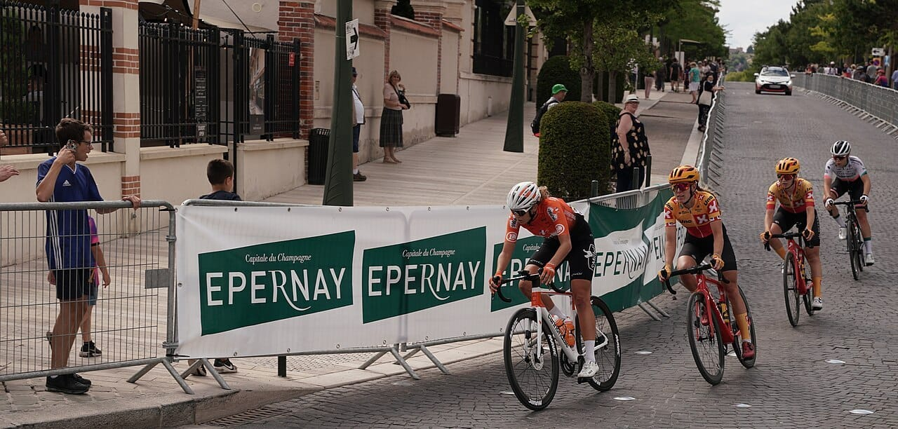

# Avenue de Champagne, Épernay

Avenue de Champagne runs south-east from the centre of Épernay for about 1.5 km. It is not a single winery but a street of champagne merchants' mansions, production buildings and cellars. In the 18th century it was part of the royal road from Paris to Germany; merchants clustered here because the chalk beneath was ideal for digging cellars. The street was renamed Avenue de Champagne in 1925, after the railway from Paris had arrived in 1849 and the champagne trade had grown into an international business.

> **Visit information**
> - Address: Avenue de Champagne, 51200 Épernay, France.
> - Opening and booking: check the [official page](https://epernay.fr/sortir-bouger/culture-patrimoine/patrimoine-a-decouvrir/lavenue-de-champagne) before travelling; hours, tours and booking rules change by season.
> - Getting there and cost: check the official page before booking; this entry does not promise a fixed price.
> - Status: Verified; sources checked: 2026-11-08.

Figure: Avenue de Champagne, Épernay. Photograph: Avenue de champagne épernay 1409027. Credit: G.Garitan, CC BY-SA 4.0, via Wikimedia Commons ([source](https://commons.wikimedia.org/w/index.php?curid=121135039)).

## Setting and history

The history of the avenue works on three levels. The first is transport: it began as a route from Paris towards Germany, and merchants used it to move goods north. The second is geology: Épernay sits on thick chalk, and cellars cut into it keep a stable temperature and humidity for long ageing. That is why the houses, warehouses and offices all gathered on the same street. The third is regulation: by 1925 the champagne appellation had established that only sparkling wine made in the region by the traditional method could be called Champagne, and the street name became part of that identity.

In 1994 the avenue was recognised as a Site Remarquable du Goût, a French label for places where architecture, culture and gastronomy meet. In 2015 it became part of the UNESCO World Heritage listing Coteaux, Maisons et Caves de Champagne, a cultural landscape that combines vineyards, merchant houses and cellars. The avenue is one of the most representative urban sections of that landscape, which is why a walk here is also a lesson in how a wine region built its public face.

## Space and wine

Both sides of the street are lined with late-19th-century mansions and production buildings. Moët & Chandon is at number 18, Perrier-Jouët's Cellier Belle Epoque at 26, the Museum of the Wine of Champagne and Regional Archaeology in the Château Perrier at 13, and the tourist office at 7. Mercier runs a small train through its cellars, whose underground galleries stretch for about 18 km. Beneath the whole avenue the city counts roughly 110 km of cellars and some 200 million bottles. What you see above ground is a row of houses; the real scale of the street is underground.

The "wine list" here is not a menu but a set of separate house experiences. Moët's classic cellar tour emphasises scale and brand history; Mercier's train is a good first look at a cellar; Perrier-Jouët combines Art Nouveau collections with tasting; Boizel's Atelier 1834, de Castellane's tower and flowers, and Pol Roger's family-house route each have a different rhythm. Prices, languages and child policies vary, so one house's rules cannot be applied to the whole street.

## Visiting and tasting

The avenue itself is a public street, free to walk, with no ticket. To go into a cellar you must join that house's visit, usually booked in advance on its own website. Some houses have a bar or shop at the entrance where you can drink a glass without a full tour, but wandering the street is not the same as seeing the cellars. For a first visit, choose one large house for scale and history and one smaller house for contrast; fitting three or four into a day turns the visit into a rush. If you only want to taste without booking, bars at the entrance end of the avenue and at some houses pour by the glass, subject to their opening hours.

When booking, check three things: the language of the tour, the meeting point and the late-arrival rule. Most cellars stop admitting visitors ten minutes before the start, and mobile reception underground is poor, so a late arrival often cannot catch up. Confirm whether tasting is included, how many glasses, and whether any are vintage champagnes. Families should ask whether minors may enter the cellars; some houses only allow them to wait in the tasting area.

## Practical information

Address: Avenue de Champagne, 51200 Épernay, France (coordinates 49.04111, 3.96972, taken at mid-avenue). The avenue is a public street, open at all hours and free to walk; there is no ticket. Entering a cellar requires joining that house's visit, normally booked on its own website or designated ticket page, and prices, duration, language and whether tasting is included vary by house.

Transport: about a five-minute walk from Épernay station (Gare d'Épernay) to the start of the avenue; direct trains from Paris Gare de l'Est take roughly 80 minutes, and the drive from Paris on the A4 takes about 90 minutes. There is public parking along the street, but it fills in high season, so parking in a town-centre car park and walking is more reliable.

Opening times and restrictions: the avenue itself has no fixed opening hours. Houses generally receive visitors from about 9:30 to 17:30, with timed entry for Moët & Chandon, Perrier-Jouët and Mercier's cellar train; some houses suspend visits during the harvest (around September), and a house under renovation may close outright, so check each official booking page before travelling. Cellars are cold even in summer, so bring a light jacket; the surface is cobbled and sloping, and sturdy shoes are more useful than formal wear.

Page checked on 2026-11-08; operating status, prices and bookings are subject to official channels.

## Etiquette and misconceptions

The first misconception is that Avenue de Champagne is one winery or one brand. It is a street, and each house runs its own visits and bookings. The second is that every door is open: many mansions and production areas are private, and a closed door without a visitor sign should be left alone. The third is that champagne is just another sparkling wine; only sparkling wine made in the Champagne region by the traditional method may carry the name. The fourth is treating tasting as a competition to drink back the ticket price. The point of a cellar visit is the underground galleries, the method and the differences between styles, not the number of glasses.

Inside a cellar, do not touch bottles or wooden racks and do not use a flash. In a tasting, look and smell before sipping, and use the spittoon if you need to. Anyone driving should not taste at all, since France has a zero-tolerance approach to drink-driving. The avenue also has residents and people going to work, so do not block doorways for photographs or call loudly to companions. Champagne bottles are heavy, so think about luggage and shipping before buying a case at the first house you visit.

## Surroundings and itineraries

Walking north-west back into the centre brings you to Épernay's town hall and church; heading south-east leads towards Chouilly and the Côte des Blancs vineyards. With more time, drive about 15 minutes north-west to Hautvillers, associated with the legend of the Benedictine monk Dom Pérignon, or continue north to Reims for another group of champagne houses and the cathedral. A comfortable day in Épernay is one cellar visit in the morning, lunch in the centre, and a walk along the avenue and through the museum in the afternoon; trying to fit in two major houses usually means spending more time in the car than in the cellars.

Walking the avenue without booking a cellar still shows the facades, courtyards and street life, but misses the most important part, which is underground. Booking a cellar without leaving time to walk misses the fact that this is a living street, not a visitor corridor. Half of each is a better balance.

## See also

Avenue de Champagne is an entry point to [champagne](ref:champagne) as a region, a brand and a ritual drink, and it pairs well with a comparison of [sparkling wine](ref:sparkling) methods; [place and process](ref:process) explains why the same technique becomes a different wine outside Champagne.

Further reading: [Champagne](ref:c-extra-1), [A Ginjinha](ref:c-extra-2).

[Champagne](ref:champagne) and [Why does a drink taste of a place?](ref:process) answer different questions about Avenue de Champagne, Épernay: address and space and operating status. Read them as a pair rather than as alternatives.
