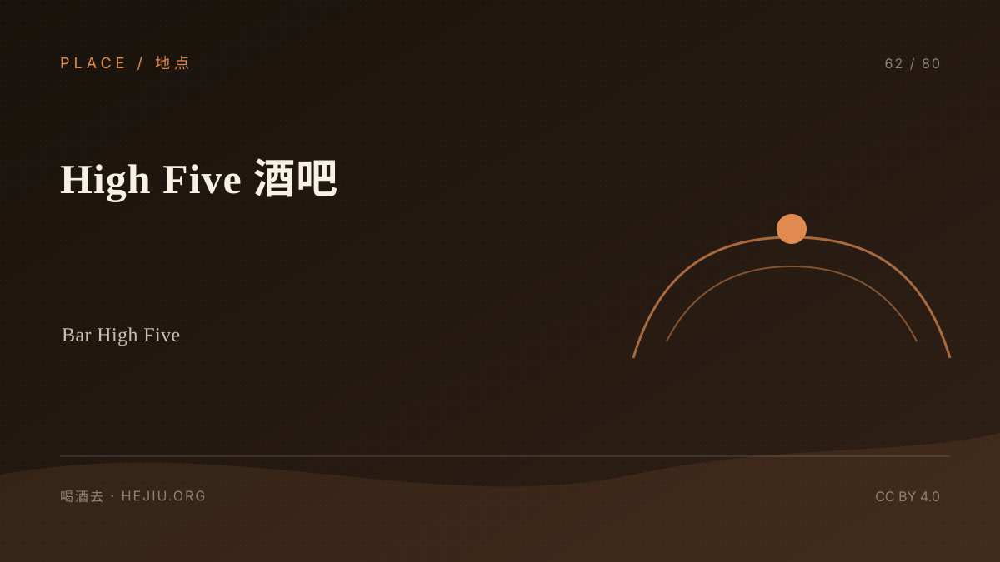

# Bar High Five

Figure: Bar High Five. Project-generated or category illustration used for bar and drinks context; not a photograph of the subject.

> **Quick verdict**
> **In one line:** This entry helps you decide whether Bar High Five deserves a detour, and what to check before visiting.
>
> - **Best for:** Anyone planning a visit to Bar High Five who needs to decide whether it deserves a half-day or a full day.
> - **Not for:** If you want only want a must-visit list and will not check booking, transport or opening hours.
> - **Check first:**
>   - Bar High Five occupies the basement of a building in Ginza 5-chome, Tokyo, with an entrance that is easy to miss and best found by address.
>   - Before you go, decide on two or three preferences: gin, whisky or rum; short or long; whether sweet, sour or bitter matters most.

## Setting and history

Bar High Five occupies the basement of a building in Ginza 5-chome, Tokyo, with an entrance that is easy to miss and best found by address. It opened in July 2008, founded by the bartender Hidetsugu Ueno; Ueno had worked at Star Bar in Ginza and trained in the Japanese classic-bar tradition. The name is not a "high-five chain": the official account explains it as the English high five, a raised-hand slap with a celebratory, informal tone.

When the bar opened in 2008, Ginza's bar ecology was already changing, with hotel bars, members' bars and small specialist bars side by side. High Five took a narrower path: a small room centred on the counter, no fixed menu, and drinks made after a conversation between bartender and guest. In June 2010 Kaori Kurakami joined and became head bartender, as the official page lists her. From May 2015 the bar stopped taking reservations and limited itself to phone checks just before arrival; from April 2020, under Tokyo's ordinance, it became fully non-smoking. These rules are on the official site, not rumours.

Its international reputation comes from the precision of Japanese bartending: hand-carved clear ice, control of dilution, attention to aroma and temperature, and a very steady execution of classics. The 50 Best entry describes it as a showcase of Ueno's ice-carving and a regular on the World's 50 Best Bars list; it ranked No. 18 in the world in 2019 and No. 45 in Asia in 2023. Rankings change, but the small counter, slow service and no-menu format have not.

## The room and the list

The room is small, mainly counter seating with a few tables; the lighting is low and the volume kept down, so the rhythm is "sit down and drink slowly". It is not a standing, loud party bar, and it does not suit a large table clinking glasses. The bartender asks what direction you want: base spirit, strength, sweet or sour, fruit, aroma, even short drink or long drink. No menu does not mean no choice; the choice is generated in conversation.

The official Menu page lists some House Specials as ordering clues: Ceremony (J's Whisky, matcha liqueur, green-tea liqueur and homemade matcha bitters), Japanese Garden, Harvester, Full Bloom (sakura liqueur and maraschino, with or without lemon), Curtain Call, Awl (Pink Gimlet), Innocent Love and Huntsman; there are also sake and shochu cocktails, and Japanese classics such as Bamboo, Million Dollar, Yokohama and Cherry Blossom. The 50 Best entry also names the White Lady as a signature and Full Bloom as Japan-only. Check the room for current and seasonal drinks.

Ice is the bar's craft display. The bartender carves a large block of clear ice into a diamond or a sphere by hand before putting it in the glass; this is not for photographs but for reducing surface area and controlling melt to stabilise dilution. Watching takes time and patience; if you are in a hurry, this is not the right place.

According to the 50 Best entry, the average price is about $16 per cocktail; professional Ginza bars may also add a service or seating charge, so check the bill and official channels (page verified 2026-11-07). Do not budget this as an ordinary neighbourhood bar.

## What to order on a first visit

Before you go, decide on two or three preferences: gin, whisky or rum; short or long; whether sweet, sour or bitter matters most. When you sit down, tell the bartender directly rather than only asking "what is your signature". If you truly have no idea, say "something fresh, citrus-led and not too strong" or "a classic with a whisky base". The bartender adjusts the recipe to your answer.

Pace the order: finish one drink before ordering the next; Japanese bars generally do not encourage filling the table at once. For classics, start with a clearly structured drink such as the White Lady, Bamboo or Million Dollar; for the house style, order Full Bloom or Ceremony. Do not be anxious about the absence of a menu, and do not order a row of drinks for companions without knowing what they are.

The bar takes no reservations (since 2015), but you can call just before arrival to check whether seats are free; the official page also advises calling so you do not wander the building or make a wasted trip. The small room does not suit large groups; two or three people is the practical maximum. Smart casual is recommended; silence your phone and do not use a flash to photograph other guests.

## Practical information

The address is Efflore Ginza 5 Bldg. B1F, 5-4-15 Ginza, Chuo-ku, Tokyo 104-0061, Japan; telephone +81 3-3571-5815. The nearest rail station is Ginza on the Metro, with JR Yurakucho and Shimbashi also within walking distance; the bar is in the basement, so find the Efflore Ginza 5 building by name first and then go down. Exact exits and walking times were not verified; follow on-site signage or a map app.

Hours: Monday to Saturday 17:00–01:00, last entry 00:00, closed on Sundays and Japanese national holidays (official Map page). The bar has taken no reservations since May 2015 and only checks seat availability by phone just before arrival; it has been fully non-smoking since April 2020. Check the official home page for buy-outs and temporary closures before setting out.

Prices are mid-to-high for a specialist Tokyo bar, from about $16 per cocktail plus a possible service or seating charge; the bill is the final guide. There is no admission fee and no booking fee; seating is in arrival order, and whether a place is held is at the staff's discretion. Smart casual dress, two or three people at most, and no large groups.

Page verified 2026-11-08; opening status, prices and reservations are subject to official channels.

## Etiquette and common mistakes

First, the absence of a menu is a design choice, not neglect; stating your preferences is more useful than flipping through a menu that does not exist. Second, do not treat this as a quick stop; ice carving, stirring and dilution take time, and rushing spoils the experience. Third, keep your voice down; in a small room, a loud conversation directly affects the next seat. Fourth, do not photograph other guests or the inside of the counter without asking; if you want a picture of your own drink, ask the bartender first. Fifth, tipping is not customary in Japan; if a service charge is on the bill, pay as billed.

Four myths are common: that "no menu" means "the bartender decides everything" (you can say clearly what you do not want); that High Five is a chain sports bar (it is a small specialist cocktail bar); that all Ginza bars stay open late (this one closes on Sundays and holidays and has an early last entry); and that ice carving is only theatre (it directly affects temperature and dilution). Another mistake is watching the ranking alone: a ranking is a result, not an ordering guide.

This bar does not suit large groups, people who want to talk loudly, people in a hurry, or anyone looking only for cheap drinks. It suits people willing to give an evening's time, sit down, talk to the bartender and drink one or two drinks properly.

## Around and routes

High Five is in Ginza 5-chome, within walking distance of Ginza Six, Mitsukoshi, Wako and the Kabuki-za; east lies the Tsukiji outer market and the Sumida River direction, west the offices of Shimbashi and Shiodome, south Hibiya Park and Yurakucho. Put High Five in the evening: shop in Ginza in the afternoon, enter the bar around 17:00 for a first drink, then eat nearby; or eat first and use the bar as the last stop.

The bar is closed on Sundays and Japanese national holidays, so avoid those days; if there is a buy-out, the official home page carries a notice, so check before leaving. Ginza has many specialist bars, and there is no need to line up three or four in one night; two at most, with an hour each, gives a fuller experience than rushing. To compare Japanese classic bars, split High Five and another small counter bar across two evenings.

## See also

- [Raffles Long Bar](ref:raffles-long-bar): a hotel bar known for one signature long drink, a contrast with High Five's no-menu custom approach.
- [American Bar at The Savoy](ref:american-bar-savoy): the classic hotel cocktail bar in London, representing another service tradition.
- [Harry's Bar Venice](ref:harrys-bar-venice): the old bar known for the Bellini and carpaccio, useful for comparing a signature drink with a sense of place.

Further reading: [Speak Low](ref:c-extra-1), [Old Fashioned](ref:c-extra-2).
