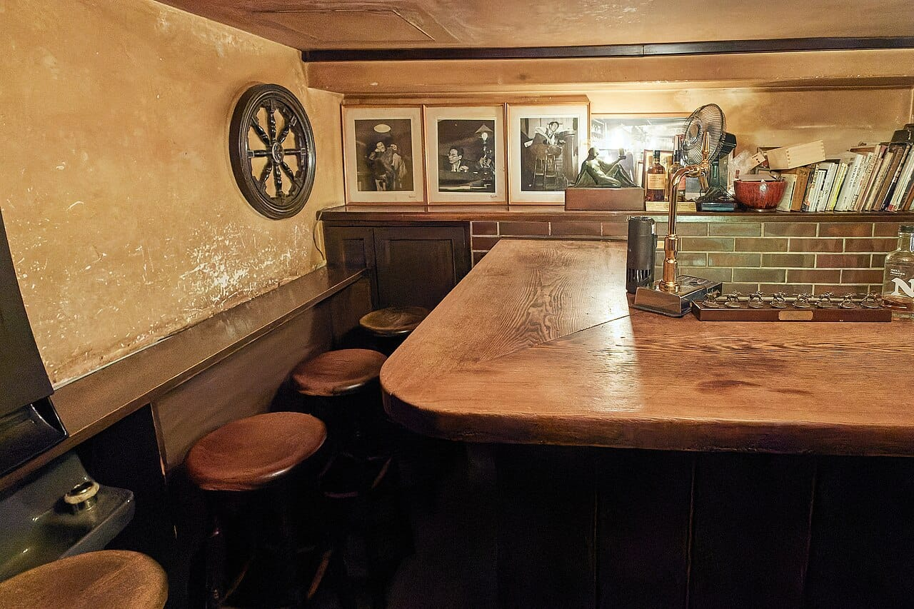
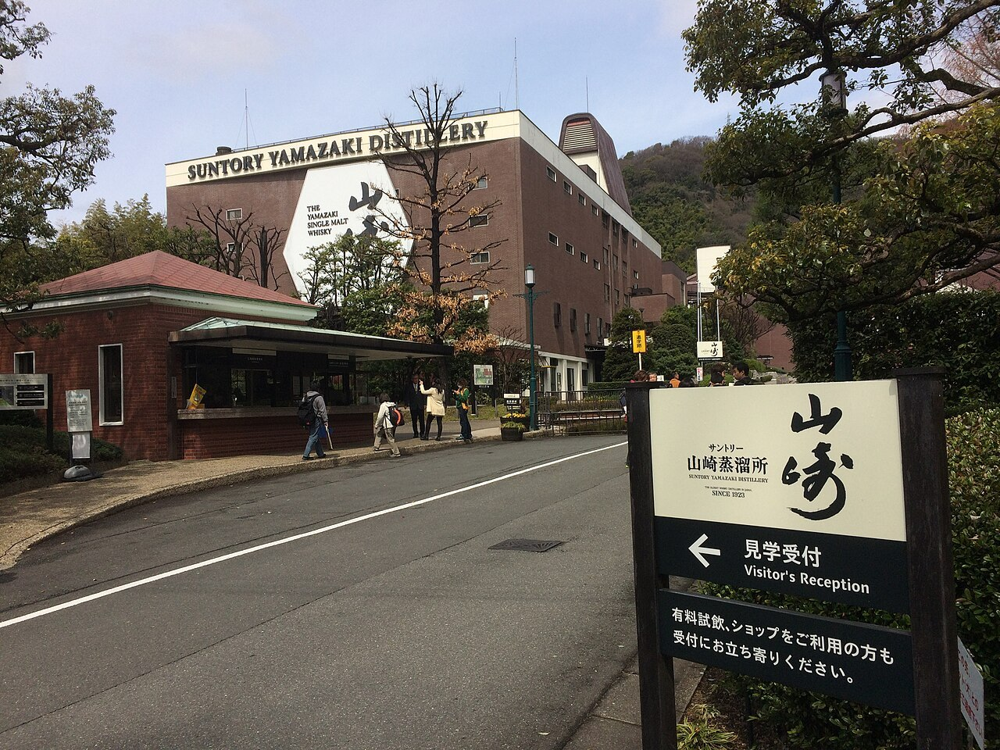

# Bar Lupin

Turn off Ginza’s Namiki-dori into a narrow alley and look up: an old red-and-white sign shows a man in a bowler hat and monocle, glass in hand, above the word “Lupin.” Descend the steep stairs to the basement, open the door, and the noise disappears: dark wood counter, brass lamps, old mirrors, black-and-white photographs and a dozen stools. This is not a Bungo Stray Dogs theme café; it is a literary bar that has survived since 1928, and the anime is a later layer of readership.

Figure: The L-shaped wooden counter at Bar Lupin; the 1935 counter, chairs and lamps were removed and stored during the 1970s rebuilding and later reinstalled. Image: Araisyohei, CC BY 4.0, via Wikimedia Commons ([source page](https://commons.wikimedia.org/wiki/File:Interior_of_bar_Lupin_Ginza.jpg)).

## Location and history

Bar Lupin opened on 3 October 1928. The founder was Takasaki Yukiko. She worked at a Ginza café in the early Showa years, met Izumi Kyoka and Satomi Ton, and gained the support of Kikuchi Kan and Kume Masao; acquaintances such as Naoki Sanjūgo helped produce promotional leaflets. Early on it was a referral-membership bar with female servers; a drink cost about 3 yen at the time. The 1935 renovation turned it into a counter bar and created the present L-shaped Japanese ash (yachidamo) counter—about 7.5 metres on the long side and 1.6 metres on the short.

War pushed the bar to the edge. It was forced to close in 1944, and its name was briefly changed to the Japanese-style “Pantei” under the wartime rejection of “enemy language.” In the air raid of 27 January 1945 the building was not directly hit, but the door was blown off and water pipes leaked. After the war, with supplies scarce, the bar reopened first as a café, then found alcohol so old guests could drink again. In 1972 the building was rebuilt; the bar did not discard the old counter. It removed the counter, chairs, lamps and fittings, stored them, closed for two years, and reinstalled them unchanged in the new building. Dazai Osamu’s place at the L-shaped counter therefore survived; every year on his memorial day, readers still place a glass there and offer a toast.

## Architecture and space

The bar is on the basement floor, entered by a steep, narrow stair. The door is black wood, its handle and frame polished by decades of hands; beside it hangs the hand-drawn Arsène Lupin sign—the name comes from Maurice Leblanc’s gentleman thief, not from Miyazaki’s animated Lupin. Inside, the room is small: the L-shaped counter takes most of it, bottles and a refrigerator behind, a dozen stools in front, a few small tables against the wall, and a photo wall at the back.

The counter is Japanese ash, pale in colour, its edge rounded by decades of forearms. Brass pendant lamps and wall lights give just enough light for the glass and the face, not the wall. On the wall hang Tadahiko Hayashi’s photographs of Oda Sakunosuke, Sakaguchi Ango and Dazai Osamu, along with a handwritten opening commemorative sheet, old labels and drawings. There is no dense “theme decoration”; the power comes from restraint: wood, brass, black-and-white photos and quiet. Seats are few, so keep bags and coats at your feet or in the cloakroom, not in the aisle.

## The drinks

The list centres on whisky, bourbon and classic cocktails. DEEPTOKYO notes that bartender Ikuo Hiraki’s cocktails are excellent and that the most popular is the Golden Fizz, the classic Fizz associated with Sakaguchi Ango. Golden Fizz belongs to the Fizz family: gin, lemon juice, sugar and soda, sometimes egg yolk, giving a creamy body, bright acidity and fine bubbles. It does not chase complex modern garnish; it relies on temperature, acidity and bubble balance.

Whisky runs from Scottish single malts to Japanese whisky, with bourbon and rye also on the shelf; Martinis, Manhattans and Sidecars are available. For a first visit, order a Golden Fizz, or let the bartender recommend a whisky—straight, on the rocks or as a highball. Do not ask for elaborate “literary-themed” specials; this bar wins on classic recipes, ice and temperature, not on a creative menu. Food is simple—nuts, chocolate or cheese—so do not expect a meal.

## How to drink

Indicative hours are 17:00–23:00 (last order), closed Sunday and Monday; check the official site or phone. The easiest window is 17:00–19:00, just after opening, when the counter has space and the bartender can talk; after 21:00, especially Friday and Saturday, regulars and visitors fill the stools. It is not for loud groups or a party of ten; two to four people is best.

On entering, look for an empty seat and do not pull out a stool yourself; wait for the bartender to signal. Order by name, or say “whisky, on the rocks” or “Golden Fizz.” Counter seats often carry a table charge or service fee; check the menu and the bill. Photos are fine, but no flash, and do not photograph the bartender or guests’ faces without permission; ask before a wide shot of the counter. Smoking follows the house rule; do not assume.

## Practical information

- Address: B1F Tsukamoto Real Estate Building, 5-5-11 Ginza, Chuo-ku, Tokyo 104-0061.
- Coordinates: 35.672014, 139.764720.
- Phone: 03-3571-0750.
- Hours: indicative 17:00–23:00 (LO), closed Sunday and Monday; holidays and temporary closures follow the official site or phone.
- Transport: about three minutes on foot from Ginza Station; enter the alley off Namiki-dori, look for the red Lupin sign and go downstairs.
- Entry: DEEPTOKYO advises age verification, so carry a passport or ID; overly revealing dress (sandals, shorts, tank tops) may be refused.
- Reservations: the small room usually does not take large bookings; walk in for available seats, and call ahead on special dates.
- Payment: follow house rules; Japanese bars often mix cash and cards, so carrying some cash is safer.
- Accessibility: basement access is by stairs only; wheelchairs cannot enter, and the stairs are steep—take care in high heels or with limited mobility.

## Etiquette and common misconceptions

First, do not treat this as a Bungo Stray Dogs theme café. It is a real literary bar; the anime is a later pop-culture layer, and there are no character standees or themed menus. Second, do not say Dazai “founded” the place; the founder was Takasaki Yukiko, and Dazai was a regular. Third, do not discuss anime plots loudly or turn it into a photo checkpoint; the room is for quiet drinking, and regulars and bartenders need space. Fourth, do not use a flash; the counter is small and a flash disturbs everyone. Fifth, do not wear tank tops, shorts and sandals; the door may refuse you. Sixth, do not treat Golden Fizz as the only choice; whisky and classic cocktails are equally worth ordering.

## Nearby and routes

From Bar Lupin, head south for Ginza’s main street and Kabukiza, north for Kyobashi and Nihonbashi, east for Tsukiji. The stop fits a “Ginza bars at night” line: start at [Star Bar Ginza](ref:star) for modern precision, then [Kamiya Bar](ref:kamiya) for the Meiji-era mass tavern, [Bar High Five](ref:highfive) for another style of classic cocktail service, and [American Bar Savoy](ref:savoy) for hotel-bar order; the whole line can follow the [Tokyo bar route](ref:route) on foot or by short taxi rides.

Ginza is not car-friendly; metro and walking are safest. After 22:00 the alleys off Namiki-dori are quiet, but the main roads still have traffic; return to Ginza or Higashi-Ginza Station. If you continue drinking, note that Japanese bars usually take last orders 30–60 minutes before closing.

## Further reading and see also

- Bar Lupin official site: <http://home.u06.itscom.net/lupin/> (redirected from lupin.co.jp), for the name, address, 1928 founding and hours.
- DEEPTOKYO article: <https://deeptokyo.jp/en/spot/nightlife/1598/>, for the 1935 ash counter, Dazai/Sakaguchi/Oda regulars, Hayashi’s photographs, Golden Fizz and entry advice.
- さんたつ article: <https://san-tatsu.jp/articles/524680/>, for the 1944 closure, postwar reopening, the 1972 rebuild and counter preservation, Dazai’s seat, the memorial toast and hours.
- JNTO article: <https://www.japan.travel/en/de/story/japanische-literatur-reise/>, to cross-check the 1928 opening and literary regulars.
- Same-city entries: [Star Bar Ginza](ref:star), [Kamiya Bar](ref:kamiya), [Bar High Five](ref:highfive), [American Bar Savoy](ref:savoy), [Tokyo bar route](ref:route).

## Related images

Image: File:YamazakiDistillery 01.jpg. Credit: Ujigis, CC BY-SA 4.0, via the site archive. Category photograph used to illustrate the subject; not an official product image.. Credit: Ujigis, CC BY-SA 4.0, via Wikimedia Commons ([source page](https://commons.wikimedia.org/wiki/File:YamazakiDistillery_01.jpg)). Related image for Bar Lupin.
