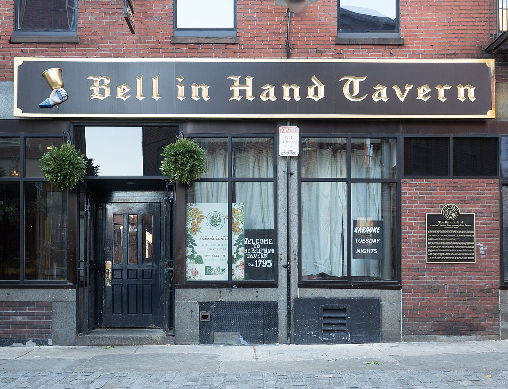
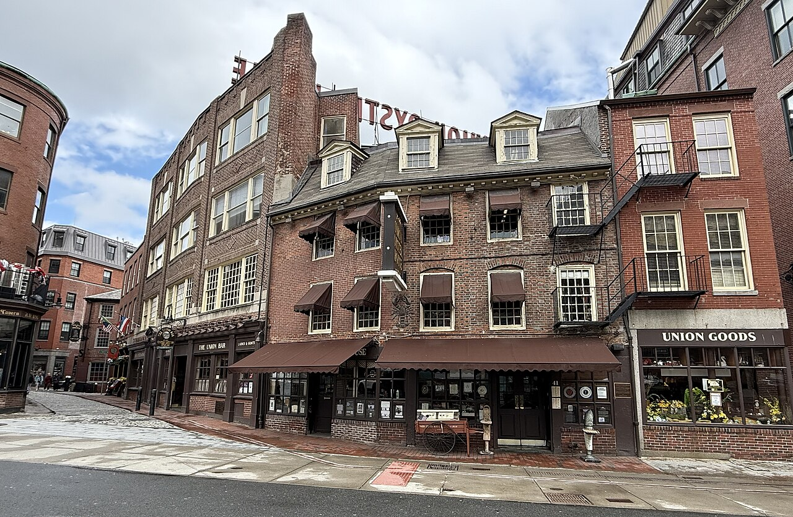

# Bell in Hand Tavern

On Union Street in downtown Boston, a short walk from Faneuil Hall, a narrow storefront carries a black sign with gold lettering and a painted hand holding a bell. The sign reads “Bell in Hand Tavern.” Office workers, tourists and sports fans pass through the same door; some stop for a photo, others for a pint. The Bell in Hand is one of the places most often called Boston's oldest tavern, but its history is not a straight line from 1795 to today. It is a line that moves addresses, closes, reopens and changes buildings.

Figure: The corner frontage and sign of the Bell in Hand tavern on Union Street, Boston; the tavern was founded in 1795 by town crier Jimmy Wilson, while the building in the photograph is a mid-19th-century brick building, not the original 1795 structure. Image: Rhododendrites, CC BY-SA 4.0, via Wikimedia Commons ([source page](https://commons.wikimedia.org/wiki/File:Bell_in_Hand_Tavern_(36199).jpg)).

## Location and history

The house narrative begins in 1795 with James “Jimmy” Wilson, Boston's town crier. Wilson rang a hand bell in the streets to announce news and public notices; the tavern took the image of the bell in hand as its name. That detail explains both the sign and the bar's long association with news, gossip and political conversation. In a city where newspapers were still limited, the town crier was a moving information office, and a tavern was where people stayed after hearing him to argue about what they had heard.

The 1795 tavern was not at today's Union Street address. Local histories record a series of moves: first near the old City Hall, then to Williams Court/Pi Alley, then to 81 Devonshire Street, and finally to Union Street. The present address is the latest stop in that life, not the starting point. The brick building now on the corner is a later commercial structure; its facade, windows and interior partitions have been altered many times. Treating it as the “1795 original” is inaccurate.

The most sensitive claim is “America's oldest continuously operating tavern.” The official site uses it as a headline; public histories repeat it with a caveat. Public notices also point to ownership and address changes during the 1910s. Secret Boston, working from Boston newspaper records, reports that the tavern closed in 1915 and reopened in 1934 at a different address, a gap of about 19 years. Even the common version admits a closure during Prohibition. The honest formulation is narrower: the Bell in Hand brand dates from 1795, the business moved several times and closed for extended periods, and it still operates under the same name today. “Founded in 1795” is defensible; “continuously operating since 1795” is not.

In the 19th century the tavern mixed politics, commerce and dock labor. Daniel Webster is among the early patrons associated with the place; the bar was also used for meetings, deals and the exchange of news. After Prohibition it adjusted to the changing downtown, gradually becoming a historic bar for office workers and visitors rather than a neighborhood tavern. It still functions as a pub: beer, cocktails, bar food, sports on television and weekend music, not a house museum.

## Space and drinks

The current building is a corner brick property with the entrance on Union Street. Inside, the bar is divided into two main rooms and three bar areas. Dark wood, brick, old photographs, vintage signs and sports memorabilia cover the walls. Daylight comes through the front windows; at night the room is lit by warm pendants and television screens. The atmosphere is closer to a city bar than a country inn: tables are close together, sound levels rise, and groups come for conversation and games rather than quiet reading.

The drink list follows the American tavern playbook: local and national craft beers on tap, bottled beer and cider, classic cocktails and seasonal specials, plus burgers, lobster rolls, fish and chips, soups and salads. It is not a destination craft-beer bar and not a seafood restaurant. Ordering with tavern expectations works better than ordering with museum expectations. For a lighter stop, take a soup or a small plate; for a serious drink, ask the bar which tap is in best condition.

## How to drink

Start with a local ale or a classic American lager, then move to a cocktail if the mood shifts. Boston bar service is direct: the bar is busy, so say whether you want a pint or a half pint, whether you want it opened, and whether you want ice. Sitting near the window or the brick wall gives the historic feel, but do not expect the 1795 interior. The point is that an old name is still working, not that an old building is frozen in time.

Weekday afternoons and early evenings are the easiest time; lunch gives enough light to see the room. Nights and game days are loud, and weekends often bring music. If you are walking the Freedom Trail, a half pint and a snack are a better stop than a full meal.

## Practical information

The address is 45 Union Street, Boston, MA 02108. It sits in downtown Boston, within walking distance of Faneuil Hall, Quincy Market and the Union Oyster House; the nearest subway stations are State Street and Government Center. The official hours are daily 11:00–02:00, with the kitchen usually running until midnight. Holidays, games and private events can change that, so check the site or call ahead.

Walk-ins are normal; groups and buyouts should contact the bar in advance. The legal drinking age in Massachusetts is 21, and ID is checked at the door and at the bar. There is no strict dress code, though a slightly smarter shirt is more comfortable at dinner. Tipping 18%–20% of the pre-tax bill is standard; at the bar, $1–2 per drink or the same percentage works.

## Etiquette and common misconceptions

The first misconception is that “1795” means the building dates from 1795. The brand starts in 1795; the present building is later, and the address changed several times. The second is that “America's oldest continuously operating tavern” is an undisputed fact. Public records show a closure from 1915 to 1934, so the phrase should be quoted or attributed. The third is treating the place as a museum: it is a working bar, so do not block the service area or ask staff to stop and deliver a history lecture. The fourth is expecting silence; music, television and crowd noise are part of the experience. For quiet conversation, avoid game nights and late weekends.

## Nearby and routes

Leave the bar and walk a few minutes to Faneuil Hall and Quincy Market, then east to the Rose Kennedy Greenway and the harbor, or west along the Freedom Trail toward Boston Common. Pairing the Bell in Hand with the Union Oyster House is natural: both are on Union Street, one is a pub and the other a restaurant, so you can drink first and eat later, or reverse the order. To compare old bars in the Northeast, read [McSorley's Old Ale House](ref:mcsorleys) and the [New York historic pubs route](ref:ny-route); for the wider role of taverns in cities, read [A History of Taverns](ref:taverns) and [Understanding a City Through Its Pub](ref:pub-city); for the Boston comparison, see [Union Oyster House](ref:union).

## Further reading and see also

- [A History of Taverns: From Alehouses to Bars](ref:taverns)
- [Understanding a City Through Its Pub](ref:pub-city)
- [Union Oyster House](ref:union)
- [McSorley's Old Ale House](ref:mcsorleys)
- [New York Historic Pubs Route](ref:ny-route)

Checked on 2026-11-21: the current address at 45 Union Street, the 1795 brand origin and the 1915–1934 closure record were checked against the official site and public sources. "Oldest continuously operating" is not treated as undisputed fact. Image credits and licences are given in the captions.

## Related images

Image: The brick facade and entrance of the Union Oyster House on Union Street, Boston; the restaurant opened in 1826 in a building whose history reaches back to the 18th century, so the photograph does not show its 1826 appearance. Credit: Seasider53, CC BY 4.0, via Wikimedia Commons ([source page](https://commons.wikimedia.org/wiki/File:Union_Oyster_House_2025.jpg)). Related image for Bell in Hand Tavern.
