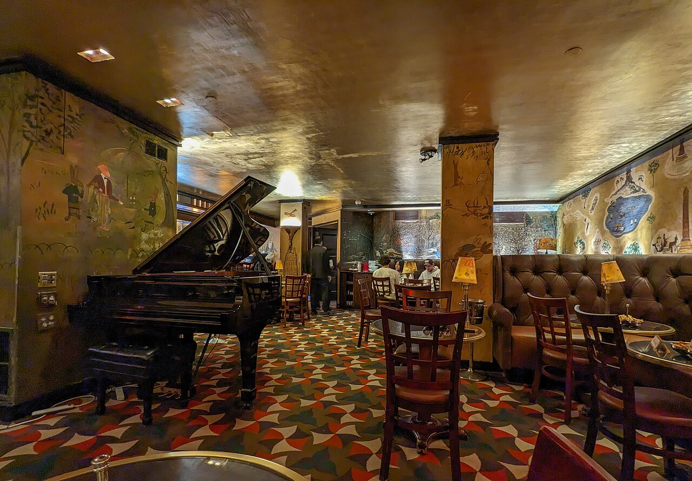

# Bemelmans Bar

Bemelmans Bar occupies the ground floor of The Carlyle on New York's Upper East Side, at 35 East 76th Street. It opened in 1947 and takes its name from Ludwig Bemelmans, the Austrian-American illustrator and author of the Madeline books. The walls carry his hand-painted Central Park scenes — skaters, horse-drawn carriages, animals and children. By day it is a quiet hotel bar; in the evening a pianist begins, and later a jazz trio turns the room into one of the Upper East Side's most recognisable night-time living rooms.

Figure: Bemelmans Bar. Image: Ɱ, CC BY-SA 4.0, via Wikimedia Commons ([source page](https://commons.wikimedia.org/wiki/File:Bemelmans_Bar.jpg)).

## Place and history

The Carlyle opened in 1930 as an Art Deco apartment hotel on the Upper East Side. Bemelmans Bar appeared on the ground floor in 1947, part of the post-war reinvention of New York hotel nightlife. It was never an ordinary corner bar: it was a reception room for hotel guests and Upper East Side residents, small, tightly seated, dimly lit, built for low conversation and slow drinking.

Ludwig Bemelmans was born in Austria in 1898 and later moved to the United States, where he became famous for the Madeline series. The most often repeated story is that he painted the walls in exchange for eighteen months' lodging at the hotel; the hotel itself stresses that the murals are the only surviving public commission of his work. The two stories are not in conflict: one describes the deal, the other the work's place in art history. The murals set Central Park behind the room, with skating, carriages, animals and children, and Madeline herself somewhere in the scene. It is not a children's illustration show; it is an illustrator's imagination installed in a room where adults drink.

The bar is often confused with Café Carlyle in the same hotel. Café Carlyle is the dinner-and-cabaret room where Bobby Short played for thirty-six years; Bemelmans Bar is the bar, with piano and a jazz trio and a cocktail list. They share a hotel and a history but are different rooms with different bookings and charges. Treating Bemelmans as a cabaret restaurant, or Café Carlyle as a casual bar, will lead to the wrong plan.

## The room and the list

The bar is on the ground floor, small enough that the bar counter, banquettes and piano share one room. The murals cover the walls, the lighting is low, the tables are small and the seats are close together. That scale dictates how the room is used: two or three people talking, listening to music, drinking one or two cocktails — not a large group or a long working session. The murals are the main subject, but the hotel has not isolated them like a museum; guests sit beneath them, and coats, glasses and conversation form the work's present-day setting.

The list is built on classics: martinis, Manhattans, old fashioneds, gin and tonic, champagne and wine. It does not aim at molecular mixology or elaborate garnish; its strength is consistent execution, temperature and proportion. On a first visit, a martini or a Manhattan is the safest order; for something lighter, champagne or wine. Specific drinks, seasonal specials and prices change, so use the hotel's official menu; this page gives no fixed prices.

Music is the other half of the product. The official page says the pianist begins at 5:30 pm and the jazz trio plays from 9 pm; a cover charge applies from 5:30 pm, at USD 25–35 per person for tables and USD 20–25 per person at the bar, depending on the artist. This is a music charge, not a drink minimum; drinks are separate. If you only want to look at the murals in peace, the hours after opening and before 5:30 pm are the cheapest and quietest; if you want the trio, accept the cover and the later crowd.

## How to drink

Decide where to sit first. Tables suit conversation and a view of the whole room; the bar suits a solo drinker, watching the bartender and talking to neighbours. The cover charge varies by area and artist. Book through Resy, by telephone on +1 212 570-7120 or by email at bemelmansbar@rosewoodhotels.com; tables are best reserved, bar seats are usually first-come, and the hotel's practice should be confirmed. Weekends and holiday periods are hardest, and if you want the 9 pm trio, leave enough time.

Keep the order simple: a glass of champagne or a light highball first, then a martini or a Manhattan. If you are having only one drink, choose the martini and tell the bartender whether you want gin or vodka, how dry, and olive or twist. Cocktails are strong, so eat something and do not drink on an empty stomach. The legal drinking age in New York is 21, and ID may be checked; a passport or a clear copy is safer than a photo on your phone.

Photograph the murals and your own glass, but do not use a flash directly on the murals and do not photograph other guests' faces. Do not talk loudly or take long calls while the pianist is playing. The dress code is enforced: no hoodies, sweatpants, shorts, tank tops, baseball caps or athletic sneakers; the hotel may ask guests to change or come back another time. This is not a neighbourhood bar for a quick stop; changing shoes and adding a jacket before leaving saves trouble at the door.

## Practical information

The address is 35 East 76th Street, New York, NY 10021, USA, between Madison and Park Avenues; the coordinates are 40.77440, -73.96300. Take the 6 train to 77th Street and walk one block (about 4–6 minutes), or an M1/M2/M3/M4 bus to Madison or Fifth Avenue and walk; a taxi driver will know "The Carlyle" more readily than the bar's name.

Hours are 12 pm to midnight on Sunday and Monday, 12 pm to 12:30 am Tuesday to Thursday, and 12 pm to 1 am Friday and Saturday. This was rechecked on the hotel's official page on 2026-11-08; holidays and private events can change it. `operating_status` is `verified`, meaning the official page and booking channel were live on the check date, not that every time slot is available without a reservation. The cover charge starts at 5:30 pm and differs between tables and bar; drinks and cover are billed separately, with tax and tip added.

Reservations are not compulsory, but tables and prime evening slots are best booked; the bar accepts walk-ins, though there may be a wait when full. Hotel guests and outside guests may both queue, most visibly at weekends. The hotel and bar have accessible entrances; ask staff about the route, because the bar is compact and wheelchair access may need assistance. The surrounding Upper East Side is generally safe, but at night stay on the main avenues rather than unfamiliar side streets. Page checked 2026-11-08; opening status, prices and reservations are subject to official channels.

## Etiquette and common mistakes

The first mistake is to treat Bemelmans Bar and Café Carlyle as the same place. The former is a bar; the latter is a cabaret and dinner room. Bookings, cover charges and dress expectations differ. The second is to read the cover charge as a drink minimum. It is a music charge; drinks are separate. If you do not want to pay it, arrive before 5:30 pm or plan another time.

The third is to underestimate the dress code. Upper East Side hotel bars keep athletic leisure wear out: hoodies, sweatpants, shorts, tank tops, baseball caps and athletic sneakers are not appropriate. Enforcement varies, but do not argue if asked to change. The fourth is to expect a quiet museum for looking at murals. In the evening the piano and trio make the room louder; for a quiet look, come just after opening or early on a weekday.

Drink etiquette: do not down a cocktail; a martini warms quickly, so sip slowly. Do not reach into the glass with your fingers for an olive, and do not hold a phone in front of other guests' faces. Tip 18%–20% of the bill, more for good service; the cover charge and the tip are separate. Do not request songs or start singing along unless the performer invites it.

## Around and routes

The bar is on 76th Street, two blocks east of Central Park and a short walk from Madison Avenue's galleries and shops. In the afternoon, walk through the 76th Street entrance to the park, Bethesda Fountain and the Mall, then visit the Metropolitan Museum of Art at Fifth Avenue and 82nd Street, and come back to Bemelmans for a drink. That is a natural park–museum–hotel-bar route. The Frick Collection on 70th Street, the Neue Galerie on 86th and the Guggenheim on 89th can be added or dropped depending on energy.

To see another side of New York drinking, combine Bemelmans with the downtown historic pubs: McSorley's Old Ale House on 7th Street and Employees Only in the West Village are rougher and louder. The Upper East Side hotel bar and the downtown bar are two different New Yorks, not one experience. Do not try to do both in one evening; the 6 train from the Upper East Side to downtown takes over twenty minutes, and you still have to get home after drinking.

The 6 train at 77th Street is closest; the M79 crosstown bus runs along 79th Street to Central Park West and the Museum of Natural History; taxis can crawl on Madison Avenue in the evening. For a single night, stay on the Upper East Side or in Midtown rather than forcing Bemelmans into an itinerary with Brooklyn or the Lower East Side.

## See also

Bemelmans is a New York sample of the relationship between [bars and the city](ref:pub-and-city): a hotel bar, murals, music and a dress code together define an Upper East Side evening. For a New York historic-bar route, see [New York historic pubs](ref:ny-route); for an older Irish saloon, read [McSorley's Old Ale House](ref:mcsorleys); for the post-Prohibition cocktail-bar tradition, read [Employees Only](ref:employees-only).

Further reading: [A Ginjinha](ref:c-extra-1).
