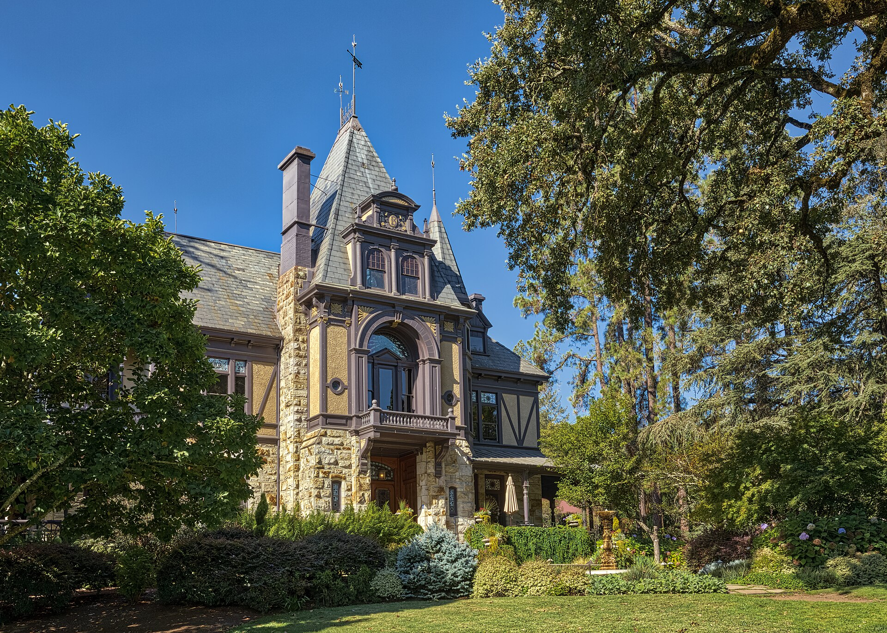

# Beringer Vineyards

Beringer Vineyards stands at the northern end of Main Street in St. Helena, Napa Valley. The entrance is modest, but once inside, the estate looks unlike most modern wineries along Highway 29: an 1884 Rhine House, an 1876 Old Winery and caves dug by hand into the hillside. German immigrants from Mainz, the Beringer brothers founded it in 1876, and in 2026 the estate marks its 150th anniversary. It is both a historic site and a working winery still producing Private Reserve Cabernet Sauvignon.

Figure: Related photograph of Beringer Vineyards. Image: Frank Schulenburg, CC BY-SA 4.0, via Wikimedia Commons ([source page](https://commons.wikimedia.org/wiki/File:Rhine_House,_Beringer_Vineyards.jpg)).

> **Quick verdict**
> **In one line:** This entry helps you decide whether Beringer Vineyards deserves a detour, and what to check before visiting.
>
> - **Best for:** Anyone planning a visit to Beringer Vineyards who needs to decide whether it deserves a half-day or a full day.
> - **Not for:** If you want only want a must-visit list and will not check booking, transport or opening hours.
> - **Check first:**
>   - In 1876 Jacob and Frederick Beringer bought land in St.
>   - Beringer recommends booking ahead: the official page advises reserving to secure a preferred experience and time, while same-day places may exist if checked at the Welcome Center.

## Place and history

In 1876 Jacob and Frederick Beringer bought land in St. Helena and established the winery. Jacob had worked as a winemaker in the eastern United States and understood European cellar practice; what drew him to the St. Helena slope was not only sun but rock that could be excavated for cellars. The brothers came from the Rhine Valley in Germany and brought its architectural tastes with them.

The Old Winery is the earliest building, made of local stone with thick walls and small windows that use the hillside for insulation. What secured Beringer's place in Napa history, however, is the cave system: before modern machinery, workers dug tunnels into the slope with picks and explosives to age wine. The tunnels used on tours still show tool marks. They are not natural caverns, nor concrete imitations built to look like cellars.

The Rhine House was built in 1883–1884 as Frederick's residence. It copies the Beringer family home in Germany's Rhine Valley, with stained glass, carved wood and a prospect over the vines. The house was not a production facility but a statement of success in architecture; it later became the centre of hospitality and tasting, and it is one of the few 19th-century mansions in Napa that visitors can enter.

During Prohibition from 1920 to 1933, many Napa wineries closed. Beringer survived by making wine for religious use under permit, among other legal allowances, which helped preserve the buildings and cellars. The period is often reduced to "all wineries shut", but the reality was more varied: some sold grape juice, others survived through medicinal or sacramental channels, and Beringer belonged to the latter group. Because the buildings and storage were not abandoned, the estate can claim continuity.

## Space and wine list

The visit is divided into four areas: the welcome centre, the Old Winery, the cave tunnels and the Rhine House. The welcome centre on Main Street handles bookings and tastings; the Old Winery displays early equipment and company history; the caves are cool and dark, used for ageing and private events; the Rhine House hosts higher-tier tastings and food events. The areas do not sit on a single straight route, so staff guide the movement rather than leaving visitors to wander.

The wine list is built around Cabernet Sauvignon. Private Reserve Cabernet is the flagship, usually drawn from several strong parcels and styled for ripeness and structure. Knights Valley wines come from the Knights Valley AVA in Sonoma County and show more outward fruit; the Napa Valley range is the everyday tier; Chardonnay, Sauvignon Blanc and dessert wines complete the list. Beringer also entered American wine history in the 1970s through the popularity of White Zinfandel, a pink, lightly sweet, low-alcohol wine far from today's fine-wine positioning — but part of the commercial story.

Experiences are tiered. The Estate Tour & Tasting lasts about 75 minutes and walks the vineyards, caves and Rhine House before a seated tasting of single-vineyard wines. The Knights Valley Expression Tour & Tasting also runs about 75 minutes and focuses on that AVA. Discover Beringer is a self-guided outdoor tour open to families, including minors. Other programmes cover food pairing, library vintages or private terraces. Names and contents change, so the booking page is authoritative.

The estate does not aim to pour every wine in one sitting. The Estate Tour tasting usually covers a few representative wines and explains parcel and vintage. Older Private Reserve requires a dedicated programme. For a first visit, the Estate Tour gives the most complete picture; for repeat visitors, a library or single-vineyard experience is more rewarding.

## How to visit

Beringer recommends booking ahead: the official page advises reserving to secure a preferred experience and time, while same-day places may exist if checked at the Welcome Center. Book through the official site by choosing an experience, date and party size. Groups of seven to fourteen must call; fifteen or more use the group channel. Wine experiences are limited to guests 21 and over, with Discover Beringer the family-friendly exception.

Ordering happens during the tasting, with staff pouring according to the programme rather than guests queueing at a bar. Extra glasses can be requested after the tasting, but the estate is not run as a bar and additions are not guaranteed. Bottles are bought at the welcome centre or shop, and older or limited wines depend on stock.

In the caves, do not touch the walls or bungs and do not cross barriers; the floor is uneven, so wear shoes with grip. Photography is allowed in the Rhine House, but no flash, and do not sit on display furniture. The Estate Tour involves a slope and steps, so visitors with limited mobility should say so when booking and the route can be adjusted.

## Practical information

The address is 2000 Main Street, St. Helena, CA 94574, USA; the coordinates are 38.51061, -122.48130 (OpenStreetMap way 768409823). The winery is at the northern end of St. Helena's main street, walkable from the town centre, about 25 minutes by car from downtown Napa, 15 minutes from Oakville and about 1.5 hours from San Francisco via Highway 29. The official site lists tasting-room hours as daily 10 am–5 pm, subject to holidays and private events; the booking calendar is the reliable guide.

Public transport depends on the infrequent VINE bus; ride-hailing works but return cars are not guaranteed. The realistic option is a car with a designated driver, or a hired car. Parking on Main Street is limited, and the winery car park fills at midday in high season. `operating_status` is `verified`, meaning the official site and booking channel were live on 2026-11-08 with no closure notice; it does not guarantee a place on a given day.

Booking ahead is advised: the official page says reserving secures the experience and time you want, while same-day places may exist if checked at the Welcome Center. Groups of seven to fourteen must call; fifteen or more use the group channel, on +1 707-257-5771. Wine experiences are limited to guests 21 and over, with ID checked; a foreign licence or passport is accepted. Discover Beringer, the self-guided outdoor tour, is the only family-friendly exception.

Prices by programme (2026 reference): Estate Tour & Tasting about $95 for 75 minutes, including the caves and Rhine House; Taste of Beringer Tour about $95; Knights Valley Expression about $65; Legacy Cave Tour about $35 for 30 minutes; Collectors' about $150; Veranda about $65; Discover Beringer outdoor self-guided about $35; Backyard Social about $55 (7–15 guests); Bar at the Rhine House about $65. Programmes and prices change, so check the official site or the Tock booking page. The caves are cold, so a jacket is useful even in summer. Page verified 2026-11-08; opening status, prices and reservations are subject to official channels.

## Etiquette and misconceptions

The first misconception is to treat the Rhine House as a hotel or a preserved house museum. It is a 19th-century residence now used for hospitality and tasting; furniture and decoration include repairs and replacements, and it is not an untouched family home. The second is to think the caves are natural: they were dug by hand, and the tool marks are historical evidence rather than decoration.

The third is to reduce Beringer to White Zinfandel. That wine was enormously popular in the 1970s and 1980s, but today's core is Private Reserve Cabernet and single-vineyard wines; summarising the estate with one commercial brand misses its layers. The fourth is to assume an old winery must be conservative: Beringer adapted after Prohibition, during the varietal revolution of the 1970s and in the tourism boom of the 2000s, keeping old buildings while adding new programmes.

Spitting is normal at a tasting; do not empty the glass in one go. Do not cup the bowl, and do not add ice or cola. Photographs are fine, but do not block walkways or carry glasses out of the tasting area. If driving, say so in advance; the winery can provide a spittoon, and California does not accept "just one drink" as a defence.

## Neighbourhood and routes

Beringer sits at the north end of St. Helena's main street, a short walk from restaurants, cafés and bookshops. North lie Charles Krug and Beringer's old neighbours; south lie Rutherford and Oakville. A half day might combine the Beringer Estate Tour in the morning, lunch on Main Street and one more winery in the afternoon; in a single day, do not exceed two wineries and a proper meal.

St. Helena is quieter than Oakville, and the main street is pleasant on foot, but the wineries are still spread out, so a car is practical. Traffic is heavy at weekends and during harvest from August to October, so allow time between Highway 29 and the Silverado Trail. Keeping drinking and driving separate is the first rule of the route.

## See also

Beringer is a sample of the layers in [Napa Valley](ref:napa) and [wine](ref:wine) history: 19th-century immigrant architecture, a survival strategy under Prohibition and 20th-century commercial innovation in one estate. For how American Prohibition reshaped the trade, read [US Prohibition](ref:prohibition).

Further reading: [United States](ref:c-extra-1), [Robert Mondavi Winery](ref:c-extra-2).
