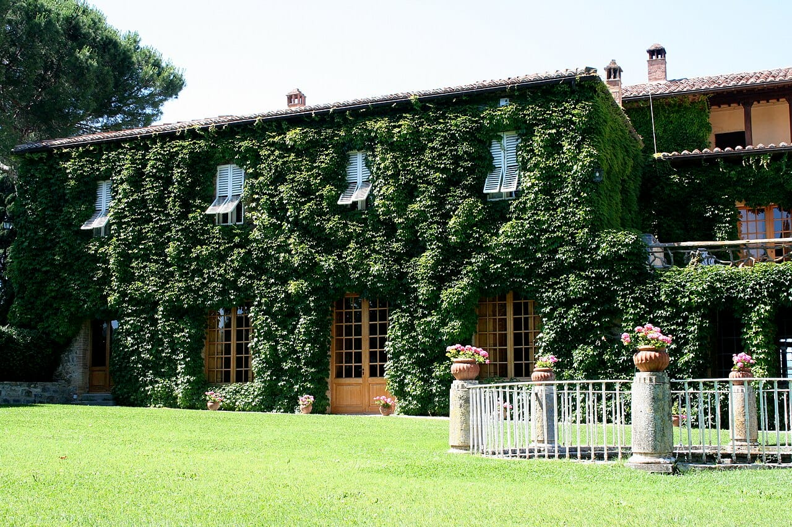

# Biondi-Santi Tenuta Greppo

Northeast of Montalcino, the road climbs between cypresses and olive groves before entering the Greppo yard. The houses are low, walls are covered with climbing vines, and the cellars still look nineteenth-century. Biondi-Santi is not a castle estate. It is more like a family farm that hides time underground: in 1888 Ferruccio Biondi Santi made the first wine officially labelled Brunello di Montalcino, and today the estate still centres on 100% Sangiovese Grosso, old vines and long ageing in large Slavonian oak.

> **Visit information**
> - Address: Località Greppo 183, 53024 Montalcino, Siena, Italy.
> - Opening and booking: check the [official page](https://www.biondisanti.it/en/) before travelling; hours, tours and booking rules change by season.
> - Getting there and cost: check the official page before booking; this entry does not promise a fixed price.
> - Status: Verified; sources checked: 2026-11-21.

Figure: The vine-covered villa at Biondi-Santi’s Greppo estate. Image: Megan Cole from Vancouver, Canada, CC BY 2.0, via Wikimedia Commons ([source page](https://commons.wikimedia.org/wiki/File:Brunello_di_Montalcino,_Italy_(5874133867).jpg)).

## Location and history

The story begins with a marriage. In 1840 Caterina Santi of the Santi family married Jacopo Biondi of the Biondi family, merging vineyards and farms. Caterina’s father Clemente Santi was an agronomist and winemaker who studied Sangiovese; his grandson Ferruccio Biondi Santi made the first Brunello in 1888 and used the name to distinguish it from ordinary Sangiovese.

Ferruccio’s son Tancredi continued the estate; Tancredi’s son Franco took over in 1970 and ran it until his death in 2013. Franco kept the old Riservas in the cellar, even walling them up during the Second World War to protect them; afterwards he reopened the cellar and used late-nineteenth-century Riservas for vertical tastings that proved Brunello’s longevity. The Riserva has been made only about 38 times in the estate’s history, not every year.

In 2017 the French EPI group acquired the estate, with the family retaining a role; new management and a winemaker followed, but Greppo’s vineyards, old cellars and BBS11 clone remained. BBS11 is a Sangiovese Grosso clone selected and officially registered by the estate, and it is central to the Greppo and Brunello style.

## Architecture and spaces

Greppo is built at Tuscan farm scale: low stone houses, vine-covered walls, cypress rows and stone benches in the yard. The cellar is underground, with an inconspicuous entrance, vaults, stone walls and rows of large casks. The estate keeps “La Storica”, the old library of Riservas going back to the late nineteenth century; it is not a public exhibition but the family’s time archive. The newer cellar and tasting room are plainer, still using stone, wood and neutral containers.

The vineyard is also architecture. Greppo sits high on the Montalcino hill, where altitude and day-night temperature range keep Sangiovese fresh; the soil mixes clay, limestone, sandstone and galestro. All vines are Sangiovese Grosso, old vines over 25 years; young and old plots are separated, and the Riserva comes mainly from old vines. The vineyard is not an industrial grid but a set of small plots following slope, stone walls and exposure.

## The wines and palate

Brunello di Montalcino is the main wine: 100% Sangiovese Grosso, long maceration after harvest, at least three years in large Slavonian oak and at least one year in bottle, with a legal minimum of four years before release. Young Brunello shows sour cherry, rose, violet, spice and mineral, with fine but dense tannin; with age come dried fruit, leather, tobacco, mushroom and forest floor. The Riserva is made only in the best years, ages longer, is more complex and structured, and can reach twenty to thirty years.

Rosso di Montalcino is the earlier-drinking version, also 100% Sangiovese but with shorter ageing, more outgoing fruit and a restaurant-friendly profile. It is not a lower standard but a separation of Greppo’s younger vines and earlier-drinking style. Biondi-Santi does not make a Hollywood “fruit bomb”; its power comes from acidity, tannin and time, not new oak.

## How to drink

Serve Brunello at 16–18°C. Young wine one to two hours ahead, or decant once; Riserva and older vintages 30–60 minutes, without violent decanting. Use a large red-wine glass and fill no higher than the widest part; old bottles are best finished in one sitting, not left to the next day.

Pair Brunello with roast beef, game, truffle, mushrooms and hard cheese; Riserva with aged beef, stews and aged Parmigiano; Rosso with tomato pasta, roast meat and pizza. Avoid very hot dishes and heavy sweet sauces; Sangiovese acidity needs fat and salt.

## Practical information

Address: Località Greppo 183, 53024 Montalcino, Siena. Telephone +39 0577 848023; email biondisanti@biondisanti.it. Visits are by appointment; there is no daily walk-in tour, and tastings and cellar access are arranged in advance, with group size and language confirmed by email. It is about 1 hour 30 minutes by car from Florence, one hour from Siena and ten minutes from Montalcino; the last stretch is narrow, so choose the right rental car.

Link Montalcino town, the Sant'Antimo abbey, the Val d’Orcia, Pienza and Siena. Half a day is enough for a booked tasting and Montalcino; a full day can add Sant'Antimo and the Val d’Orcia scenic road. Put [Antinori](ref:antinori) on another day: one is a 2012 contemporary building, the other a nineteenth-century farm cellar, and they should not be rushed together.

## Etiquette and common misreadings

First, Greppo is not a wine bar; do not enter the yard without an appointment or ask for an impromptu tour or “cellar-direct” old vintages. Second, Riserva is not an annual upgrade; it is made only in selected years, about 38 times in history, and a year without Riserva is normal. Third, Brunello is neither better young nor automatically better old; it needs time, but old bottles carry oxidation risk, so provenance matters.

Fourth, do not reduce all Brunello to “100% Sangiovese”; Montalcino’s soils, altitudes and clones vary widely, and Biondi-Santi is one classic expression. Fifth, the cellar and old library are not photo backgrounds; no flash, no touching old bottles, no crossing barriers. Sixth, keep your voice down; Greppo is still a family home and working estate, not a theme park.

## Around and routes

Montalcino town deserves half a day: walls, the civic museum, wine shops and restaurants are walkable. South are the Sant'Antimo abbey and the Val d’Orcia; north is the [Chianti Classico route](ref:route) through Greve, Radda and Gaiole; west is Siena. To compare Brunello and Chianti, start with [Antinori](ref:antinori) or [Castello di Brolio](ref:brolio), then come to Greppo; put [Fattoria Felsina](ref:felsina) on another day.

Never taste before driving; the Montalcino to Val d’Orcia road is winding and steep, with limited lighting at night. By public transport, reach Siena or Buonconvento first and change to a taxi; services are sparse, so confirm the return.

## Further reading and see also

- Tuscan comparisons: [Antinori](ref:antinori), [Castello di Brolio](ref:brolio), [Fattoria Felsina](ref:felsina), [Chianti Classico route](ref:route).
- Background: [Tuscany](ref:tuscany).
- This entry provides no map; visits, vintages and prices should be checked with official channels.

Begin with the address, move on to the current opening status, and finish with what the place is known for. That order keeps the reading of Biondi-Santi Tenuta Greppo practical.

Start with [Antinori nel Chianti Classico](ref:antinori) for address and space, then read [Fattoria Fèlsina](ref:felsina) for operating status. Seeing both keeps Biondi-Santi Tenuta Greppo from being confused with a neighbouring idea.
