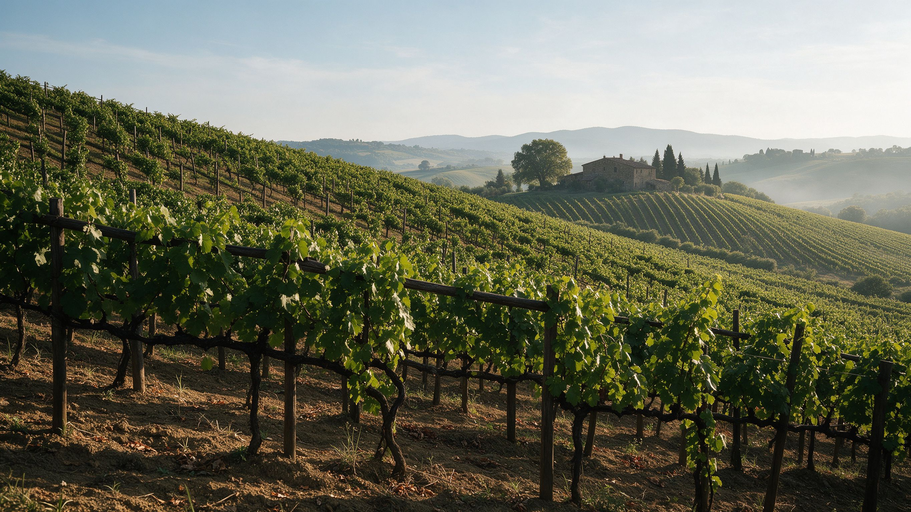

# Bisol

Bisol1542 stands in Santo Stefano di Valdobbiadene, at Via Follo 33. It puts the family at the centre of its identity: the official account traces the family's presence in the Prosecco heartland back to the sixteenth century and uses 1542 as the starting point of the Bisol1542 name; more than twenty generations have worked the same slopes. In 2014 the winery joined the Lunelli Group, but the historic cellar, vineyards and brand still operate under the Bisol name. For a visitor it is both a winery and an introduction to why steep-slope Prosecco costs what it does.

Figure: Bisol. Project-generated or category illustration used for vineyard and wine region context; not a photograph of the subject.

## A family and a brand from 1542

"1542" is not the year a vineyard was planted but the date the brand uses to mark the family's historical starting point in Valdobbiadene. The official story links early documents, the Cartizze hillside and family movement, then war, and Desiderio "Jeio" Bisol riding a motorcycle after the war in search of slopes, before the children divided the work. The useful fact in this story is that Bisol's fruit has long come from the steep hills of Valdobbiadene rather than from the plain or outside the zone.

Brand and family are not identical. Bisol1542 is the market-facing brand, Jeio the easier-drinking line; after the 2014 entry into the Lunelli Group the capital structure changed, but the winery still trades under its own name. The family story heard on a visit is part of the brand's assets; judging the wine still comes back to site, harvest and fermentation.

## Glera, steep slopes and hand harvesting

[Glera](ref:glera) is the principal permitted variety for Prosecco. Conegliano Valdobbiadene Prosecco Superiore DOCG requires at least 85% Glera, with a small allowance for other varieties. Glera has high acidity and aromas of white flowers, green apple and pear, low alcohol and a light body, which suits fresh sparkling wine; it is also prone to disease in wet years, so slope and airflow matter.

The hills of Valdobbiadene are described officially as "heroic" viticulture: steep, narrow parcels that machines cannot enter, needing at least 600 hours of manual work per hectare, several times the labour of mechanised farming. Harvest must be by hand, with fruit carried down in small boxes or small transporters. In 2019 the hills were listed as a UNESCO World Heritage site, precisely for this long interaction between people and terrain. A good share of the bottle price pays for those hours.

## A cellar cut into the rock

Bisol's cellar is described officially as a treasure hidden in the rock: a space dug beneath the Prosecco slopes where the temperature stays between 10°C and 15°C, suitable for long storage of wine and historic bottles. It is not a new climate-controlled showroom but an old cellar integrated with the terrain, its walls, vaults and passages still showing use. A visit usually starts in the newer reception and tasting area before entering the cooler, darker old cellar.

Stable temperature matters especially for sparkling wine: second fermentation and lees contact need steady cold, and storage after bottling dislikes swings. On a visit, notice the ventilation and humidity, do not leave a coat in the cellar, and do not touch the historic bottles on the walls or the aged wines on the racks. Floors can be wet, so non-slip shoes are better than formal ones.

## Cartizze, Rive and single parcels

Cartizze is a small hillside in Valdobbiadene with a legal area of only 107 hectares, roughly pentagonal, between San Pietro di Barbozza, Santo Stefano and Saccol. It is called the quality summit of the denomination; soil and exposure ripen Glera more fully, giving a broader body and aromas closer to yellow apple, honey and flowers. Cartizze can be made at different sweetness levels, from Brut to Dry; sweeter is not automatically better.

Rive are the small villages or parcels on steep slopes, with stricter rules, and the label names the specific place, for example Rive di Santo Stefano. The emphasis is on one slope's personality rather than the average style of the whole zone. Bisol's range covers Cartizze, Rive and standard DOCG, and understanding these three levels explains the price differences on the shelf. "Single parcel" is not a marketing phrase here; it corresponds to a verifiable geographical boundary.

## Visits, tastings and opening hours

The official contact page gives hospitality@bisol.it for visits and tastings. The Strada del Prosecco association page lists the cellar as open Monday to Saturday 10:00–13:00 and 15:00–18:00, Sunday 10:00–13:00, with cellar visits, tastings and retail sales. Meeting points and specific slots depend on the booking reply; high season and weekends fill up, so contact ahead.

A visit normally begins in reception, then moves into the cellar and the tasting. If you only want to buy wine, the retail area can be visited on its own. In the tasting, distinguish Brut, Extra Dry and Dry by sweetness, and notice how lees contact adds weight. Do not judge quality by bubble size; acidity, sugar, pressure and time on the lees decide the palate.

## Visiting notes and a contrast

From Venice the drive is about an hour; from Conegliano, about half an hour. Regional trains reach Conegliano or Treviso, then a bus or taxi is needed. The winery is in the village, parking is limited and tighter at weekends. Do not touch fermentation tanks, pipes or wine racks; the cellar is cold, so bring a light jacket in summer.

To see Veneto's two wine worlds side by side, continue to [Allegrini](ref:allegrini) in Fumane, about an hour and a half away. The first is the world of Glera and tank-fermented sparkling wine; the second is the world of Corvina and dried grapes. One region, two completely different technical logics. Opening hours, bookings and prices are subject to official channels; this page was verified on 2026-11-09, and coordinates should be confirmed through official channels.

For Bisol, begin with the address. Then look at the current opening status, and finally ask what the place is known for. The answers point to different choices, not to a single score.

Start with [Glera](ref:glera) for address and space, then read [Veneto](ref:c-extra-1) for operating status. Seeing both keeps Bisol from being confused with a neighbouring idea.

## References

- [Bisol — official English site](https://bisol.it/bisol/en/): the Santo Stefano cellar, steep slopes, DOCG range and brand history.
- [Bisol — contact page](https://bisol.it/bisol/en/contact/): the hospitality@bisol.it channel for visits and tastings.
- [Bisol1542 — Strada del Prosecco](https://www.coneglianovaldobbiadene.it/soci/bisol-1542/10475/): Via Follo 33 address, opening hours, cellar visits and the 2014 Lunelli Group entry.
- [Prosecco.it — Area of Origin](https://www.prosecco.it/en/area-of-origin/): 15 communes, Glera, 600 hours of manual work and the 2019 UNESCO listing.
- [Prosecco.it — DOCG](https://www.prosecco.it/en/conegliano-valdobbiadene-prosecco-superiore-docg/): the 1969 DOC, 2009 DOCG and quality-label system.

Further reading: [Veneto](ref:c-extra-1), [Sparkling wine](ref:c-extra-2), [Appellation](ref:c-extra-3).
