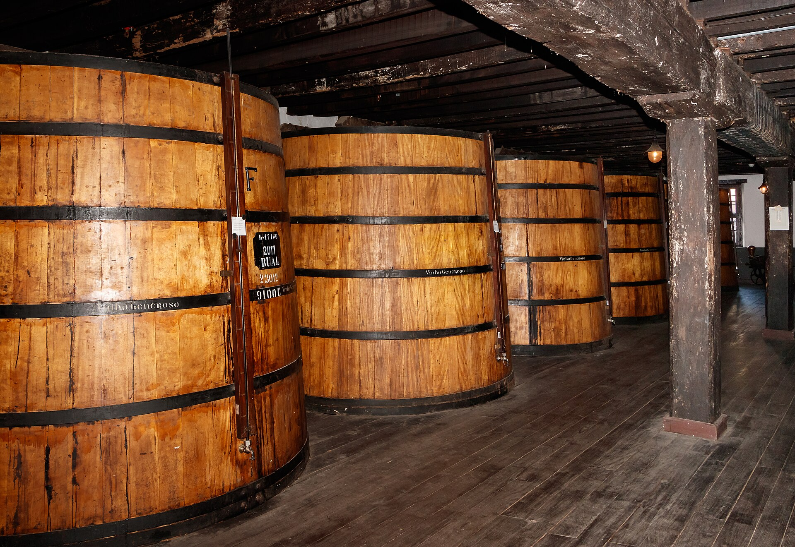

# Blandy's Wine Lodge

Blandy's Wine Lodge sits in the centre of Funchal at Avenida Arriaga 28. It belongs to the Madeira Wine Company and has been the Blandy family's base for seven generations of Madeira. No grapes grow here: wine from across the island is aged, blended, bottled, tasted and sold. It is also the easiest place to understand the heating that defines Madeira.

Figure: Related photograph of Blandy's Wine Lodge. Image: H. Zell, CC BY-SA 3.0, via Wikimedia Commons ([source page](https://commons.wikimedia.org/wiki/File:Blandy%27s_Wine_Lodge_-_Funchal_03.jpg)).

## A lodge in the middle of Funchal

The lodge faces the Municipal Garden, a short walk from the cathedral and the harbour. The buildings form the Adegas de São Francisco, most dating from the 17th and 18th centuries, with old warehouses, cobbles and the remains of a chapel. John Blandy bought the property in the mid-19th century; it connected directly to the family's town house, so wine, offices and family life shared one route.

The old layout survives: thick walls, high roofs, beams, and a temperature gradient from floor to ridge. Inside are more than 650 casks and vats, a family museum, tasting rooms and a shop. The museum holds Churchill letters, coins from Blandy's bank and the island's oldest wooden lagar, from the 17th century. Coordinates are about 32.64783, -16.91058; the entrance is on Avenida Arriaga.

## 1811 and an English trading family

John Blandy came to Madeira from England in 1808 for his health and first worked for a wine merchant. In 1811 he founded his own house with his brothers Thomas and George, exporting to Russia, northern Europe, the Antilles and North America. By 1824, nearly twenty years of small purchases had assembled the lodge property. When oidium struck in 1852, Charles Blandy bought a large share of the island's old stocks, keeping the firm supplied.

In 1913 the Madeira Wine Association was formed so that several shippers could buy and make wine together; Blandy's and Leacock joined, followed by Miles and Cossart Gordon, creating the largest producer and exporter on the island. In 1989 the family invited the Symington Port house into partnership for sales and marketing. From 2015 the lodge was renovated with a museum, shops, tasting rooms and event space.

## Canteiro: ageing slowly in the attic

Madeira's trick is that heat and oxygen age it without ruining it. In canteiro, casks rest on beams in the hottest attic for at least four years; the subtropical climate keeps the loft warm, so the wine heats and oxidises slowly. Casks then move down, floor by floor, to cooler levels and finally the ground floor. They are never full: some wine evaporates as the angels' share, leaving a denser, more complex wine with dried fruit, caramel, coffee, tobacco and sea salt.

The lodge also uses estufagem: wine is warmed to 45 °C in tanks for about four months, then aged for two years in Brazilian satinwood vats. This is mainly for three-year-old Tinta Negra blends; canteiro is kept for higher grades and single harvests.

## From Sercial to Malvasia

The four white styles run from dry to sweet: Sercial, Verdelho, Bual and Malvasia. Sercial is dry and acidic, with lemon peel and nuts; Verdelho is medium dry and rounder; Bual is medium sweet with caramel and spice; Malvasia, often labelled Malmsey, is the sweetest, with fig, coffee and syrup. Tinta Negra, the island's most planted grape, can make every style depending on fermentation and fortification.

Blandy's ranges from 5, 10, 15 and 20 year olds to single-harvest Colheita and vintage Frasqueira. Madeira is regulated by IVBAM under the DOP Madeira system; it is fortified with 96% neutral grape spirit and usually reaches 17.5% to 21% alcohol. High acidity keeps sweet styles fresh. Serve dry styles at 12 to 14 °C and sweet ones at 14 to 16 °C; an open bottle keeps far longer than ordinary wine.

## Three tours and what they cost

Tours run daily and should be booked online. The Lodge Tour is about €15, 30 minutes, with two wines. The Premium Tour is about €20, 45 minutes and adds the cooperage, canteiro rooms, satinwood vats, the vine-to-wine display and the museum, with two wines. Vintage Premium is about €54, 90 minutes, combining both routes with four wines including a Frasqueira. A private tour is about €140 per person for two to four guests, with five premium wines. Children under 6 are free; 6 to 17 about €7.70. Cancellation is free up to 24 hours before.

Tours are offered in Portuguese, English, German, French and Spanish. Cruise days and holidays are busy, so book days ahead; allow extra time for the shop, which stocks older vintages and gift packs.

## Fitting the lodge into a Funchal day

The central position suits a morning visit: take the 45-minute Premium Tour, then the Municipal Garden, cathedral and farmers' market; in the afternoon ride the cable car to Monte. For a fuller picture of Madeira, continue to [Henriques & Henriques](ref:hh) in Câmara de Lobos, a working bottling and ageing cellar that contrasts with this city visit.

Spitting is acceptable, especially if you drive; Funchal's slopes and cobbles are no place for a drink-driving risk. The lodge is damp and cool, so bring a light layer, and avoid flash on old bottles and documents. For background, read [Madeira](ref:madeira), [Madeira wine](ref:madeirawine), [oxidation](ref:oxidation), [oak ageing](ref:oak) and [dessert wine](ref:dessert).

**At a glance:** A Madeira wine ageing lodge and visitor site in central Funchal, founded by John Blandy in 1811 and run by the Madeira Wine Company; known for canteiro attic ageing, its cooperage and the four Madeira styles, with tours every day. 

Start with the address. From there, consider the current opening status, then what the place is known for. That is how a practical judgment about Blandy's Wine Lodge is built.

A brand or a region is not a safe shorthand for Blandy's Wine Lodge. Check whether it is still open, then whether it accepts visitors; where they diverge, prefer the specific source.

Blandy's is a Madeira wine house founded in 1811; its Funchal lodge offers tastings and tours, and the range runs from dry Sercial to rich Malmsey.

**Key facts.**

| Item | Detail |
| --- | --- |
| In one line | A Madeira wine ageing lodge and visitor site in central Funchal, founded by John Blandy in 1811 and run by the Madeira Wine Company; known for canteiro attic ageing, its cooperage and the four Madeira styles, with tours … |
| Address | Avenida Arriaga 28, 9000-064 Funchal, Madeira, Portugal |
| City and country | Funchal / Portugal |
| Status | verified open |
| Official site | blandyswinelodge.com |

**Sources and limits.** The key claims about Blandy's Wine Lodge are checked against the following sources: Blandy's Wine Lodge / Madeira Wine Company (Used to check the Avenida Arriaga 28 address and telephone +351 291 228 978), Madeira Wine Company (Used to check the more than 650 casks and vats, the family museum and the tasting rooms), Visit Funchal. For current products, addresses or opening status, use blandyswinelodge.com. Prices, batches and status change; the body is project-written and does not reproduce source text.
