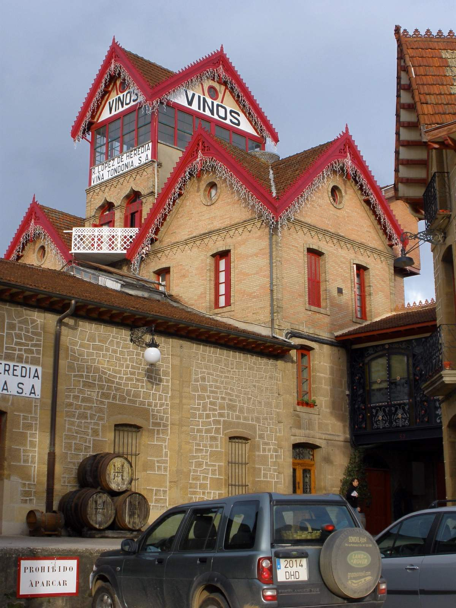

# Bodegas López de Heredia

Bodegas López de Heredia stands in Haro's Barrio de la Estación, in Rioja, at Avenida de Vizcaya 3. Rafael López de Heredia y Landeta founded it in 1877; it is the oldest winery in Haro and one of the three earliest in Rioja. Unlike estates that have turned visits into a standardised product, this is first of all a working building operating on an old rhythm: sandstone cellars, rows of American oak barrels, its own cooperage, and Reserva and Gran Reserva wines released many years after harvest.

> **Visit information**
> - Address: Avenida de Vizcaya 3, 26200 Haro, La Rioja, Spain.
> - Opening and booking: check the [official page](https://www.lopezdeheredia.com/) before travelling; hours, tours and booking rules change by season.
> - Getting there and cost: check the official page before booking; this entry does not promise a fixed price.
> - Status: Verified; sources checked: 2026-11-08.

Figure: Bodegas López de Heredia. Image: Zarateman, CC0, via Wikimedia Commons ([source page](https://commons.wikimedia.org/wiki/File:Haro_-_Bodegas_L%C3%B3pez_de_Heredia_Vi%C3%B1a_Tondonia_1.JPG)).

> **Quick verdict**
> **In one line:** This entry helps you decide whether Bodegas López de Heredia deserves a detour, and what to check before visiting.
>
> - **Best for:** Anyone planning a visit to Bodegas López de Heredia who needs to decide whether it deserves a half-day or a full day.
> - **Not for:** If you want only want a must-visit list and will not check booking, transport or opening hours.
> - **Check first:**
>   - In 1877 Rafael López de Heredia y Landeta began building the winery beside Haro station.
>   - The winery is open by appointment only, with no walk-in tours or tastings.

## Place and history

In 1877 Rafael López de Heredia y Landeta began building the winery beside Haro station. The site was not accidental. In the late nineteenth century Rioja's wines travelled by rail to France and the Atlantic ports, and proximity to the station meant lower transport costs and faster turnover. French vineyards were then suffering from phylloxera, which gave Rioja an opening in the French market; López de Heredia also sold wine in bulk to France, but by the 1880s had turned to bottling under its own name rather than building a reputation for merchants.

The estate is still owned by the founding family, one of the few historic Rioja houses not sold to a larger group. It is often described as the most traditional bodega in Rioja, not because it rejects every modern tool but because it keeps a very slow timetable. Reds spend years in oak; for the Gran Reserva the house describes ten years in barrel, racked twice a year and fined with fresh egg whites, followed by further bottle age. Whites are also aged in oak for a long time and reach the market with pronounced nutty and oxidative notes. Drinkers used to the fruit of the New World need to adjust their expectations.

Viña Tondonia is the core vineyard. It lies on the right bank of the Ebro and covers more than 100 hectares, an unusually large single holding for Rioja; with Viña Bosconia, Viña Cubillo and Viña Zaconia the estate farms about 170 hectares. The Viña Tondonia name appears on red, white and rosé; Viña Bosconia is a separate vineyard and usually a rounder wine; Viña Cubillo comes from younger vines; Viña Gravonia is the white, often associated with the Viña Zaconia plot. Remembering these names is more useful than remembering the word "Rioja" when reading the range.

## The cellars and the wines

The winery is a group of red-brick buildings, the oldest parts dating to the late nineteenth century; fermentation, ageing, bottling and offices still happen in the same block. What defines the visit is the underground cellar, carved into sandstone, with passages up to 200 metres long and more than ten metres below ground. It is cold and damp all year, with black mould on the walls. Around 12,900 Bordeaux-shaped oak barrels rest there, and the estate still keeps its own cooperage, one of the few in Spain able to make its own barrels. Inside, the air, light and sound change; that physical experience explains "long ageing" better than any display panel.

The range can be read by vineyard, colour and ageing level. Viña Tondonia is the flagship: the red is mainly Tempranillo with small amounts of Garnacha, Graciano and Mazuelo; the white is mainly Viura, aged in oak until golden, with nut, honey and oxidative notes; the rosé is scarce and usually released after several years. Viña Bosconia red is rounder, Viña Cubillo drinks earlier, and Viña Gravonia is the other white line. Gran Reserva is made only in better vintages, Reserva more often; both are aged far longer than the legal minimum.

The "list" here is not a cocktail menu but a sequence of vintages and ageing levels. On a first visit, the safest comparison is a Reserva and a Gran Reserva from the same vineyard, or a red and a white from the same year: the first shows what extra ageing does, the second shows why Rioja white cannot be dismissed as "light". If you get to taste Viña Tondonia Blanco, notice that its colour is deeper than most white wine; serve it not too cold or the aroma will close down.

## How to visit

The winery is open by appointment only, with no walk-in tours or tastings. The contact addresses are visitas@tondonia.com and +34 941 310 244; visits are usually arranged Monday to Saturday, excluding Sundays and holidays, and close during harvest. Some sources say visits are aimed mainly at the trade, importers and groups; whether individual visitors can book, and whether a tasting is included, must be confirmed by email. Do not treat it as a winery where you buy a ticket at the gate, and do not expect to taste on arrival.

When booking, state the number of people, language, what you hope to see and whether you are driving. A visit usually covers the historic buildings, the underground cellars, the cooperage and the barrel rooms; if a tasting is arranged, a few representative wines are usually poured, but the fee and format are confirmed separately. The estate also sells wine from its shop, but opening days are not fixed; some sources say public sales happen only on selected days and without tastings, so confirm before making it part of your plan.

Allow one to two hours depending on the tasting and the number of questions. The cellar is cold and damp, even in summer, and the floor can be wet; wear flat shoes with grip and bring a light jacket. It is dark, so do not use a flash directly on barrels or labels, and do not touch barrel heads or pipes. Visitors with limited mobility should say so in advance; the historic buildings have thresholds and stairs that are not always wheelchair-friendly.

## Practical information

**Address:** Avenida de Vizcaya 3, 26200 Haro, La Rioja, Spain, in Haro's Barrio de la Estación.

**Getting there:** Haro station is next to the winery, about a 5-minute walk from the platform; by car, Logroño is about 45 km away, Vitoria about 50 km and Bilbao about 120 km. The wineries cluster around the station and can be walked between — CVNE, Muga, La Rioja Alta and Gómez Cruzado are all within a few minutes — but each needs a booking.

**Opening hours:** there are no fixed public opening hours; all visits are by appointment, and the winery closes or reduces visits during harvest (usually September to October). `operating_status: verified` means the estate is trading, not that it is open to walk-in visitors on a given day.

**Tickets and reservations:** booking in advance is mandatory, with no walk-in tours. Contact visitas@tondonia.com or +34 941 310 244; visits are usually arranged Monday to Saturday, excluding Sundays and holidays. The Rioja UK page states that visits are aimed mainly at the trade, importers and groups, that the winery closes during harvest, and that the public can buy wine only on selected days without a tasting. The visit fee, whether a tasting is included and the ticket price were not verified on this pass and must be confirmed by email.

**Duration and practical notes:** allow one to two hours depending on the tasting. The cellar is cold and damp with a wet floor at times; wear flat shoes with grip and bring a light jacket. The historic buildings have thresholds and stairs that are not always wheelchair-friendly, so state access needs in advance.

Page verified 8 November 2026; opening status, prices and reservations are subject to the official channels.

## Etiquette and common mistakes

The first mistake is to read "most traditional" as "oldest and never changed". The estate adopted the railway and export markets in the late nineteenth century and has updated equipment since; "traditional" refers to its ageing logic and flavour profile, not a refusal of modernity. The second is to treat "Rioja" as a single style. Rioja has different subzones, ageing levels and blends, and López de Heredia is one traditional strand within that range.

The third is to assume sediment means a faulty wine. Long barrel and bottle ageing naturally throws sediment in reds; stand the bottle upright, decant if necessary, and continue. The fourth is to treat the whites as light aperitifs. Viña Tondonia Blanco is deep in colour and complex in aroma, and works with grilled fish, ham, mushrooms and aged cheese; serving it ice-cold kills the perfume.

Do not arrive late: visits run to a schedule, and lateness can mean a shortened visit or no entry. In a tasting, spitting is acceptable, especially if you are driving; Rioja's wineries are close together, but the country roads curve, so do not drive after drinking. Do not touch barrels, pipes or old photographs, and do not enter closed side passages of the cellar; follow the guide's instructions on photography.

## Around and routes

The Barrio de la Estación is itself a historic winery trail: from López de Heredia, CVNE, Muga, La Rioja Alta and Gómez Cruzado are a few minutes' walk away. Putting several in one day makes the difference between "traditional" and "modern" visible, but every visit needs a booking. Haro's old town is worth a walk, and the bars and small restaurants around Plaza de la Paz are convenient for lunch.

With more time, go east to Briones for the Vivanco wine museum, or north to Laguardia and Rioja Alavesa for medieval towns and cellars. West lies Logroño, where Calle del Laurel is known for pinchos; south is San Vicente de la Sonsierra, with its spring wine battle. Two days is more sensible than trying to force all of this into one.

Without a car, the train to Haro is easiest, but public transport from Haro to Briones or Laguardia is limited; expect to use a taxi or a local day tour. With only half a day, stay in the station quarter, visit two booked wineries and have lunch in the old town rather than adding a distant stop.

## See also

López de Heredia is a concrete sample of traditional [Rioja](ref:rioja) and turns the idea of ageing in [wine](ref:wine) into a cellar you can walk through. For how cellars shape flavour, read [cellar and storage](ref:cellar); for another benchmark producer in the same region, see [Vega Sicilia](ref:vega).

Further reading: [A Ginjinha](ref:c-extra-1).
