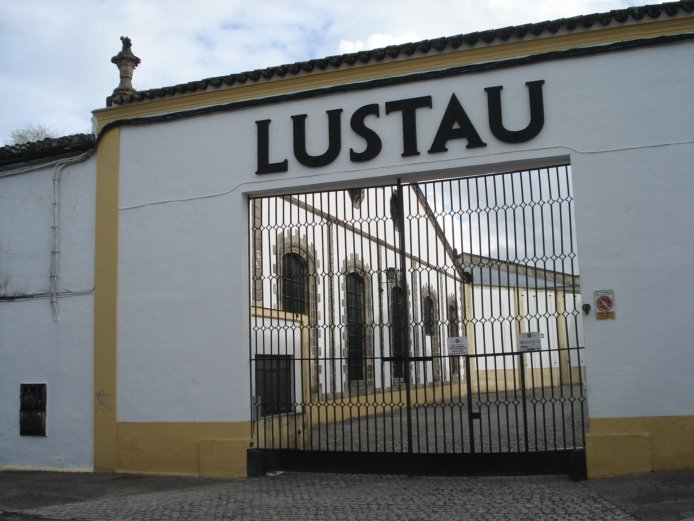
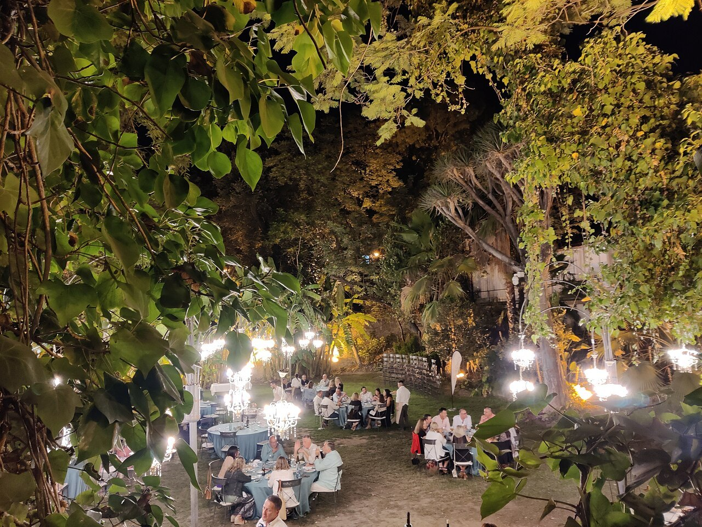

# Bodegas Lustau

Bodegas Lustau stands at Calle Arcos 53 in central Jerez de la Frontera. It is one of the few Sherry houses that ages wine in all three cities of the Sherry triangle: Jerez de la Frontera, El Puerto de Santa María and Sanlúcar de Barrameda. Its history is often reduced to "founded in 1896", but the more accurate story is that it began as an almacenista, a stock-holding house that supplied larger merchants, spent half a century behind the scenes, and then turned old reserve wines into a brand of its own. What visitors enter today is not a new visitor centre but six 19th-century cellars built on a cathedral scale.

> **Visit information**
> - Address: Calle Arcos 53, 11402 Jerez de la Frontera, Cádiz, Spain.
> - Opening and booking: check the [official page](https://www.lustau.es/) before travelling; hours, tours and booking rules change by season.
> - Getting there and cost: check the official page before booking; this entry does not promise a fixed price.
> - Status: Verified; sources checked: 2026-11-08.

Figure: Related photograph of Bodegas Lustau. Image: El Pantera, CC BY 3.0, via Wikimedia Commons ([source page](https://commons.wikimedia.org/wiki/File:Lustau-DSC07720.JPG)).

> **Quick verdict**
> **In one line:** This entry helps you decide whether Bodegas Lustau deserves a detour, and what to check before visiting.
>
> - **Best for:** Anyone planning a visit to Bodegas Lustau who needs to decide whether it deserves a half-day or a full day.
> - **Not for:** If you want only want a must-visit list and will not check booking, transport or opening hours.
> - **Check first:**
>   - All visits are by reservation, booked through the visit page at lustau.es, by email at visitas@lustau.es or by telephone on 956 341 597.
>   - Address: Calle Arcos 53, 11402 Jerez de la Frontera, Cádiz, Spain.

## Calle Arcos 53: a winery inside the city

The entrance is at number 53, postcode 11402, on the edge of the old town, close to Plaza del Arenal and the Santiago district. This is not a country estate with vineyards around it. The cellars sit inside a city block: limewashed walls, very high roofs and side windows placed near the ridge so that air enters without direct sun falling on the casks. The floors are packed albero sand, soft underfoot, holding moisture and keeping temperature and humidity relatively stable.

The railway station is about a 15-minute walk away and Jerez airport about 15 minutes by car; Sevilla is roughly 90 km and Cádiz about 35 km. This entry gives no coordinates; use official channels for the exact location. The gate, meeting point and luggage arrangements come with the booking confirmation. The house is trading, but trading does not mean walk-in access: visits still have to be reserved.

## From almacenista to own brands

In 1896 José Ruiz-Berdejo began tending, in his spare time, the vines of the family estate called Nuestra Señora de la Esperanza and sold the wine on to larger Sherry producers. Such a stock-holder was called an almacenista. In 1931 his daughter, María Ruiz-Berdejo Alberti, bought a small cellar closer to the centre of Jerez and moved the existing soleras there, giving the business its first public-facing premises.

In the 1940s María's husband, Emilio Lustau Ortega, moved the house to the old Santiago district, the area around today's Calle Arcos; parts of the buildings use the old Moorish city wall. In 1945 the firm stopped being only an almacenista and began selling under its own labels: Papirusa, Jarana, Escuadrilla, Emperatriz Eugenia and Cinta de Oro were among the early names. In 1950 it began exporting its own Sherry.

In the 1980s, under Rafael Balao, the house expanded: the Solera Familiar range took shape, the first Almacenista bottlings appeared in 1981, the Vintage Series began ageing in 1989, and in 1988 the company introduced its dark, sloping-shoulder bottle. In 1990 Lustau joined the Spanish family group Luis Caballero, which brought capital and reach. In 2000 it bought six 19th-century cellars in central Jerez, restored them and made them the main ageing and visitor site: the Calle Arcos complex of today.

## Six cathedral-like cellars

The Calle Arcos site covers about 20,000 square metres and consists of six 19th-century cellars. They are called cathedrals of wine not for ornament but for proportion: high ridges, wide spans and ordered columns make people lower their voices. High side windows cut the light into strips that fall across rows of oak casks, and the pale albero floor can be damped down to cool and humidify the air. The structure is equipment rather than scenery: whether flor grows steadily depends heavily on the temperature and humidity inside.

Lustau is also the only winery in the Sherry triangle that ages wine in Jerez de la Frontera, El Puerto de Santa María and Sanlúcar de Barrameda. The climates differ. Sanlúcar is coastal and humid, so flor grows thicker and Manzanilla tastes saltier and lighter; inland Jerez has greater temperature swings; El Puerto sits between the two. Applying one solera logic in three cities produces subtle differences, a concrete way to see that terroir exists in the cellar as well as in the vineyard.

## Solera, flor and oxidation: three paths

The fork in Sherry happens at fortification and at the flor. After fermentation, wine destined for biological ageing is fortified to about 15%; flor forms a pale film, excludes oxygen and leaves notes of bread, almond and sea salt. Wine destined for oxidative ageing is fortified to at least 17%; flor cannot survive, the wine meets oxygen directly, darkens and develops hazelnut, caramel and old wood. Fino and Manzanilla take the first path, Oloroso the second, while Amontillado and Palo Cortado are biological first and oxidative afterwards.

A solera is not one cask but a set of tiers. The oldest row is the solera, with first, second and further criaderas above it. Each year a proportion is drawn from the oldest row for bottling and replaced from the row above, and so on up the stack. The result is consistency: good year or bad, the bottled wine carries the same family memory. Lustau's range makes the system legible: Jarana is a Fino, Escuadrilla an Amontillado, Península a Palo Cortado, Emperatriz Eugenia an Oloroso, Emilin a Moscatel and San Emilio a Pedro Ximénez. For a first visit, compare Jarana with Emperatriz Eugenia rather than memorising names.

## More than thirty sherries and the Sacristy

Lustau often says it sells more than thirty Sherries, a figure that comes from ageing in three cities, old almacenista reserves and different levels of sweetness. Solera Familiar is the everyday range; the Almacenista range bottles a single solera from a partner stock-holder, often naming that house and its city on the label; the Vintage Series is bottled by year, unusual in Sherry; VORS stands for Vinum Optimum Rare Signatum and averages over 30 years of age. The oldest wines rest in a room called the Sacristy, which also gives its name to one of the tours.

Cellar master Sergio Martínez handles the daily drawing, refreshing and flor watching, marking cask heads in chalk and tasting with a venencia. The house notes that in 2026 he was named World's Best Winemaker of Fortified Wines by the International Wine Challenge for the eighth time; Lustau was also named Best Spanish Winery in 2011 and Best Sherry Producer in 2014 and 2016. Awards do not change the taste, but they show that the house is taken seriously by both old and new systems of judgement.

## Tours, prices and booking

All visits are by reservation, booked through the visit page at lustau.es, by email at visitas@lustau.es or by telephone on 956 341 597. Three tours are currently listed. The Cathedrals of Wine lasts about 60 minutes, costs €26 and includes 5 Sherries tasted along the route plus a vermouth at the end. The Symbols of Sherry lasts about 75 minutes, costs €36, and includes 5 premium wines and 2 VORS, again finishing with vermouth. The Sacristy of Lustau lasts about 90 minutes, costs €60, and starts with 2 wines in the cellars before an exclusive VORS tasting in the Sacristy.

All three include tasting; the difference is the level of wine and the length, not whether you drink. Prices, times and languages change, so check the official site before travelling. Berths are tight on cruise days, during Holy Week and during the Jerez fair, so book several days ahead. Anyone who only wants to buy wine can use the shop without taking a tour.

## Practical notes and visitor etiquette

**Address**: Calle Arcos 53, 11402 Jerez de la Frontera, Cádiz, Spain. Coordinates are not fixed in this entry; use official channels for the exact location.

**Getting there**: about 15 minutes on foot from Jerez station, about 15 minutes by car from the airport, roughly 90 km from Sevilla and 35 km from Cádiz. Old-town streets are narrow, so allow time to park.

**Opening and booking**: `operating_status: verified` means the house is trading, not that walk-in places exist. Visits must be booked in advance; more slots run Monday to Saturday, with a reduced schedule on Sundays and public holidays.

**On site**: cellars are cool and the floors are sand, so wear dark, practical shoes and bring a light jacket in summer. Do not touch casks, bungs or pipes; check with the guide before photographing, since flash and tripods are usually unwelcome; skip strong perfume. Spitting is normal.

**Drinking and pairing**: serve Fino and Manzanilla at 7–10 °C and finish the bottle soon; Oloroso and Amontillado suit 12–15 °C; Pedro Ximénez can be cooler, but not so cold that the aroma closes down. Fino goes with ham, fried fish and olives; Oloroso with game, mushrooms and hard cheese; Pedro Ximénez with blue cheese and chocolate.

**Driving**: the old town is made for walking, but do not drive after a tasting. Spit everything, or appoint a driver who is not drinking; Spain has clear drink-drive limits and local enforcement sets the detail.

To place this stop in a wider context, read the [Jerez](ref:jerez) region page and the [Sherry](ref:sherry) style page, then compare the entries on [solera](ref:solera), [flor](ref:flor) and [fortification](ref:fortification). For another house that turns urban cellars into the main event, read [González Byass](ref:gb). The two are close enough to combine on foot or with a short drive into half a day.

## Related images

Image: Jardines de las Bodegas González Byass - IMG 20220811 230512. Credit: El Pantera, CC BY-SA 4.0, via Wikimedia Commons.. Credit: El Pantera, CC BY-SA 4.0, via Wikimedia Commons ([source page](https://commons.wikimedia.org/w/index.php?curid=121644467)). Related image for Bodegas Lustau.
