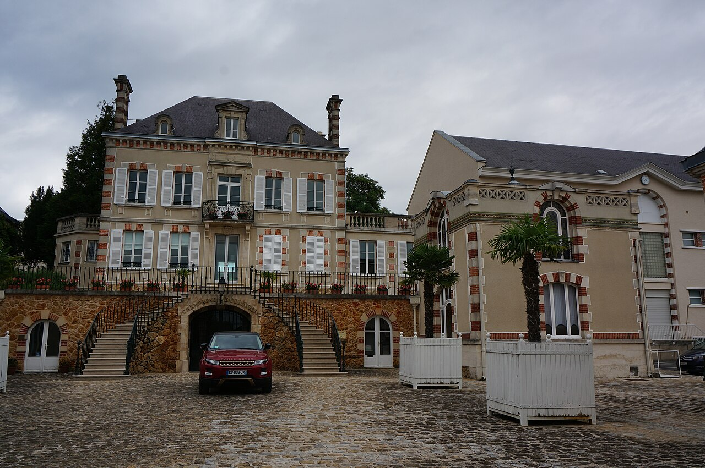

# Champagne Bollinger

Driving north from Reims into Aÿ, the vineyards press right up to the edge of the town. Bollinger’s house and cellars sit on the main street behind stone steps, an iron gate and a discreet sign. It is a different Champagne from Krug: Krug turns blending into a library across years, while Bollinger puts Pinot Noir, old oak and long lees ageing at the front. Three numbers matter here: 180 hectares, 85% and 60%.

Figure: The Bollinger house and courtyard in Aÿ. Image: G.Garitan, CC BY-SA 3.0, via Wikimedia Commons ([source page](https://commons.wikimedia.org/wiki/File:Bollinger_01315.JPG)).

## Location and history

On 6 February 1829, Athanase de Villermont, Joseph “Jacques” Bollinger and Paul Renaudin founded Renaudin-Bollinger & Cie in Aÿ. Athanase, an aristocrat barred from commerce, supplied land and capital; Joseph handled sales; Paul ran the cellar. The trio became a family firm, and the house still belongs to the Bollinger family.

After Georges Bollinger died in 1918, Jacques Bollinger took over; in 1923 he married Elisabeth Law de Lauriston-Boubers. Jacques died in 1941, and Elisabeth, Madame Bollinger, ran the house until 1971, pulling it through war and crisis. Claude d’Hautefeuille followed in 1971, Christian Bizot in 1978, Ghislain de Montgolfier in 1994, Jérôme Philipon in 2008 and Charles-Armand de Belenet in 2017. The family still owns the house, but day-to-day management has long included people outside the bloodline.

The vineyards total about 180 hectares, 85% Grand and Premier Cru, spread across seven villages: Aÿ, Avenay, Tauxières, Louvois, Verzenay, Cuis and Champvoisy. Pinot Noir accounts for over 60%, the same proportion it holds in Special Cuvée; that high Pinot share is the backbone of the style. Two walled plots, Clos Saint-Jacques and Chaudes Terres, have never succumbed to phylloxera and supply Vieilles Vignes Françaises.

## Architecture and spaces

The Aÿ headquarters is a group of nineteenth-century houses, courtyards, fermentation rooms and cellars. In the yard, barrels are often drying in the sun; below ground, rows of old oak line the cellars. Bollinger is one of the Champagne houses that still employs a resident cooper, and some of its 4,000 old barrels are close to a century old. Older wood influences the wine less, shifting from “flavour” to “breathing space”.

The other architecture is the wall of reserve magnums. Each year Bollinger puts part of its best reserve wine into magnums; the collection now numbers about one million bottles and dates back to 1890. In a 2010 inventory the house discovered a forgotten cellar with reserve magnums going back to 1830. In 2016 it turned the old stocks and history into Galerie 1829 and La Réserve. If a visit includes those rooms, it is more rewarding than another “big cellar” photo.

## The wines and palate

Special Cuvée is the entry: over 60% Pinot Noir with Chardonnay and a little Meunier, part fermented in old oak and aged on the lees far beyond the legal minimum. The perfume is baked apple, hazelnut, cream, citrus peel and spice; the palate is broad rather than heavy, with fine bubbles. La Grande Année is the vintage wine, made only in good years, all fermented in old oak, hand-riddled and hand-disgorged; it is more concentrated, with honey, nuts, yellow plum and mineral. R.D. is the same wine left longer on the lees before disgorgement, darker in toast, mushroom and dried fruit, and very much a food wine.

Vieilles Vignes Françaises comes from the two ungrafted walled plots and is tiny in quantity, a historical specimen. The PN series separates Pinot Noir into different villages and years: PN VZ, PN TX, PN AYC. Do not dismiss Special Cuvée as the “simple entry”; it is the fullest expression of the house style and the best test of whether you like Bollinger.

## How to drink

Serve at 8–10°C. Avoid a very small, narrow flute; a wide white-wine glass lets the Pinot Noir perfume open. Pour in two stages, a little first, then top up once the foam settles. Special Cuvée is ready on opening but can rest ten minutes; La Grande Année can be opened 20–30 minutes ahead; R.D. and VVF need no violent decanting, but old bottles dislike sudden temperature change.

Pair Special Cuvée with roast chicken, mushrooms, Comté, caviar or fried food; La Grande Année with lobster, creamy veal or roast cod; R.D. with mushrooms, truffle, roast poultry and aged cheese; VVF is best on its own. Avoid very sweet or hot dishes; Bollinger’s broad body needs fat and salt rather than sugar.

## Practical information

Address: 20 Boulevard Maréchal de Lattre de Tassigny, 51160 Aÿ-Champagne. Visits and tastings are by reservation, with some experiences available through the 1829 membership or official events; do not walk into the cellars without an appointment. It is about 30 minutes by car from Reims and 20 from Épernay; TGV from Paris to Reims, then a car or taxi.

Parking in Aÿ is limited; use short stays and walk. To link the region, put Bollinger with the [Avenue de Champagne](ref:avenue), [Krug](ref:krug) or [Taittinger](ref:taittinger) across two days. Three houses in one day is too much, especially if R.D. and VVF are on the table.

## Etiquette and common misreadings

First, Bollinger is family-owned, but “family-run” does not mean every decision is made by a family member; a non-family CEO has led since 2008. Do not replace corporate structure with a bloodline story. Second, Special Cuvée is not a “lesser” wine; it is the core style and is underrated for ageing and food. Third, R.D. does not mean a second fermentation or added sugar; it means recently disgorged after extended lees ageing.

Fourth, do not touch barrels, bottles or riddling racks; old wood and old wine are fragile. Fifth, do not use “Bolly” to sound familiar unless the other person does first; it is an internal nickname, not the official brand. Sixth, Champagne is not better the colder it is; 8–10°C reveals more perfume than 4°C.

## Around and routes

Aÿ sits in the northern Champagne, south of Épernay and the [Avenue de Champagne](ref:avenue), east of Verzenay’s vineyards and lighthouse, west of the Hautvillers abbey. Build a day around Aÿ, Hautvillers and Épernay, or put [Krug](ref:krug) and [Taittinger](ref:taittinger) into two days in Reims. If Pinot Noir is the interest, link Aÿ, Verzenay and Ambonnay rather than three cellars in town.

Half a day: a booked Bollinger tasting and a walk in Aÿ. A full day: add the avenue and a Côte des Blancs village. Never taste before driving; the country roads are narrow and the risk is real.

## Further reading and see also

- Champagne comparisons: [Krug](ref:krug), [Taittinger](ref:taittinger), [Avenue de Champagne](ref:avenue), [Champagne avenue walk](ref:route).
- Background: [Champagne](ref:champagne).
- This page provides no map; visit, membership and release information should be checked with official channels.

[Krug](ref:krug) explains address and space; [Avenue de Champagne, Épernay](ref:avenue) adds operating status. Put Champagne Bollinger between them before deciding what it is.

**Short definition:** A family-owned Champagne house in Aÿ, founded in 1829 by Athanase de Villermont, Joseph Bollinger and Paul Renaudin. It farms about 180 hectares, 85% Grand and Premier Cru, with Pinot Noir over 60%; it is known for oak fermentation, 4,000 old barrels, a million reserve magnums and Special Cuvée, La Grande Année and R.D.

**Key facts.**

| Item | Detail |
| --- | --- |
| In one line | A family-owned Champagne house in Aÿ, founded in 1829 by Athanase de Villermont, Joseph Bollinger and Paul Renaudin. It farms about 180 hectares, 85% Grand and Premier Cru, with Pinot Noir over 60%; it is known for oak f… |
| Address | 20 Boulevard Maréchal de Lattre de Tassigny, 51160 Aÿ-Champagne, France |
| City and country | Aÿ-Champagne / France |
| Status | verified open |
| Official site | champagne-bollinger.com |

**Sources and limits.** The key claims about Champagne Bollinger are checked against the following sources: Champagne Bollinger (Used to confirm the Aÿ headquarters, the winery building and the official entry point; the booking arrangements for 1829 member visits, estate events and scarce-release sales), Groupe Bollinger (the group's brand structure and family ownership background). For current products, addresses or opening status, use champagne-bollinger.com. Prices, batches and status change; the body is project-written and does not reproduce source text.
