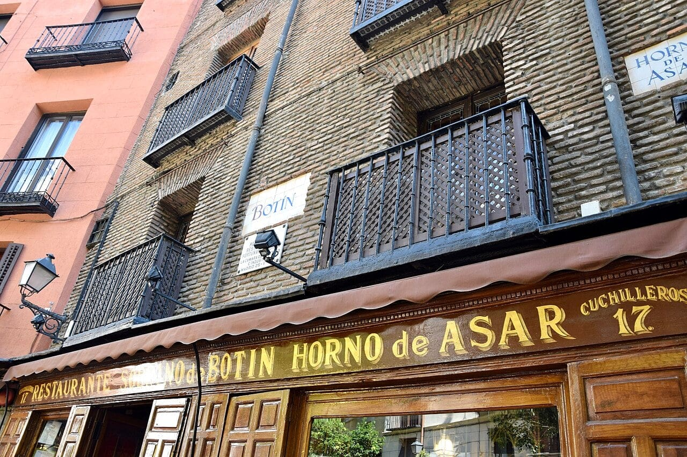

# Botín

At the south-west corner of Madrid's Plaza Mayor runs a short, sloping street called Calle de Cuchilleros. Number 17 has a modest frontage, yet there are almost always people outside peering in, queueing or photographing the wooden sign. Botín (Restaurante Botín, historically Sobrino de Botín) opened here in 1725, is often cited by Guinness World Records as the world's oldest restaurant, and still serves Castilian roast suckling pig, roast lamb and a very Madrid style of old-school service.

Figure: The façade of Botín at Calle de Cuchilleros 17 in Madrid, its awning lettered “Restaurante Sobrino de Botín” and “Horno de Asar”. Image: Ank Kumar, CC BY-SA 4.0, via [source page](https://commons.wikimedia.org/wiki/File:2014_-_Sobrino_de_Bot%C3%ADn_%28Casa_Bot%C3%ADn%29_Restaurant%2C_Madrid%2C_Spain_%28_Ank_Kumar_%29_01.jpg).

> **Quick verdict**
> **In one line:** This entry helps you decide whether Botín deserves a detour, and what to check before visiting.
>
> - **Best for:** Anyone planning a visit to Botín who needs to decide whether it deserves a half-day or a full day.
> - **Not for:** If you want only want a must-visit list and will not check booking, transport or opening hours.
> - **Check first:**
>   - The "oldest" claim needs unpacking.
>   - In 1590 the building enters the written record.

## Why this place

The "oldest" claim needs unpacking. Botín's own history dates the beginning to 1725: the French cook Jean Botín arrived in Madrid with his Asturian wife, hoping to work for a noble family at court; in 1725, his wife's nephew, Cándido Remis, opened a small inn on Calle de Cuchilleros and renovated the ground floor of the building. Guinness World Records, by contrast, usually describes the restaurant as having been opened in 1725 by the French cook Jean Botín and his wife. The accounts differ on the family relationship but agree on 1725 as the start.

The building itself is older than the restaurant. The house history says the earliest documentary record of the present structure dates from 1590; the restaurant moved into a sixteenth-century building rather than constructing a new one. In the nineteenth century it was known as a casa de comidas, a "house of meals", because the word "restaurant" was still reserved for a small number of exclusive places imitating Paris. In the twentieth century the González family took over and, through the Spanish Civil War and the hard post-war years, gradually turned it into what it is today. In 1987 Guinness listed Botín as the world's oldest restaurant in the same edition that repeated an anecdote about the teenage Goya washing dishes here in 1765. The restaurant itself places that story "between history and legend"; readers should not treat it as established fact.

The right expectation, then, is not "the best restaurant in the world" but "a traditional Madrid roast in a family restaurant that has kept trading for nearly three centuries". In 2025 Botín marked its tercentenary. It has not become a museum, and it has not sealed off the old kitchen for visitors; it still lights the fire, roasts meat and turns tables every day.

## Timeline

In 1590 the building enters the written record. In 1725 the small inn opens on Calle de Cuchilleros. In the eighteenth century, guild rules prevented inns from selling meat, wine and other food freely, so guests often brought ingredients to be cooked; this is the origin of the saying that in Spanish inns you could find only what the traveller brought. In the nineteenth century the ground floor was remodelled again, with the polychrome wood frieze at the entrance, shop windows and a pastry counter, and the place became known as a casa de comidas.

In the twentieth century, when the González family took over, Botín had only seven employees, including the couple and their three children; the entrance and second floor were used as the restaurant, the cellar as a storeroom, and the second and third floors as the family's home. During the Civil War of 1936–1939 the restaurant was turned into a dining room for militiamen. After the war, the brothers Antonio and José expanded the business into today's four dining rooms, cellar dining area and stable menu. In 1987 Guinness World Records named it the world's oldest restaurant; in 2025 the restaurant refreshed its branding and held events for its 300th anniversary. Put together, these dates show that "oldest" is not a static plaque but the result of a small business surviving war, regulation and urban change.

## The signature dishes

The signatures are cochinillo asado (roast suckling pig) and cordero asado (roast lamb). The restaurant says its pigs and lambs come from the Sepúlveda–Aranda–Riaza area around Segovia, with deliveries three or four times a week; the meat is slowly roasted in the old oven over holm oak wood, with the fire and embers arranged to one side so that salt, pepper, water, lard, white wine, bay, onion and garlic are distributed evenly. The claim that the oven has been in use since the restaurant's foundation is part of the house narrative; even if not every detail is verifiable, it helps explain the pronounced wood-fire aroma of the meat.

The menu goes beyond the two roasts. The official site also lists line-caught hake, sole, clams Botín-style, Castilian soup and gazpacho, while desserts and the wine list follow a traditional Spanish pattern. Portions are large, and the suckling pig or lamb is best shared by two or more; a small party might order one roast plus a soup or vegetable rather than one main course each. Lunch is generally 13:00–16:00 and dinner 20:00–23:30; the homepage also summarises the hours as daily 13:00–23:30, so confirm the exact service when booking.

Prices sit in the upper-middle range for an old Madrid restaurant; set menus and à la carte are not street-food prices. Check the official menu and your bill for current prices, set-menu contents and service charges. The wine list is predominantly Spanish; for suckling pig, ask for a Rioja or Ribera del Duero red, or simply order the house wine without embarrassment. There are four dining rooms; the cellar is the most atmospheric, but it involves stairs, so mention accessibility needs when booking.

## Getting there

The address is Calle de Cuchilleros 17, 28005 Madrid, immediately south-west of Plaza Mayor. Metro lines 2, 5 and R stop at Ópera, lines 1, 2 and 3 at Sol, and line 5 at La Latina; from any of them it is a few minutes on foot. Coming through the arch from Plaza Mayor, the sloping street and the queue usually make the restaurant obvious. The old streets are narrow, so walking or the metro makes more sense than driving; if you take a taxi, ask to be dropped at the edge of Plaza Mayor, not on Calle de Cuchilleros itself.

Reserving is the most important practical advice. Book lunch or dinner in advance through the official website or by telephone (+34 91 366 42 17), especially at weekends and on public holidays; the restaurant may ask for a credit-card guarantee, and a no-show or cancellation within 24 hours may incur a charge of €25 per guest. If you cannot book, you can ask at the door when service begins, but do not treat walk-in availability as guaranteed. Madrid eats later than northern Europe: 13:00 is early for local diners, and 20:00 at the start of dinner is relatively easy.

Nearby you can combine a meal with Plaza Mayor, the Mercado de San Miguel, the old shops around the square and the Royal Palace; after dinner, La Latina to the south and Puerta del Sol to the east are both close. Botín works best as the main meal of a walking day in this part of Madrid, not as a quick drink stop.

## Common misconceptions

The first misconception is to confuse "oldest" with "best". Guinness records continuous operation, not taste; Botín's strength is traditional roasting, old-school service and atmosphere, not innovation. The second is to treat the restaurant as a museum: the old photographs and literary anecdotes are background, while the core business is still taking orders, turning tables and serving food. The third is to present "Goya washed dishes here" as proven fact; the restaurant itself places the story between history and legend, so enjoy it as an anecdote, not a verifiable biography.

The Hemingway connection also needs care. He was indeed a regular during his Madrid years, the official site and numerous media accounts note that characters in The Sun Also Rises eat at Botín, and the restaurant lists Hemingway, Benito Pérez Galdós, Graham Greene and María Dueñas among its literary guests. But "Hemingway's fixed table" is part of the restaurant's storytelling; the exact table matters less than the broader literary association. A fourth misconception is to expect a quiet, romantic dinner: the place is busy, tables are close together and service moves quickly, so choose a later slot or off-peak day if you want to linger.

When ordering suckling pig, remember that it is rich and fatty, with crisp skin and soft meat; bread and red wine suit it better than beer. For two people, one portion of suckling pig plus a soup or salad is usually more comfortable than two main courses. Tipping is not compulsory in Spain, and service is normally included in the bill; rounding up or leaving a little change is enough. The restaurant expects reasonable dress, but no formal suit is required; the old quarter is hot in summer, and the indoor rooms are more comfortable than the street. This entry was verified on 2026-11-08; opening hours, prices and reservation policies are subject to official confirmation.

## See also

Botín is an old sample from the food history of [Spain](ref:spain): it ties Castilian roasting, Rioja wine and the streets of old Madrid together. To understand the role of such places in the city, read [pubs and the city](ref:pub-and-city); if you care more about what is in the glass, start with the styles and food-matching logic of [wine](ref:wine), then return to why a plate of roast suckling pig goes so well with red wine.

Further reading: [A Ginjinha](ref:c-extra-1), [À la Mort Subite](ref:c-extra-2).
