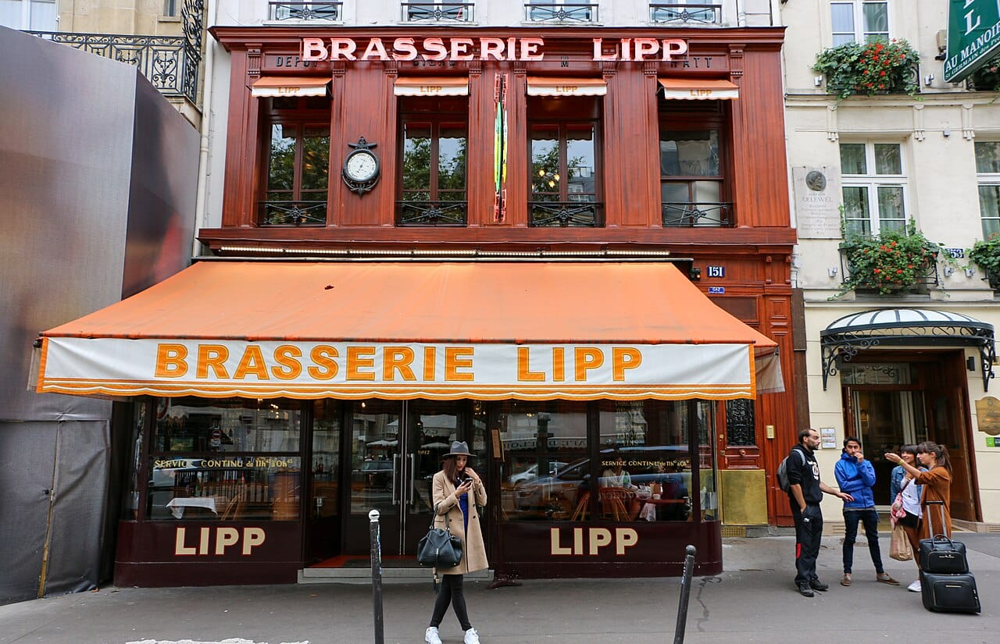

# Brasserie Lipp

At 151 Boulevard Saint-Germain, a facade covered in glazed floral tiles and an old "BRASSERIE LIPP" sign mark the entrance. Unlike Café de Flore, it does not spill seats onto the pavement; unlike a grand restaurant, it has no doorman. Step through the old revolving door and you find dark woodwork, mirrors, leather banquettes and tightly packed tables. At lunch and dinner there is always someone eating, talking business or watching the room. It is a brasserie, but more than that it is Saint-Germain-des-Prés's political and literary drawing room.

Figure: The glazed-tile facade and awning of Brasserie Lipp, 151 boulevard Saint-Germain. Image: Daniel Cruz Valle, CC BY 2.0, via Wikimedia Commons ([source page](https://commons.wikimedia.org/wiki/File:Brasserie_Lipp,_Paris_17_September_2016.jpg)).

## Location and history

On 27 October 1880 Léonard Lipp and his wife Pétronille opened the brasserie on Boulevard Saint-Germain. Alsace had been annexed by Germany after the Franco-Prussian War, and Lipp, like many of his compatriots, moved to Paris; he brought two skills — judging beer and making choucroute — and opened a "Rhine-side" brasserie. The first shop had only a few marble tables, beer taps and a barrel of sauerkraut, serving Alsatian home cooking.

During the First World War, anti-German feeling led the house to rename itself "Brasserie des Bords" for a time. In July 1920 Marcelin Cazes, from Laguiole, took over and had the shop redecorated in the then-fashionable mix of Art Nouveau and Art Deco: Léon Fargue's glazed wall ceramics, Charly Garrey's painted ceilings, brown leather banquettes and mirrors. From then on Lipp became a meeting point for writers, publishers, deputies and ministers; the Paris Tourist Office says it gradually turned into "a branch of Parliament".

In 1935 Marcelin Cazes established the Prix Cazes for French-language fiction; in 1955 he passed the house to his son Roger Cazes; in 1990 the Bertrand family took over, continuing the Auvergne and Alsatian threads. In 1989 the ground-floor restaurant and its decoration were listed as a historic monument. The house still keeps legends around old table numbers: table 1, near the bar, is often described as Mitterrand's place for oysters with Mazarine; table 8 is the "lovers' table", where two people sit side by side.

## The rooms and the drinks

Lipp's space is narrow, deep and dense. The exterior is glazed tile and a red awning; the interior is dark woodwork, mirrors, brass coat hooks, leather banquettes and white tablecloths, with tables close together and waiters threading through the aisles. There are no large windows or open kitchen; the light is warm, brightest near the windows by day, and at night the room feels like an old theatre box.

The menu is Alsatian and Auvergnat home cooking: choucroute garnie with sausages, bacon and potatoes, cassoulet (usually on Thursdays), steak, duck confit, fish, foie gras, and profiteroles, baba au rhum and tarte Tatin. The wine list is built on classic French regions: Alsatian whites, champagne, the Loire, Burgundy and Bordeaux, plus beer and a few classic cocktails. It does not chase vintage hype; the logic is pairing: white with choucroute, a south-west red with cassoulet, a sweet wine or coffee with profiteroles. This is not a "creative modern" restaurant; its strength is steady, generous traditional cooking.

## How to drink here

At midday, order choucroute or cassoulet with an Alsatian white wine or a beer; the acidity of the sauerkraut and the richness of the pork need wine to cut through, and white works better than red. In the evening, steak, duck confit or fish with Bordeaux or Burgundy; for dessert, profiteroles or baba au rhum with a sweet wine or coffee.

For drinks only, the bar area is easier than the restaurant; a glass of champagne, a kir or a beer with a snack, watching the boulevard. Do not expect a "Mitterrand menu" or a fixed commentary; Lipp is a working restaurant, and ordering, eating and watching the room is how you enter it.

## Practical information

- Address: 151 Boulevard Saint-Germain, 75006 Paris.
- Hours: daily 09:00–02:00, continuous service; holidays and special events can alter this.
- Transport: metro Line 4 to Saint-Germain-des-Prés; buses 39, 63, 86 and 95 stop nearby.
- Reservations: book ahead for dinner; lunch and late night usually accept walk-ins, though weekends and political or publishing events fill the room.
- Prices: a full meal is expensive; a bar drink and snack cost much less than a restaurant dinner.
- Dress: the old sign at the door says "tenue correcte"; a suit is not required, but flip-flops, sports shorts and vests are out of place.

## Etiquette and common mistakes

First, do not simply sit at table 1 or table 8 because Lipp is famous; those tables have regulars and bookings, and staff will seat you. Second, do not read "branch of Parliament" as present-day politics; it describes the twentieth-century guest list, while today the room is more publishers, lawyers, visitors and local diners. Third, do not order only a coffee and occupy a restaurant table; for a drink, stay at the bar or ask whether a bar place is free. Fourth, do not infer from "1880" that every fixture is original; the 1920s Cazes redecoration and later restorations overlap, and the 1989 listing covers the ground-floor restaurant and its decoration as a whole. Fifth, do not use flash while people are eating; Lipp's guests are sensitive about being watched, so ask before photographing.

## Around and nearby

From Lipp, two minutes east are Café de Flore and Les Deux Magots, west are Rue de Rennes and Montparnasse, north across Boulevard Saint-Germain are the church of Saint-Germain-des-Prés and the direction of the Musée d'Orsay. A route might run: the church, lunch at Lipp, coffee at Les Deux Magots or Flore, the Musée d'Orsay and the Seine. For the Montparnasse literary circle, walk ten minutes south to La Closerie des Lilas and La Coupole.

## Further reading and see also

- The house's "about" page: <https://www.brasserielipp.fr/zh/about-us/> for 1880, the 1920 Cazes era, the 1935 Prix Cazes, the 1989 listing and the decoration.
- The Paris Tourist Office entry: <https://en.parisinfo.com/paris-restaurant/93697/Brasserie-Lipp> for the literary and political guests and the "branch of Parliament" description.
- Groupe Bertrand's group-menus PDF: <https://evenement.groupe-bertrand.com/wp-content/uploads/2024/04/LIPP-PE24-MENUS-GROUPES-1.pdf> to cross-check 1880, 1920, 1990 and the address.
- Nearby `place:cafe-de-la-paix`, `place:la-closerie-des-lilas` and `place:la-coupole` compare different Paris literary café and brasserie types.
- For the Saint-Germain route, see `route:saint-germain-literary-cafes`.
- Related entries: [La Closerie des Lilas](ref:closerie)、[Café de la Paix](ref:paix)、[La Coupole](ref:coupole)、[Saint-Germain literary cafés route](ref:saint-germain)、[Hemingway Bar at the Ritz, Paris](ref:hemingway)

Brasserie Lipp is best approached through the address, then the current opening status, and then what the place is known for. One check alone will not settle it.

[La Closerie des Lilas](ref:closerie) and [La Coupole](ref:coupole) answer different questions about Brasserie Lipp: address and space and operating status. Read them as a pair, not as alternatives.

**In brief:** Brasserie Lipp at 151 Boulevard Saint-Germain was opened in 1880 by the Alsatian Léonard Lipp; after Marcelin Cazes took over in 1920 it became a meeting place for writers and politicians, was listed as a historic monument in 1989, and still serves choucroute and profiteroles.

**Key facts.**

| Item | Detail |
| --- | --- |
| In one line | Brasserie Lipp at 151 Boulevard Saint-Germain was opened in 1880 by the Alsatian Léonard Lipp; after Marcelin Cazes took over in 1920 it became a meeting place for writers and politicians, was listed as a historic monume… |
| Address | 151 Boulevard Saint-Germain, 75006 Paris, France |
| City and country | Paris / France |
| Status | verified open |
| Official site | brasserielipp.fr |

**Sources and limits.** The key claims about Brasserie Lipp are checked against the following sources: Brasserie Lipp (Used for the 151 boulevard Saint-Germain address and the daily 09:00–02:00 hours), Paris Convention and Visitors Bureau, Groupe Bertrand. For current products, addresses or opening status, use brasserielipp.fr. Prices, batches and status change; the body is project-written and does not reproduce source text.

For Brasserie Lipp, this entry was last checked in 2026; prices, batches and availability change, so confirm them against the sources below.
