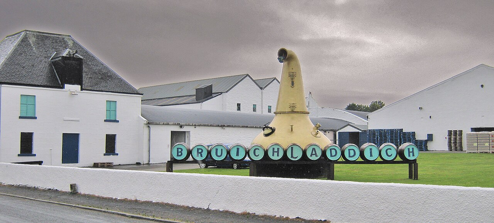

# Bruichladdich Distillery

Drive west from Bowmore and the road follows the south shore of Loch Indaal: grey-blue water on the left, low grass banks and white distillery buildings on the right. Bruichladdich has none of the grand gateways some distilleries build. It looks like a working Victorian factory—white walls, black window frames, a tall chimney, and the words “PROGRESSIVE HEBRIDEAN DISTILLERS / BRUICHLADDICH / SINCE 1881” painted across the wall. The wind is strong, the sea is close, and the smell of the distillery mixes with salt.

Figure: The white-washed distillery buildings and entrance at Bruichladdich, beside Loch Indaal. Image: Fumaro, CC BY-SA 3.0, via Wikimedia Commons ([source page](https://commons.wikimedia.org/wiki/File:Bruichladdich-Islay.jpg)).

## Location and history

Bruichladdich was built in 1881 by the Harvey brothers William, John and Robert. They came from a Glasgow whisky dynasty but built what the official history calls a “state-of-the-art” distillery on Islay: close to the loch for coal, barley and shipping; on a gentle slope so gravity could move material through the process; with a cathedral-like stillhouse for three pairs of unusually tall, narrow-necked stills. The official history says the design gave the spirit its elegance.

The story was not smooth. The brothers fell out; poor management, Prohibition, the Depression and two world wars brought repeated closures and changes of ownership. The distillery closed in 1929, was sold to a whisky conglomerate in 1938, passed through several owners, and was mothballed in 1994 before being sold to Jim Beam Brands. In 2000 the London wine merchant Mark Reynier and his business partner Simon Coughlin assembled investors and bought the semi-derelict site; distillation restarted in 2001 with Jim McEwan as master distiller. Rémy Cointreau bought the distillery in 2012, and in May 2020 Bruichladdich became one of the first Scotch whisky companies to obtain B Corp certification.

The famous anecdote is Reynier writing to the owners every January for nine years, then closing the £6.5 million deal on 19 December 2000 with the final funds arriving two minutes before noon. The more important shift was philosophical: the new owners brought the wine world’s idea of terroir into whisky, arguing that barley origin, Islay water and sea air, and differences between batches mattered as much as consistency.

## Architecture and site

Bruichladdich is a working Victorian distillery, not a museum set. The white walls, black-framed windows, stone bases, narrow production buildings and tall chimney remain, and the copper stills are still in use. The visitor route passes through mashing, fermentation, distillation and warehousing. Space is tight in places, with stairs, thresholds and wet floors when production is running. The beauty is in proportion and repetition: a row of white walls, a few black windows, a name board, and the sea behind.

The visitor centre is deliberately modest. The Laddie Shop and reception sit on one side, the production area on the other, and on a clear day the front door is a place to look at Loch Indaal. The architectural point is not a single exhibit but the way the buildings sit on the land: low volumes, a gravity-led flow, warehouses close to the shore. It is a reminder that a distillery is first a factory and only second a brand experience.

## Spirits and flavour

Bruichladdich makes four spirits under one roof: unpeated Bruichladdich single malt, heavily peated Port Charlotte, super-heavily peated Octomore, and The Botanist gin. It is more accurate to treat them as four distinct spirits than as four marketing tiers: they share buildings, equipment and people, but differ in peat level, barley provenance and distillation parameters.

The Bruichladdich line usually shows sea salt, green apple, citrus, honey, malt and a light smoke. It is not an Islay “peat bomb”, and first-time drinkers are often surprised by how clean it is. Port Charlotte raises the peat: smoke, ash, seaweed and darker fruit become more prominent. Octomore is one of the official “most heavily peated” Scotch whiskies, often above 80 ppm, but high peat does not mean coarse; the spirit retains sweetness and oiliness. The Botanist uses 22 wild Islay botanicals in a re-engineered Lomond still; it shares the site but follows a completely different product logic.

Bruichladdich emphasises place. The official FAQ says 52% of annual production now uses Islay barley, and that everything is conceived, distilled, bottled and matured on Islay. The distillery rejects caramel colouring (E150a) and avoids shortcuts beyond reduction with water. These choices do not guarantee that every bottle suits every drinker, but they make the relationship between raw material, process and place easier to taste.

## How to drink

For a first visit, the 90-minute Guided Distillery Tour is the safest choice: production buildings, stills, warehouses and a few basic drams. For more depth, the Warehouse Tasting takes you to the casks for spirits straight from the barrel; it is longer, more expensive and better suited to someone who already knows what they like. The UK tours page lists the guided tour from £15, the warehouse tasting from £40 and the full Bruichladdich Experience from £55, but regional pages may show different currencies and prices; check the checkout page.

Taste from unpeated to heavily peated: Bruichladdich first, then Port Charlotte, then Octomore. If you start with Octomore, the smoke will overwhelm what follows. Smell each glass twice, then take a small sip; a drop or two of water can open the aroma, but ice will close it down. Do not join a tasting if you are driving. The distillery may offer drivers samples to take away, but “take away” does not mean “drink now”.

If you have time for only one event, choose the tour rather than the bar. The point of Bruichladdich is the production site, not the menu. During Fèis Ìle the distillery hosts special events; dates and tickets follow the official announcement, and it is the busiest week on the island, so book ferries and accommodation far ahead.

## Practical information

- Address: Bruichladdich, Isle of Islay PA49 7UN, Scotland.
- Coordinates: 55.7666, -6.5028.
- Telephone: +44 (0)1496 850 190.
- Opening: March to October daily 09:45–17:30; November to February Tuesday–Sunday 09:45–17:00. Holidays and events may alter hours.
- Tours: 90-minute guided tour, 90-minute warehouse tasting, 150-minute full experience and a Botanist cocktail class; book ahead, especially in summer.
- Age: tastings are 18+; only the Distillery Tour accepts all ages, and other experiences are usually adults only.
- Transport: about 30 minutes by car from Islay Airport (ILY); about 30 minutes from the Port Ellen or Port Askaig ferry terminals. Public transport is limited; self-drive or a private driver is the practical choice.
- Weather: wind and rain arrive quickly. Bring a windproof/waterproof jacket and grippy shoes; the production areas are cool even in summer.
- Accessibility: the visitor centre is accessible, but the production route has stairs, thresholds and wet floors. Contact the distillery in advance if you need wheelchair access or assistance.

## Etiquette and common misunderstandings

First, do not assume every Islay whisky is heavily peated. Bruichladdich’s core single malt is unpeated; Port Charlotte and Octomore are the peated lines. Second, Port Charlotte and Octomore are not separate distilleries; they are brands made at Bruichladdich. Third, do not judge Bruichladdich only by age. Many releases are about cask type, batch and Islay barley rather than long maturation. Fourth, do not touch equipment, valves or cask racks in the production area; the distillery is still working, not a playground. Fifth, do not wear heavy perfume into a tasting room or talk loudly with whisky in your mouth; spitting is a normal tasting action.

There is also a historical ethics to the visit. Islay distilling is entangled with land, tenancy, poverty and emigration, not only sea air and peat. When you see the old buildings, warehouses and pier, it is worth asking how the whisky was shipped out, and by whom and under what conditions it was made.

## Around and routes

Bruichladdich sits on the west side of Loch Indaal. South lies Port Charlotte, Kilchiaran and Loch Gorm; north lies Bowmore and Port Askaig. To place the distillery in an “Islay south coast” day, continue to [Lagavulin](ref:lagavulin), [Laphroaig](ref:laphroaig) and [Ardbeg](ref:ardbeg); the three sit on the same coastal road, close enough to combine. The [Islay whisky trail](ref:islayroute) works best over two or three days.

For a single day, Bruichladdich plus Bowmore is a relaxed pairing. To add the south coast three, allow at least two days. Before flying back to Glasgow, stop at Bowmore’s round church and pier. For a “peat versus no peat” comparison, Bruichladdich and the south coast trio are the best combination; to switch to Speyside fruit and sherry-cask styles, continue on the [Speyside malt trail](ref:speyside) or visit [Glenfiddich](ref:glenfiddich) for a very different scale of visitor experience.

## Further reading and see also

- Official history “Breaking the Mould”: <https://www.bruichladdich.com/blogs/news/breaking-the-mold>, for the 1881 build, the 1929/1938/1994 closures and sales, the 2000 purchase and 2001 restart.
- Official FAQ: <https://us.bruichladdich.com/pages/faqs>, for the four spirits, 52% Islay barley, the 2012 acquisition, 2020 B Corp and opening hours.
- Official tours page: <https://uk.bruichladdich.com/pages/tours>, for tour types, lengths, prices and the 18+ rule.
- Rémy Cointreau brand page: <https://www.remy-cointreau.com/en/brands/bruichladdich-port-charlotte-octomore/>, for the 1881/1994/2000/2001/2004/2012/2020 timeline.
- Islay comparisons: [Lagavulin](ref:lagavulin), [Laphroaig](ref:laphroaig), [Ardbeg](ref:ardbeg), [Islay whisky trail](ref:islayroute), [Fèis Ìle 2026](ref:feis).
- Other Scottish routes: [Speyside malt trail](ref:speyside), [Glenfiddich](ref:glenfiddich), [Scotch Whisky Experience](ref:scotchexperience).
