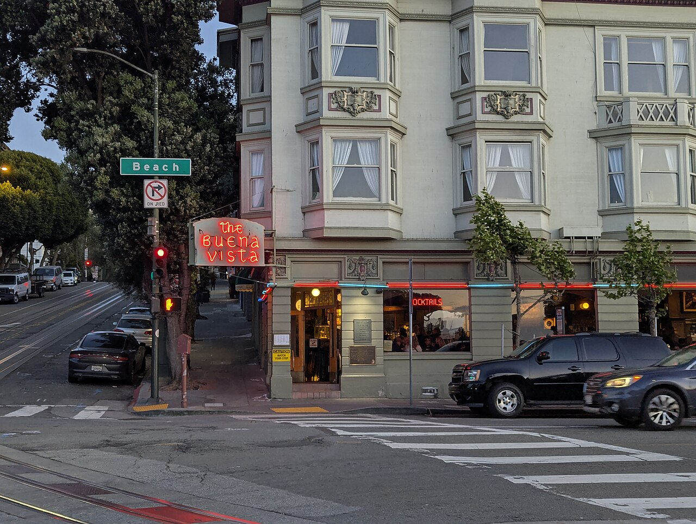

# Buena Vista Café

At the end of the Powell-Hyde cable car line, where Hyde Street meets Beach Street, a low corner building faces the bay. Inside, the bar is often full before noon, and almost everyone is holding a glass of Irish coffee: dark coffee, a layer of pale cream, no visible stirring. This is the Buena Vista Café. It is a neighborhood bar, a cable-car terminus and one of the most famous Irish coffee destinations in the United States. The drink is not an Irish import in the literal sense; its American popularity is closely tied to this room.

Figure: The corner exterior of the Buena Vista Café at Hyde and Beach Streets, San Francisco; the bar opened in 1916 in the ground floor of a boarding house and became associated with the American Irish coffee after 1952, and this is a 2025 street view. Image: BriefEdits, CC BY-SA 4.0, via Wikimedia Commons ([source page](https://commons.wikimedia.org/wiki/File:Buena_Vista_Cafe_(November_2023).jpg)).

## Location and history

The Buena Vista opened in 1916 on the ground floor of a boarding house at Hyde and Beach. It was originally a bar for the waterfront and the cable-car crews; the building's address, 2765 Hyde Street, is still the same. The cable car line outside is the Powell-Hyde, and the turnaround at Aquatic Park is one of the most photographed transit scenes in San Francisco.

The Irish coffee story begins in 1952. Stanton Delaplane, a San Francisco Chronicle travel writer, had tasted Irish coffee at Shannon Airport in Ireland and wanted to reproduce it in San Francisco. He brought the idea to Jack Koeppler, the Buena Vista's owner at the time; the two experimented with cream, sugar, coffee and whiskey. The first attempts failed because the cream sank or the drink was too cold. The version that worked used lightly whipped cream, a pre-warmed glass and a specific pouring technique. The date usually given is 10 November 1952, when the drink was first served at the Buena Vista.

The cream problem led to a maturation rule. The café says its cream is aged for 48 hours so that it whips to the right consistency and floats on the coffee rather than sinking. The whiskey is Irish, the coffee is strong and hot, and the glass is six ounces. The recipe is not a secret in the patent sense; the method is the identity. The Buena Vista has trademarked the phrase and trains its staff to assemble the drink in a fixed order.

The claim “the first American Irish coffee” needs a qualifier. The drink existed in Ireland and had been served in other American bars before 1952. The Buena Vista's contribution was to make it famous, standardize it and turn it into a San Francisco ritual. Delaplane and Koeppler are usually credited with the American version, not with the invention of Irish coffee itself.

## Space and drinks

The café occupies a corner building with large windows facing the cable-car turn. The front bar is usually crowded; the back room and the second floor are quieter. The decor is old San Francisco: wood, mirrors, maritime photographs, a long bar and a menu board. The room is not elegant, but it is comfortable in the way a working waterfront bar can be. At the right time, you can watch the cable cars rotate on the turntable while you drink.

The menu is short and traditional: Irish coffee, other coffee drinks, beer, wine, cocktails, breakfast items, sandwiches, soups and simple seafood. The Irish coffee is the reason most people come; the food is secondary but reliable. There is no need to order a full meal to sit at the bar, but during peak hours the café may limit how long a party can hold a table.

## How to drink

The correct Irish coffee at the Buena Vista is not stirred. The cream sits on top, and you drink the hot coffee through the cream; the layer should be thick enough to hold a line but not stiff like whipped cream. Do not mix it with a spoon. If the cream is too heavy, it will sink; if the coffee is not hot enough, the drink will taste flat. The café's training is designed to prevent both.

Morning is the classic time: the cable cars are running, the bay is visible, and the bar is busy but not impossible. Afternoon and sunset are busier; weekends are the worst. For a quieter drink, go upstairs or to the back room. Irish coffee is strong; one is usually enough before a walk.

## Practical information

The address is 2765 Hyde Street, San Francisco, CA 94109, at Hyde and Beach. The Powell-Hyde cable car stops at the door; the Powell-Mason line is a short walk away. Official hours: Monday–Thursday 09:00–23:00 with the kitchen closing at 21:30, Friday 09:00–24:00, Saturday 08:00–24:00, Sunday 08:00–23:00. Holiday hours can differ.

The café accepts credit cards. Reservations are not usually taken; seating is first come, first served. Dress is casual; layers are useful because the wharf is cold even when the sun is out. Tipping 18%–20% is standard. The cable car is a better way to arrive than driving; parking near Fisherman's Wharf is expensive and scarce.

## Etiquette and common misconceptions

The first misconception is that the Buena Vista invented Irish coffee. It popularized and standardized an American version; the drink came from Ireland. The second is stirring the cream into the coffee; the layered presentation is the point. The third is expecting a quiet romantic bar at sunset; the location is a major tourist junction, and the bar can be loud. The fourth is ordering a large Irish coffee; the six-ounce glass is the house standard, and refills are separate drinks. The fifth is assuming the cable car runs all night; service ends in the evening, so check the schedule before a late visit.

## Nearby and routes

Leave the café and walk along Hyde Street Pier to the San Francisco Maritime National Historical Park, or take the cable car up Hyde Street to Russian Hill and Lombard Street. The Buena Vista fits a “San Francisco literary and bar” route with [Vesuvio Café](ref:vesuvio) in North Beach and [City Lights](https://citylights.com/) nearby; for the drink itself, read [Irish Coffee](ref:irish-coffee); for comparison, read [Union Oyster House](ref:union) in Boston and [Bell in Hand](ref:bell) for two very different historic-bar models, and [Understanding a City Through Its Pub](ref:pub-city) for the wider context.

## Further reading and see also

- [Irish Coffee](ref:irish-coffee)
- [Union Oyster House](ref:union)
- [Vesuvio Café](ref:vesuvio)
- [Bell in Hand Tavern](ref:bell)
- [Understanding a City Through Its Pub](ref:pub-city)

Read [Irish Coffee](ref:irish-coffee) for the address and space side of Buena Vista Café, and [Vesuvio Café](ref:vesuvio) for the operating status side. Together they locate it on a map.

Checked on 2026-11-21: the address at 2765 Hyde Street, the cable-car line location and current opening arrangements were confirmed on the official site. Versions of Irish coffee and the claim that the café invented it are qualified in the body. Image credits and licences are given in the captions.
