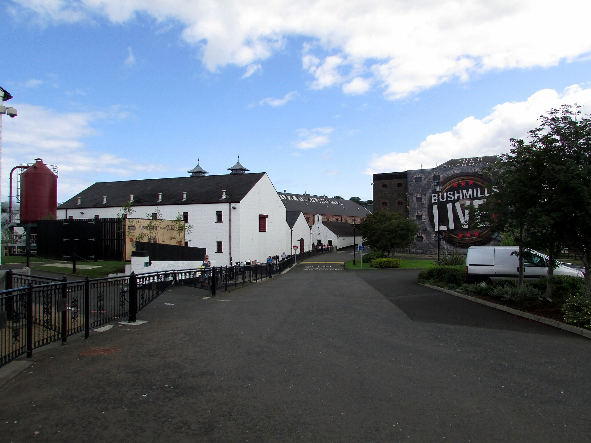

# Bushmills Distillery

Bushmills is a village on the north coast of County Antrim, Northern Ireland, and the distillery stands beside the River Bush, about two miles from the Giant's Causeway. Its loudest claim is to be "the world's oldest licensed whiskey distillery", based on a distillation licence dated 1608. The buildings you actually visit — the production halls, visitor centre and 1608 Bar — were built and rebuilt much later. Keeping the licence date, the distillery's own history and the standing buildings apart is the first step to reading the place.

Figure: Related photograph of Bushmills Distillery. Image: Reading Tom, CC BY 2.0, via Wikimedia Commons ([source page](https://commons.wikimedia.org/wiki/File:Bushmills_Whiskey_Distillery_02.jpg)).

## A village, a river and a licence from 1608

In 1608 King James I granted land and rights in the Bushmills area to Sir Thomas Phillips, including the right to distil, and the distillery dates its story from that licence. The claim appears in the official account and in Northern Ireland tourism material, but "oldest" refers to a tradition of licensed distilling on the site rather than to a seventeenth-century building. What kept Bushmills working was the river, the farming hinterland, and later the railways and ports that carried casks out.

Today the distillery is about an hour by car from Belfast and two and a half hours from Dublin. Public transport usually means a train to Coleraine and then a bus or taxi into the village; the distillery has no railway line, and parking on site is easiest. Coordinates should be taken from official channels; for navigation, use the address.

## Triple distillation as the Irish frame

The distillery puts triple distillation at the centre of its identity: 100% malted barley is distilled three times in copper pot stills, giving a cleaner new make with clearer fruit, and that is the base of its single malt. Triple distillation is a tradition at many distilleries in [Ireland](ref:ireland), but it is not a legal requirement for [Irish whiskey](ref:irish); the rules concern raw materials, distillation strength, maturation and labelling. Compared with the double distillation common in Scotland, a third pass usually produces a lighter body, which puts more weight on cask maturation.

To follow the point, read [distillation](ref:distillation) alongside [pot still](ref:potstill). The number of passes shapes the skeleton of the new make; cask type and time decide what it becomes. Blends also contain grain whiskey, so "triple distilled" does not mean "all single malt".

## Inside the works: from mash to bottling

A tour usually gathers in the visitor centre, sets out the village and licence history, then moves through the mash house, washbacks, still house, maturation warehouses and finally a tasting room. This is a working plant rather than a museum set, so the air carries malt, yeast and copper. The bottling line runs on weekdays and is normally idle on Friday afternoons and at weekends; production can also pause for maintenance or scheduling, so the route changes from visit to visit.

Floors can be wet and stairs are common, so sturdy shoes beat formal ones. If steam, noise or strong smells bother you, tell the guide early. Do not cross the yellow lines, touch valves or reach into a washback; those rules are not decorative, because the production areas are hot and the machinery is running. For a drink without a tour, the 1608 Bar serves, subject to age rules.

## Reading the range: from Original to single malt

The entry point is Bushmills Original, a blend of pot still malt and grain whiskey, light and clean, at home in a highball or over ice. Black Bush has a higher malt content and Oloroso sherry casks, so dried fruit and spice come forward; Red Bush leans on bourbon casks for a sweeter, more direct profile. The single malts commonly include 10, 12, 16 and 21 years, with different cask programmes and prices.

Older is not automatically better: the 10-year-old's apple and malt, the 12-year-old's sherry weight and the 16-year-old's layered casks serve different purposes. If you want a reference point, order a core flight before deciding what to buy. The shop carries travel-retail exclusives and older single bottles; think about luggage space and customs before you pay. Once opened, the bottle will change, so the tasting-room dram is not a guarantee at home.

## Booking, arriving and opening

The address is 2 Distillery Road, Bushmills, Co Antrim BT57 8XH, Northern Ireland. Book tours online in advance; high season and weekends fill up, and groups of 12 or more must arrange a booking and deposit. The official site lists the gift shop and 1608 Bar as open Monday to Saturday 10:00–17:00 and Sunday 11:00–17:00, while tour times change with the season. Children under eight are not admitted to the standard guided tour, and under-18s cannot join the premium tasting.

Tour prices run roughly from £15 to £50 depending on the format; check the official site for the day. The Giant's Causeway, Dunluce Castle and Portrush are all within half an hour, so the distillery fits a coastal day. Without a car, change at Coleraine and check return times; evening rural buses are thin.

## Visiting notes and the neighbourhood

This is a production site, not a bar: do not enter the works without a booking, and do not touch stills, pipes or cask racks. Nose before you sip, and use the spittoon if you do not want to finish a dram. Anyone driving should not drink at all; Antrim's country roads are narrow and winding, so a designated driver, a private car or a tour with transport is the safe arrangement.

To set Irish whiskey's two narratives side by side, add [Jameson Bow Street](ref:jameson) in Dublin: one site still distils, the other is now a visitor experience, and the contrast makes the difference between a working distillery and a distillery museum clear. Leave time for the Giant's Causeway, Dunluce Castle and the village itself.

**Short definition:** An Irish whiskey distillery in the village of Bushmills, County Antrim, Northern Ireland, which dates its licence to 1608 and calls itself the world's oldest licensed whiskey distillery; it still triple distils in copper pot stills and runs booked tours, a gift shop and the 1608 Bar.

**Key facts.**

| Item | Detail |
| --- | --- |
| In one line | An Irish whiskey distillery in the village of Bushmills, County Antrim, Northern Ireland, which dates its licence to 1608 and calls itself the world's oldest licensed whiskey distillery; it still triple distils in copper… |
| Address | 2 Distillery Road, Bushmills, Co Antrim BT57 8XH, Northern Ireland |
| City and country | Bushmills / United Kingdom |
| Status | verified open |
| Official site | bushmills.eu |

**Sources and limits.** The key claims about Bushmills Distillery are checked against the following sources: Bushmills (Used to check the official wording on the 1608 licence, triple distillation and 100% malted barley), Tourism Ireland (Used to check tour times, the price range and group booking advice), Tourism NI (Used to check the village setting and the distance to the Antrim coast and the Giant's Causeway). For current products, addresses or opening status, use bushmills.eu. Prices, batches and status change; the body is project-written and does not reproduce source text.
