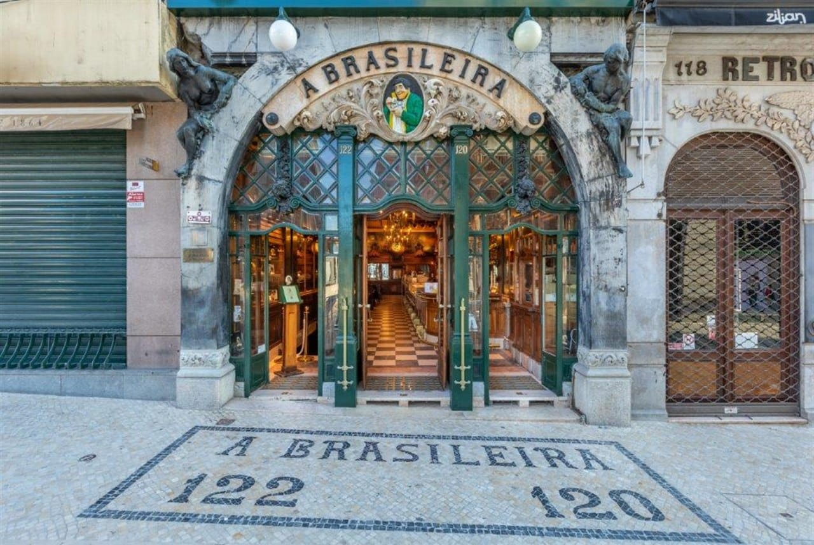
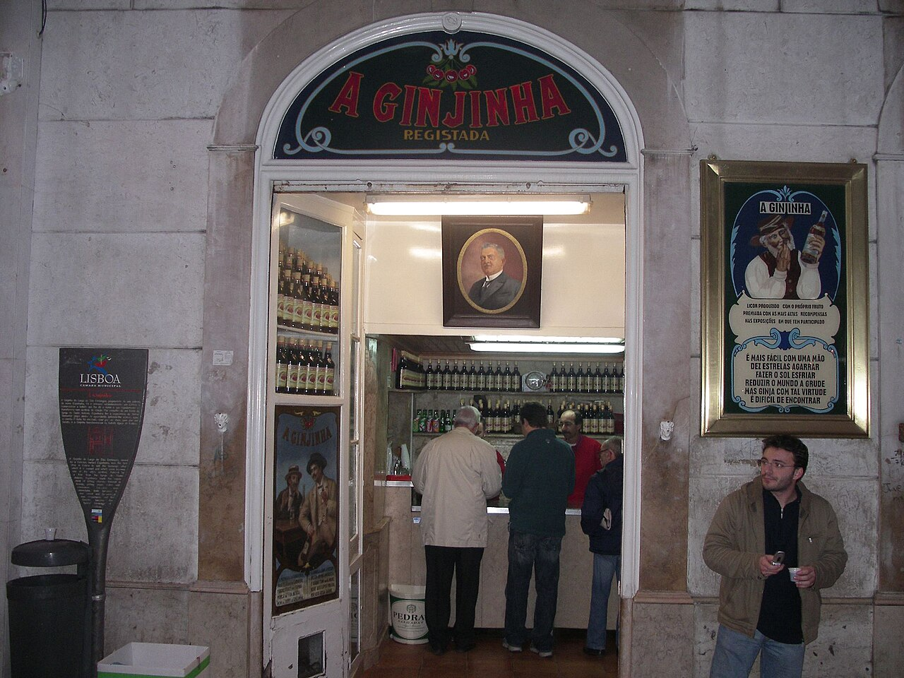

# A Brasileira

On the slope of Rua Garrett, A Brasileira’s dark-green awning and gold lettering are hard to miss. At a small round table by the door, a bronze Fernando Pessoa sits with his chin on his hand and a book open on his knee, as if he might look up and ask a passer-by for a coffee. Visitors queue to photograph the statue; locals step around them and push through the door into a café of mirrors, dark wood, and marble counters. It is Chiado’s closest thing to a civic living room, and Lisbon’s most successful attempt to turn literary memory into an everyday business.

Figure: The Art Nouveau facade of Café A Brasileira on Rua Garrett in Chiado. Image: VDT2021, CC BY-SA 4.0, via Wikimedia Commons ([source page](https://commons.wikimedia.org/wiki/File:A_BRASILEIRA_DO_CHIADO.jpg)).

## Location and history

A Brasileira opened in 1905, founded by Adriano Telles. The name means “the Brazilian woman,” but the original business was Brazilian coffee: the shop sold coffee beans and promoted coffee from Brazil at a time when the trade between Portugal and Brazil was thriving. It did not begin as a literary café. It became one because of its position, its clientele, and its interior—writers, painters, doctors, lawyers, and republicans gradually made it a meeting place.

The official brand history credits the 1905 façade and interior to the architect Manuel Norte Júnior, working in the Parisian Art Nouveau taste of the period: curved metalwork, plant motifs, mirrors, and wood panelling. The aim was not nostalgia but a modern urban showcase. In the 1920s, Pessoa began to visit regularly. He usually chose a quieter corner, where he could read, write, and observe. In 1988, the centenary of his birth, a bronze seated statue was placed outside. Since then, “having coffee with Pessoa” has become a standard Chiado ritual.

## Architecture and space

The shop retains the essentials of its 1905 layout: the glass front and dark-green awning, a long bar just inside, mirrored walls and wood panelling, and a rear dining area. The Art Nouveau metalwork is restrained rather than spectacular, but under warm yellow light it has weight; the mirrors fold the modest room into several layers, reflecting the street by day and the chandeliers and customers at night. The pavement terrace is the most sought-after seat because it faces the flow of Rua Garrett and the Pessoa statue.

There are two ways to use the space. The first is “a drink at the bar”: order a coffee or a glass of wine, stand or perch, and leave. The second is “sit down”: the terrace, inner salon, and dining area work for breakfast, afternoon coffee, or dinner. The two rhythms coexist, which is why the café feels more alive than a purely tourist-oriented monument. Photographers should avoid midday and weekend afternoons, when the statue is surrounded by queues.

## The drinks

A Brasileira’s signature is coffee, especially the Lisbon-style short espresso called a bica. It is usually shorter and stronger than an Italian espresso, served in a hot cup with a light brown crema. Order “um café” or “uma bica”; if you dislike bitterness, ask for a garoto (a short coffee with a little milk) or a galão (a long milk coffee). The classic accompaniment is a pastel de nata, an almond biscuit, or a chocolate cake.

The drinks list is that of a café-restaurant rather than a cocktail bar: port, Madeira, Portuguese white wines, champagne, and simple cocktails. In the afternoon, a dry white or a port with a small snack works well; in the evening, a cocktail or a wine with a full meal. Do not expect a documented “Pessoa drink.” What he drank and which table he used are literary legends more than menu facts. The safest order is a bica, a pastel de nata, and two minutes on the terrace before deciding whether to add alcohol.

## How to drink

From the 08:00 opening until about 10:00 is the quietest window, good for breakfast, a newspaper, and watching the staff set out the terrace chairs. From midday to 15:00, Rua Garrett is at its busiest and the terrace is usually full; arrive early or stand at the bar. After 18:00 the lighting warms up and a glass of wine with a snack feels right; for dinner, book or avoid the peak.

Whether you sit first or order first depends on the area: the terrace usually has host seating, while the bar accepts direct orders. Do not pose for long beside the Pessoa statue, sit on its lap, or rest a cup on the book; it is a public sculpture, not a prop. Do not carry the coffee cup into the street; in Lisbon cafés, cups stay on the table for the waiter.

## Practical information

- Address: Rua Garrett 120-122, 1200-205 Lisbon.
- Hours: daily 08:00–02:00 (Visit Lisboa; holidays and special events may differ).
- Transport: Baixa-Chiado metro (green/blue lines); Rossio and Praça do Comércio are a 5–8 minute walk.
- Reservations: recommended for full meals; breakfast, coffee, and the terrace are usually walk-in.
- Prices: coffee and pastries are everyday; full meals and the wine list are higher. Check the menu for terrace service charges.
- Accessibility: there is a step at the entrance and narrow circulation inside; ask about the side entrance or call ahead.
- Nearby: Livraria Bertrand, the National Museum of Contemporary Art, and Teatro Nacional de São Carlos are within minutes.

## Etiquette and common misconceptions

First, do not treat A Brasileira as only a statue stop; it is a working café, and guests need the doorway and the tables. Second, do not order an “espresso” when you want a bica; the Lisbon term gets you the right short cup. Third, do not assume every seat is available for coffee only; the dining area usually requires a meal at lunch and dinner. Fourth, do not climb or sit on the statue; you may stand beside it, but it is not furniture. Fifth, do not date the café’s opening to a later move; the official history says it opened in 1905, with Norte Júnior’s façade and interior. Sixth, do not confuse it with Porto’s cafés; A Brasileira’s literary memory belongs to Chiado.

## Nearby and routes

Two minutes north are Livraria Bertrand and the Carmo Convent; to the east are Teatro Nacional de São Carlos and the Baixa; south leads to Praça do Comércio and the Tagus. A good sequence is: morning bica, Chiado bookshops, Carmo Convent, Santa Justa Lift, and a riverfront lunch. To compare Lisbon’s standing glass with its seated café culture, start at [A Ginjinha](ref:ginjinha), then walk ten minutes to A Brasileira for a bica. Porto’s [Café Majestic](ref:majestic) offers another Portuguese historic café; Vienna’s [Café Central](ref:central) and [Café Hawelka](ref:hawelka) place the “writers’ café” in a Central European lineage. Paris’s [Café de la Paix](ref:paix) is another model of the grand façade with a literary and political clientele.

## Further reading and see also

- Current operator’s brand page: <https://ovalordotempo.pt/marcas/a-brasileira-do-chiado/>, for 1905, Adriano Telles, Manuel Norte Júnior, Pessoa, and the 1988 statue.
- Visit Lisboa’s “21 shops with history” route: <https://www.visitlisboa.com/en/lisbon-stories/21-shops-with-history-route/pois>, for the address and hours.
- Visit Lisboa’s Pessoa route: <https://www.visitlisboa.com/en/lisbon-stories/4-route-pessoa/pois>, for the literary-landmark narrative.
- The nearby `place:a-ginjinha` is the standing-glass counterpart to A Brasileira’s seated coffee.
- For a Central European café route, read `place:cafe-central`, `place:cafe-hawelka`, and `route:vienna-coffee-house-evening`.
- Related entries: [A Ginjinha](ref:ginjinha), [Café Majestic](ref:majestic), [Café Central](ref:central), [Café Hawelka](ref:hawelka), [Café de la Paix](ref:paix)

## Related images

Image: The A Ginjinha storefront at Largo de São Domingos 8, with its red sign and standing bar. Credit: Shadowgate, CC BY 2.0, via Wikimedia Commons ([source page](https://commons.wikimedia.org/wiki/File:Ginjinha_store.jpg)). Related image for A Brasileira.
