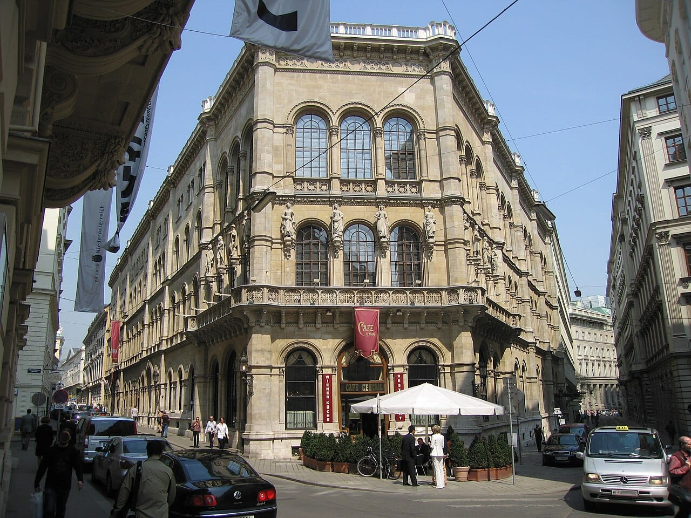
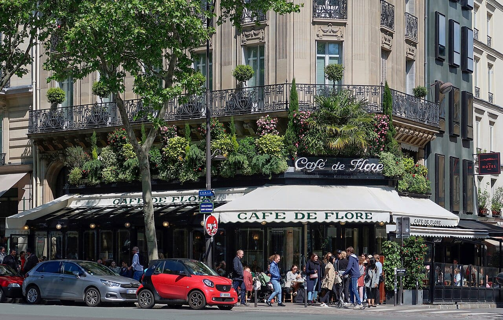

# Café Central

> **Visit information**
> - Address: Herrengasse 14 (corner of Strauchgasse), 1010 Vienna, Austria.
> - Opening and booking: check the [official page](https://www.cafecentral.wien/) before travelling; hours, tours and booking rules change by season.
> - Getting there and cost: check the official page before booking; this entry does not promise a fixed price.
> - Status: Not verified; sources checked: 2026-11-08.

Figure: Café Central. Image: User:Florian Prischl, Public domain, via Wikimedia Commons ([source page](https://commons.wikimedia.org/wiki/File:Palais_Ferstel.jpg)).

## Setting and history

Café Central is at Herrengasse 14 in Vienna's inner city, on the ground floor of the Palais Ferstel. The palace was built in the middle of the nineteenth century and originally housed the Vienna Stock Exchange; after the exchange moved out in 1876, the brothers Gustav and Hermann Pach opened a café on the ground floor, and Café Central began. It still operates in the same building's arcades and halls, with stone columns and vaulting above the tables rather than a later "historic" set.

The café's reputation is bound up with Vienna's intellectual circles around 1900. The house's own account names Trotsky, Freud, the writers Alfred Polgar, Stefan Zweig and Peter Altenberg, and the architect Adolf Loos. These were real customers and regulars, but stories about a particular chair belonging to a particular person are mostly later legend. Treat the famous names as background rather than as coordinates for a pilgrimage.

In the middle of the twentieth century the café closed; in 1986, after the Palais Ferstel was restored, it reopened in the same building. That interruption matters: today's Café Central is a 1980s restoration. It inherits the name, the address and the coffee-house tradition from 1876, but not every piece of furniture and decoration has survived unchanged from the original.

## The rooms and the menu

The keywords are vaults, columns, piano and newspapers. The main hall is tall and open, with window tables looking onto Herrengasse; side rooms and the arcade are quieter. Seating in a Viennese café is not designed around table turnover, and the gaps between tables allow a reader to sit for an afternoon. That is a different arrangement from a tourist café in Venice or Paris.

The coffee list is an introduction to the Viennese system. Wiener Melange is espresso with hot milk and milk foam, closer to a small latte but lighter; Einspänner is espresso in a tall glass under a thick layer of cream; Verlängerter is a "lengthened" espresso, close to a mild Americano; Kleiner Brauner and Großer Brauner are small or large coffees with a little milk. A Melange is the safest first order, an Einspänner if you want something richer, a Verlängerter if you want it weaker.

Food and cakes are the other half. Breakfast brings bread, eggs and jam; the afternoon is for cakes, with Sachertorte, Apfelstrudel and Topfenstrudel among the usual choices; at meal times the café serves Austrian dishes such as Wiener Schnitzel, beef stew and roast dishes. The menu changes with the season, and prices are as posted on site.

## What to order on a first visit

Find a free table yourself and sit down; wait for the waiter to come to you rather than standing at the door for an escort or ordering at the bar. One person can order a single coffee and stay for a long time; two people sharing a cake with two forks is normal. For the full experience, order a Melange and a Sachertorte, or a breakfast of coffee, eggs and bread.

Early morning, just after opening, is the quietest time, good for reading and writing. Mid-afternoon is the peak for cakes and visitors, with queues at the door; in the evening a pianist plays and the room fills, raising the volume of conversation. Choose a side room or an inner table for quiet talk, or accept the crowd and the noise of the main hall.

The cost structure needs saying clearly: traditional Viennese cafés generally do not charge for seating or for music; the bill is drinks and food plus a tip. If a tourist-area menu lists a seating charge or a minimum spend, the menu governs, and it is a mistake to assume "Viennese cafés never charge". This is where the café differs from [Caffè Florian](ref:florian) in Venice, which adds a per-person music surcharge when the band plays.

## Practical information

**Address:** Herrengasse 14 (officially given as the corner of Herrengasse and Strauchgasse), 1010 Vienna, Austria, in the ground-floor arcade of Palais Ferstel. The entrance is not prominent, so following the Herrengasse house numbers is more reliable than following the crowd.

**Getting there:** take Metro U3 to Herrengasse and you arrive at the door; St Stephen's Cathedral is about a 5-minute walk. The inner city is walkable, though cobbles and arcade floors are slippery in rain. Check Wiener Linien for the day's connections and step-free exits.

**Opening status (important):** the official notice says Café Central closed for a full renovation on 16 March 2026, with reopening scheduled for winter 2026. As of the verification date, 8 November 2026, the official site had not announced that it had reopened. `operating_status` is therefore `unknown`, not "permanently closed". During the works the official recommendation is the DECENTRAL pop-up at Freyung 3/1 (daily 07:30–22:00, tel. +43 1 533 37 63-61). Post-reopening hours, booking rules and menus have not been published; check the official site on the day.

**Tickets and reservations:** there is no admission charge; you pay for what you order. During the renovation the café is not open for walk-ins and previous online reservations are no longer accepted. Post-reopening prices and reservation rules are subject to official channels. Historically coffee, cakes and full meals were priced separately, mid-to-high for Vienna, so a breakfast budget differed greatly from an afternoon-tea one.

Dress is casual and neat, with no need for formal wear. Carry some cash for easier settlement.

Page verified 8 November 2026; opening status, prices and reservations are subject to the official channels.

## Etiquette and common mistakes

First, sitting down is not ordering; wait for the waiter and signal with eye contact and a quiet gesture rather than shouting. Second, a single coffee over two or three hours is normal, but occupying a large table through the peak affects the queue, so use your judgment. Third, a glass of water usually comes with the coffee and does not need ordering; sparkling water is a separate purchase. Fourth, tipping is not compulsory: state a total including the tip, usually rounded up or 5%–10%, and do not leave cash on the table.

Four myths are common: that a Melange is a latte (it is smaller, with lighter foam); that Café Central is "Trotsky's study" (the famous names are background, not stage set); that you must order a full meal to sit; and that all Viennese cafés charge for seats. Another practical mistake is assuming that the longest queue means the best café: the location and fame do bring visitors, but the inner city has quieter old cafés with a different experience.

This café does not suit anyone in a hurry who wants to drink standing up, anyone wanting a quiet phone conference, or anyone whose budget is limited to the cheapest fast food. It suits a style of travel that spends time sitting down.

## Around and routes

Step out into Herrengasse and the Palais Ferstel arcade; a few minutes east brings you to St Stephen's Cathedral and the Graben, south to the National Bank and inner-city lanes, north to the City Hall and the university quarter. Put Café Central in the morning: coffee and newspapers first, then the cathedral, lunch around the Graben, museums in the afternoon.

To make coffee the theme, compare two or three old cafés in the inner city, but no more than that in a day, or taste and attention fade. Café Central works well as the first stop because the room is large, the menu broad and the place easy for newcomers; leave the quieter lanes for later. In winter Vienna darkens early, and after four o'clock the crowds move towards Christmas markets and theatres, so adjust the route accordingly.

## See also

- [Pub and city](ref:pub-and-city): how cafés use seating, newspapers and opening hours to organise public life.
- [Café de Flore](ref:cafe-de-flore): the Left Bank literary café in Paris, a useful contrast with Vienna's "public drawing room".
- [Caffè Florian](ref:florian): the historic café on St Mark's Square, with a different cost structure.

Further reading: [A Ginjinha](ref:c-extra-1).

**In brief:** A historic literary café in Vienna, opened in 1876 and known for its coffee, cakes and intellectual clientele.

## Related images

Image: Café de Flore. Credit: Celette, CC BY-SA 4.0, via Wikimedia Commons ([source page](https://commons.wikimedia.org/wiki/File:Caf%C3%A9_de_Flore,_172_boulevard_Saint-Germain,_Paris_6e.jpg)). Related image for Café Central.
