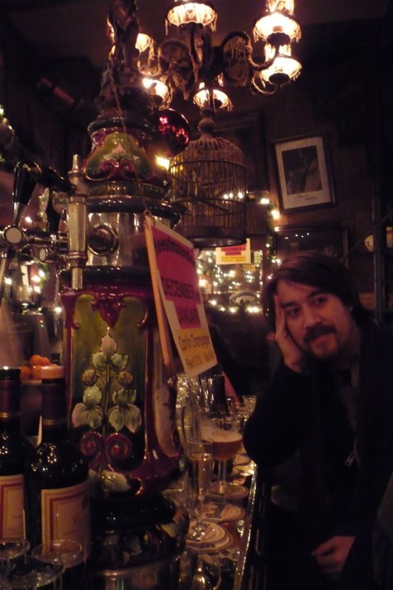
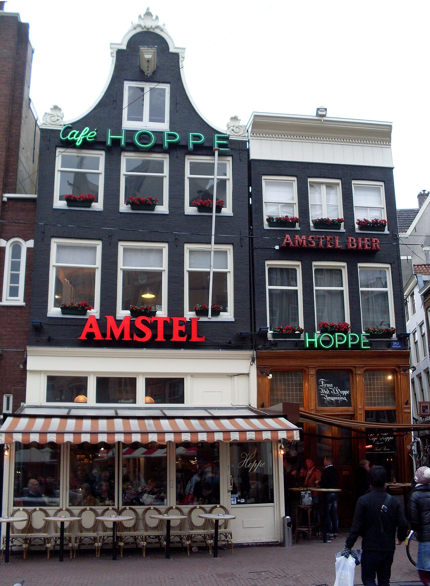

# Café De Dokter

From Spui, walk south into Rozenboomsteeg, an alley barely wide enough for two people abreast, and at No. 4 a small sign reads “Café De Dokter.” Push the door and the first reaction is a pause: one bar, a few stools, and walls packed with old clocks, birdcages, medical instruments, photographs, and chandeliers. There is almost no room to turn. It is not designed to look vintage; two centuries of objects have simply been left in place until time itself became the décor.

Figure: The 18-square-metre bar of Café De Dokter, with its chandelier and birdcage. Image: Rex Roof, CC BY 2.0, via Openverse / Flickr ([source page](https://www.flickr.com/photos/18199354@N00/3147493495)).

## Location and history

Café De Dokter was founded in 1798 by a surgeon from a nearby hospital, originally as a meeting place for doctors and medical students—a kind of waiting room or doctors’ club. The name means “The Doctor,” and locals prefer “Het Doktertje” (“The Little Doctor”). It slowly changed from a medical gathering place into a bruin café open to everyone, but the medical theme stayed: antique instruments, medical books, old medicine bottles, anatomical prints, and portraits share the walls with beer glasses and jenever bottles.

Today it is run by Maria and Henry, an elderly couple. Maria took over from her parents, who worked in the bar for almost fifty years. Official and media accounts say the same family has run it into the seventh generation. The exact generational count matters less than the fact that this is not a chain or a museum reconstruction, but a micro-bar still running on family memory. In 2013 it was repeatedly named on “Amsterdam’s smallest bar” lists, yet it did not expand or renovate because of the attention.

## Architecture and space

Eighteen square metres is the most quoted figure. The bar takes half the room; the rest holds a few stools, a corner drinks cabinet, and a narrow passage. When it is busy, people stand at the door and glasses pass from the counter to the alley. Almost no wall is blank: clocks, birdcages, old medical instruments, photographs, signs, bottle caps, and wine labels are layered under warm pendant lights. The air smells of old wood, dust, and jenever; the glasses, by contrast, are polished bright—a “dust may stay, but glasses must shine” contrast.

The space does not suit large groups. Four people can block the doorway; for photos, order first, ask permission, and avoid flash. Stools are few, standing is normal; winter pushes everyone inside, summer spills into the alley. Maria and Henry are usually happy to talk, but at peak times do not hold them for long—there are people behind you waiting to order.

## The drinks

De Dokter’s core is jenever, especially its house recipe “Dokters Recept” (the doctor’s prescription). It is a Dutch juniper spirit, more malty and sweeter than British gin, served in a small borrel glass with a beer or a bitter. There are also beers, wines, simple cocktails, and soft drinks, but no elaborate bartending. Food is minimal—perhaps cheese, nuts, or a simple snack; this is not a restaurant.

Order “een jenever, Dokters Recept” or “een biertje.” If unsure about strength, ask “jong of oud” (young or aged): young is cleaner and sharper, aged is rounder and sweeter. A young jenever with an Amstel or a local beer is the Amsterdam standard; do not order a gin and tonic with elaborate garnishes—this is not a gin bar. Prices are mid-range for Amsterdam, and cash is the safest payment.

## How to drink

The best times are Wednesday to Saturday, 16:00–18:00, or after 21:00. In the afternoon there is room to study the walls and chat with the owners; at night the alley fills and seats disappear. Weekends and holidays are very crowded; groups should split up. Because there are no reservations, the only strategy is to arrive early; if the doorway is full, wait outside rather than pushing in.

Stand at the bar and wait for the owner to look up before ordering; do not tap the counter or shout. Return empty glasses to the bar and do not carry them into the alley. There may be jazz, but at low volume; do not bring a speaker or play music aloud. Have cash ready at payment; if a card is refused, do not argue—there is an ATM nearby.

## Practical information

- Address: Rozenboomsteeg 4, 1012 PR Amsterdam.
- Hours: Wednesday–Saturday 16:00–01:00 (Atlas Obscura/Time Out); Foursquare gives Tuesday as the start, so call or check on site. Usually closed Sunday–Tuesday.
- Transport: metro 52 Rokin, 2 minutes on foot; trams 2, 11, and 12 to Spui, 3 minutes.
- Reservations: not accepted; stand or wait. Groups should split up.
- Payment: cash only (common practice; bring euro change).
- Capacity: about 18 square metres; four or more people feel crowded. Do not bring large luggage.
- Accessibility: the alley is narrow and the doorway has a step; wheelchairs cannot enter. Wait outside if mobility is limited.

## Etiquette and common misconceptions

First, do not read “De Dokter” as a medical clinic; it is a bar, and the name comes from its 1798 doctors’ meeting history. Second, do not use a flash inside; the room is tiny and the guests are close. Third, do not order elaborate cocktails or ask for “low-sugar” versions; jenever, beer, and simple snacks are the core. Fourth, do not treat “seventh generation” as a formal business register; it is the family narrative repeated by the owners and media. Fifth, do not block the alley for photos at peak times; Rozenboomsteeg is shared with residents and pedestrians. Sixth, do not treat the hours as absolute; the Tuesday/Wednesday conflict shows seasonal and staffing variation, so check before going.

## Nearby and routes

From De Dokter, two steps north are Spui and [Café Hoppe](ref:hoppe); east are Rokin and the Amsterdam Museum; south are Singel and the flower market; west is Kalverstraat. A good sequence is: Spui book market, a standing beer at Hoppe, squeeze into De Dokter’s 18 square metres, then dinner on Rokin. For an Amsterdam micro-bar route, Hoppe is the “double space plus standing culture” and De Dokter the “extreme small plus family history”; [Heineken Experience](ref:heineken) is the brand museum, while [De Halve Maan](ref:halve-maan) and [Cantillon](ref:cantillon) are Belgian brewery/tavern contrasts. Madrid’s [Casa Labra](ref:labra) is another Iberian “small space plus standing snack” model.

## Further reading and see also

- Atlas Obscura’s De Dokter entry: <https://www.atlasobscura.com/places/cafe-de-dokter>, for 1798, 18 square metres, the seventh generation, Maria/Henry, Dokters Recept, and hours.
- Walktionary’s De Dokter page: <https://walktionary.com/place/netherlands/amsterdam/caf-de-dokter>, for the address and “smallest bar” positioning.
- Time Out’s best Amsterdam bars: <https://www.timeout.com/amsterdam/bars-and-pubs/best-bars-in-amsterdam>, for cash-only/no-reservation practice and hours.
- Foursquare’s De Dokter page: <https://foursquare.com/v/de-dokter/4bc0a1ef4cdfc9b618219321>, for the address and the hours conflict.
- The nearby `place:cafe-hoppe` is the double-space bar; `place:heineken-experience` is the brand museum; `place:de-halve-maan` and `place:cantillon-brewery` are Belgian beer-culture examples.
- Related entries: [Café Hoppe](ref:hoppe), [Heineken Experience](ref:heineken), [De Halve Maan](ref:halve-maan), [Cantillon](ref:cantillon), [Casa Labra](ref:labra)

**Short definition:** Café De Dokter at Rozenboomsteeg 4 was founded in 1798 by a surgeon from a nearby hospital, originally as a meeting place for doctors and medical students. At about 18 square metres it is one of Amsterdam’s smallest bars; the same family runs it into the seventh generation, now under Maria and Henry. Antique medical instruments, clocks, birdcages, chandeliers, Dokters Recept jenever, cash-only payment, and no reservations complete its character.

## Related images

Image: The twin facades of Café Hoppe at Spui 18–20, with green neon and Amstel signs. Credit: Marcelmulder68, CC BY-SA 3.0 nl, via Wikimedia Commons ([source page](https://commons.wikimedia.org/wiki/File:Spui_nr._18_en_20.jpg)). Related image for Café De Dokter.
