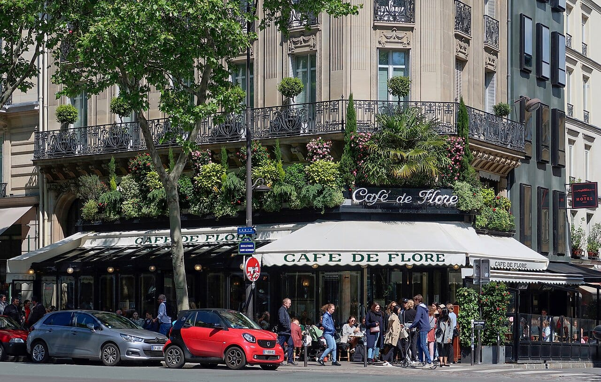
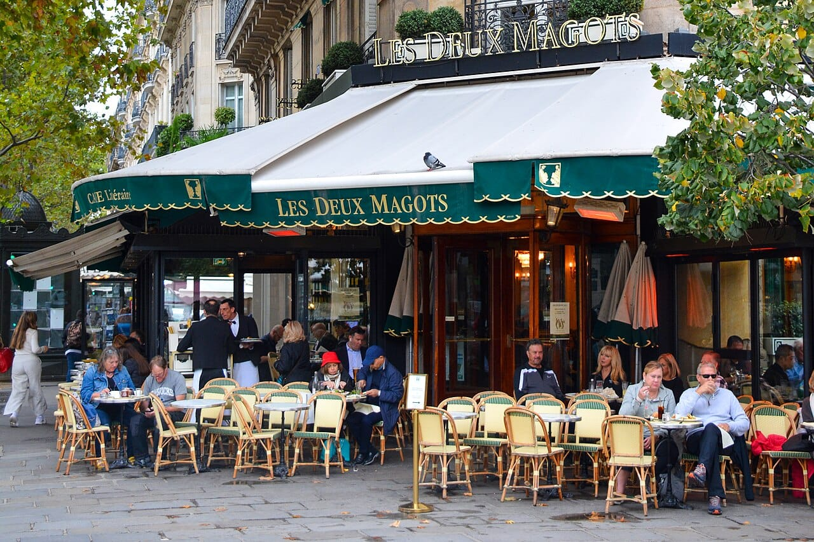

# Café de Flore

Café de Flore (Huāshén Kāfēi Guǎn) occupies the corner of Boulevard Saint-Germain and Rue Saint-Benoît in the sixth arrondissement of Paris, at 172 Boulevard Saint-Germain. It opened in 1887, and its name comes from a small sculpture of Flora that stood across the boulevard. Like Les Deux Magots, it is often called a literary café. What sets Flore apart is its corner position, the stage-like effect of its red banquettes and mirrors, and a younger, more irreverent literary prize.

Figure: Café de Flore. Image: Celette, CC BY-SA 4.0, via Wikimedia Commons ([source page](https://commons.wikimedia.org/wiki/File:Caf%C3%A9_de_Flore,_172_boulevard_Saint-Germain,_Paris_6e.jpg)).

> **Visit information**
> - Address: 172 Boulevard Saint-Germain, 75006 Paris, France.
> - Opening and booking: check the [official page](https://cafedeflore.fr/) before travelling; hours, tours and booking rules change by season.
> - Getting there and cost: check the official page before booking; this entry does not promise a fixed price.
> - Status: Verified; sources checked: 2026-11-08.

## Place and history

Flore opened just after the Boulevard Saint-Germain was cut through Paris, in a neighbourhood reshaped by Haussmann’s works. By the end of the nineteenth century it had attracted writers and artists; in the twentieth century Dada, Surrealism and Existentialism all became part of its mythology, with Apollinaire, Breton, Sartre and Beauvoir among the names attached to the area. In 1994 a group of writers and journalists founded the Prix de Flore around one of its tables. The prize rewards a “promising” author and stresses originality, modernity and youth. Compared with the Prix des Deux Magots, created in 1933 and closer to an institutional award, the Flore prize feels like an internal literary game played in a café: the cash is modest, the conversation is not. History and the prize together explain why Flore is always placed in the “literary café” story.

## The room and the menu

The café has an interior and a corner terrace. Inside, red banquettes, mirrors, wooden tables and Art Deco lines are packed closely together. Outside, the terrace faces Boulevard Saint-Germain: a good place to watch the street, and a place the street cannot avoid. Drinks are mainly coffee, hot chocolate and tea. Food includes a French breakfast, croque monsieur, simple starters and desserts. This is not a cocktail bar either; the alcohol list is light. Prices are at tourist-area level, clearly above an ordinary neighbourhood café. Flore is a place to sit down, not to drink standing up; the seat is part of what you are buying.

## How to order on a first visit

First look at the corner and see which side has space: the terrace for people-watching, the interior for conversation. In French, “un café” is a small espresso; ask for “café crème” if you want milk, or “chocolat chaud” for hot chocolate. At breakfast time, order a set of bread, butter and jam with coffee or hot chocolate. At meal times, croque monsieur or a simple savoury dish is more filling than a dessert. If you only want the atmosphere, two people can share one coffee and one dessert rather than ordering two full sets. Do not ask for “Sartre’s seat”; there is no reserved chair for famous guests. And do not treat Flore as a chain café with free refills.

## Practical information

Address: 172 Boulevard Saint-Germain, 75006 Paris (coordinates 48.85414, 2.33256). The company's registered address in the site's legal notice is 174 boulevard Saint-Germain, next door; look for number 172 on the corner when you arrive.

Transport: Metro line 4 to Saint-Germain-des-Prés, then two or three minutes on foot; Les Deux Magots is just across the corner. Buses and taxis stop along Boulevard Saint-Germain, though the corner itself is no place for a long stop.

Opening hours and booking: the official site carries history, menus and legal notices but no daily timetable and no online reservation facility, so the exact opening and closing times could not be verified; third-party guides commonly quote about 7:30 to 1:30 the next morning, for reference only. In practice seating is walk-in, with clear queues at weekends and in high season; groups and special needs should call +33 1 45 48 55 26 first.

Admission and spending: there is no entrance ticket; you pay from the menu. Prices are at tourist-area level, clearly above an ordinary neighbourhood café, and the menu PDF is published on the official site. There is no formal dress code; casual or smart casual is fine. The terrace is uncomfortable in rain or strong wind.

Page checked on 2026-11-08; operating status, prices and bookings are subject to official channels.

## Etiquette and common mistakes

Order soon after sitting, and do not hold a four-person table all afternoon with a single coffee; staff will gently remind you at peak times. Do not move neighbouring chairs, and do not block the corner passage with a stroller or large luggage. Keep other customers’ faces out of your photographs, and do not stand at the edge of the road to photograph the red banquettes. Slow service is normal in a Parisian café; when you want the bill, say “l’addition, s’il vous plaît”, and round up or leave a small tip. The common mistake is to expect a quiet reading room because the café is called “existentialist”: on weekend afternoons, voices, traffic and photographers are dense. Another mistake is to expect the literary prize to be a daily event; it is awarded once a year, not every afternoon.

## When not to come

Flore is a poor choice if you are on a tight budget, need a quiet place to work, are carrying large luggage or a stroller, or want a full cocktail and dinner menu. It is also unsuitable for a large group arriving without warning; corner seating is limited, and waiting spills onto the street. Anyone who dislikes tourist crowds should avoid weekends and public holidays in daytime; a weekday morning is calmer. People looking for a night out should go to a bar, not ask a café to behave like one.

## Nearby and around

Rue Saint-Benoît leads north to bookshops and small restaurants; to the south you reach the church of Saint-Germain-des-Prés and the Musée Eugène Delacroix. Marché Saint-Germain and the food street of Rue de Buci are also close. [Les Deux Magots](ref:deux-magots) is across the same corner, and the [Saint-Germain literary cafés walk](ref:route-saint-germain) invites a comparison: first the square-facing terrace at Les Deux Magots, then the corner seats at Flore. The two are close enough to walk in minutes, which makes the difference in atmosphere easy to see. From the Seine, the café is about ten minutes on foot; after leaving the metro, look at the corner and the house number before crossing.

## See also

Coffee houses and bars are both part of a city’s public life; [Pub and city](ref:pub-and-city) sets out how seating, regulars and opening hours shape a place. To see the two literary cafés side by side, read [Les Deux Magots](ref:deux-magots) and the [Saint-Germain literary cafés walk](ref:route-saint-germain).

**At a glance:** A literary café in Saint-Germain-des-Prés, Paris, opened in the late 19th century and known for its intellectual clientele. 

Begin with the address, move on to the current opening status, and finish with what the place is known for. That order keeps the reading of Café de Flore practical.

Start with [Reading a city through its bars](ref:pub-and-city) for address and space, then read [Saint-Germain-des-Prés literary cafés: a half-day walk](ref:route-saint-germain) for operating status. Seeing both keeps Café de Flore from being confused with a neighbouring idea.

## Related images

Image: Les Deux Magots. Credit: Cheng-en Cheng from Taichung City, Taiwan, CC BY-SA 2.0, via Wikimedia Commons ([source page](https://commons.wikimedia.org/wiki/File:Les_Deux_Magots,_25_September_2019.jpg)). Related image for Café de Flore.
