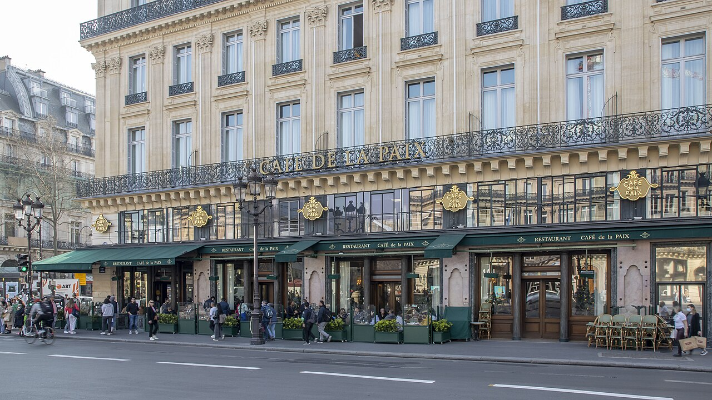

# Café de la Paix

Step out of the Opéra Garnier's main entrance, cross the traffic of Place de l'Opéra, and the green awning and gilded front of Café de la Paix come into view. Its position is almost too good: the opera house on one side, the Grand Hôtel on the other, and the Grands Boulevards department stores behind it along Boulevard des Capucines. Visitors come for a first coffee, a look at the opera facade or to wait for a performance; Parisians treat it as a landmark of the theatre district and know when it is loudest and when the terrace is best for watching the square.

Figure: The daytime facade and awnings of Café de la Paix facing the Opéra Garnier, 5 Place de l'Opéra. Image: Arthur Weidmann, CC BY-SA 4.0, via Wikimedia Commons ([source page](https://commons.wikimedia.org/wiki/File:Caf%C3%A9_de_la_Paix_1.jpg)).

## Location and history

Café de la Paix opened in 1862, the same year as the Grand Hôtel. On 5 May 1862 Empress Eugénie inaugurated the hotel in person; according to the café's own account, after touring the building she exclaimed that it felt like home, as if she were at Compiègne or Fontainebleau. The anecdote makes the point: from the beginning this was not a corner café but part of the Second Empire combination of hotel, theatre and boulevard.

By the end of the nineteenth century its guest list included Guy de Maupassant, Victor Hugo, Émile Zola, Oscar Wilde and Arthur Conan Doyle; the house still repeats the literary joke that Sherlock Holmes met Watson here. Serge de Diaghilev and the Ballets Russes held dinners in the area, and the café half-jokingly notes that the impresario often left without paying. In June 1948 Maurice Chevalier, Henri Salvador and Yves Montand met at Café de la Paix to record "This is Paris". These stories turned the place into a stage for the theatre district rather than a mere tourist coffee stop.

The present interior was restored by Pierre-Yves Rochon, keeping the Napoleon III gilded panelling, coffered ceiling, mirrors and chandeliers while simplifying the furniture lines. It does not seal the old decoration away; it puts a nineteenth-century shell back into a contemporary restaurant's circulation, with the café area, terrace, restaurant and bar each having a boundary but sharing one visual language.

## The rooms and the drinks

Inside, Café de la Paix feels like a lit Second Empire drawing room: gilded panelling, white and pale-wood furniture, mirrors, a coffered ceiling and large chandeliers, with seats along the walls and windows; the terrace faces the opera directly. The space is not designed for hiding but for being seen. At midday it holds business guests and shoppers, in the evening opera-goers, and late at night passers-by from the boulevards.

The café area serves coffee, tea, hot chocolate, pastries and light dishes all day; the restaurant menu includes French onion soup, snails, foie gras, steak tartare, seafood and French classics. Among desserts, gâteau Opéra, mille-feuille and canelés are common choices. The drinks list leans on French wine, champagne and classic cocktails; at aperitivo time a glass of champagne or a kir with a snack on the terrace is the obvious move.

## How to drink here

At 07:00, when the café opens, the atmosphere is at its lightest. Order a café crème or espresso with a canelé or croissant and sit by the window to watch the square before the opera wakes up. Lunch from 12:00 to 15:00 is the restaurant's busiest period; if you do not want to wait, stay in the café area with a coffee or light dish and avoid the noon rush.

In the afternoon, a glass of champagne, kir royale or café gourmand on the terrace with a small dessert works well. After 18:00 the restaurant moves into dinner service; if you only want a drink before a performance, the café area and terrace are more appropriate than a restaurant table. Around 23:00 the café area closes, so the last coffee or after-dinner drink has to be ordered before the shutters come down.

## Practical information

- Address: 5 Place de l'Opéra, 75009 Paris, directly opposite the opera house.
- Hours: café area daily 07:00–23:00 continuous service; restaurant breakfast 07:00–10:30, lunch 12:00–15:00, dinner 18:00–23:00; public-holiday hours vary; Sunday has the Grand Brunch.
- Transport: metro lines 3, 7 and 8 to Opéra; RER A to Auber; buses 20, 32, 45, 52, 66, 68 and 95.
- Reservations: the restaurant takes bookings; the terrace and café area generally do not, with seating on arrival.
- Prices: terrace, café area and restaurant are priced differently; the same coffee can cost different amounts on the terrace and in the restaurant, so check the menu first.
- Performance days: when the opera has a show, the period after 18:00 and the interval around curtain-down are the busiest; avoid those windows for a quiet drink.

## Etiquette and common mistakes

First, do not treat the terrace as a free viewing platform. Ordering a drink before sitting is the basic rule, and long photo sessions without an order get in the way of table turnover. Second, do not enter the restaurant in flip-flops or beachwear; there is no formal dress code, but this is a formal restaurant opposite the opera, and smart casual is safer. Third, do not assume you can move freely between the café area and the restaurant; they have different menus and service, and staff will seat you in the correct zone. Fourth, do not read "1862" as meaning that every fixture is original; the interior has been restored several times, the gilded panelling and coffered ceiling are protected historic decoration, and the furniture and lighting belong to the modern refurbishment. Fifth, do not block the entrance at curtain-down waiting for a table; that is the peak moment, so book ahead or walk to one of the boulevard cafés nearby.

## Around and nearby

From Café de la Paix the opera house is across the street; north lie Boulevard Haussmann and Galeries Lafayette and Printemps, south through Place Vendôme are the Tuileries and the Louvre, and east along Boulevard des Capucines are the Madeleine and Rue Royale. A route might run: opera facade, a drink on the Café de la Paix terrace, the Galeries Lafayette roof, Place Vendôme and the Tuileries. For a performance, drinks on the terrace an hour before, then crossing the square to the opera, is the most natural sequence.

## Further reading and see also

- The café's history page: <https://www.cafedelapaix.fr/en/history/> for 5 May 1862, Empress Eugénie, Diaghilev and the 1948 recording.
- The café's FAQ: <https://www.cafedelapaix.fr/fr/faq/> for the café and restaurant hours.
- Other Paris venues in the same literary and theatre network: `place:la-closerie-des-lilas`, `place:brasserie-lipp` and `place:la-coupole`.
- For the Saint-Germain literary café route, see `route:saint-germain-literary-cafes`.
- This page treats the Sherlock Holmes and Watson meeting as the café's own literary anecdote, not a verifiable historical event; hours and prices should be checked with the venue on the day.
- Related entries: [La Closerie des Lilas](ref:closerie)、[Brasserie Lipp](ref:lipp)、[La Coupole](ref:coupole)、[Saint-Germain literary cafés route](ref:saint-germain)、[Hemingway Bar at the Ritz, Paris](ref:hemingway)

**At a glance:** Facing the Opéra Garnier, Café de la Paix opened in 1862 with the Grand Hôtel; its Napoleon III gilded panelling, coffered ceiling and terrace made it the theatre district's classic place to see and be seen. 

Café de la Paix is best read by starting with the address, moving to the current opening status, and ending with what the place is known for.

[La Closerie des Lilas](ref:closerie) and [La Coupole](ref:coupole) are the two useful reference points for Café de la Paix. [La Closerie des Lilas](ref:closerie) sets out address and space; [La Coupole](ref:coupole) brings in operating status. Read them together.

**Key facts.**

| Item | Detail |
| --- | --- |
| In one line | Facing the Opéra Garnier, Café de la Paix opened in 1862 with the Grand Hôtel; its Napoleon III gilded panelling, coffered ceiling and terrace made it the theatre district's classic place to see and be seen. |
| Address | 5 Place de l'Opéra, 75009 Paris, France |
| City and country | Paris / France |
| Status | verified open |
| Official site | cafedelapaix.fr |

**Sources and limits.** The key claims about Café de la Paix are checked against the following sources: Café de la Paix, InterContinental Paris Le Grand (Used to cross-check the address, hours and the Maupassant / Hugo / Hemingway guest narrative). For current products, addresses or opening status, use cafedelapaix.fr. Prices, batches and status change; the body is project-written and does not reproduce source text.
