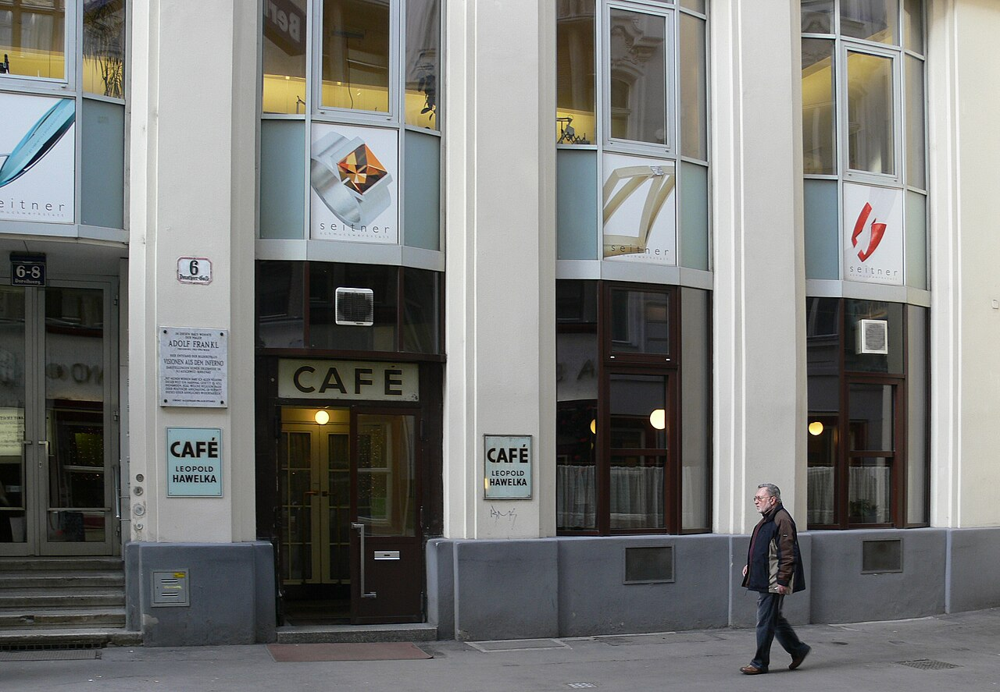

# Café Hawelka

From St Stephen's Cathedral, walk south for two minutes and turn into Dorotheergasse. A slightly worn sign reads Café Hawelka. The frontage is small, newspapers are stacked in the window, the tables are close together, and paintings and old photographs cover the walls. It has neither the grand vaulting of Vienna's large cafés nor a carefully styled shop window, yet it is often treated as the living version of Viennese coffee-house culture: family-run, ordinary in price, and willing to let one person sit for a long time.

Figure: The façade of Café Hawelka in Vienna. Image: Photo: Andreas Praefcke, CC BY 3.0, via Wikimedia Commons ([source page](https://commons.wikimedia.org/wiki/File:Wien_Caf%C3%A9_Hawelka.jpg)).

## Setting and history

Café Hawelka opened in May 1939. Its founders were Leopold Hawelka and Josefine Hawelka. Leopold had run Kaffee Alt Wien in the same district since 1936; in 1939 the couple took over Café Ludwig on Dorotheergasse and turned it into their own café. The chronology matters: 1936 belongs to the earlier business, while 1939 is the opening of Hawelka itself. Mixing the two adds three years to the café's age.

The Second World War began soon after, Leopold was called up, and the café closed. In the autumn of 1945 the couple reopened it in the largely intact building. In postwar Vienna a café was not only a place to drink coffee; it was also a place to warm up, read newspapers, exchange news and look for work. After the occupation ended in 1955, Hawelka gradually became a base for writers and critics. Heimito von Doderer, Friedrich Torberg, Hilde Spiel and Hans Weigel were regulars. When the nearby literary café Herrenhof closed in 1961, more artists moved to Hawelka, forming a looser circle that included Friedensreich Hundertwasser, Ernst Fuchs, Rudolf Hausner, Helmut Qualtinger and Oskar Werner, as well as younger writers such as H. C. Artmann and Gerhard Rühm.

Josefine died in 2005 and Leopold in 2011. Their son Günter took over and ran the café until his death in 2021. It is now run by the third generation, Amir and Michael, and the family also operates its own coffee roastery in the 23rd district. This succession is not a marketing story; it is part of the café's character. The furniture has not been comprehensively modernised, the menu has not expanded into an "international" restaurant, and regulars can still find their usual place in the afternoon.

## The rooms and the menu

The keywords at Hawelka are cramped, dark, worn and newspaper. The tables are small, the chairs are bentwood, the banquettes shine at the back, and the walls are covered with paintings, posters and photographs left by customers. It is not designed for photography, and the lighting is not flattering to selfies; but if you want to see how Viennese people use a café as a living room, this is more direct than Café Central. Seating is not organised around table turnover. One person ordering a coffee and sitting for two hours is normal. Sharing a table is also normal at busy times, and asking "is this seat taken?" before sitting down is basic manners.

The coffee list follows the Viennese system: Wiener Melange (espresso with hot milk and milk foam), Einspänner (espresso in a tall glass under a thick layer of cream), Verlängerter (a "lengthened" espresso), and Kleiner Brauner or Großer Brauner (small or large coffee with a little milk). A Melange is the safest first order; an Einspänner if you want something richer and sweeter; a Verlängerter if you want it weaker. Hawelka is not a "specialty coffee" shop. The beans and extraction follow the traditional model, and the point is the temperature, the cups and the time to sit.

Food is available through the day: breakfast, bread, eggs and light dishes. After 20:00 the kitchen bakes Buchteln, yeast dough buns filled with plum jam and dusted with sugar while still warm. Buchteln are Hawelka's most famous item, but they are an evening dessert, not something served all day. Arrive too early and they are not ready; arrive too late and they may be sold out. Cakes, ice cream and Austrian home cooking are also on offer, subject to the day's menu.

## What to order on a first visit

Find a seat yourself and wait for the waiter; do not stand at the door waiting to be seated, and do not order at the bar. One person may order only a coffee. Two people sharing a Buchteln should ask for one bun and two forks; that is normal. For the full experience, order a Melange and a cake in the afternoon, then return after 20:00 for Buchteln and coffee. If you only want to taste one, split it between two people; the bun is not small.

The rhythm of the day matters. From 09:00 to 11:00 it is quietest, good for reading and writing. From 14:00 to 15:00 tourists and shoppers arrive. After 20:00, when the Buchteln come out of the oven, the room suddenly becomes busy. For photographs, avoid meal times and weekend afternoons. To feel the "literary café", a weekday evening is closer to the local rhythm. There is no piano performance and no dress code; everyday clothes are fine.

The bill needs explaining. Traditional Viennese cafés generally do not charge for a seat or for "music"; the bill is drinks and food plus a tip. If a menu mentions a seat charge, a minimum spend or a rule that Buchteln must be ordered with a drink, the menu is authoritative. Hawelka's prices are mid-range for the inner city, not the cheapest, but without the tourist premium of Café Central. Do not shout for the bill; catch the waiter's eye or raise a hand quietly.

## Practical information

**Address**: Dorotheergasse 6, 1010 Wien, Austria. About 2 minutes on foot from St Stephen's Cathedral. The door is on the northern side of Dorotheergasse, near the junction with Graben. The sign is modest; look for "Café Hawelka" and the newspapers at the entrance.

**Transport**: Metro U1 or U3 to Stephansplatz, then 2–3 minutes on foot; alternatively walk from Graben. The inner city is pedestrianised, so taxis cannot stop at the door; the nearest drop-off is on Graben or the Ringstrasse. Stone paving is slippery in rain, so high heels are a poor choice.

**Opening hours**: Monday to Thursday 09:00–00:00, Friday to Saturday 09:00–01:00, Sunday 10:00–20:00. Holidays and special events may alter this, so check the official site or the notice at the door. `operating_status` is `verified`, meaning the official site and the tourist board's information were still available on 20 November 2026 with no closure notice; it does not guarantee that the café opens every day.

**Reservations**: Hawelka generally does not take large reservations and works on a walk-in basis. Small groups can turn up, but weekend evenings and Buchteln time may involve a wait. There is no dress code and no minimum spend. Children are welcome, but the room is narrow and pushchairs are awkward.

**Prices**: Coffee and desserts are mid-range for the inner city; Buchteln are priced per piece, subject to the menu. Card payment is now possible, but small transactions may still be easier in cash, so carry a little.

Page verified 20 November 2026; opening hours, prices and Buchteln availability are subject to official channels.

## Etiquette and common mistakes

First, do not treat 1936 as the year Hawelka opened. 1936 is when Leopold ran Kaffee Alt Wien; Hawelka itself opened in May 1939. Second, do not ask at the door whether Buchteln are available. They usually come out after 20:00, and asking in the morning signals that you do not know the rhythm of the house. Third, do not treat it as a quiet study. It is noisy in the evening and at weekends; for reading and writing, come on a weekday morning.

There are four more common mistakes. One is assuming every Viennese café charges for a seat. Traditional cafés generally do not, but individual tourist-area businesses may, so the menu decides. Another is assuming that "famous regulars" means a preserved "so-and-so table". Hawelka has no reserved author's table, only areas where regulars tended to sit. A third is treating Buchteln as an all-day dessert; they are an evening bake and sell out. The fourth is thinking that a full meal is required to sit. One coffee for an afternoon is allowed, though at busy times do not monopolise a large table.

Hawelka is not the right stop if you are in a hurry and only want takeaway coffee, need a quiet room for a phone call, or are pushing a pram or carrying large luggage. It suits a style of travel that spends time sitting down, and anyone who wants to see ordinary Vienna rather than only palaces.

## Nearby and routes

Step outside and you are on Dorotheergasse. Two minutes north is Graben and St Stephen's Cathedral; south leads to the Vienna State Opera and the Ringstrasse. Put Hawelka in the morning: coffee and newspapers first, then the cathedral, lunch around Graben, and museums or Café Central in the afternoon. If cafés are the theme, two in a day are enough: Hawelka in the morning and Café Central in the afternoon. Their rooms and customers are different, and the comparison is the point.

Ten minutes west are the University of Vienna and City Hall; east leads into the old-town lanes and the Mozart house area. In winter it gets dark early, and after 16:00 the crowds turn toward Christmas markets and theatres, so adjust the route. There is no parking at the door; walk or take the metro.

If a queue forms outside, do not block the Dorotheergasse pavement. The line is usually short, about ten minutes. Around Buchteln time the café is warm and smells strongly of the bake; a thick coat can go over the chair, but do not take the neighbouring seat.

## See also

- [Pubs and the city](ref:pub-and-city): how cafés use seating, newspapers and opening hours to organise public life.
- [Café Central](ref:cafe-central): another Viennese literary café, with a larger room and more tourists.
- [Café Slavia](ref:slavia): the Prague café opposite the National Theatre, with a different literary and political tradition.
- [Café de Flore](ref:cafe-de-flore): a Left Bank literary café, useful as a contrast with Vienna's family-run houses.
- [Antico Caffè Greco](ref:greco): a closed Italian historic café, a reminder that "famous" and "still trading" are different things.
