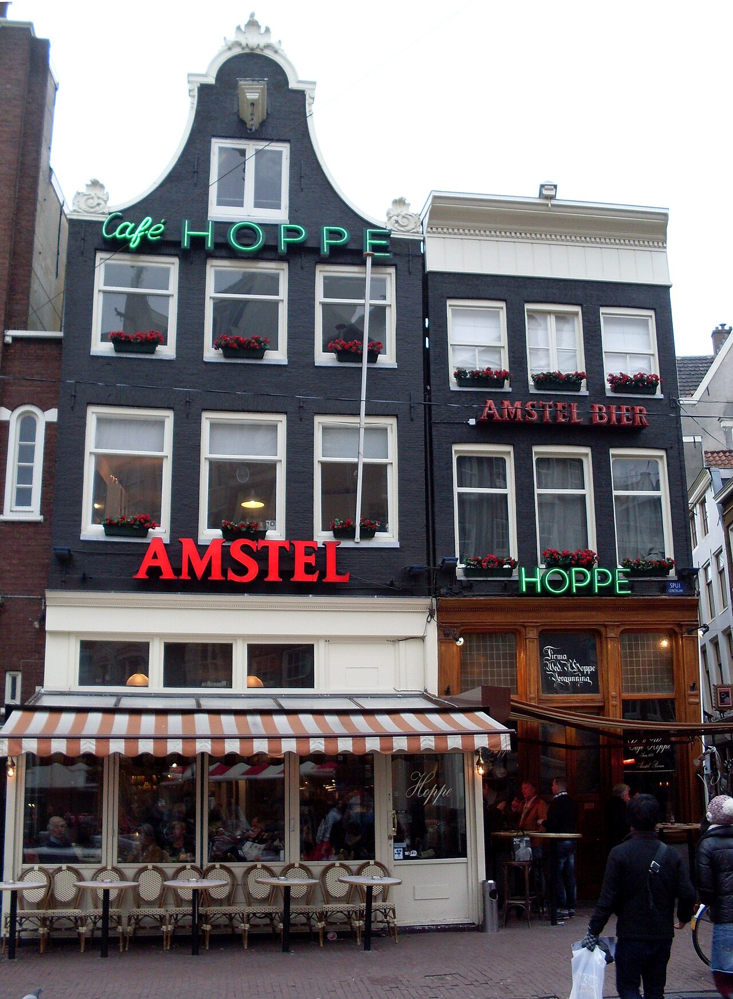

# Café Hoppe

On the south-east corner of Spui, two narrow Dutch façades stand joined: No. 18 on the left, green neon “Café HOPPE” against dark brick; No. 20 on the right, red “AMSTEL” and green “HOPPE” side by side. There is no large sign, only a small bar table and a few people standing with beer glasses. Inside, the first zone is the crowded standing bar and the beer taps; further in is the seated salon. Amsterdammers call this kind of place a bruin café (brown café), and Hoppe is the oldest and most complete example.

Figure: The twin facades of Café Hoppe at Spui 18–20, with green neon and Amstel signs. Image: Marcelmulder68, CC BY-SA 3.0 nl, via Wikimedia Commons ([source page](https://commons.wikimedia.org/wiki/File:Spui_nr._18_en_20.jpg)).

## Location and history

Café Hoppe’s official history says it has been selling drinks on this Spui corner since 1670. No. 18 is a listed rijksmonument, with its interior and exterior largely unchanged; No. 20 was originally a hotel/restaurant and was brought into Hoppe’s operation in the early twentieth century. In the 1930s, Harry Mustert gave the place its current name, “Hoppe,” and joined Nos. 18 and 20 into two distinct spaces: the standing Hoppe at No. 18 and the sitting Hoppe at No. 20. That layout survives today and is the most common misunderstanding—Hoppe is not one room but two connected ones.

Hoppe’s history carries many Dutch political and cultural footnotes. Hans van Mierlo and the early D66 discussions took place here; the young Princess Beatrix visited; Freddy Heineken was a regular. The official About page uses these stories as evidence that Hoppe was Amsterdam’s living room. In 2013, Misset Horeca named it the Netherlands’ best café; today it is run by Jan-Wieger van der Linden and Pepijn Zonneveld. It has not been converted into a “Dutch theme bar” for tourists; it still sells jenever, Amstel, and simple pub food.

## Architecture and space

No. 18 is a classic Amsterdam building: dark brick, white window frames, green neon, a narrow door, and tall windows. Inside are dark wood, mirrors, brass beer taps, old posters, and a long standing-bar counter. There is no stage and no background music; guests stand close, and conversation is the entire soundscape. No. 20’s salon is wider, with more tables and window seats facing Spui’s pedestrians and book market; old Hoppe photographs and Amstel advertisements hang on the walls.

The route between the two buildings is the core experience: drink a beer standing at No. 18, then move to No. 20 to sit and eat, or the reverse. At peak times No. 18 is almost impossible to turn around in, and glasses are raised high; No. 20 is calmer and suits two or three people. For photos, the twin façade and green neon are the best subject; inside, the light is dim, so do not use a flash on other guests.

## The drinks

Hoppe’s core is jenever and beer. Jenever is the Dutch juniper-flavoured spirit, usually sweeter and more malted than British gin, served in a small glass (borrel) alongside beer. Hoppe has its own “Firma H.J. Hoppe” jenever label, with young and aged versions. Beer is mainly Amstel, with seasonal brews and radler; the list is short but sufficient for a standing drink. Food is Dutch pub fare: bitterballen, cheese cubes, fried meatballs, sandwiches, and simple cold plates.

Order “een jenever” or “een biertje.” If unsure about the jenever, ask for young (jong) or aged (oud): young is cleaner and sharper, aged is rounder and sweeter. A young jenever with an Amstel or a bitter is the Amsterdam standard. Do not expect elaborate cocktails or a refined wine list; Hoppe’s value is old wood, cold beer, and low conversation, not bartender theatre.

## How to drink

The best times are 16:00–18:00 or after 21:00. In the afternoon, Spui’s book market and pedestrians are still out, and a drink at the door is pleasant; at night, No. 18 fills with locals and visitors, while No. 20 is better for sitting. Weekends and King’s Day are extremely busy; avoid them for quiet. Hoppe has no music, so conversation does not require shouting—which also means do not bring a Bluetooth speaker.

Decide whether you are at No. 18 or No. 20: No. 18 usually means ordering at the bar and standing; No. 20 means finding a table and ordering from a waiter. Return empty glasses to the bar or table and do not carry them into the street. If you smoke, use the designated spot outside and do not block the doorway. Service is usually included; a small tip is still appropriate.

## Practical information

- Address: Spui 18-20, 1012 XA Amsterdam.
- Hours: Sunday–Thursday 09:00–01:00; Friday–Saturday 09:00–02:00 (official Contact).
- Transport: trams 2, 11, and 12 to Spui; metro 52 to Rokin, 3 minutes on foot.
- Reservations: not accepted; walk in. Groups should split up.
- Prices: beer and jenever are mid-range for Amsterdam; food and snacks are cheaper.
- Payment: cards and cash are both common; keep small change for small orders.
- Accessibility: a step at the entrance and a narrow No. 18 passage; wheelchair users should ask about the No. 20 entrance.

## Etiquette and common misconceptions

First, do not treat Hoppe as a quiet café; it is a bruin café, and conversation, beer glasses, and the standing bar are the point. Second, do not assume Nos. 18 and 20 are two businesses; they are two spaces of one Hoppe, though bills and rules may differ. Third, do not order elaborate cocktails or latte art; jenever, beer, and simple pub food are the core. Fourth, do not use a flash inside; old wood, mirrors, and strangers do not photograph well under flash. Fifth, do not play music at the door; Hoppe’s tradition is no background music. Sixth, do not treat 1670 as the construction date of every part of No. 18; it is a historic building, and No. 20 was added later.

## Nearby and routes

Step out of Hoppe onto Spui and the book market; north are Kalverstraat and the Begijnhof; east are the Amsterdam Museum and Rokin; south are Singel and the flower market. A good sequence is: Spui book market, a standing beer at Hoppe, the Begijnhof, the Amsterdam Museum, and De Dokter in the evening. For an Amsterdam small-bar route, start at Hoppe for the standing/sitting double space, then walk five minutes to [Café De Dokter](ref:dokter) for the 18-square-metre extreme; [Heineken Experience](ref:heineken) is the brand museum, while [De Halve Maan](ref:halve-maan) and [Cantillon](ref:cantillon) are Belgian brewery/tavern contrasts. For a wider historic-café lineage, Lisbon’s [A Brasileira](ref:brasileira) is another literary café.

## Further reading and see also

- Café Hoppe About: <https://cafehoppe.com/en/about/>, for 1670, Nos. 18/20, Harry Mustert, standing/sitting Hoppe, and the 2013 award.
- Café Hoppe Contact: <https://cafehoppe.com/en/contact/>, for the address and hours.
- Amsterdam Now’s Hoppe article: <https://www.amsterdamnow.com/uitgaan/cafe-hoppe-op-het-spui-bruine-kroeg-met-350-jaar-geschiedenis/>, for the bruin-café positioning and 350-year history.
- I amsterdam’s no-music café page: <https://iamsterdam.nl/zien-en-doen/cafes-zonder-muziek>, for Hoppe’s quiet tradition.
- The nearby `place:cafe-de-dokter` is the 18-square-metre micro-bar; `place:heineken-experience` is the brand museum; `place:de-halve-maan` and `place:cantillon-brewery` are Belgian beer-culture examples.
- Related entries: [Café De Dokter](ref:dokter), [Heineken Experience](ref:heineken), [De Halve Maan](ref:halve-maan), [Cantillon](ref:cantillon), [A Brasileira](ref:brasileira)

**At a glance:** Café Hoppe at Spui 18–20 has been selling drinks on this corner since 1670. No. 18 is a listed national monument; No. 20 was a hotel/restaurant, and in the 1930s Harry Mustert joined the two buildings and named the place Hoppe, creating a “standing Hoppe” and a “sitting Hoppe.” No music, jenever, and Amstel beer make it one of the most complete Dutch bruin cafés.

**Key facts.**

| Item | Detail |
| --- | --- |
| In one line | Café Hoppe at Spui 18–20 has been selling drinks on this corner since 1670. No. 18 is a listed national monument; No. 20 was a hotel/restaurant, and in the 1930s Harry Mustert joined the two buildings and named the place… |
| Address | Spui 18-20, 1012 XA Amsterdam, Netherlands |
| City and country | Amsterdam / Netherlands |
| Status | verified open |
| Official site | cafehoppe.com |

**Sources and limits.** The key claims about Café Hoppe are checked against the following sources: Café Hoppe, Amsterdam Now, I amsterdam (Used for the no-music café tradition and Hoppe’s quiet-conversation atmosphere). For current products, addresses or opening status, use cafehoppe.com. Prices, batches and status change; the body is project-written and does not reproduce source text.
