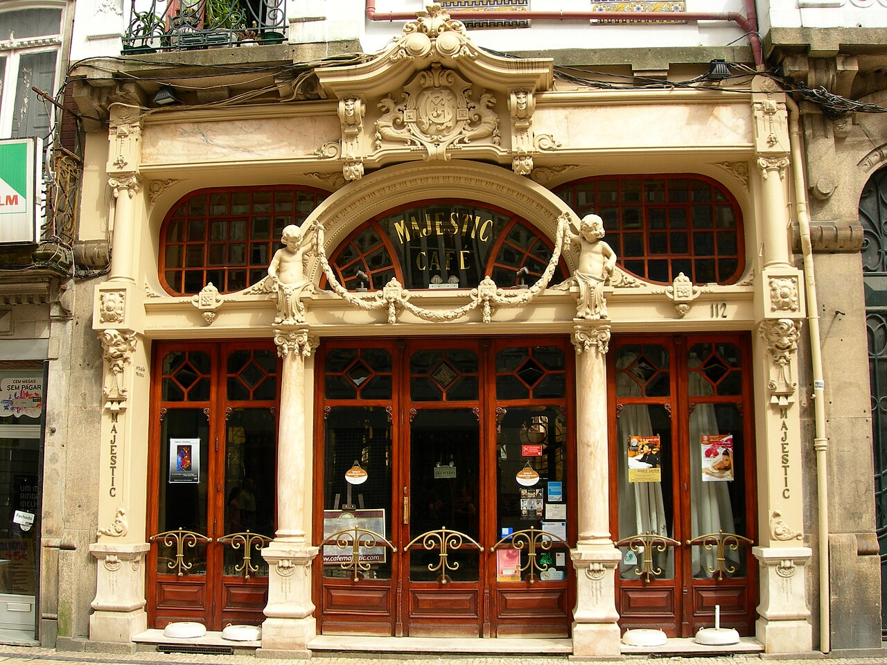

# Café Majestic

Rua de Santa Catarina is one of Porto's busy pedestrian streets, crowded with shops, cafés and theatres. At number 112 a white marble facade appears, "MAJESTIC" above the door, brass handles and an old revolving door at the entrance. Inside are dark woodwork, mirrors, a carved ceiling and leather seats, then a glass conservatory linking Santa Catarina with the parallel Passos Manuel. Unlike the Paris cafés that look outward, it wraps the guest inside a 1920s Art Nouveau box.

Figure: The Art Nouveau facade and "MAJESTIC" sign of Café Majestic, Rua de Santa Catarina 112. Image: Maragato1976, CC BY-SA 3.0, via Wikimedia Commons ([source page](https://commons.wikimedia.org/wiki/File:Caf%C3%A9_Majestic_(Porto).jpg)).

## Location and history

On 17 December 1921 the Café Elite company was formed and signed the lease for the ground floor of 110–116 Rua de Santa Catarina. On 2 December 1922 the café opened as "Majestic Café", with an interior designed by José Pinto de Oliveira. In 1924 the company was renamed "Café Majestic"; in 1925 João Queiroz designed the bar and conservatory on the Passos Manuel side.

The café's golden age was the 1920s and 1930s. It was a meeting point for Porto's bourgeoisie, writers, artists, journalists and aviators: José Régio, Teixeira de Pascoaes, Leonardo Coimbra, Gago Coutinho, Beatriz Costa and Júlio Resende were regulars. The house's Honours Book records these names and the social network around them.

On 31 August 1983 Café Majestic was listed as a "public-interest building" (Imóvel de Interesse Público). In 1992 the house decided to restore it; the work took two years and it reopened on 15 July 1994. The marble facade, Art Nouveau woodwork, Flemish mirrors, stucco ceiling, leather seats and conservatory seen today are the result of that restoration; it is not "the untouched 1922 interior" but a 1920s interior rebuilt to its historical pattern.

Put Majestic back into 1920s Porto and a different temperament from the Paris cafés appears: the commercial bourgeoisie here was more restrained, and the café was at once a place for business, reading, music and meeting friends; Art Nouveau was not royal display but the urban middle class's image of modern life. It has no Parisian pavement terrace, yet it draws the movement of the street into its glass conservatory.

## The rooms and the drinks

Café Majestic is a front room, a conservatory and a back room. The front has marble tops, dark wooden cabinets, mirrors and brass lamps; the conservatory has a glass roof, wicker chairs and plants, and the best light; the back room is quieter and suits a full meal. The walls have carved woodwork and framed posters, the ceiling stucco decoration, the floor old tiles. The scale is small but the detail dense: you sit down and look at the ceiling before the menu.

For anyone looking at the architecture, Majestic's interest lies in the joins between ceiling, mirrors and woodwork: stucco patterns, mirror mouldings and the curve of the counter answer one another, while the conservatory links inside and outside with glass and iron. It is small, but reads like a carefully preserved stage set.

The menu mixes Portuguese tradition with café food: pastéis de nata, torrada, sandwiches, seafood, grilled meat, cod, caldo verde and desserts; the drinks list has port, Douro wine, beer and coffee. This is not a coffee-only café; at meal times food dominates, while in the afternoon you can order coffee, port or dessert.

## How to drink here

In the morning, coffee and a pastel de nata in the conservatory, watching the Santa Catarina flow; in the afternoon, port or a Douro white with a sandwich, torrada or dessert. In the evening, cod, grilled meat or seafood with a Douro red; a glass of port to finish is the Porto way.

Do not expect a "Gago Coutinho seat" or a fixed commentary; the house has not labelled every table as a relic. To understand the history, read the Honours Book on the wall and the website, or treat it as one stop on a Porto Art Nouveau and literature walk. For drinks only, the bar is easier than the conservatory, which is mostly kept for diners and photographers; weekend afternoons are often full, so avoid 15:00–18:00 if you want a table.

## Practical information

- Address: Rua de Santa Catarina 112, 4000-446 Porto.
- Hours: Monday to Saturday 09:30–23:30; closed Sunday.
- Transport: metro Line 24 (Bolhão), about three minutes on foot; buses 202, 207 and 502 stop nearby.
- Reservations: book for a full meal; afternoon coffee and dessert usually accept walk-ins.
- Prices: full meals are medium to high; coffee and dessert are lighter.
- Tip: the interior is small, and prams and suitcases block the passage; expect a queue at peak times, so arrive ten minutes early.

## Etiquette and common mistakes

First, do not treat it as a café where you can work quietly all afternoon; Café Majestic is a popular sight, crowded in the afternoon and at weekends, and long table occupation is not appropriate. Second, do not describe every fixture as "original 1922"; the 1983 listing recognised architectural and decorative value, and the 1992–1994 restoration rebuilt to the historical pattern, so originals and reproductions coexist. Third, do not read "public-interest building" as "a museum that cannot trade"; it is a working café, subject to conservation requirements when altered. Fourth, do not use flash to photograph the ceiling in the conservatory; the glass roof and mirrors reflect it and it disturbs neighbours. Fifth, do not treat port as only a sweet wine; there are white, red, aged and tawny types, and it is worth asking the waiter.

## Around and nearby

From Café Majestic, west is Bolhão market, east are São Bento station and Avenida dos Aliados, south are São Bento church and the Clérigos tower. A route might run: Bolhão market, coffee or lunch at Café Majestic, São Bento station, Clérigos tower, Livraria Lello and the Douro. For Porto's historic cafés, pair Majestic with Café Guarany and Café A Brasileira in one day.

## Further reading and see also

- The house's history page: <https://www.cafemajestic.com/en/Majestic-Cafe/History.aspx> for 1921, 1922, 1924, 1925 and the 1983/1992/1994 restoration.
- The house's Honours Book: <https://www.cafemajestic.com/en/Majestic-Cafe/Honors-Book.aspx> for the guest list.
- The Comércio com História entry: <https://www.comerciocomhistoria.gov.pt/en/listings/majestic-cafe-3206/> for the 1983 listing, the 1994 reopening and the architecture.
- The Travel Portugal Now entry: <https://travelportugalnow.com/majestic-cafe-porto/> to cross-check the address, hours and space.
- Elsewhere in this batch, `place:els-quatre-gats` and `place:casa-labra` compare different southern European historic café and tavern types.
- Related entries: [Els Quatre Gats](ref:gats)、[Casa Labra](ref:labra)、[Hemingway Bar at the Ritz, Paris](ref:hemingway)、[Caffè Florian](ref:florian)、[Café de la Paix](ref:paix)

For Café Majestic, begin with the address, then the current opening status, and finish with what the place is known for; that order keeps the account grounded.

Start with [Els Quatre Gats](ref:gats) for address and space, then read [Bar Hemingway](ref:hemingway) for operating status. Seeing both keeps Café Majestic from being confused with a neighbouring idea.

**Short definition:** Café Majestic at Rua de Santa Catarina 112 in Porto opened on 2 December 1922, designed by José Pinto de Oliveira; its marble facade, Art Nouveau woodwork, Flemish mirrors and conservatory make it Porto's most complete Art Nouveau café, listed as a public-interest building in 1983 and reopened after restoration in 1994.

**Key facts.**

| Item | Detail |
| --- | --- |
| In one line | Café Majestic at Rua de Santa Catarina 112 in Porto opened on 2 December 1922, designed by José Pinto de Oliveira; its marble facade, Art Nouveau woodwork, Flemish mirrors and conservatory make it Porto's most complete A… |
| Address | Rua de Santa Catarina 112, 4000-446 Porto, Portugal |
| City and country | Porto / Portugal |
| Status | verified open |
| Official site | cafemajestic.com |

**Sources and limits.** The key claims about Café Majestic are checked against the following sources: Café Majestic, Comércio com História, Travel Portugal Now (Used to cross-check the address, hours, space and guest description). For current products, addresses or opening status, use cafemajestic.com. Prices, batches and status change; the body is project-written and does not reproduce source text.
