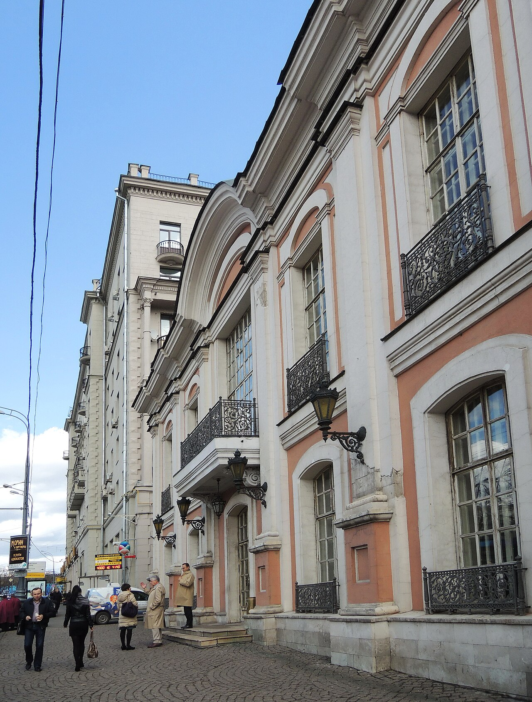

# Café Pushkin

Near the start of Moscow’s Tverskoy Boulevard, cars often wait outside a pale Baroque mansion. Inside, the first thing you see is dark wood cabinets, rows of old books, brass instruments and uniformed staff; beyond them are tables and candles. The place looks like a nineteenth-century aristocratic home, but it has not been serving since Pushkin’s time—it opened in 1999, a modern restaurant built from a literary fantasy.

Figure: The Baroque mansion at 26A Tverskoy Boulevard, home to Café Pushkin since 1999. Image: Shakko, CC BY-SA 4.0, via Wikimedia Commons ([source page](https://commons.wikimedia.org/wiki/File:Moscow,_Tverskoy_blrd_26a_-_Cafee_Pushkin_(2014)_by_shakko_01.jpg)).

## Location and history

The official history makes one key fact clear: in his 1964 song “Nathalie,” French singer Gilbert Bécaud has the characters enter a Moscow café called “Café Pouchkine,” drink hot chocolate and watch the snow outside. It was a fictional address, yet French visitors arrived in Moscow and looked for it. Andrei Dellos was inspired by this “café that did not exist” and decided to build it in a Baroque mansion on Tverskoy Boulevard. Café Pushkin opened on 4 June 1999, and Bécaud sang “Nathalie” at the opening.

It therefore belongs among “historicist restaurants,” not century-old institutions. Its own history is only a few decades old, but the symbols it uses are old: Pushkin, Tverskoy Boulevard, nineteenth-century aristocratic salons, a French-Russian menu, old books and an apothecary. The official history also explains the Pushkin connection: the boulevard opened in 1796 as a promenade for Moscow high society, and Pushkin was seen there often; nearby mansions hosted children’s balls where he met his future wife, Natalya Goncharova; the church at the end of the boulevard is where they married. The restaurant collects these memories into its narrative, but it is not the site of those events.

## Architecture and space

The official description places it in a Baroque mansion. Today the interior is divided into rooms with different personalities: the best-known is the “Apothecary,” with tall windows, botanical motifs, brass and glass that make it look like a late-nineteenth-century French conservatory; the “Library” has dark wooden bookcases, carved ceilings, old Russian classics and armchairs, and keeps the light low; there is also the “Entresol” and window seating. Each room has its own menu and wine list, a “house” design that makes the restaurant feel like a mansion rather than one large hall.

The interior is deliberately excessive: book spines, frames, porcelain, candlesticks, magnifying glasses and plant specimens crowd together, and staff move through narrow paths. It does not aim for minimalism or “authentic reconstruction”; it aims at a literary Russian aristocratic space. By day, the tall windows bring the trees of Tverskoy Boulevard inside; at night, candles and lamps warm the wood and gold. For photos, late morning or afternoon tea is best; at dinner the aisles are narrow and a flash disturbs other guests.

## The menu and the drinks

The core is “nineteenth-century Russian noble cuisine” combined with classic French gastronomy. Both the official site and Maison Dellos use this formula: Russian nobility employed French cooks in the nineteenth century, and French technique mixed with Russian ingredients, sour cream, pickles, black bread, caviar, fish and game to form what later became “noble cuisine.” Today the menu makes this mix orderable: pelmeni, borscht, Pozharsky cutlet, sturgeon, game, veal, sour cream and buckwheat, plus desserts such as Napoleon and honey cake.

The drinks list follows Russian tradition and French pairing: vodka, house nalivka (infused fruit spirits), champagne, Bordeaux and Burgundy. The official homepage mentions “champagne breakfasts”: weekdays until 12:00 and weekends until 14:00, for those who want to start slowly. For a first visit, order borscht with black bread, pelmeni or Pozharsky cutlet, and a glass of nalivka; for the French line, look at veal or sturgeon. Honey cake and Napoleon are better with tea or coffee than with a strong spirit.

## How to eat

Café Pushkin is a sit-down meal, not a quick drink. Reservations are advisable for lunch and dinner, especially weekends and theatre season; the official phone is the surest confirmation. Breakfast is relatively relaxed, and the champagne breakfast is a signature; 15:00–17:00 suits tea or dessert only. Allow two hours for dinner rather than scheduling it like a fast meal.

There is no strict dress code, but this is a high-priced Moscow restaurant, so smart casual is safest. Children are welcome, though the Library is quieter for dinner conversation; for photos, the Apothecary’s tall windows are best by day. Menus are in Russian and English, and staff usually explain dishes in English; ask what game or fish is available today, because the menu changes with season. Prices are those of the printed menu; the website’s PDF is indicative only.

## Practical information

- Address: Tverskoy Boulevard 26A, Moscow (Russian: Тверской бульвар, 26А).
- Coordinates: 55.7637, 37.6050 (use the official 26A address; some secondary sources say 27A, which is a confusion).
- Phone: +7 (495) 739-00-33.
- Hours: the official contacts page lists Monday–Wednesday 9:00–24:00, Thursday 9:00–00:00, Friday–Saturday 24 hours and Sunday 24 hours; holidays often change, so call ahead.
- Transport: metro to Pushkinskaya, Tverskaya or Chekhovskaya, then 5–10 minutes on foot; valet parking is available, but central traffic is heavy, so metro is easier.
- Reservations: strongly advised, especially dinner and weekends; say whether you want the Apothecary, Library or Entresol.
- Payment: cards are standard, cash accepted; tips are usually 10%–15%, left on the table or added to the card.
- Accessibility: steps at the entrance and an adapted old building; call ahead to confirm wheelchair access.
- Nearby: Tverskoy Boulevard, the Pushkin statue and the old Moscow Art Theatre are within walking distance.

## Etiquette and common misconceptions

First, do not treat this as a “century-old Pushkin-era institution.” It opened in 1999 as a literary-themed modern restaurant; its “history” comes from design, menu and narrative, not continuous operation. Second, do not confuse it with the Paris Café Pouchkine; the Moscow restaurant is the source, and the Paris branch opened after 2010 under the same group. Third, do not expect a “Soviet canteen” or cheap Russian food; this is a full-service, high-price restaurant with a formal menu and wine list. Fourth, do not dress too casually; there is no strict rule, but tank tops, flip-flops and sports shorts are out of place at dinner. Fifth, do not bring a large group without booking; seating between rooms is limited and improvised tables are awkward. Sixth, do not take long phone calls in the Library; it is the quietest room in the house.

## Nearby and routes

Step out and turn left for the trees and benches of Tverskoy Boulevard, right for Pushkin Square and the statue. The stop fits a “literature and cafés” city line: walk the boulevard, see the Pushkin statue and the old mansions, then eat Russian noble cuisine at Café Pushkin; for a drink only, use a nearby café or bar and leave the full meal for the evening. Cross-city comparisons include Paris’s [Café de la Paix](ref:paix), [La Coupole](ref:coupole) and [Brasserie Lipp](ref:lipp): all turn “literature/history” into space, but their historical depth and business models differ. Vienna’s [Café Central](ref:central) and Budapest’s [New York Café](ref:newyork) are other samples of the “writers’ café.”

Central Moscow is not car-friendly; the metro is the reliable option. For a one-day line, combine Tverskoy Boulevard, Pushkin Square, the Moscow Art Theatre and the restaurant into an afternoon-to-evening walk. In winter the pavements ice over, so wear grippy shoes; in summer the boulevard’s shade is good for a pre-dinner walk.

## Further reading and see also

- Official history: <https://cafe-pushkin.ru/o-restorane/istoriya/>, for the fictional café in “Nathalie,” Dellos’s inspiration, the 4 June 1999 opening and the Pushkin memories of Tverskoy Boulevard.
- Official contacts: <https://cafe-pushkin.ru/o-restorane/kontakty/>, for the 26A address, phone and opening hours.
- Maison Dellos page: <https://maison-dellos.com/en/>, for the 1999 opening, Andrei Dellos’s project, the mansion and the “nineteenth-century Russian noble cuisine + French gastronomy” positioning.
- Official homepage: <https://cafe-pushkin.ru/>, for “opened in 1999,” champagne breakfasts and the day/night pattern.
- Cross-city entries: [Café de la Paix](ref:paix), [La Coupole](ref:coupole), [Brasserie Lipp](ref:lipp), [Café Central](ref:central), [New York Café](ref:newyork).

Café Pushkin is best read by starting with the address, moving to the current opening status, and ending with what the place is known for.

Put [Café de la Paix](ref:paix)'s address and space next to [Brasserie Lipp](ref:lipp)'s operating status; the difference marks the boundary.
