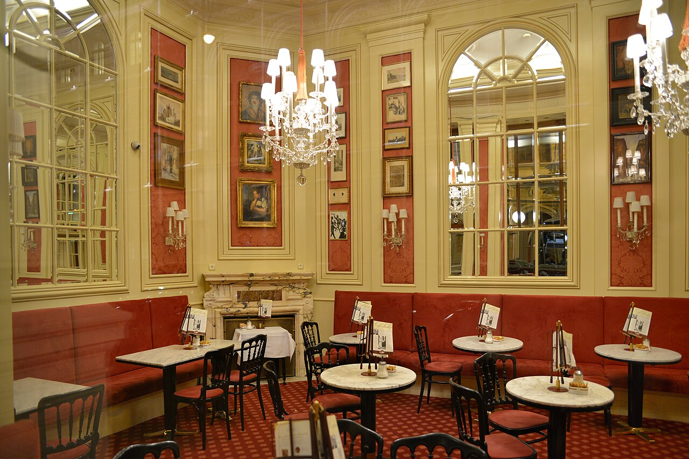

# Café Sacher

Leave the Vienna State Opera, walk a few dozen metres along Philharmoniker Straße, and you reach the dark canopy and gold lettering of Hotel Sacher. Café Sacher is not a separate street-front shop; it sits on the hotel’s ground floor. Inside, dark wood, red velvet, mirrors, and brass chandeliers lead to a cake display and a host stand. It feels like a room designed for four o’clock in the afternoon—outside, opera, carriages, and the Ringstrasse traffic; inside, forks touching porcelain.

Figure: Inside Café Sacher at Hotel Sacher, with red velvet seating and chandeliers. Image: Feel free to use my photos, but please mention me as the author and if you want send me a message . or ( rufre@lenz-nenning.at ), CC BY-SA 3.0 at, via Wikimedia Commons ([source page](https://commons.wikimedia.org/wiki/File:Cafe_Sacher,_Hotel_Sacher,_Wien.JPG)).

## Location and history

Café Sacher’s history has two layers. The first is the cake. In 1832, the sixteen-year-old Franz Sacher made the first Sachertorte at Metternich’s court. The official account stresses a young apprentice’s improvisation at a court dinner, though the details have been romanticised over time. What is certain is that the cake became bound to the Sacher family and to Vienna. The second layer is the hotel. In 1876, Eduard Sacher opened Hotel Sacher beside the Opera; he married Anna in 1880, and after his death in 1892, Anna took over and made the hotel and café a salon of Viennese society.

Café Sacher still belongs to Hotel Sacher, not to an independent café. Its “Original Sacher-Torte” has a clear brand boundary: two layers of apricot jam, a chocolate glaze, and a dollop of unsweetened whipped cream, made according to the original recipe in 34 handmade steps. Because “Original” is a registered trademark, other Vienna cafés may sell Sachertorte, but they may not call their cake “Original Sacher-Torte.” This is less a matter of taste than a geographical-brand narrative.

## Architecture and space

The interior is a Viennese hotel salon: dark wood panelling, red velvet banquettes, small round tables, mirrors, brass fixtures, and heavy curtains. The room is not large, the tables are close together, and the window seats look onto the street and the hotel portico. By day, the cake display near the front holds whole Sachertortes, chocolate cakes, cream cakes, and seasonal desserts; by night, the room feels like a theatre box. The host stand seats guests by the window, in a corner, or along the velvet wall.

It is not a place for loud conversation or for opening a laptop. The rhythm is “sit—order cake and coffee—eat slowly—pay.” The waiter will ask about drinks shortly after you sit. If you photograph, avoid peak times and do not include other guests; the red velvet and mirrors easily frame strangers. The hotel and café share a circulation route, so let luggage and strollers pass.

## The drinks

The core is the Original Sacher-Torte. Cut a small slice and pair it with the unsweetened whipped cream: the cake is dry, the chocolate glaze thick, the apricot jam tart, and the cream separates sweetness from bitterness. Do not eat the cream first or spread the whole mound onto the cake; one bite of cake, a little cream, is the Viennese rhythm. For coffee, order a Wiener Melange, an Einspänner, or black coffee; a high-sweetness cake benefits from an unsweetened cup.

Beyond cake, the café serves breakfast, light meals, afternoon tea, and a drinks list. Sacher’s cocktails include a Sacher Cocktail inspired by chocolate and apricot, about 15% vol. Non-drinkers can order hot chocolate, Melange, or tea. In the afternoon, the classic combination is Sachertorte and coffee; in the evening, the cake works as dessert with a sweet wine or champagne. Prices are in Vienna’s high-end café range.

## How to drink

The best times are 09:00–11:00 or 15:00–17:00. In the morning the cake display is fresh and window seats are easier; in the afternoon, tour groups and opera audiences fill the room. For an opera-night view, book after 20:00 for cake and champagne, but note the 23:00 closing. The hotel recommends reservations, especially at weekends, Christmas, and during opera season.

Order the number of Sachertorte slices first, then coffee. A slice can be shared, or each person can have one; for a taste, one slice and two coffees are enough. Do not ask for “less sugar” or “no cream”; that changes the complete serving the café defines. If you genuinely avoid cream, say so separately. Service is usually included in the bill, but a small tip is still welcome.

## Practical information

- Address: Philharmoniker Straße 4, 1010 Vienna.
- Hours: daily 07:00–23:00 (official page; special dates may differ).
- Transport: U1/U2/U4 Karlsplatz or U3 Stephansplatz, 5–10 minutes on foot; trams 1, 2, and 71 stop at Oper/Karlsplatz.
- Reservations: book through Hotel Sacher’s official channels, especially for afternoon tea and weekends; walk-ins may queue without a window seat.
- Prices: cake, coffee, and cocktails are high-end; the hotel afternoon tea and full meals are higher.
- Dress: smart casual is enough; opera guests may arrive in formal wear, but there is no strict dress code.
- Accessibility: the hotel entrance has steps and a revolving door; ask about the side entrance or call ahead for wheelchair access.

## Etiquette and common misconceptions

First, do not call every chocolate cake “Sacher-Torte”; in Vienna, Sachertorte is a type, and only Hotel Sacher’s version may be called “Original Sacher-Torte.” Second, “Original” is not just marketing; it involves recipe, trademark, and hotel history, so read the menu name. Third, do not stir the whipped cream into the coffee; it belongs to the cake. Fourth, do not treat the café as a quick photo stop after the opera; it is part of the hotel, and guests are there for meals and anniversaries. Fifth, do not arrive in opera dress with a takeaway box and expect a standing counter; the café has no fast-food flow. Sixth, do not date the hotel to 1832; 1832 is the cake’s origin, and 1876 is the hotel’s opening.

## Nearby and routes

Step outside and the Vienna State Opera is on your left; the Albertina and Hofburg are to the right. A ten-minute walk along the Ringstrasse reaches the Burggarten, the Mozart statue, and the Kunsthistorisches Museum. A good sequence is: opera tour, Café Sacher afternoon tea, Albertina, Hofburg, and the Ringstrasse at night. For a Vienna café route, start at [Café Central](ref:central) for the domed literary café, then [Café Hawelka](ref:hawelka) for the postwar writers’ tables, and [Café Sperl](ref:sperl) for Otto Wagner’s interior; Café Sacher is the “hotel salon plus cake brand” type. To compare the other Sachertorte narrative, walk a few minutes to [Demel](ref:demel) on Kohlmarkt. For a full evening, see the [Vienna coffee-house evening route](ref:vienna-route).

## Further reading and see also

- Café page: <https://www.sacher.com/en/restaurants/cafe-sacher-wien/>, for address, hours, and reservations.
- Original Sacher-Torte page: <https://www.sacher.com/en/original-sacher-torte/>, for 1832, the 34 steps, and the recipe narrative.
- Sacher Confiserie page: <https://www.sacher.com/en/sacher-confiserie-vienna/>, for the “Original” brand boundary and retail context.
- Hotel Sacher page: <https://www.sacher.com/en/vienna/>, for the 1876 opening and the hotel’s location.
- The nearby `place:demel` is the other pole of the Sachertorte story; `place:cafe-central`, `place:cafe-hawelka`, and `place:cafe-sperl` are different Vienna café types.
- Related entries: [Demel](ref:demel), [Café Central](ref:central), [Café Hawelka](ref:hawelka), [Café Sperl](ref:sperl), [Vienna coffee-house evening route](ref:vienna-route)

Start with the address. From there, consider the current opening status, then what the place is known for. That is how a practical judgment about Café Sacher is built.