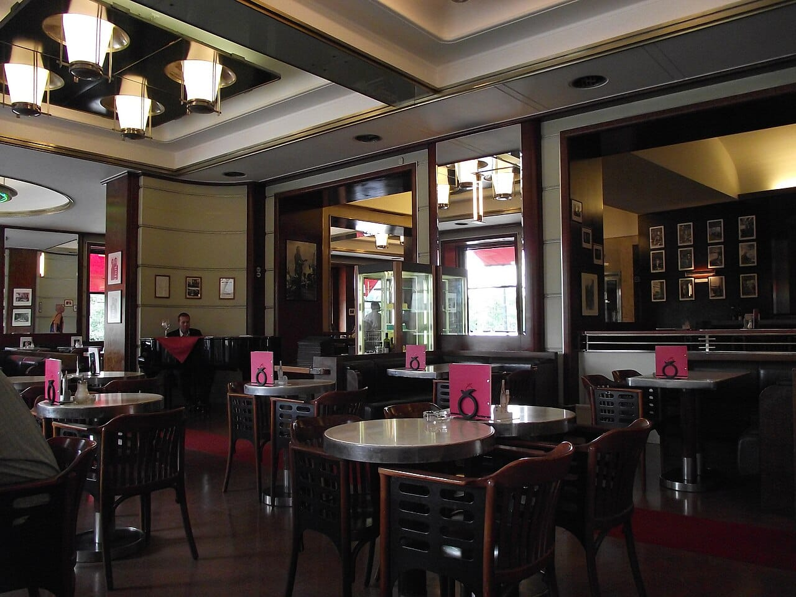
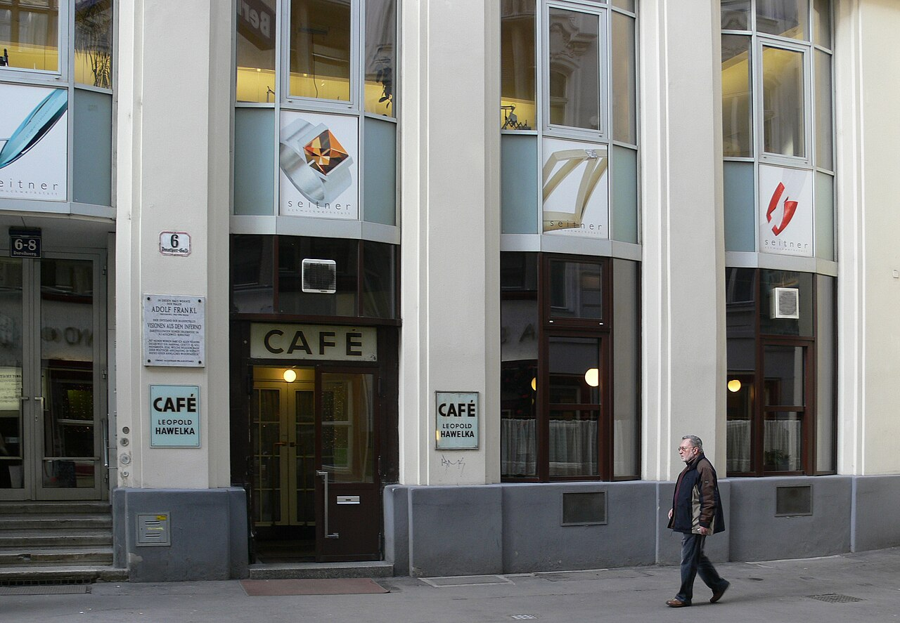

# Café Slavia

Walk along Národní in Prague until you reach the National Theatre, and look across the street. A pale corner building holds Café Slavia on its upper floor. Its position almost defines it: facing the Vltava and the National Theatre, with the busiest transport and tourist flow in Prague below, and high windows, dark wood panelling and old chandeliers above. Opened in 1884 and remodelled in Art Deco style in the 1930s, it remains one of the city's most frequently cited literary cafés.

Figure: The Art Deco interior of Café Slavia. Image: Fred Romero from Paris, France, CC BY 2.0, via Wikimedia Commons ([source page](https://commons.wikimedia.org/wiki/File:Praha_-_Kav%C3%A1rna_Slavia.jpg)).

> **Quick verdict**
> **In one line:** This entry helps you decide whether Café Slavia deserves a detour, and what to check before visiting.
>
> - **Best for:** Anyone planning a visit to Café Slavia who needs to decide whether it deserves a half-day or a full day.
> - **Not for:** If you want only want a must-visit list and will not check booking, transport or opening hours.
> - **Check first:**
>   - The history has three layers.
>   - Find a table yourself; window seats fill first.

## Setting and history

The history has three layers. The first is "Nová Slavia" in 1882, a new bourgeois social venue near the National Theatre. The second is 1884, when the café opened under the name Kavárna Slavia at the corner of the Palác Lažanský, the building it still occupies. The third is the 1931–1932 remodelling, when the interior moved toward Art Deco: high windows, mirrors, dark wood and a symmetrical plan. Confusing 1882 with 1884 is the most common dating error.

In the late nineteenth and early twentieth centuries, the café stood near the National Theatre, the Prague Conservatory and Charles University. Its customers included writers, composers, actors and critics. Rilke, Kafka, Smetana and Jan Neruda are among the names often mentioned. Whether each of them came daily does not matter much; what matters is that the café provided a social space for "before the performance, after the lecture, before the deadline". The best-known artwork in the room is Viktor Oliva's The Absinthe Drinker (Piják absintu), a symbolist painting of a man at a table with a glass of green absinthe and a female apparition beside him. It is both the café's signature image and a visual memory of Prague's absinthe era.

After 1948 the café was nationalised but continued as a cultural venue. During the Prague Spring of 1968 and the subsequent "normalisation", it became a meeting point for dissidents, writers and students. Václav Havel and Jiří Kolář are among those associated with it, which turned the "literary café" into a "political café" as well. In 1992 a property dispute closed it; it reopened in 1997. The interruption matters: today's Slavia is a post-1990s revival, not an untouched survival of the 1930s.

## The rooms and the menu

The room is high windows, mirrors, dark wood and marble tops. Window tables look onto the National Theatre, the Vltava and the traffic of Národní; the banquettes farther inside are quieter and better for conversation. It is not organised like a Viennese café with newspaper racks and bentwood chairs. It works more like a café-restaurant: coffee and cake by day, full meals at lunch and dinner, with a menu running from breakfast and sandwiches to Czech and international dishes.

On coffee, Slavia serves espresso, cappuccino, latte, mocha and Viennese-style coffee. Czech café culture is closer to a "café plus restaurant" hybrid than to Italian bar standing. For something local, order an espresso with water, or "vídeňská káva" (Viennese coffee); for something cold, an iced coffee or sparkling water. Cakes, sweet rolls and ice cream are available at the counter, subject to the day.

The drinks list is the other side of the café. As a café it serves coffee and tea; as a restaurant it serves Czech beer, Moravian wine, absinthe and spirits. Absinthe echoes Oliva's painting, but do not assume the place is "an absinthe bar". It is one item on the list, not the main event. If you want to try it, ask the waiter about the serving method and strength rather than ordering "the strongest one".

Main dishes are mostly Czech: roasted pork knuckle, beef goulash with bread dumplings, roast duck, carp, mashed potatoes and sauerkraut, alongside salads, pasta and sandwiches. Prices are mid-to-upper range for central Prague, with a premium for the window seats and the tourist location. At lunch there are plenty of locals; in the evening the tourist share rises.

## What to order on a first visit

Find a table yourself; window seats fill first. Sit down and wait for the waiter; do not order at the bar. For coffee only, an espresso or cappuccino is enough. To sit longer, add a cake. For a full meal, order Czech dishes at lunch, roast pork knuckle or duck at dinner, and remember the portions are large: one main between two people is often enough. Absinthe can be ordered after the meal, one small glass with water, sipped slowly rather than swallowed at once.

Timing matters. From 09:00 to 11:00 it is quietest, with good light at the windows. From 12:00 to 14:00 is the lunch peak. From 15:00 to 17:00 is coffee and cake time. After 19:00 the dinner and pre-theatre crowd arrives. When the National Theatre has a performance, the café is busy in the half hour before curtain, so avoid that slot for quiet. Afternoon light is better for photographs of the theatre and café together; ask neighbouring tables before photographing the interior, and do not use flash.

The bill is a café-restaurant bill, with no separate seat charge. The total covers drinks and food; a tip of about 5%–10% is left on the table or added when paying. Tourist-area restaurants may charge for bread or cutlery, so check the menu. Do not test the restaurant's limits by ordering only a coffee at lunch; a coffee is fine, but do not occupy a large table at the peak.

## Practical information

**Address**: Národní 1012/1, 110 00 Praha 1, Czechia. On the corner of Národní opposite the National Theatre, above the tram stop and metro exit. Look for "Café Slavia" and the poster reproduction of Oliva's painting.

**Transport**: Metro line B to Národní třída, then about 2 minutes on foot. Trams 6, 9, 18 and 22 to Národní divadlo, then cross the street. Národní carries heavy traffic; use the pedestrian crossings. From Old Town Square it is about 10 minutes on foot.

**Opening hours**: Monday to Sunday 09:00–23:00, Sunday 09:00–22:00. Holidays may alter this; check the official site or the notice at the door. `operating_status` is `verified`, meaning the official site and public information still showed the café as trading on 20 November 2026; this does not guarantee that it opens every day.

**Reservations**: Slavia takes dinner and group reservations; lunch is usually walk-in. Window seats cannot be reserved and are first come, first served. There is no strict dress code, though customers tend to dress more formally around National Theatre performances. Children are welcome; ask on site about high chairs.

**Prices**: Coffee and cake are mid-to-upper range for central Prague. A main course is roughly 300–600 CZK; pork knuckle and duck are large and worth sharing. Absinthe is priced by the glass, so ask about strength and price first. Cards are widely accepted, and the tip is separate.

Page verified 20 November 2026; opening hours, prices and performance schedules are subject to official channels.

## Etiquette and common mistakes

First, do not treat Slavia as a coffee-only café. It is also a restaurant, and lunch and dinner are meal services. Second, do not treat it as a Havel museum with a preserved daily seat. The dissident connection is real, but specific chairs and daily habits are mostly later narrative. Third, do not miss Oliva's painting, but do not treat it as an absinthe advertisement; it is an early twentieth-century symbolist work, not in-house drinks marketing.

Three more mistakes are common. One is confusing "Nová Slavia" in 1882 with the café's opening in 1884; the first is a predecessor, the second is the name and site we know. Another is assuming the 1990s reopening restored everything exactly; it was a new operation after a property dispute, with changes to the room and menu. The third is assuming window seats can be reserved; usually they cannot, especially before a performance.

Slavia is not the right stop for someone who only wants a quick standing coffee, needs a completely quiet room for work, or is sensitive to restaurant prices. It suits "a meal before or after a National Theatre performance", and anyone interested in Prague's literary and political memory.

## Nearby and routes

Slavia faces the National Theatre. North leads to Charles Bridge and Old Town Square; south leads to the Dancing House and the Vltava embankment. Put the café on a "National Theatre–Národní–Charles Bridge" route: coffee or lunch at Slavia, the theatre facade, the river walk to Charles Bridge, then the Old Town. About 30 minutes on foot, with no transport needed.

For another kind of Prague café, go to a place near Old Town Square, or to U Zlatého tygra on Husova for beer. The first is more touristy; the second is more local and noisier. Slavia works as a "meal plus coffee" stop, U Zlatého tygra as a "beer only" stop; do not schedule both in the same slot.

When the National Theatre has a performance, Národní and the café entrance are crowded, so allow space when photographing. The riverbank is windy, so add a layer when leaving the café in winter. If there is a film crew or event barrier at the door, do not cross it; use the side entrance or come back the next day.

## See also

- [Pubs and the city](ref:pub-and-city): how cafés use seating, newspapers and opening hours to organise public life.
- [Café Central](ref:cafe-central): a Viennese literary café, useful as a contrast with Slavia's position opposite a national theatre.
- [Café Hawelka](ref:hawelka): a Viennese family café and another version of the "writers and artists" tradition.
- [U Zlatého tygra](ref:tygra): a Prague Old Town beer hall with its own Hrabal and Havel table memories.
- [Antico Caffè Greco](ref:greco): a closed Italian historic café, a reminder that "famous" and "still trading" are different things.

## Related images

Image: The façade of Café Hawelka in Vienna. Credit: Photo: Andreas Praefcke, CC BY 3.0, via Wikimedia Commons ([source page](https://commons.wikimedia.org/wiki/File:Wien_Caf%C3%A9_Hawelka.jpg)). Related image for Café Slavia.
