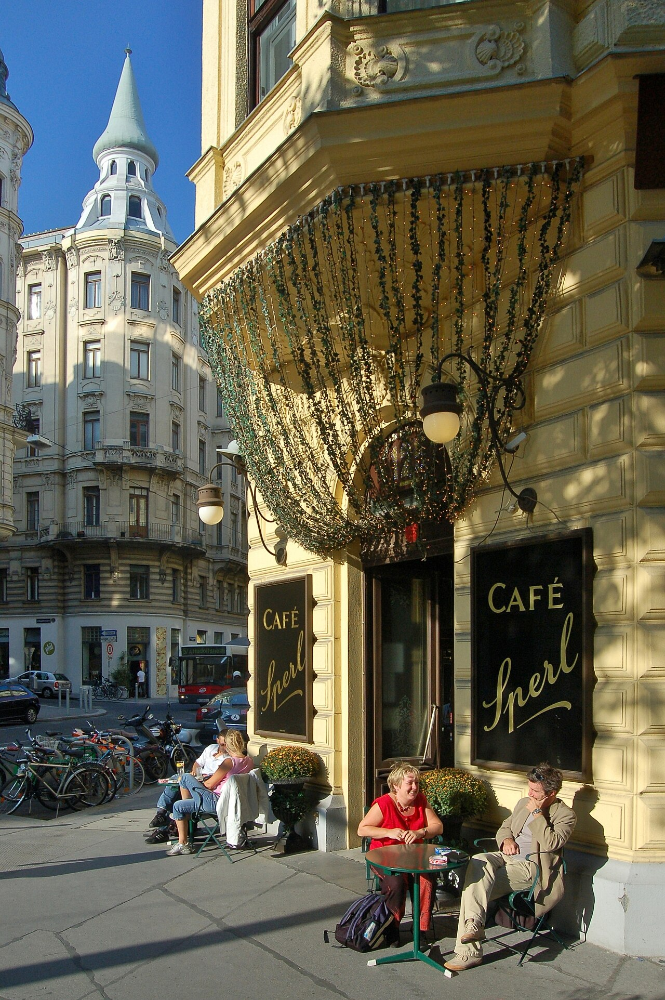

# Café Sperl

Figure: Café Sperl. Image: Bahnfrend, CC BY-SA 3.0, via Wikimedia Commons ([source page](https://commons.wikimedia.org/wiki/File:Caf%C3%A9_Sperl,_front,_2006.JPG)).

## Setting and history

Café Sperl stands at Gumpendorfer Straße 11 in Vienna's sixth district, Mariahilf, a short walk from the Naschmarkt. It is not a house museum wrapped up for photographs but a café built around everyday use: breakfast and newspapers in the morning, billiards and conversation in the afternoon, piano in the evening.

In 1880 the building was completed to designs by the Ringstrasse architects Gross and Jelinek and was first called "Ronacher"; in December of the same year the Sperl family took it over, and the café has carried their name since. In 1884 Adolf Kratochwilla took over, and his family ran it until 1968. Around 1895 the Siebenerclub (Club of Seven) and the Hagengesellschaft used the café as a meeting place; in 1897 the Vienna Secession emerged from that artistic circle. Manfred Staub took over in June 1968, and the 1983 restoration preserved the atmosphere while uncovering the original parquet floor. In 1988 Roy Ackerman named it coffee house of the year; in 1999 it received the top coffee-house rating in the Tafelspitz ranking; in 2012 it won the Golden Coffee Pot. These awards describe a working café recognised by peers and locals, not a site sustained only by an "oldest" label.

## The rooms and the coffee list

Inside, the main hall has marble tabletops, Thonet bentwood chairs, a newspaper rack along the wall and several billiard tables. Nothing is artificially distressed: wear and repair have accumulated through use, and the 1983 restoration deliberately kept that "still in use" quality. Window tables are good for reading by daylight; the billiard area is livelier; inner tables are better for quiet conversation.

The coffee list follows the Viennese system. Wiener Melange is espresso with hot milk and milk foam, lighter than a small latte; Einspänner is espresso in a tall glass under a thick layer of cream, for anyone wanting a richer drink; Verlängerter is a "lengthened" espresso, close to a mild Americano; Kleiner Brauner and Großer Brauner are small or large coffees with a little milk. A Melange is the safest first order, an Einspänner if you want it richer, a Verlängerter if you want it lighter.

Food and cakes are the other half. The house speciality is Sperltorte, which Vienna's tourist board also recommends; breakfast, Viennese home dishes and homemade pastries are also served, with the menu changing by season and daily supply. The cake is not a photographic prop: locals ordering a slice with coffee in the afternoon are taking a normal, meal-like break. Check official channels for the current menu and prices (page verified 2026-11-07).

## What to order on a first visit

Find a free table and sit down; wait for the waiter rather than standing at the door for an escort or ordering at the bar. One person ordering a single coffee and staying for a long time is normal in a Viennese café; two people sharing a cake with two forks is equally normal. The safest combination is a Melange and a slice of Sperltorte; if you want something savoury, order a Viennese home dish or breakfast and put the coffee afterwards.

Early morning, just after opening, is the quietest time for reading and writing; mid-afternoon is the peak for cakes and visitors; Sunday afternoon brings piano music, a fuller room and a higher volume of conversation. Choose an inner or window table for quiet, or accept the crowd and the noise if you want the old café's "public drawing room" atmosphere.

The cost structure needs saying clearly: traditional Viennese cafés generally do not itemise a seating charge or a music charge, and the bill is drinks, food and a tip; individual tourist-area cafés may have their own rules, so if a menu lists a seating charge or a minimum spend, the menu governs. The usual practice is to round up or add 5%–10% and state a total including the tip, rather than leaving cash on the table and walking away.

## Practical information

**Address:** Gumpendorfer Straße 11, 1060 Vienna, Austria, inside the Mariahilf blocks; the frontage is not exaggerated, so following the house number is more reliable than following the crowd.

**Getting there:** take Metro U4 to Kettenbrückengasse and walk about 5–7 minutes, or U3 to Neubaugasse and walk about 8 minutes; bus 57A also stops at Laimgrubengasse. Check Wiener Linien for the day's connections, step-free exits and last trains.

**Opening hours:** the official contact page states Monday–Saturday 07:00–22:00 and Sunday 10:00–20:00, with Sundays closed in July and August. The Vienna tourist board also lists piano music on Sunday 15:30–17:30. Holidays, summer arrangements and temporary events alter this; check the official site on the day.

**Tickets and reservations:** there is no admission charge; you pay for what you order. Walk-ins usually find their own table; groups should ask in advance by phone (+43 1 586 41 58) or email (melange@cafesperl.at). Prices are mid-to-high for Vienna: a coffee and a cake cost much less than a full meal, but breakfast, main dishes and pastries are priced separately; use the menu on the day.

Dress is casual and neat, with no need for formal wear. Carry a little cash for easier settlement.

Page verified 8 November 2026; opening status, prices and reservations are subject to the official channels.

## Etiquette and common mistakes

First, sitting down is not ordering; wait for the waiter and signal with eye contact and a quiet gesture rather than shouting. Second, a coffee over two or three hours is normal, but occupying a large table through the peak affects the queue, so use your judgment. Third, put newspapers back when you finish and do not take them away; the billiard tables are working equipment, not a photographic set. Fourth, tipping is not compulsory, but stating a total including the tip is the local habit.

Four myths are common: that this is a film set rather than a working café; that it is Vienna's "oldest" café (the "oldest" claim rests on different measures, while Sperl's verifiable starting point is 1880); that Sperltorte and Sachertorte are the same cake; and that a coffee obliges you to order a meal. Another practical mistake is judging by the queue alone: fame does bring visitors, but the café's everyday life continues, and coming off-peak shows more of it than queueing does.

This café does not suit anyone in a hurry who wants to drink standing up, anyone wanting a quiet phone conference, or anyone treating the café as a quick photo stop. It suits people willing to sit down and give a table anything from half an hour to an afternoon.

## Around and routes

Walk south for the Naschmarkt, east for the Secession building and Karlsplatz, north for the shops and restaurants of Mariahilfer Straße. Put Sperl in the morning: coffee and newspapers first, then a turn through the Naschmarkt and lunch nearby; in the afternoon, the Secession or the museum quarter. The route avoids crossing the city twice and avoids the café's afternoon peak.

To make "Viennese coffee houses" the theme, two or three in a day is enough; more produces fatigue. Sperl works well as the first stop because the room is complete, the menu broad and the place easy for newcomers; leave the quieter lanes for later. In winter Vienna darkens early, and after four o'clock the crowds turn towards Christmas markets and theatres, so adjust the route accordingly.

## See also

- [Café Central](ref:cafe-central): another historic café in the inner city, useful for comparing the arcade hall with a neighbourhood café.
- [Café de Flore](ref:cafe-de-flore): the Left Bank literary café in Paris, a contrast with Vienna's "public drawing room".
- [Caffè Florian](ref:caffe-florian): the historic café on St Mark's Square, with a different cost structure.

Further reading: [Vienna coffee-house evening: Café Central to Café Sperl](ref:c-extra-1), [A Ginjinha](ref:c-extra-2).

Put [Café Central](ref:cafe-central)'s address and space next to [Caffè Florian](ref:caffe-florian)'s operating status; the difference marks the boundary.
