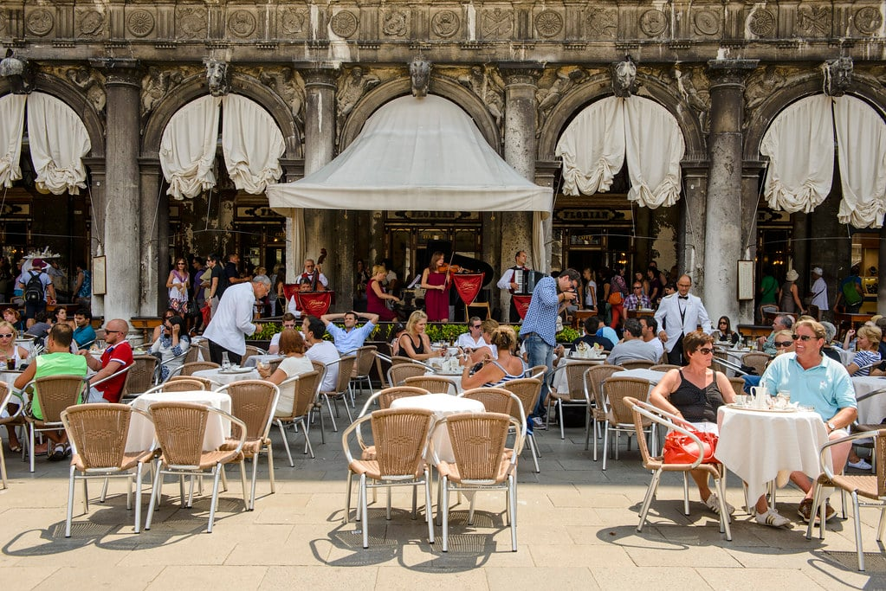
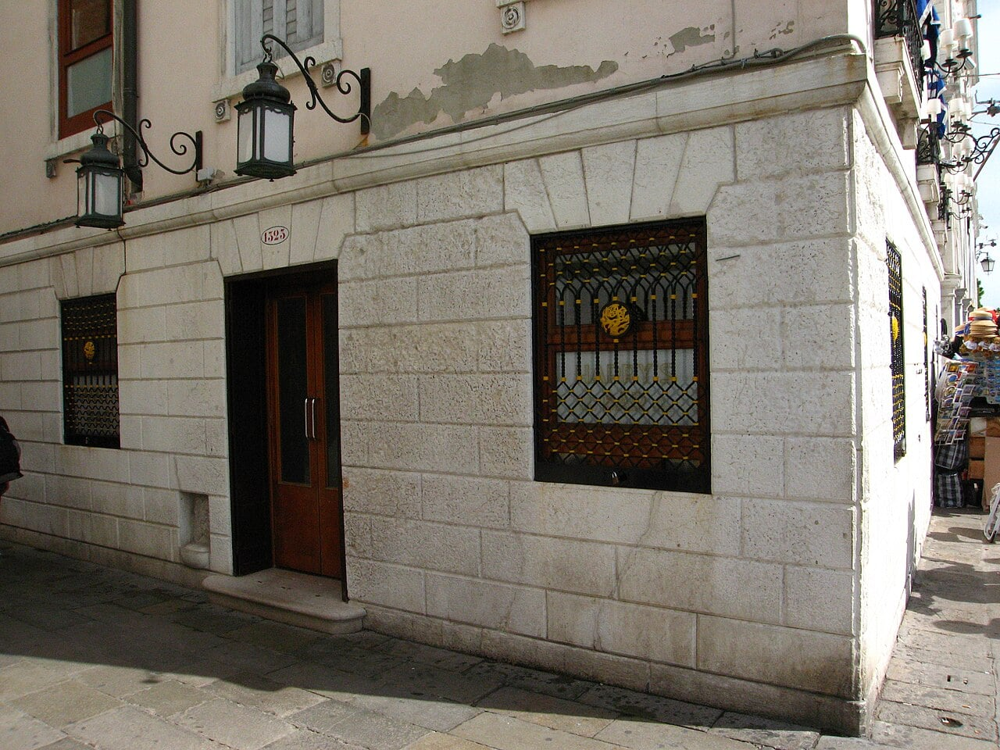

# Caffè Florian

Figure: The open-air tables of Caffè Florian under the arcades of Piazza San Marco, with the band playing in front of the white awning. Image: Son of Groucho, CC BY 2.0, via [source page](https://www.flickr.com/photo.gne?id=9755522045).

## Setting and history

Caffè Florian sits under the arcades of Piazza San Marco, on the Procuratie Nuove side, at Piazza San Marco 57. It opened on 29 December 1720, founded by Floriano Francesconi under the sign "Alla Venezia Trionfante" (Venice the Triumphant). Customers began calling it by the founder's name, and Florian stuck. The café still operates in the same group of rooms, and the house marked its 290th anniversary in 2020.

In eighteenth-century Venice, cafés were among the few public interiors where women could sit, and the café's own account stresses that point. Names such as Goldoni, Casanova, Goethe and Byron are regularly linked to the place. These are documented visits, not a promise that a particular chair belonged to a particular writer. During the nineteenth century the café changed hands and was altered more than once, gradually moving from a local drawing room to a stop on the visitor circuit. That shift is itself a small lesson in how Venice's tourist economy took shape.

The title needs care. Florian is often called "the world's oldest café", yet Café Procope in Paris opened in 1686 and is still trading. A safer description is "one of Italy's longest continuously operating cafés" and "a historic café still working in its original premises". Both claims are supported by the house's own material and avoid mixing the histories of different cities.

## The rooms and the menu

The café is made up of several decorated halls. The Sala degli Uomini Illustri (Room of Illustrious Men) is known for Giulio Carlini's portraits of notable Venetians; the Sala delle Stagioni (Room of the Seasons) was painted by Cesare Rota, who depicted the four seasons as women; the Sala Liberty dates from the early twentieth century and differs from the eighteenth-century rooms in its vaulting and lighter ornament. Other rooms take their themes from the Senate and the East. These are working seating areas, not museum cases, and a room can close for an event or maintenance.

The menu centres on coffee, hot chocolate, tea and desserts, with light dishes alongside. Coffee follows the Italian register: espresso, macchiato and milk-forward variations are all standard, while the hot chocolate is thick enough for winter. Cakes and Venetian sweets from the display are the safer choice for a first visit. The menu changes with the season, so check official channels for current items and prices.

The terrace and the arcade tables are the real product: a good part of what you pay for is the square itself. In fine weather a small band plays outside and a music surcharge is added per person. The amount is not itemised online, so ask before you sit down.

## What to order on a first visit

Look over the price board outside before deciding between an indoor table and the arcade. Inside you get the rooms and less of the square's noise; outside you get the passing crowd and the band, at the cost of the music fee. For a first visit, an espresso or a hot chocolate plus a cake keeps the bill manageable and suits the pace of the place.

If everyone in your group orders separately, remember that the music charge is usually per person, not per cup. Do not order the cheapest item simply to take photographs and then leave your table for a long time: staff will clear it and other guests are waiting. If you want a proper look at the halls, order first, sit quietly, walk through the rooms and return to your seat rather than carrying a cup through the crowd.

Early in the day and just before the evening band starts are the calmer windows. Midday and weekend afternoons are the busiest. In winter, acqua alta can flood the arcade floor; raised walkways appear and entry becomes awkward, so watch where you step.

## Practical information

**Address:** Piazza San Marco 57, 30124 Venezia, Italy, under the arcades of Piazza San Marco on the Procuratie Nuove side.

**Getting there:** there are no cars in Venice, so the square is reached on foot; ACTV water-bus lines 1 and 2 stop at San Marco, a few minutes' walk from the landing stage, and San Zaccaria is also within walking distance. From Marco Polo Airport, take the Alilaguna water bus, or travel by land to Piazzale Roma and continue by boat or on foot.

**Opening hours:** the official contacts page gives daily 9:00–23:00 (page verified 8 November 2026). Holidays and special events may alter this, so confirm on the official channels on the day; this is a heavy-traffic tourist address and worth a second check before setting out.

**Tickets and reservations:** there is no admission charge; you pay for what you order. The café does **not take reservations** — walk-in guests take the next free table, with queues in high season. Groups of 10 or more must contact the café by email. When the terrace band plays, a per-person music surcharge is added; the amount is not itemised online, so ask before sitting down.

**Prices and dress:** prices are at the top of the Venice range, and the same coffee can cost several times what a back-street café charges, with the music fee extra. There is no formal dress code, but removing a hat indoors and stowing a wet umbrella are basic courtesy.

Page verified 8 November 2026; opening status, prices and reservations are subject to the official channels.

## Etiquette and common mistakes

First, the music fee is not a tip. It is a per-person charge for seating and performance; tipping is separate, voluntary in Italy, and usually 5%–10% or a rounded-up total. Second, sitting down does not mean you have ordered: tell the waiter clearly what you want, or you may wait a long time. Third, do not move tables and chairs to join them, and do not stand in the passage to take pictures.

Three myths are worth naming: that this is the world's oldest café; that a famous visitor guarantees a particular atmosphere; that the terrace is a free viewing platform. A more accurate reading is that this is an eighteenth-century café still in business, selling coffee, rooms and a position on the square. History is the background, not a promise.

Guests with small children, pushchairs or limited mobility should note the steps and thresholds in the arcade, which are harder when the water is high. The café does not suit a quick "drink and go" stop, nor does it work well as a full restaurant meal.

## Around and routes

The Basilica, the campanile and the Doge's Palace are at the doorstep, with arcades on three sides of the square. Cross the square and the lanes to the west and you reach Harry's Bar on Calle Vallaresso in a few minutes, trading the café's slow tempo for a formal cocktail bar. The two stops are set out in the [Venice San Marco two-bar walk](ref:venice-route), which works well in the evening.

For a half day, see the church and the Doge's Palace in the morning, avoid the midday crush, return to the square for a drink in the late afternoon, then walk to Harry's Bar at dusk. San Marco is intensely crowded when tides are high and cruise groups arrive; check the water level and ship schedules before you go rather than squeezing into the arcade.

## See also

- [Pub and city](ref:pub-and-city): how cafés, pubs, bars and beer halls use seating and opening hours to organise public life.
- [Harry's Bar Venice](ref:harrys): another way to drink in the same quarter, known for the Bellini and carpaccio.
- [Venice San Marco two-bar walk](ref:venice-route): the two stops as a short evening route.

## Related images

Image: The entrance to Harry’s Bar on Calle Vallaresso, with the house number 1323 above the door.. Credit: Felix Haslimeier, CC BY-SA 2.0, via Wikimedia Commons ([source page](https://commons.wikimedia.org/wiki/File:Italy_-_Venice,_Harry%27s_Bar,_San_Marco.jpg)). Related image for Caffè Florian.
