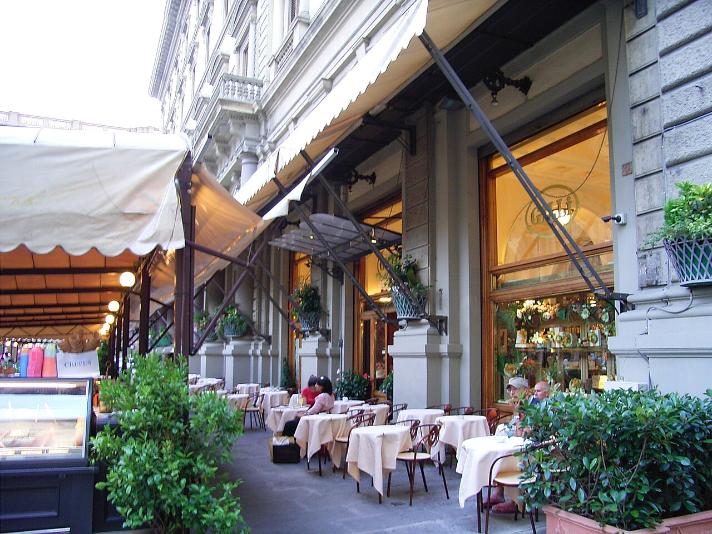

# Caffè Gilli

On the corner of Piazza della Repubblica where it meets Via Roma, Caffè Gilli's orange awning and dark wooden doors are easy for visitors to miss. It is not one of those restaurants near Piazza della Signoria that puts its history on a signboard, nor does it rely on a photogenic window display. Step inside and the first things you see are a walnut counter, an old wall clock, mirrors and rows of pastry boxes. This is one of Florence's oldest cafés still in business, but it is first of all a pastry-and-coffee business that has traded since 1733, not a historic house kept only for viewing.

Figure: The shopfront and terrace of Caffè Gilli at the corner of Piazza della Repubblica and Via Roma. Image: jeienne, CC BY 3.0, via Wikimedia Commons ([source page](https://commons.wikimedia.org/wiki/File:Caffe%27_Gigli_-_panoramio.jpg)).

## Location and history

Gilli's story starts in 1733, when the Swiss Gilli family opened a "bottega di pani dolci" — literally a sweet-bread shop — in Via dei Calzaiuoli, selling candied fruit, sweets and what eighteenth-century Florence understood as fine foods. Florence was still under the Medici, and the shop was a short walk from the cathedral; it lived on neighbourhood trade and passing customers.

In the mid-nineteenth century the shop moved toward Via degli Speziali. In 1893, as the old market was demolished and Piazza Vittorio Emanuele — today's Piazza della Repubblica — became the new centre of the city, Gilli moved near the piazza and obtained a licence to sell alcohol in the same year. On 22 December 1893 the newspaper La Nazione advertised "Maison Gilli", selling pastries, confectionery and liqueurs. In 1917 it moved to the ground floor of Palazzo Levi, the present site; the building, designed by Boccini, was the headquarters of the Fondiaria insurance company and one of the first large office buildings around the new piazza.

In 1990 the Valenza group took over Gilli with the aim of pulling it back from a tourist-oriented, tired operation into a café for Florentines. In 1991, after it had already been recognised as a historic business and a member of the Italian Association of Historic Cafés, it was designated a cultural heritage site. On 25 March 2025 it reopened after a restoration that renewed the staircase, lighting and service areas without removing the woodwork, old clock or marble counter.

## The rooms and the drinks

Gilli is a layer of old café and modern restaurant. The main ground-floor room keeps dark woodwork, mirrors, brass lamps and a walnut-and-marble counter; on the wall hangs an old clock still serviced by a Florentine watchmaker, and the ceiling carries four roundels of women painted by Ezio Giovannozzi in the first decade of the twentieth century. Window seats look onto the arcades and passing crowds of Piazza della Repubblica; deeper inside feels more like a quiet pastry shop.

Coffee and sweets lead during the day: espresso, cappuccino, caffè latte, with cantuccini, cornetti, chocolate, candied fruit and seasonal cakes. Lunch and dinner are handled by the bistrot menu, which runs to Tuscan and Italian classics; the wine list is mostly Italian, and the cocktail bar makes negroni, americano and spritz. This is not a bar where mixing is the main event, but a negroni or spritz with a snack before dinner is a way locals use the place too.

## How to drink here

Morning is best for a cappuccino or espresso with a cornetto or cantuccino, taken quickly at the counter. After ten o'clock the tourists arrive and the pastry counter develops a queue; if you want to sit, the bistrot hours in the afternoon are easier. Later, order a caffè latte or hot chocolate with a chocolate or candied fruit; Florentine sweets tend to be dry and are made for dipping in coffee.

In the early evening, start with a negroni or americano: the first is bitter, strong and orange-scented, the second lighter and better with a snack. For wine, ask the staff for a Tuscan recommendation rather than simply choosing the most expensive bottle. This is not a craft-beer bar, and the length of the drinks list is not the point; coffee, sweets and the room carry the place, with alcohol as the background that keeps the conversation going.

## Practical information

- Address: Via Roma 1R, 50123 Florence, at the corner of Piazza della Repubblica.
- Hours: daily 08:00–24:00; holidays and special events can change this, so check the official site before going.
- Transport: about a five-minute walk from the Duomo; ten to twelve minutes on foot from Santa Maria Novella station; buses and taxis stop nearby.
- Ordering: find a seat or order at the counter; pastries can be chosen directly from the display, while coffee and meals are ordered separately.
- Reservations: booking is advisable for the bistrot and dinner; breakfast and afternoon tea usually do not need one.
- Prices: sitting down costs more than standing, especially in a tourist area; pastries are priced by the piece, so check the display labels.

## Etiquette and common mistakes

First, do not treat Gilli as a photo backdrop. It is a working café, with people queuing at the counter; do not block the flow to photograph the pastry case. Second, do not order a single coffee and occupy a bistrot table; the café seating is for breakfast and afternoon tea, while the restaurant tables are for meal service. Third, do not infer from "1733" that every room dates from 1733; the present shop is the 1917 move into Palazzo Levi, and the woodwork and decoration are layers from different periods. Fourth, do not treat a historic café as a museum with an entrance ticket; there is no interpretive panel or fixed tour route, and ordering is how you enter. Fifth, do not spend ten minutes choosing at the counter while the person behind you only wants a cornetto.

## Around and nearby

From Gilli, the Duomo and Baptistery are two minutes north; crossing Piazza della Repubblica southward leads toward Via degli Speziali and Palazzo Vecchio; the Uffizi are about ten minutes west and Santa Maria Novella about ten minutes north. A workable route is Duomo, Piazza della Repubblica, a drink at Gilli, Palazzo Vecchio, the Uffizi and Ponte Vecchio. If you only want to eat nearby, the piazza has many options, but Gilli's position is best as a meeting point and a pause.

## Further reading and see also

- The café's history page: <https://www.caffegilli.com/en/story> for Maison Gilli in 1893, the 1991 cultural-heritage designation and the interior details.
- The Firenze Patrimonio Mondiale "Arte e botteghe" PDF: <https://www.firenzepatrimoniomondiale.it/wp-content/uploads/2015/12/AB-PiazzaSignoria.pdf> for the 1733 origin and the Donatello Award.
- Compare `place:antico-caffe-greco` and `place:caffe-san-carlo-torino` for other Italian historic cafés of the pastry-shop-plus-salon type.
- For Turin's bicerin and chocolate tradition, read `place:al-bicerin-torino`.
- This page does not present "Florence's oldest café" as an undisputed record; sources differ on the details of the moves after 1733, and only the supported nodes are stated.
- Related entries: [Antico Caffè Greco](ref:greco)、[Caffè San Carlo](ref:san-carlo)、[Al Bicerin](ref:bicerin)、[Camparino in Galleria](ref:camparino)、[A Vienna coffee-house evening](ref:vienna)

**In brief:** Florence's Caffè Gilli, on the corner of Piazza della Repubblica, began in 1733 as a Swiss family's sweet-bread shop; it moved to the new piazza in 1893 and to Palazzo Levi in 1917, keeping woodwork, an old clock and a marble counter.

For Caffè Gilli, begin with the address, then the current opening status, and finish with what the place is known for; that order keeps the account grounded.

The comparison with [Antico Caffè Greco](ref:greco) and [Al Bicerin](ref:bicerin) runs through address and space and operating status. Each answers a different question.
