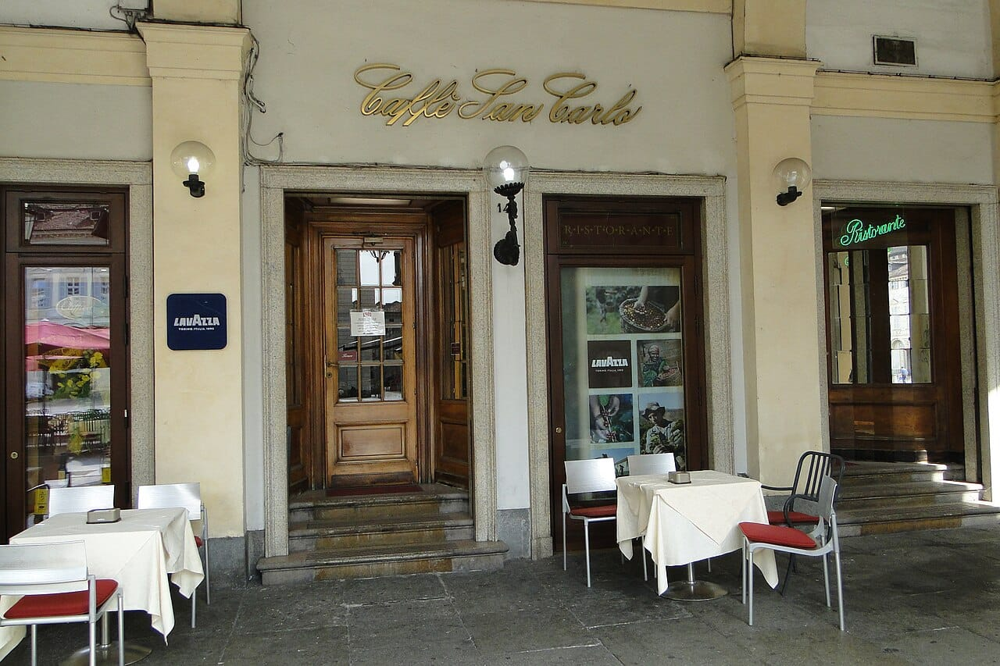

# Caffè San Carlo

On the west side of Piazza San Carlo, under the arcades, a café occupies a corner that has been a public room for two centuries. The square is one of Turin's grandest, with a statue of Emmanuel Philibert in the middle and the twin churches of San Carlo and Santa Cristina at the far end. Caffè San Carlo is not the oldest café in Turin, and it is not the most famous in Italy. It is, however, one of the clearest examples of the Italian café as a civic institution: a place where politics, literature, coffee and dessert shared the same tables.

Figure: Caffè San Carlo on Piazza San Carlo in Turin; the café opened in 1822 as Caffè di Piazza d'Armi, was remodelled by Giuseppe Leoni after 1837 and acquired its present neoclassical decoration, so this photograph shows the later building rather than its 1822 state. Image: K.Weise, CC BY-SA 4.0, via Wikimedia Commons ([source page](https://commons.wikimedia.org/wiki/File:Caff%C3%A8SanCarloTo1.jpg)).

## Location and history

The café opened in 1822 as Caffè di Piazza d'Armi, taking its name from the military parade ground that preceded the present square. MuseoTorino notes that the earliest surviving trading record dates from 1828, when Michele Ducco asked for permission to keep the café open later. In 1837 it was closed by the authorities for “subversive activity,” a charge that reflects the political role of Turin's cafés in the Risorgimento. It reopened under a new name, Caffè Vassallo, and then, after a further change of ownership, took the name Caffè San Carlo.

The building's present appearance comes from the 1830s to the 1850s. Giuseppe Leoni designed the facade in 1839; in 1840 the interior was decorated by Morgari and Borra, with neoclassical columns, mirrors, stucco and a large central room. In 1851 a Chinese Room was added, a fashionable exotic interior that survives in some form today. The café then closed for a long period in 1883–1893 and reopened in 1894 with a music room, a Moorish room and a winter garden. The result is a layered space: a neoclassical café with a Victorian-era Chinese fantasy inside it.

The café's clientele was political and literary. Camillo Benso di Cavour, Massimo d'Azeglio, Alexandre Dumas and Giovanni Giolitti are among the names associated with it; the Turin writer and politician circle used cafés as offices and newsrooms. The café was damaged by bombing in 1942, during the Second World War, and restored between 1953 and 1963. That restoration preserved the decorative scheme rather than rebuilding it as a modern café.

In 2022 the café reopened under the Costardi brothers, who also run a restaurant in Vercelli. The reopening is part of a wider revival of Turin's historic cafés, with the museum Gallerie d'Italia on the same square. The business is now a café, a restaurant and an events venue; the historic rooms are used, not sealed off.

## Space and drinks

The main room is large and high-ceilinged, with columns, mirrors, stucco and a pale color scheme; its 18-arm Murano chandelier was installed around 1960. The Chinese Room is smaller and more ornate, with lacquer, painted panels and a different palette. The seating is a mix of tables and banquettes; the room is designed for long conversations rather than quick turnover. In summer, tables spill out under the arcade; in winter, the interior is warm and busy.

The menu covers coffee, pastries, light meals and full restaurant service. The coffee is Italian-style: espresso, cappuccino, macchiato, and a selection of teas and hot chocolate. The food is Piedmontese and Italian, with a focus on local ingredients, but the café is not a cheap stand-up bar; prices reflect the setting and the service. Aperitivo is a good way to experience the room without a full meal.

## How to drink

For the classic experience, order an espresso or a cappuccino at the table and take time with it. Standing at the bar is cheaper and faster, but the historic rooms are the reason to come, so a table is worth the extra cost. In the afternoon, an aperitivo with a glass of vermouth or a spritz and a few snacks is the most Turin-specific choice. In the evening, the café becomes more of a restaurant; reserve if you want a full meal.

Dress is smart casual. The café is a historic venue, not a formal restaurant, but shorts and flip-flops look out of place in the main room. The Chinese Room is worth seeing even if you sit elsewhere; ask the staff whether it is open before you plan a visit around it.

## Practical information

The address is Piazza San Carlo 156, 10121 Turin. The square is a short walk from Turin's Porta Nuova station and the metro stop of the same name; trams and buses stop nearby. The café is generally open from about 08:30 to 20:30, though hours can extend in the evening for events and can change on holidays. Check the official site before a special visit.

Reservations are advisable for dinner and for the Chinese Room. The café accepts credit cards. Tipping is not obligatory in Italy; rounding up or leaving 5%–10% for good table service is appreciated but not expected. The café is accessible from the arcade, but the historic interior has steps in places; ask staff for the easiest route.

## Etiquette and common misconceptions

The first misconception is that Caffè San Carlo is the oldest café in Turin. It opened in 1822; the city has older coffee houses, and the title of “oldest” is contested. The second is that the Chinese Room is a modern addition; it dates from 1851, though it has been restored. The third is treating the café as a museum; it is a working business, and tables are for customers. The fourth is ordering a cappuccino after a meal; in Italy that is unusual, though tourists are not usually refused. The fifth is assuming the café is cheap because it is historic; the setting carries a premium.

## Nearby and routes

The square itself is the attraction: the twin churches, the Cavour monument, the arcades and the Gallerie d'Italia. Caffè San Carlo fits a Turin café route with [Al Bicerin](ref:bicerin) near the Consolata and the older [Antico Caffè Greco](ref:greco) in Rome; for the Austrian comparison, read [Caffè Florian](ref:florian) in Venice and the [Vienna coffee-house evening route](ref:vienna), and for the Central European model, read [Café Central](ref:central) in Vienna. The wider question of how cafés shaped urban politics is treated in the project's culture articles.

## Further reading and see also

- [Antico Caffè Greco](ref:greco)
- [Caffè Florian](ref:florian)
- [Al Bicerin](ref:bicerin)
- [Vienna Coffee-House Evening Route](ref:vienna)
- [Café Central](ref:central)

**Short definition:** A café on Turin's Piazza San Carlo since 1822, Caffè San Carlo is known for its neoclassical interior, its Risorgimento clientele and its 2022 reopening under the Costardi brothers; it is a historic café that still serves as a civic living room.

Read Caffè San Carlo through the address, then the current opening status, and finally what the place is known for. The sequence matters.

Checked on 2026-11-21 against the public pages of Costardi Bros and Gallerie d'Italia. The café usually opens 08:30–20:30, but museum exhibitions and private events can alter hours; lunch, dinner and groups should book, and seat fees and tips follow the bill. 1822 is the opening year; the interior took shape in the 1830s–1850s and was rebuilt after the 1942 bombing. San Carlo is not a Risorgimento museum, and the cappuccino habit is qualified in the body. The image shows the exterior on Piazza San Carlo, not the interior.

Gambero Rosso reviewed the café in 2025.
